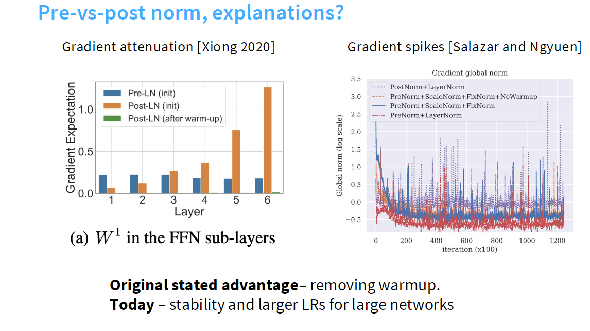
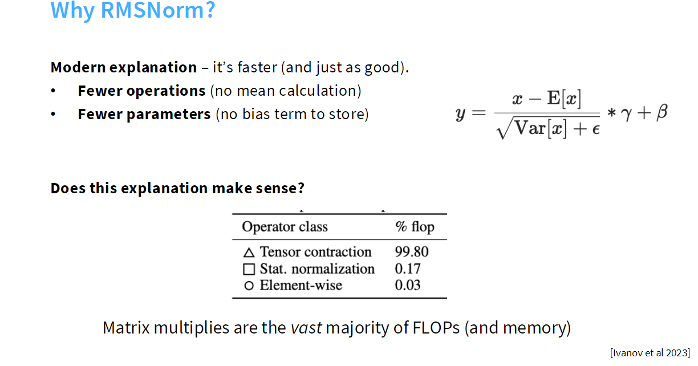
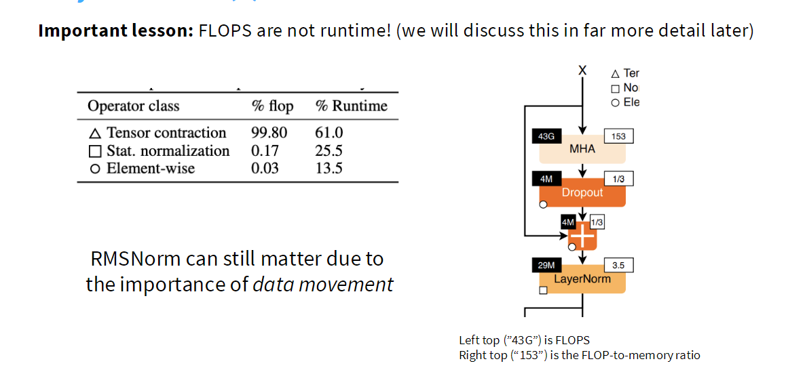
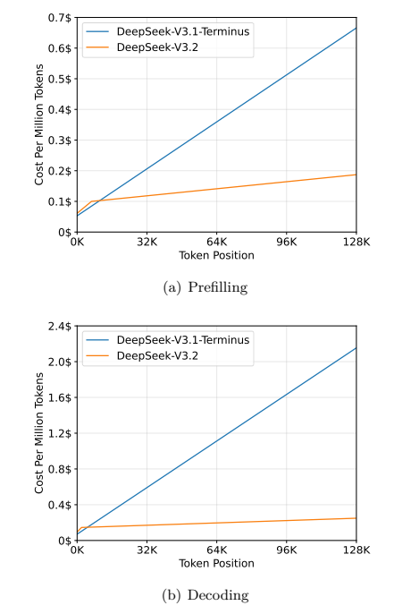
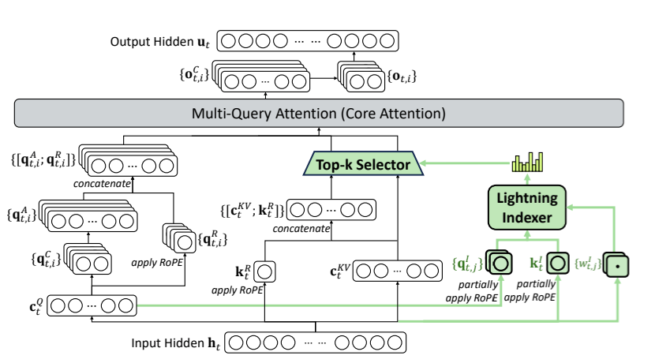
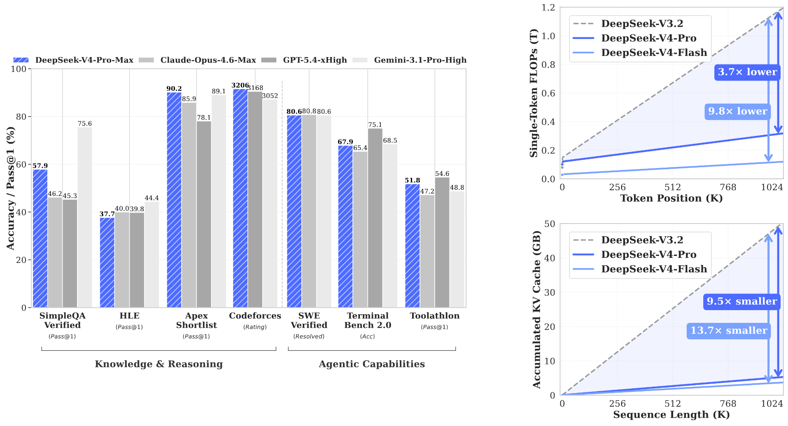
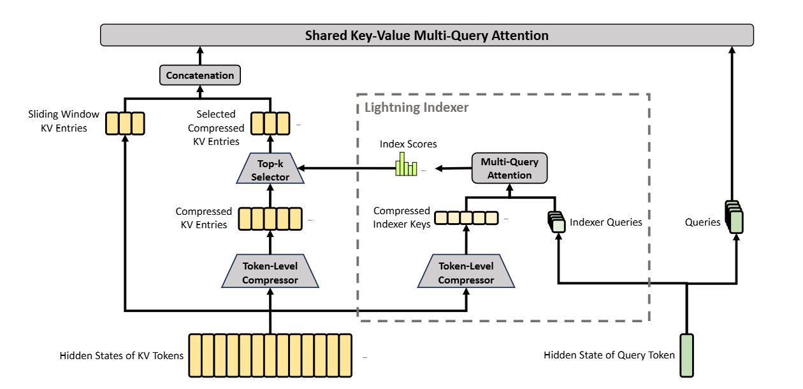
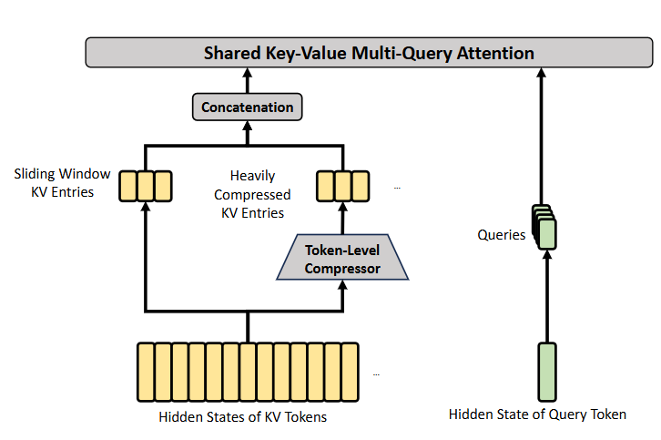

# Chapter 4: Technical Details of Language Model Architecture and Training

The origin of the Transformer model can be traced back to 2017, when the Google research team first proposed it in the paper [*Attention Is All You Need*](https://arxiv.org/abs/1706.03762). The model's core innovation was the introduction of the **self-attention mechanism**, which discarded the traditional recurrent neural network (RNN) and convolutional neural network (CNN) structures. Self-attention allows the model to compute in parallel when processing sequence data, greatly improving computational efficiency and solving the problem of long-range dependencies.

## 1 Learning Objectives

Before diving into the detailed analysis, let us clarify the focus of this section. This section centers on the language architecture and training techniques of large models, and mainly covers:

- Understanding and quickly reviewing the architecture of the Transformer from the original paper, including the specific details of each component.
- Analyzing and learning the modern variants of each Transformer component—attention, normalization, positional encoding, and so on—as well as their advantages.
- Beyond the components themselves, the choice of hyperparameters for each component is also very important.

After completing this chapter, you will be able to: systematically understand the core components of the Transformer (positional encoding, multi-head attention, layer normalization, residual connections, feed-forward networks); master the architectural variants used by modern language models (activation functions, attention variants, positional encoding, normalization methods); and understand and apply hyperparameter design principles and stability techniques to analyze and optimize the training of large-scale language models.

## 2 A Quick Review of the Standard Transformer Architecture (skip to Section 3 if you are already familiar with it)

<div align="center">
  
  <p><em>Figure 1. transformer</em></p>
</div>

The figure above shows the Transformer Block structure. On the left is the **encoder block** and on the right is the **decoder block**. Stacking N encoder and decoder blocks forms the Transformer.

### 2.1 Positional Encoding: Sinusoidal Positional Encoding

$$
\begin{align*}
PE_{(pos,2i)} &= \sin\left(\frac{pos}{10000^{2i/d_{\text{model}}}}\right) \\
PE_{(pos,2i+1)} &= \cos\left(\frac{pos}{10000^{2i/d_{\text{model}}}}\right)
\end{align*}
$$

**Variables:**

$pos$: the position of the token in the sequence (0, 1, 2, ..., N-1)
$i$: the dimension index
$d_{model}$: the model embedding dimension (512 in the paper)
$10000$: the base frequency (configurable)

After computing the positional encoding with the formula, it is added directly to the word embedding: $X = Token + PE(pos)$.

Sinusoidal positional encoding is the key design through which the Transformer introduces **positional information** into a sequence. Because the core of the Transformer is the self-attention mechanism, it **has no inherent ability to perceive input order**. If word vectors were fed directly into the model, "I love you" and "you love me" would be treated as the same set. To solve this problem, positional information must be explicitly added to the input. Sinusoidal positional encoding is a position representation that requires no training and is generated by a fixed formula. Its core idea is to use sine and cosine functions of different frequencies to generate, for each position in the sequence, a unique encoding vector that is also capable of perceiving relative position relationships.

Specifically, for the $pos$-th position in the sequence (counting from 0) and the $d$-th dimension of the encoding vector (with total dimension $d_{\text{model}}$), we define the dimension-pair index $i = 0, 1, \dots, \frac{d_{\text{model}}}{2} - 1$. The encoding values are generated as follows:

When dimension $d$ is even (i.e., $d = 2i$), the sine function is used; when dimension $d$ is odd (i.e., $d = 2i+1$), the cosine function is used. Note that the even and odd dimensions in the same pair **share the same base frequency**.

The formulas are:

$$
PE_{(pos, 2i)} = \sin\left(\frac{pos}{10000^{2i / d_{\text{model}}}}\right)
$$

$$
PE_{(pos, 2i+1)} = \cos\left(\frac{pos}{10000^{2i / d_{\text{model}}}}\right)
$$

Here $10000^{2i / d_{\text{model}}}$ determines the wavelength at different dimensions, forming a multi-scale encoding system: low dimensions (small $i$) correspond to high frequencies and can finely distinguish adjacent positions; high dimensions (large $i$) correspond to low frequencies and can cover relative relationships over longer distances. Ultimately, each position receives an encoding vector of the same dimension as the word vector, and the two are added to form the model input.

This design brings several notable advantages. First, it is completely deterministic and **requires no additional parameters**, avoiding increased model complexity or overfitting of position embeddings during training. Second, through the periodicity of trigonometric functions, the encoding values are constrained to $[-1, 1]$, which is numerically stable and easy to add to word vectors. More importantly, it **naturally supports relative position modeling**: for any fixed offset $k$, there exists a block-diagonal matrix $M_k$ that depends only on $k$ and not on $pos$, such that $PE(pos+k)=M_k\cdot PE(pos)$. See [*Attention Is All You Need*](https://arxiv.org/abs/1706.03762). Geometrically, each $(\sin,\cos)$ dimension pair undergoes a rotation in a two-dimensional plane, with the rotation angle determined jointly by $k$ and the frequency of that dimension pair; multiple dimension pairs correspond to block rotations at multiple frequencies, so the linear transformation can be written as a block-diagonal matrix $M_k$. This makes it easier for the self-attention mechanism to learn the relative position relationships between elements in a sequence, rather than only absolute positions. This property is particularly important for handling variable-length sequences and capturing local dependencies.

Sinusoidal positional encoding was first proposed in *Attention Is All You Need* as the standard positional encoding scheme of the original Transformer. Although learnable position embeddings, relative positional encoding, and other variants have appeared since then, sinusoidal encoding, because it is simple, efficient, and requires no training, is still widely used in many sequence modeling settings or serves as a classic example for understanding positional encoding mechanisms.

**Question: Why do we need positional encoding?**

**Answer:** Because the Transformer has no recurrent or convolutional structure, the model itself is **permutation-invariant**. Positional encoding, added to the token embeddings, provides the model with the necessary order information.

**Question: How does sinusoidal positional encoding provide positional information?**

**Answer:** For different positions `pos`, each dimension of the positional encoding vector takes a different value, forming a **unique pattern**; the model learns this pattern to distinguish near and far positions.

### 2.2 Multi-Head Attention

<div align="center">
  
  <p><em>Figure 2. MultiHeadAttention</em></p>
</div>

The attention mechanism imitates how human attention works. When people look at a picture, they do not distribute attention evenly over every corner of the image; instead, they selectively observe the bright and salient parts. The attention mechanism works the same way: it focuses on the important parts of the input, which show up as large weights. Attention is essentially a weighted sum.

Multi-head attention is the core innovation of the Transformer model. By running multiple attention "heads" in parallel, it allows the model to simultaneously attend to multiple dependencies in the sequence from different angles and different semantic levels, greatly enhancing its ability to model complex patterns. Below we start from the practice and limitations of single-head attention and gradually develop the complete design of multi-head attention.

**Single-head attention: practice and limitations**

Single-head attention is based on the scaled dot-product attention mechanism. For an input sequence $X$ (of shape $[batchSize, seqLen, d_{model}]$), we first map it into queries (Q), keys (K), and values (V) through three weight matrices:

$$
Q = X W^Q, \quad K = X W^K, \quad V = X W^V
$$

Here $W^Q, W^K, W^V$ all have shape $[d_{model}, d_{model}]$, so $Q, K, V$ keep the shape $[batchSize, seqLen, d_{model}]$. The attention output is then computed as:

$$
\text{Attention}(Q, K, V) = \text{softmax}\left(\frac{Q K^T}{\sqrt{d_k}}\right)V
$$

Here $d_k = d_{model}$, and the scaling factor $\sqrt{d_k}$ prevents the dot products from becoming too large and pushing gradients into the saturation region.

The limitation of single-head attention is that it can compute only one kind of "query-key-value" relationship, as if observing with only one eye. This makes it difficult for the model to capture multiple patterns—syntactic structure, semantic associations, long-range dependencies—at the same time, and the attention distribution is often too diffuse to focus on multiple important subspaces. The common practice is therefore to repeat the attention mechanism many times, let each head learn a different subspace representation, and finally merge the results.

**The design idea of multi-head attention**

Multi-head attention splits the $d_{model}$-dimensional queries, keys, and values into $h$ independent heads, and each head performs attention computation in a lower-dimensional space ($d_k = d_{model} / h$) in parallel, so that the model can jointly extract information from multiple representation subspaces.

Each head has its own projection matrices and can attend to different types of features. This phenomenon of "head specialization" has systematic empirical support. [Voita et al., 2019](https://aclanthology.org/P19-1580/) analyzed the multi-head self-attention of a Transformer encoder head by head and found that the most important and most confident heads often play **consistent, linguistically interpretable roles**.

[Clark et al., 2019](https://aclanthology.org/W19-4808/) analyzed BERT's attention and also found that different heads attend to patterns such as separators, specific positional offsets, and whole-sentence spans, and that **some heads correspond closely to syntactic relations (such as a verb's direct object or a preposition's object) and to coreference relations**, with some heads achieving quite high accuracy on these tasks. Of course, which head is responsible for which pattern still depends on the training data and model configuration, and **not every head necessarily has a clear linguistic function**; but the design intuition that multiple heads may develop a division of labor through parallel subspaces is supported by the empirical literature.

**The detailed computation of multi-head attention**

**Step 1: Split into heads (assuming Q, K, V have already been linearly projected)**

For the input $Q, K, V$ (all of shape $[batchSize, seqLen, d_{model}]$), we first split them into $h$ heads. Through reshape and transpose operations, the head dimension is moved forward:

```python
Q = Q.reshape(batch_size, seq_len, h, d_k)   # [bs, seq_len, h, d_k]
Q = Q.transpose(1, 2)                        # [bs, h, seq_len, d_k]
```

After the transpose, the shapes of $Q, K, V$ become $[batchSize, h, seqLen, d_k]$. In this way, each head can be processed independently and efficiently in a batch.

**Step 2: Compute the attention of each head in parallel**

For the $i$-th head, scaled dot-product attention is performed independently:

$$
\text{Head}_i = \text{Attention}(Q_i, K_i, V_i) = \text{softmax}\left(\frac{Q_i K_i^T}{\sqrt{d_k}}\right)V_i
$$

Here $Q_i, K_i, V_i$ all have shape $[batchSize, seqLen, d_k]$, so $Q_i K_i^T$ has shape $[batchSize, seqLen, seqLen]$, representing the attention scores between every pair of positions within that head. The output $\text{Head}_i$ of this head also has shape $[batchSize, seqLen, d_k]$.

**Step 3: Concatenation and final linear transformation**

The outputs of all heads are concatenated along the head dimension to restore the original dimension:

$$
\text{MultiHead}(Q,K,V) = \text{Concat}(\text{Head}_1, ..., \text{Head}_h)
$$

The concatenated shape is $[batchSize, seqLen, h \times d_k] = [batchSize, seqLen, d_{model}]$. Finally, an output projection matrix $W^O$ (of shape $[d_{model}, d_{model}]$) performs a linear transformation to obtain the final multi-head attention output:

$$
\text{Output} = \text{MultiHead}(Q,K,V) W^O
$$

This output keeps the same dimension as the input, which facilitates subsequent operations such as residual connections.

**Specific parameters in the original paper**

In *Attention Is All You Need*, the multi-head attention design uses the following configuration:

- Model dimension $d_{model} = 512$
- Number of heads $h = 8$
- Dimension per head $d_k = d_v = d_{model} / h = 64$
- Scaling factor $\sqrt{d_k} = \sqrt{64} = 8$

This setting makes the computational cost of multi-head attention similar to that of single-head attention: because the dimension of each head is reduced to $d_k=d_{model}/h$, the total computational complexity of multi-head attention is of the same order as single-head attention running on the full $d_{model}$ dimension. This conclusion is stated in the original paper.

In other words, multi-head attention does not buy representational capacity by increasing the total computation; under essentially the same compute budget, it splits the representation space into multiple lower-dimensional subspaces, thereby obtaining richer attention patterns. Under the standard setting $h=8$, $d_k=d_{model}/h=64$, this "similar cost, richer representation" trade-off is one of the core reasons the Transformer architecture chose multi-head attention.

**Question: Why use multiple heads instead of a single head?**

**Answer:** To attend to different patterns in parallel; each head can learn a different attention pattern:

For example (this is an illustrative analogy for intuition; in reality it is more of a black box):
**Head 1**: attends to **syntactic dependencies** (subject-verb-object relations)
**Head 2**: attends to **coreference relations** (pronoun reference)
**Head 3**: attends to **semantic similarity** (synonyms)

**It also improves representational capacity**, because each head computes in a **low-dimensional subspace** ($d_k=64$), which is more efficient than a single head in a high-dimensional space.
The multi-head mechanism can be understood as extracting features in parallel in multiple low-dimensional subspaces, then concatenating and fusing them, thereby increasing the diversity of representation subspaces and **strengthening expressive power**.

**Computational efficiency is also higher**: the heads can **compute in parallel**, which suits GPU acceleration (as we will see in the GPU chapter), and the total computation is comparable to single-head attention ($d_{model} \times d_{model}$).

**Question: Why divide by $\sqrt{d_k}$?**

**Answer:** The original paper [*Attention Is All You Need*](https://arxiv.org/abs/1706.03762) explains the necessity of this scaling, which can be understood rigorously from the variance perspective: if the components of $Q$ and $K$ are independent, zero-mean, and unit-variance, then the variance of the $d_k$-dimensional dot product $Q\cdot K=\sum_{i=1}^{d_k}q_i k_i$ is $d_k\cdot \mathrm{Var}(q_i k_i)$, and the standard deviation grows with $d_k$. Dividing by $\sqrt{d_k}$ normalizes the scale of the pre-softmax logits, preventing softmax from degenerating into an approximately one-hot distribution because of large values and entering a saturation region where gradients are near zero. The original paper's "suspicion" can therefore be understood as a **variance-stabilizing** operation.

During the dot product the variance is amplified. The dot product $Q \cdot K = \sum_{i=1}^{d_k} q_i k_i$ has **variance**:

$$
\text{Var}(Q \cdot K) = \sum_{i=1}^{d_k} \text{Var}(q_i k_i) = d_k \cdot \text{Var}(q_i k_i)
$$

Dividing by $\sqrt{d_k}$ re-standardizes the distribution. The effects are:

1. **Keep the variance stable**: no matter how large $d_k$ is, the values fed into $softmax$ stay in a reasonable range
2. **Avoid vanishing gradients**: the $softmax$ gradients remain at effective values, so backpropagation runs smoothly
3. **Stabilize training**: the model becomes insensitive to the choice of dimension; the original paper used $d_k=64$ and remained stable

### 2.3 Layer Normalization (LayerNorm) and Residual Connections

**What is normalization?**

**Normalization is the technique of scaling data according to specific rules** so that it falls into a uniform standard range or distribution. In deep learning, it mainly refers to transforming the activations or weights of intermediate layers of a neural network in order to stabilize training and accelerate convergence.

The normalization formula in probability theory is $x_{norm} = (x - \mu) / \sigma$, where $\mu$ and $\sigma$ are the mean and standard deviation of the original data. The resulting data distribution is "reset" to a standard state. Subtracting the mean and dividing by the standard deviation for each element yields a **distribution with unit variance and zero mean**.

The original Transformer's layer normalization:

$$
\text{LayerNorm}(v) = \gamma \frac{v - \mu}{\sigma} + \beta
$$

Similarly, layer normalization normalizes within the same layer (a single sample) and is not essentially different from ordinary normalization.

1. **Compute the mean** (over all neurons in the same layer):

$$
\mu = \frac{1}{d} \sum_{i=1}^{d} v_i
$$

2. **Compute the standard deviation**:

$$
\sigma = \sqrt{\frac{1}{d} \sum_{i=1}^{d} (v_i - \mu)^2 + \varepsilon}
$$

Here $\varepsilon$ is a very small constant (typically between $10^{-6}$ and $10^{-5}$) that prevents division by zero. LayerNorm was first proposed by [Ba, Kiros & Hinton, 2016](https://arxiv.org/abs/1607.06450). Its original form is $\text{LN}(x)=\gamma \frac{x-\mu}{\sqrt{\sigma^2+\varepsilon}}+\beta$, with the normalization statistics computed over **all feature dimensions of a single sample**, not across the batch. The original paper uses a biased variance estimate with denominator $d$ and $\varepsilon$ as a numerical stability term; its purpose is always to prevent division by zero when the variance approaches zero, and its effect on training is negligible within a reasonable range. In the context of LayerNorm, the choice between biased and unbiased estimates has little effect on training, and a denominator of $d$ is the consistent practice of the original paper and mainstream implementations.

3. **Normalize**:

$$
\hat{v} = \frac{v - \mu}{\sigma}
$$

4. **Apply learnable parameters**:

$$
\text{Output} = \gamma \cdot \hat{v} + \beta
$$

**Learnable parameters** $\gamma$ (scale) and $\beta$ (shift) have the same dimension as the input. They let the model learn the scaling and shifting itself.

**What is a residual?**

In deep learning, residual specifically refers to the **residual connection**, also called a **skip connection**. It is a "shortcut" between neural network layers that lets information bypass certain layers and pass through directly.

<div align="center">
  
  <p><em>Figure 3. Add&amp;Norm</em></p>
</div>

Residual formula:

$$
Output=  Input +Layer(Input)
$$

As the figure shows, a residual connection simply adds the input $x$ of a sublayer (such as multi-head attention) element-wise to the sublayer output $\text{Sublayer}(x)$, rather than passing through an independent "residual layer." Abstractly, it introduces a shallow information flow that prevents information loss and error amplification as layers deepen; the residual continuously reintroduces earlier information to correct the representation.

Mathematically, a residual does not force the network to learn the ideal mapping $H(x)$ directly; instead, it lets the network learn the "residual" $F(x)=H(x)-x$. If a layer does not need to perform a transformation, the network only needs to learn $F(x)\approx 0$ and preserve the input $x$.

[He et al., 2016, *Deep Residual Learning for Image Recognition*](https://openaccess.thecvf.com/content_cvpr_2016/html/He_Deep_Residual_Learning_CVPR_2016_paper.html) (ResNet) systematically generalized and popularized residual connections. The paper's starting point was precisely that "deeper networks are harder to train," and it proposed **not forcing the network to learn the ideal mapping $H(x)$ directly, but instead letting it learn the residual $F(x)=H(x)-x$ relative to the input**. If a layer does not need to perform a transformation, the network only needs to learn $F(x)$ to be close to zero, thereby preserving the input $x$. Even if the sublayer learns poorly, the residual path still guarantees $Output \approx Input$, so the model is no worse than without the added depth. This inductive bias of "identity mapping first" is the key design that makes deep networks optimizable.

**Layer normalization and residual connections**

In the original Transformer paper, layer normalization and residual connections are core designs that work together to ensure stable training of deep networks.
The original paper performs the residual connection first and then normalization:

$$\text{output} = \text{LayerNorm}\big(x + \text{Sublayer}(x)\big)$$

Here $x$ is the tensor input to the current sublayer module. $\text{Sublayer}(x)$ is the sublayer's own transformation (for example, multi-head self-attention or a feed-forward network), applied directly to $x$. $x + \text{Sublayer}(x)$ represents the residual connection. $\text{LayerNorm}$ is layer normalization, applied after the residual connection.

Compared with the **variant proposed later**, Pre-Norm (normalize first, then sublayer, then residual), this is Post-Norm, with the order: **sublayer → residual → normalization**.

**The residual connection ensures that gradients can flow directly back and at least preserves identity-mapping capability**, while **layer normalization standardizes the distribution after addition and avoids numerical explosion or vanishing**. **Together they make a 6-layer (original paper) or even 12-layer (BERT-base) network trainable.**

**Question: What does layer normalization do?**

**Answer:**

It addresses distribution shift and gradient instability, standardizes the distribution, accelerates model convergence, and prevents vanishing and exploding gradients.

**Question: What do residual connections do?**

**Answer:**

They ensure that gradients flow directly back, at least preserve identity-mapping capability, provide a stable information pathway, and address the problem that deep networks remain hard to train due to unstable distributions.

### 2.4 Feed-Forward Networks (Feed Forward) and Activation Functions

<div align="center">
  
  <p><em>Figure 4. FeedForward</em></p>
</div>

The activation function used in the original Transformer paper *Attention Is All You Need* is **ReLU** (Rectified Linear Unit), applied specifically in the **position-wise feed-forward networks**.

**Where ReLU is applied**

In each layer of the encoder and decoder, the feed-forward network has the structure:

$$
\text{FFN}(x) = \max(0, xW_1 + b_1)W_2 + b_2
$$

**The first layer** is a **linear transformation** + **ReLU activation**; **the second layer** is only a **linear transformation**, with no activation function.

**Specific parameter configuration**

According to the original paper:

| Parameter | Value | Description |
|------|-----|------|
| **Input/output dimension** | $d_{\text{model}} = 512$ | Same as the model's main dimension |
| **Intermediate layer dimension** | $d_{\text{ff}} = 2048$ | Expanded 4× and then compressed |
| **Activation function** | $ReLU$ | Applied only in the first layer |

**The complete flow** is: **512-dimensional input** → **linear layer (512→2048)** → **ReLU** → **linear layer (2048→512)** → output.

**Why ReLU?**

ReLU is **computationally efficient**. Compared with Sigmoid/Tanh, ReLU's derivative is simple (0 or 1). ReLU's **computational efficiency** comes precisely from its derivative being identically 1 on the positive interval and 0 on the negative interval: unlike Sigmoid/Tanh, which require computing exponentials or divisions, ReLU needs only comparisons and multiplications in both the forward and backward passes, significantly reducing computational overhead in deep networks that are called very frequently. The original Transformer paper [Vaswani et al., 2017](https://arxiv.org/abs/1706.03762) adopts precisely $\mathrm{FFN}(x)=\max(0,xW_1+b_1)W_2+b_2$ in Section 3.3, i.e., ReLU applied after the first linear transformation.

**Question: What basic properties does a qualified activation function need?**

**Answer:**

First, it must be **nonlinear**. An activation function must be nonlinear, because a composition of linear functions is still a linear function: no matter how deep the network is, if every layer is only a linear transformation, the entire network is equivalent to a single linear mapping that can only fit linearly separable functions, and stacking more layers brings no gain in representational capacity.

The rigorous mathematical statement of this intuition comes from the **universal approximation theorem**: [Cybenko, 1989,](https://doi.org/10.1007/BF02551274) proved that a feed-forward network with only **a single hidden layer** and a continuous sigmoidal nonlinear activation can uniformly approximate any continuous function on the unit hypercube to arbitrary accuracy; [Hornik, 1991](https://doi.org/10.1016/0893-6080(91)90009-T) further relaxed the condition to "any bounded, non-constant activation function." In other words, **nonlinear activation is a necessary condition for a neural network to be a universal function approximator**; without nonlinearity, a deep network strictly degenerates into a linear model in terms of expressive power. ReLU is exactly such a nonlinear function: it inserts a nonlinear switch between the two linear transformations of the FFN, enabling the feed-forward sublayer to learn nonlinear combinations of the input rather than merely performing a linear projection.

Second, it must be **differentiable**, i.e., differentiable almost everywhere in its domain, to support gradient descent and backpropagation; otherwise gradient descent cannot be used to train the model. ReLU is not differentiable at $x=0$, but in practice a subgradient can be used with good results.

Third, **computation must be simple and efficient**. An activation function is called billions of times during model inference and training, so its computational cost must not be too high at such scale.

## 3 Modern Variants of the Transformer and Representative Models

We have introduced the standard Transformer architecture. In recent years, many high-quality papers and models have emerged: Command A, OLMo 2, SmolLM, Phi-4, and then Gemma 3, Qwen 2.5, InternLM... more and more models, enough to fill an entire screen. About 19 dense models were released last year, most of them involving subtle architectural adjustments.

<div align="center">
  
  <p><em>Figure 5. models</em></p>
</div>

We will find that studying only the standard architecture of the original paper is increasingly insufficient for the market's accelerating innovation. Here is an architecture comparison table from the original 2017 Transformer to the latest 2025 models.

You will notice that each module has some innovation. In the **positional encoding** column, for example, people have tried absolute positional encoding, relative positional encoding, and RoPE, and some models even went through an ALiBi stage. Convergence came later: starting around 2023, everyone began adopting RoPE because it performs better! The Llama-like architecture convergence trend—Llama being the most popular open-source model (**a status now being challenged by the Qwen series**)—means its improved architecture has **reference value**.

I will focus on **activation functions, feed-forward networks, attention mechanism variants, positional encoding**, and all related components. Once the architecture is determined, what do we need to do? We need to choose hyperparameters: how large should the hidden dimension be? How large should the MLP's internal projection layer be? How should the number of dimensions be handled? What vocabulary size? These are all important decisions that must be made when actually training a language model.

We will introduce the common architectural variants:

1. Activation functions
2. Attention variants
3. Position embeddings
4. Normalization

### 3.1 Normalization

<div align="center">
  
  <p><em>Figure 6. Per&amp;PostNorm</em></p>
</div>

**Placement: Post-LN (the original paper's design, post-normalization)**

**Structure**: sublayer → residual connection → layer normalization

$$
X = \text{LayerNorm}(X + \text{Sublayer}(X))
$$

This is the design of the original Transformer paper, i.e., the post-normalization scheme (**left figure**): the gray residual stream passes through the sublayer, is then added to the input, and finally LayerNorm is applied. But people soon found that moving LayerNorm before the residual connection (i.e., pre-normalization) yields better results in many respects (**right figure**, Pre-LN).

**Placement: Pre-LN (the modern mainstream, pre-normalization)**

**Structure**: layer normalization → sublayer → residual connection

$$
X = X + \text{Sublayer}(\text{LayerNorm}(X))
$$

Pre-LN places LayerNorm before the sublayer, so the residual connection retains a direct path that does not pass through normalization, improving the stability of gradient propagation in deep Transformers. As for its advantages, [Xiong et al., 2020](https://proceedings.mlr.press/v119/xiong20b.html), starting from the gradient scale at initialization, also point out that in Post-LN the expected gradient near the output layer is large and easily causes training instability, whereas Pre-LN alleviates this problem and reduces dependence on learning-rate warm-up.

Note that **Pre-LN being more stable does not mean Post-LN is worse in all cases**; the two have different advantages at different network depths. However, Pre-LN has its own limitations. Recent research, [*The Curse of Depth in Large Language Models* (2025)](https://arxiv.org/abs/2502.05795), found that as network depth increases, the activation variance in the Pre-LN residual stream may keep growing, degrading the feature-learning ability of deep modules. This shows that although Pre-LN improves gradient propagation, it does not fully solve the training-stability problem of deep Transformers, and it has also motivated improvements such as LayerNorm Scaling.

<div align="center">
  
  <p><em>Figure 7. post&amp;perNormData</em></p>
</div>

With pre-normalization combined with other stabilization techniques, the system can match or even **outperform** post-normalization LayerNorm that requires a carefully designed warm-up, even without a **warm-up mechanism**. The left figure shows results in a **machine translation** setting, while the right figure shows trends across various tasks (especially BERT trained with post-normalization).

There are **multiple explanations** for the advantages of pre-normalization. [Takase et al., 2022,](https://arxiv.org/abs/2206.00330) explicitly propose that "**the LN in Post-LN is the main source of the vanishing-gradient problem**, causing training instability, whereas Pre-LN avoids this problem." Meanwhile, the explanation in terms of **gradient scale at initialization** is provided by [Xiong et al., 2020](https://proceedings.mlr.press/v119/xiong20b.html): the excessively large expected gradient near the output layer in Post-LN is the direct cause of training instability. Therefore, "Pre-LN is more stable" and "Post-LN is not necessarily worse in shallow networks" are not contradictory: Pre-LN provides a more predictable gradient scale **in deep settings that do not require fine-grained warm-up**, but this does not mean Post-LN is inferior to Pre-LN at all depths and under all conditions. The contribution of Takase et al. lies precisely in revealing the mechanism of this trade-off and, on that basis, proposing the B2T connection, which balances stability and effective training in deep networks.

<div align="center">
  
  <p><em>Figure 8. An explanation of pre- and post-normalization</em></p>
</div>

Early research focused on removing the learning-rate warm-up stage, because training Transformers usually depends on warm-up, and eliminating this step would significantly simplify the training process. For example, [Nguyen and Salazar (2019)](https://aclanthology.org/2019.iwslt-1.17/) found experimentally that Pre-LN combined with small parameter initialization enables stable training without warm-up. Subsequently, [Xiong et al. (2020)](https://proceedings.mlr.press/v119/xiong20b.html) also found that the original Post-LN Transformer is prone to training instability without warm-up, whereas Pre-LN can achieve good convergence even without warm-up. However, [Liu et al. (2020)](https://aclanthology.org/2020.emnlp-main.463/) showed that with improved parameter initialization, Post-LN can also be trained without warm-up, indicating that the placement of normalization is not the only factor affecting training stability.

Further research explains Pre-LN's stability advantage in deep Transformers from the perspective of gradient propagation and signal transmission. The key is that Pre-LN places LayerNorm before sublayers such as attention and feed-forward networks, so the residual connection retains an identity-mapping path that does not pass through normalization. Consequently, during backpropagation, gradients can not only pass back through each sublayer but also propagate directly along the residual path, alleviating vanishing gradients in deep networks. [Takase et al. (2022)](https://arxiv.org/abs/2206.00330) point out that the LayerNorm in Post-LN is one of the important causes of vanishing gradients, and that Pre-LN can effectively alleviate this problem. [Kedia et al. (2024)](https://proceedings.mlr.press/v235/kedia24a.html) analyzed how gradients vary with network depth under different normalization structures and found that, in their setting, the backward gradient variance of Pre-LN grows hyperbolically, whereas that of Post-LN decays exponentially. This shows that although Pre-LN improves the gradient-propagation conditions in deep networks, it does not mean the gradient norm stays constant; as depth increases, reasonable parameter initialization and residual scaling are still needed to maintain signal stability.

From the design principle of "keeping the residual stream clean," pre-normalization is clearly more reasonable. Experimental data (such as the study by [Nguyen and Salazar (2019)](https://aclanthology.org/2019.iwslt-1.17/) and others) also confirm that pre-normalization significantly improves the size and frequency of gradient spikes and is overall more stable than post-normalization. It is precisely this stability and its ability to support deep architectures that make the scheme essential for modern large language models. As a result, "moving layer normalization out of the residual stream" has become a standard practice widely adopted in the industry.

Today, **pre-normalization and other LayerNorm techniques are widely used as stability aids when training large neural networks**.

**Structurally, "double normalization"**

LayerNorm is not limited to the sublayer input. In recent years, research has begun to explore more diverse normalization layouts. For example, Google DeepMind adopted a front-and-back double normalization structure in Gemma 2, applying RMSNorm at both the input and output positions of the attention and feed-forward sublayers to enhance training stability. In contrast, Allen AI's OLMo 2 adopted a sublayer post-normalization strategy, placing RMSNorm at the outputs of attention and feed-forward networks, combined with QK-Norm to control the numerical scale in attention computation. These practices show that Pre-Norm is not the only feasible design.

[Kim et al. (2025)](https://proceedings.mlr.press/v267/kim25u.html) further systematically studied the effects of different normalization positions on activation variance and gradient propagation, and proposed Peri-LN, which achieved good training stability in experiments with up to 3.2B parameters. In addition, controlled-variable studies have pointed out that architectural factors such as normalization position and QK-Norm, as well as their combinations, significantly affect a model's long-context extension capability. Thus, normalization design in modern Transformers is moving from a single Pre-Norm scheme toward a coexistence of multiple strategies.

**A simplified variant: RMSNorm (the most popular)**

LayerNorm's computation of the mean and standard deviation is **expensive**, and it is not necessary for the Transformer. Most modern models have now switched to RMSNorm, whose core change is to remove the mean-adjustment step entirely. So you do not subtract the mean, and you do not add a bias term. Many well-known models adopt this approach. **The LLaMA series, Chinchilla, T5, and Gemma**, among others, have all moved to RMS normalization (PaLM still uses LayerNorm without bias). Models trained with RMS normalization perform comparably to those trained with layer normalization. But the real reason is that RMS normalization is faster and works just as well. Not subtracting the mean means fewer arithmetic operations. Second, not needing to add the bias term $\beta$ means fewer parameters must be loaded from memory into the compute units. This means comparable or even better results can be achieved with fewer operations and less compute.

<div align="center">
  
  <p><em>Figure 9. Why RMSNorm</em></p>
</div>

<div align="center">
  
  <p><em>Figure 10. Arithmetic intensity of various operations</em></p>
</div>

LayerNorm has stronger expressive power than RMSNorm, but the latter has **almost no performance loss in practice** and a significant speed advantage. This involves co-design of systems and architecture, improving **arithmetic intensity**, i.e., prioritizing high-density computations such as matrix multiplication and avoiding GPUs sitting idle inefficiently while moving small, fragmented pieces of memory. Subtracting the mean contributes little to expressive power, so removing it is a reasonable choice.

Although subtracting the mean accounts for only about 0.17% of total floating-point operations, runtime is not equivalent to floating-point operation count. Statistical normalization involves a large amount of memory traffic, and memory access is much slower than computation. Depending on the workload, such operations can consume up to 25% of runtime, and this proportion is even larger for small models, because when activation sizes are relatively large, the cost of repeatedly moving data between fast and slow memory becomes especially prominent. RMSNorm can therefore effectively reduce the load of operations with very low arithmetic intensity, yielding a significant speedup.

Practical evaluation confirms this. **After switching to RMSNorm in small Transformer models, training steps per second increase noticeably**, and sometimes model performance improves as well. This is effectively a "free" system-level optimization, which is why the scheme is now widely adopted.

By extension, the same principle applies to removing bias terms from neural networks. The linear layers of the original Transformer all had biases, but modern implementations have mostly dropped them. Bias terms have low arithmetic intensity and relatively high memory-traffic cost, and can sometimes cause stability problems. Removing such redundant operations yields free system gains while simplifying the architecture, which is why it has become the mainstream design choice.

The original Transformer's layer normalization:

$$
\text{LayerNorm}(v) = \gamma \frac{v - \mu}{\sigma} + \beta
$$

**Formula** (mean normalization removed, only variance normalization retained):

$$
\text{RMSNorm}(v) = \gamma \frac{v}{\sqrt{\frac{1}{d}\sum_{i=1}^{d} v_i^2 + \varepsilon}}
$$

Models in practice all demonstrate that removing mean normalization and keeping only variance normalization gives better results and faster computation.

The original RMSNorm paper (Zhang & Sennrich, 2019) reports speed improvements ranging from about 7% to 64% (depending on model and implementation), while performance is comparable to LayerNorm on most tasks; subsequent systematic ablation experiments have repeatedly observed this trend of "faster with no loss in quality."

<div align="center">
  
  <p><em>Figure 11. RMSnorm_exp</em></p>
</div>

The runtime benefits of RMSNorm can already be observed in the paper.

**Question: Why is LayerNorm in the residual path bad (Post-Norm)?**

**Answer:**

The intuitive explanation is that the residual connection lets the network **maintain an identity mapping from the top layer to the bottom layer**, which is very beneficial for **gradient propagation** when training very deep networks. Recurrent neural networks such as LSTMs have difficulty with gradient backpropagation, and residual connections avoid this problem entirely. Inserting LayerNorm in the middle may interfere with this gradient behavior, which is consistent with the gradient-spike phenomenon shown earlier. Although LayerNorm works well, **many models today have switched to RMSNorm, which has become a consensus improvement**.

**A new normalization trend: double normalization (Pre + Post Norm)**

In recent years, a more aggressive normalization strategy has gradually emerged: placing **LayerNorm both before and after** a sublayer (such as attention or FFN), forming "double normalization." Typical representatives include Grok and Gemma 2. Notably, OLMo 2 chose a different path—it switched from OLMo 1's Pre-Norm back to **Post-Norm** (RMSNorm applied after the outputs of attention and FFN) and introduced QK-Norm to stabilize attention computation, so it does not belong to the "double normalization" camp.

The intuition behind this design comes from a practical rule of thumb: **"If you run into stability problems, sprinkling some LayerNorm around often fixes them."** Although this sounds theoretically inelegant, the strategy has repeatedly been shown to significantly improve the training stability of deep Transformers with almost no loss in performance.

**The design philosophy is "keep your residual stream clean."** Whether Pre-Norm or double normalization, the core idea is to **keep the residual stream clean**. In a Pre-Norm architecture, the residual connection from the bottom to the top of the model forms an **unobstructed gradient highway**, allowing gradients to flow back without loss during backpropagation, without being attenuated or amplified by repeated scaling of the residual path by layer normalization. This intuitive principle explains why most modern models move layer normalization out of the residual stream (with a few exceptions such as OLMo 2), and it further motivated the practice of double normalization.

Take Grok-1 as an example: each of its 64 Transformer blocks contains four layer normalizations—pre_attn_norm, post_attn_norm, pre_moe_norm, and post_moe_norm. Gemma 2 uses RMSNorm both before and after the attention and FFN sublayers. This "double normalization" strategy has been validated by models such as Grok and Gemma 2 as an effective means of improving deep-training stability.

### 3.2 Feed-Forward Networks

The feed-forward network in the original Transformer:

$$
FFN(x) = max(0, xW_1 + b_1)W_2 + b_2
$$

The original Transformer's feed-forward network consists of a linear layer with bias → ReLU → a second linear layer. Most modern implementations (the non-gated version) have **removed the bias term (b)**—though not all of them; the Q/K/V projections in the Qwen2 series, for example, still keep biases. One reason for removing the bias is that matrix multiplication alone is enough for the model to run. The other reason is optimization stability. Removing bias terms reduces memory traffic and operator complexity at the engineering level; its contribution to training stability comes mainly from large-scale empirical observations reported by models such as PaLM, while the precise theoretical mechanism remains an open question. As a result, many implementations now omit bias terms entirely and train only in these pure matrix-multiplication settings.

Removing bias terms from linear and normalization layers is not only about reducing memory overhead and improving arithmetic intensity; there is also a widely observed phenomenon that is not yet fully explained theoretically: **bias terms may induce training instability**. Although the exact mechanism remains an open question, extensive empirical experience shows that removing bias terms usually reduces the risk of gradient spikes and numerical divergence. Thus, in modern architectures, "bias-free" design has risen from a purely system-level optimization to a default stability safeguard.

Most implementations of modern models (if not gated):

$$
\mathrm{FFN}(x) = \max(0, xW_1)W_2
$$

The rationale for removing the bias term $b$ from the FFN is almost the same as for RMSNorm. The idea of removing bias is broadly applicable, and many models have no bias terms in most places at all.

### 3.3 Activation Functions

Ever since the Transformer, or deep learning itself, was invented, people have been keen to improve activation functions. There is a whole pile of them—ReLU, GeLU, Swish, ELU, GeGLU. There are different types of MLPs—GeGLU, ReGLU, SeLU, SwiGLU, and LiGLU. What are they? What do people use them for, and how much does it matter?

<div align="center">
  
  <p><em>Figure 12. ReLU&amp;GeLU</em></p>
</div>

**1. ReLU**

We introduced the ReLU function in the review of the Transformer. It simply takes the maximum of 0 and the input. This is the most basic activation function and is quite simple. One advantage is that its **derivative is simple**.

**2. GeLU**

GeLU, also called the **Gaussian Error Linear Unit**, multiplies the linear part by the cumulative distribution function of the Gaussian distribution. So it is basically like ReLU, but with a **bump** at the origin. In the figure above you can see a slight protrusion at the origin; otherwise its shape is essentially the same as ReLU. ReLU changes abruptly at the origin, which means it is **not differentiable at the origin**, whereas **GeLU improves on this shortcoming and makes the function more differentiable**, which may or may not help training. The GPT series—including GPT-1/2/3 and GPT-J—uses the GeLU activation function. The original Transformer and some early models used ReLU.

$$ \text{GeLU}(x) = x \cdot \Phi(x) $$

where $\Phi(x)$ is the cumulative distribution function (CDF) of the standard Gaussian distribution:

$$ \Phi(x) = P(X \le x) = \frac{1}{2} \left[1 + \text{erf}\left(\frac{x}{\sqrt{2}}\right)\right] $$

One disadvantage is that it is more computationally complex than ReLU and consumes more computational resources. Because exactly computing the error function is expensive, GeLU is approximated by a polynomial in practice; we will discuss this in the high-performance programming chapter.

**Gated Linear Units (GLU)**

After the GLU gating mechanism was introduced into the Transformer FFN and combined with activation functions such as GeLU and Swish, variants such as GeGLU and SwiGLU emerged; GeLU itself is one of the optional "content transformation" functions in these variants.
After 2023, gated linear units became the mainstream choice, though not all models adopt them (for example, Nemotron and Falcon, mentioned below).

<div align="center">
  
  <p><em>Figure 13. GLU</em></p>
</div>

**GLU, the ancestor of the gated family**

$$
\text{GLU}(x) = (xW) \odot \sigma(xV)
$$

where:
**$x \in \mathbb{R}^{d_{\text{model}}}$**: the input vector
**$W, V \in \mathbb{R}^{d_{\text{model}} \times d_{\text{ff}}}$**: two independent linear transformation matrices

**$\sigma$**: the Sigmoid function, which compresses the gate values into **(0, 1)**

**$\odot$**: element-wise multiplication (Hadamard product)

GLU can be understood as a **"gate + content"** two-channel mechanism:

1. **Content channel**: $xW$ provides the original information
2. **Gate channel**: $\sigma(xV)$ generates a 0–1 "switch" that determines how much each neuron passes through
3. **Dynamic activation**: the gate value differs for every token, realizing **input-dependent sparsity**

It can be understood this way: we apply **gating** to the MLP's hidden layer. After the original activation function maps the input into the hidden space, we gate it with $x\cdot V$ and then project it back to the hidden dimension through $W_2$. The core operation here is **element-wise gating**.
It is like a smart Venetian blind that dynamically adjusts the opening of each slat according to the input, rather than the "fully open / fully closed" behavior of a traditional activation function. Because the multiplication is element-wise, each element of $\sigma(xV)$ multiplies the corresponding element of $(xW)$; $\sigma(xV)$ can be understood as generating a zero-to-one switch for each element. Where the product with $(xW)$ is zero, the result is zero; where it is one, the value is unchanged; in between, it is effectively applying a weight.

**Mainstream gated variants**

**GeGLU (Gated GELU)**

$$
\text{GeGLU}(x) = \text{GELU}(xW) \odot (xV)
$$

The difference from GLU is that **the activation function is changed from Sigmoid on the gate branch to GELU on the content branch**, i.e., $\mathrm{GELU}(xW)\odot(xV)$, and the gate branch $(xV)$ itself no longer has an activation. The **advantage** of this is more stable gradients and slightly better performance. This architecture is used by many Google models, such as **T5 v1.1**, Gemma 2/3, etc. (the original T5 used a ReLU FFN).

**SwiGLU (Swish GLU)**

$$
\text{SwiGLU}(x) = \text{Swish}(xW) \odot (xV)
$$

where $\text{Swish}(x) = x \cdot \sigma(\beta x)$, whose shape is similar to the Gaussian error unit; usually $\beta=1$, and $\sigma(x) = \frac{1}{1 + e^{-x}}$.

Its **advantage** is that it gives a **slight performance improvement** over GeGLU; computationally, Swish requires only one sigmoid and is usually not more expensive than GELU, which needs erf, but the overall GLU structure still has one more projection matrix than a single-path ReLU FFN.

SwiGLU is basically the structure adopted by most models today, such as the LLaMA series, PaLM, OLMo, and so on.

**The choice between parallel and serial layers**

The standard Transformer Block is **serial**: attention is computed first, then the FFN. Around 2020, GPT-J and PaLM tried a **parallelized Block** design, in which the outputs of attention and the FFN are added directly and injected together into the residual stream, in the hope of reducing latency and improving system utilization through operator fusion.

However, this parallel structure has largely **fallen out of use** over the past two years. The main reason is that the parallel structure changes the information flow between sublayers: in the serial design, the FFN takes the **output** of attention as input and has the opportunity to perform further layer-by-layer transformation on the representation extracted by attention; in the parallel design, attention and the FFN process the same input independently, and the FFN no longer has the opportunity to consume the information processed by attention, losing the composite expressive ability of "route first, then transform." With advances in hardware and software optimization, the serial form has become efficient enough that the system overhead saved by parallelism no longer compensates for this loss of expressive power.

As a result, mainstream models since 2024 (such as LLaMA 3 and Qwen 2.5) have returned to the serial design. This rise and fall fully demonstrates that **architecture design is a delicate trade-off between expressive power and system efficiency**.

**Question: Are gated units effective?**

**Answer:**

<div align="center">
  
  <p><em>Figure 14. NoamShazeer</em></p>
</div>

In the paper [*GLU Variants Improve Transformer*](https://arxiv.org/abs/2002.05202), Noam Shazeer (2020) systematically evaluated the application of gated linear unit variants such as GLU, GEGLU, SwiGLU, and ReGLU in Transformer feed-forward networks. The experimental results showed that, under roughly matched parameter count and computation, the four GLU variants achieved average scores of 84.20, 84.12, 84.36, and 84.67 on the GLUE benchmark, all higher than the traditional ReLU baseline of 83.80. This result indicates that introducing gating into the feed-forward network can bring some performance improvement in that experimental setting, and it provided early empirical evidence for the subsequent widespread adoption of SwiGLU and other gated activation functions in large language models. Note that the paper points out that the experimental results have some fluctuation, so these data are better treated as empirical evidence of performance improvement rather than as direct proof of statistical significance.

In the paper [*Do Transformer Modifications Transfer Across Implementations and Applications?*](https://arxiv.org/abs/2102.11972), Narang et al. (2021) systematically evaluated more than 40 Transformer architecture variants. The experiments were based on a T5-base-scale model, comparing the effects of different architectural modifications under a unified training configuration. The results showed that most architectural changes do not reliably improve performance, and that GLU-type activation functions are among the more prominent improvements. In the pretraining stage, the final losses of GLU, GeGLU, ReGLU, SwiGLU, and LiGLU were 1.814, 1.792, 1.803, 1.789, and 1.798, respectively, all lower than the traditional ReLU baseline of 1.838. Among them, SwiGLU and GeGLU showed performance advantages in pretraining, fine-tuning, and supervised training tasks without a clear sacrifice in runtime efficiency. This further indicates that gated linear units not only have an advantage in a single experiment but also show good transferability under a unified experimental framework.

<div align="center">
  
  <p><em>Figure 15. Narang_exp</em></p>
</div>

There are many variants of gating and activation functions across models, but gated linear units have basically become the mainstream choice. Of course, it must be clear that **a good model does not necessarily have to use GLU**. Its slight advantage and widespread use do not make it indispensable. **There are indeed many high-performance models that do not use GLU.** For example, GPT-3; the newer Nemotron-4 340B uses squared ReLU, a design rarely seen before; and Falcon-2 11B uses a non-gated 4× MLP + GELU. Both are relatively high-performance models. So this is evidently not a necessary choice. The available evidence does show that SwiGLU and GeGLU can bring consistent performance improvements.

### 3.4 Positional Encoding

Explaining the development of positional encoding clearly is a very laborious task. We will focus on **RoPE**, the positional encoding used by almost all advanced models, and cover the others only briefly. Otherwise we could talk for three days and three nights without finishing.

<div align="center">
  
  <p><em>Figure 16. posEmbedding</em></p>
</div>

**Absolute embedding: sine embeddings**

It assigns **a unique encoding vector to each position** in the sequence and adds it to the word embedding:

$$
\text{Final Embedding} = \text{Token Embedding} + \text{Positional Embedding}
$$

Models such as T5 instead use relative positional encoding.

**Sine embedding is a kind of absolute positional encoding.**

The **fixed absolute positional encoding** proposed in the original Transformer paper uses sine/cosine functions to generate a unique pattern:

$$
PE_{(pos, 2i)} = \sin\left(\frac{pos}{10000^{2i/d_{\text{model}}}}\right)
$$

$$
PE_{(pos, 2i+1)} = \cos\left(\frac{pos}{10000^{2i/d_{\text{model}}}}\right)
$$

where:

$pos$: the token position index
$i$: the dimension index (0 to $d_{\text{model}}/2-1$)
$d_{\text{model}}$: the model dimension (e.g., 512)

Sine embedding is **parameter-free**: it **requires no training parameters** and is **computationally efficient**. It also has a degree of **extrapolation ability**, generalizing to longer sequences unseen during training.

However, it is **aware of absolute position** and cannot directly model relative distance, and **performance on long sequences degrades**, with positional-encoding differences blurring as distance increases. Sine embedding can in principle compute any position and has some extrapolation ability, but actual long-sequence performance drops noticeably.

**Relative embedding: rotary position embedding (RoPE)**

The core idea is to model the relative distance between tokens rather than absolute position: instead of adding an absolute position vector at the input, it **explicitly introduces relative position information into the attention computation**—specifically, by applying position-dependent rotations to Q and K so that attention logits depend only on the distance between tokens.

Rotary position embedding is a kind of relative embedding.

At present, the vast majority of **advanced models use rotary position embedding**. RoPE was first proposed by Jianlin Su in the 2021 paper *RoFormer: Enhanced Transformer with Rotary Position Embedding*. GPT-J was one of the earliest well-known open-source models to adopt RoPE. Today **RoPE has many algorithms for extending context length**, which are an important part of modern production-grade language models. Even in small-scale, short-context settings, its empirical performance is very significant, and it can be said to have won the positional-embedding competition. Note that the base $\theta$ that determines the scale of the rotation angle (i.e., the RoPE base) **is itself a configurable hyperparameter**; in most models it is set according to a predetermined scheme, but in long-context extension it is adjusted explicitly. Its design intuition is the same as that of sine-cosine embeddings: it needs to cover different frequency ranges to capture both high- and low-frequency information. Rotation is essentially **matrix multiplication**. For an already-trained model, the values of $\theta$ and $m$ are fixed, which amounts to **multiplying a vector by a fixed matrix**.

**What is rotation?**

The concept of rotation is related to complex numbers.
In two-dimensional space, a vector $\boldsymbol{v}=(x,y)$ can be represented as the complex number $z=x+iy$. Rotating it counterclockwise by an angle $\theta$ is equivalent to multiplying by $e^{i\theta}$. Using the properties of trigonometric functions and complex numbers, this can in turn be transformed into **multiplication by a rotation matrix**.

In **vector space**, rotating a vector clockwise or counterclockwise **by a certain angle** can be achieved by **multiplying the vector by a rotation matrix**:

In **two-dimensional space**, a rotation matrix can be written as:

$$
R(\theta)=
\begin{bmatrix}
\cos(\theta)&-\sin(\theta)\\
\sin(\theta)&\cos(\theta)
\end{bmatrix}
$$

Rotating a vector by an angle $\theta$ is equivalent to multiplying it by a rotation matrix:

$$
R(\theta)\cdot \boldsymbol{v}
=
\begin{pmatrix}
\cos\theta & -\sin\theta\\
\sin\theta & \cos\theta
\end{pmatrix}
\begin{pmatrix}
x\\
y
\end{pmatrix}
$$

**A brief aside on the mathematical properties of rotation matrices**

1. **Orthogonality**: a rotation matrix is an orthogonal matrix, meaning its column vectors and row vectors are all unit vectors and are pairwise orthogonal. Therefore, the inverse of a rotation matrix equals its transpose.
2. **Determinant equal to 1**: the determinant of a rotation matrix is 1, which means the rotation does not change the length of a vector, only its direction.
3. **Periodicity**: rotation matrices have period $2\pi$, i.e., for any integer $k$, $R(\theta+2\pi k)=R(\theta)$.
4. **Composition**: multiplication of rotation matrices follows the rules of matrix multiplication, i.e., $R(a+b)=R(a)R(b)$. We will use this property shortly.

What happens when we rotate both the Q and K matrices?

First let us clarify how Q, K, and V are represented. In the Transformer, Q, K, and V are usually matrices for the entire sequence, with each row corresponding to the hidden vector of one token. Suppose the input sequence length is $L$. Then:

$$
Q,K\in\mathbb{R}^{L\times d_k}
$$

$$
V\in\mathbb{R}^{L\times d_v}
$$

In other words, **uppercase Q, K, and V denote matrices for the entire sequence, each row being the row vector corresponding to one token**.

To make the mathematical derivation convenient, we temporarily consider only two tokens and transpose their Query and Key row vectors into column vectors. We use lowercase $q_m$ and $k_n$:

$$
q_m,k_n\in\mathbb{R}^{d_k\times 1}
$$

Here $q_m$ is the Query column vector corresponding to the token at position $m$, and $k_n$ is the Key column vector corresponding to the token at position $n$.

Thus the difference between uppercase and lowercase is: **uppercase Q and K denote matrices for the whole sequence, while lowercase q and k denote the vectors of a single token**. Writing the lowercase vectors as column vectors here is only for convenience of the rotation-matrix derivation; it does not mean that the Q and K matrices actually stored in the Transformer change shape.

Suppose we rotate the Query and Key at positions $m$ and $n$, respectively:

$$
q_m'=R(m)\cdot q_m
$$

$$
k_n'=R(n)\cdot k_n
$$

Attention computation requires multiplying Q and K:

$$
\text{Attention}(Q,K,V)
=
\text{softmax}\left(
\frac{QK^T}{\sqrt{d_k}}
\right)V
$$

For the two tokens, their attention score after rotation is:

$$
\begin{aligned}
q_m'^T k_n'
&=(R(m)q_m)^T(R(n)k_n)\\
&=q_m^T R(m)^T R(n)k_n\\
&=q_m^T R(-m)R(n)k_n\\
&=q_m^T R(n-m)k_n
\end{aligned}
$$

Here we used two properties of rotation matrices introduced earlier:

- The transpose of a rotation matrix equals its inverse, i.e., $R(m)^T=R(-m)$.
- Multiplying rotation matrices is equivalent to adding their angles, i.e., $R(a)R(b)=R(a+b)$.

Finally, we obtain:

$$
\boxed{q_m'^T k_n'=q_m^T R(n-m)k_n}
$$

We multiply tokens at different positions by rotation matrices with different angles. When attention is computed, $R(n-m)$ appears, which introduces the **relative position information** of the two tokens.

Of course, this is only the **two-dimensional** case, and we can extend it to **high-dimensional vectors**. Although rotation in two-dimensional space is intuitive, rotation in high-dimensional space is not obvious.

RoPE's solution is to **partition a high-dimensional vector into multiple two-dimensional sub-blocks** and **perform the rotation independently within each two-dimensional subspace**.

Assume the vector dimension is $d$ and $d$ is even. Then it can be divided into $d/2$ two-dimensional vectors. For a token at position $m$, we can construct a block-diagonal rotation matrix:

$$
R(m)=
\begin{bmatrix}
R_0(m)&0&\cdots&0\\
0&R_1(m)&\cdots&0\\
\vdots&\vdots&\ddots&\vdots\\
0&0&\cdots&R_{\frac d2-1}(m)
\end{bmatrix}
$$

where each $2\times2$ sub-block is:

$$
R_i(m)=
\begin{bmatrix}
\cos(m\theta_i)&-\sin(m\theta_i)\\
\sin(m\theta_i)&\cos(m\theta_i)
\end{bmatrix}
$$

Here $m$ is a scalar, usually related to the token's position index; $\theta_i$ is the rotation frequency corresponding to the $i$-th two-dimensional subspace; and $d$ is the dimension of the embedding vector.

Each $2\times2$ sub-block in the matrix corresponds to a pair of dimensions in the embedding vector, and the sub-blocks rotate within their respective two-dimensional subspaces. Different sub-blocks use different rotation frequencies, so different dimension pairs of the same token rotate at different speeds.

The frequency parameter is usually defined as:

$$
\theta_i=10000^{-\frac{2i}{d}}
$$

where $i$ is the index of the dimension pair (starting from 0), with range:

$$
i=0,1,\ldots,\frac d2-1
$$

and $d$ is the total dimension of the embedding vector.

This high-dimensional embedding method is **simple and efficient**, extending the mathematical properties of two-dimensional rotation to high-dimensional space. **Every pair of dimensions** rotates by its own angle, and therefore at its own speed.

I rotate paired dimensions in the vector. In this way, different dimension pairs jointly encode positional information at different frequencies. As with sine-cosine positional encoding, we choose a set of different $\theta$ values so that some dimension pairs rotate quickly while others rotate more slowly. This captures both high-frequency information (more sensitive to position changes, suitable for expressing fine-grained positional differences at short range) and low-frequency information (suitable for expressing positional relationships over longer distances).

The actual mathematical principle of RoPE is: **simply multiply the vector by sine-cosine rotation matrices of different frequencies**. If you still remember the relevant knowledge from linear algebra and trigonometry, you can regard this as an operation that multiplies the embedding vector by these $2\times2$ block matrices. The rotation operation itself does not require adding an extra position vector; it changes the direction of the vector through matrix multiplication. The relative-position property derived earlier is reflected in the dot product of the rotated Query and Key.

Compared with the original Transformer, which directly adds sine-cosine positional encoding to the input embedding, the difference here is that RoPE acts directly on the Query and Key in the attention layer, rather than simply adding a position embedding at the bottom. Whenever attention is computed, the Query and Key are rotated according to the token positions, thereby introducing positional information into the attention scores.

**Why everyone likes RoPE:**

First, it is **explicitly relative**—**the inner product depends only on relative distance**, which matches the nature of attention. Second, it is **formally unbounded**—a corresponding rotation matrix can be computed for any position, and orthogonal rotations can be multiplied indefinitely. But note that **this does not mean it can actually extrapolate indefinitely**: beyond the training length, unseen positions cause the logits distribution to drift, and extension methods such as position interpolation (PI), NTK-aware scaling, and YaRN are still required. Finally, it is **parameter-free and efficient**, with zero additional parameters and negligible computational overhead.

**A lightweight RoPE variant: P-RoPE (Proportional RoPE)**

Gemma 4, released in 2026, introduced an extremely simple RoPE variant called P-RoPE (Proportional Rotary Position Embedding). Its core change is: **rotate only the first 25% of the dimensions of each attention head**, leaving the remaining dimensions unchanged. For example, when head_dim=512, only the first 128 dimensions participate in rotation.

More notably, Gemma 4 adopts a "dual RoPE" configuration: sliding-window layers use standard RoPE (theta=10,000), while global-attention layers use P-RoPE ($\theta$=1,000,000). The hypothesis behind this is: **high-frequency positional variation can already be fully expressed through a small number of dimensions, while most dimensions can be preserved as pure content representations, reducing the interference of positional signals with the semantic space**. Despite its extreme simplicity, P-RoPE has been validated in Gemma 4, demonstrating a new trend in positional-encoding design from full coverage toward on-demand allocation.

### 3.5 Variants of the Attention Mechanism

When discussing attention mechanisms, one cannot avoid the three pillars Q, K, and V. Multi-head attention splits the input into multiple heads, performs self-attention on each head, and finally merges the results.

In **the traditional attention mechanism**, we allocate **a Q, K, V matrix to each head**, and each head has its **own** Q, K, V matrices.
For $h_1$, we allocate three **different** matrices $Q_1$, $K_1$, $V_1$; for $h_2$, we similarly allocate three **different** matrices $Q_2$, $K_2$, $V_2$.

**KV cache**

<div align="center">
  
  <p><em>Figure 17. KV_cache</em></p>
</div>

When we generate text, remember that we generate one token, the Transformer reads and processes it, and we then obtain the distribution for the next token; we repeat this autoregressively, one token at a time. Doing so prevents us from parallelizing generation—we must proceed step by step for each new token. We store the K and V values computed for the history so that we do not need to recompute them when generating a new token. This is called the KV cache.

**MQA: Multi-Query Attention**

<div align="center">
  
  <p><em>Figure 18. MQA</em></p>
</div>

Traditional **multi-head attention (MHA)** allocates a Q, K, V matrix to each head, and each head has its own Q, K, V matrices. **Multi-Query Attention (MQA)** optimizes this. Its main improvement is to **share the K and V matrices**, i.e., multiple heads share the same K and V matrices, while the Q matrices are **not shared**. This is also the origin of the name **multi-query attention**. It reduces the GPU memory pressure of storing KV matrices.

**In MQA**, all attention heads share the same key (K) and value (V) matrices. Each attention head keeps only its own query (Q) matrix. This means K and V need to be computed and stored only once, rather than recomputed for each head.

The **query (Q) matrix** remains independent: each head has its own query matrix, so each head can still attend to different features of the input data from different angles. This avoids computing separate K and V matrices for each head, saving memory and compute.

**GQA: Grouped Query Attention**

GQA (Grouped Query Attention) adjusts this slightly: instead of pairing many queries with a single key, it reduces the number of keys by a certain factor. This strikes a balance between inference-time performance and model expressive power, because switching directly from multi-head attention to multi-query attention may be too aggressive.

The **core idea** of GQA is to divide the **queries** into multiple groups, with each group sharing one set of keys and values, rather than each query head independently using its own keys and values. Specifically, in MQA all heads share the key and value matrices while each head has its own query matrix; in GQA, the heads are divided into multiple groups, each group shares one set of key and value matrices, and each head still has its own query matrix.

In other words, GQA considers MQA and MHA too extreme and chooses the middle ground. Through **grouped query attention**, the Qwen series maintains relatively high inference efficiency while reducing redundant KV-cache computation. For example, Qwen2.5-32B's GQA configuration has 40 Q heads and 8 KV heads (8 groups × 5 heads), and its KV cache is about **20%** the size of standard multi-head attention's, saving roughly 80%. This design is especially effective in large-scale language models, **significantly improving inference speed and resource utilization**.

**Why is GQA so effective? An explanation from the perspective of KV-cache arithmetic intensity**

GQA not only saves GPU memory; more importantly, it addresses the **arithmetic-intensity bottleneck** of the autoregressive inference stage.

During autoregressive generation, each step must read all historical Keys and Values from the KV cache for incremental computation. Memory access increases sharply while the amount of computation stays the same, causing **arithmetic intensity to drop substantially**, so the GPU spends most of its time waiting for data movement. Its arithmetic intensity is roughly proportional to:

$$
\frac{1}{N/D + 1/B}
$$

where $N$ is the sequence length, $D$ is the model dimension, and $B$ is the batch size. The **$N/D$ term** is what causes inference efficiency to deteriorate sharply for small models or long sequences.

The core contribution of MQA/GQA is this: by letting multiple query heads share the same set of Keys/Values, the $N/D$ term in the denominator of arithmetic intensity is multiplied by the number of heads $H$, becoming $N/(H \cdot D)$. This effectively **amortizes the cost of memory access across more query heads**, greatly increasing throughput at the hardware level—far more than simply "saving GPU memory." GQA can therefore achieve inference efficiency close to MQA with almost no loss in performance.

**Sparse / sliding-window attention**

<div align="center">
  
  <p><em>Figure 19. sparse&amp;structuredAttention</em></p>
</div>

Back in 2019, OpenAI published an excellent paper on how to build models with longer attention. Their solution was to **design sparse attention patterns**: instead of attending to the entire sequence, focus on the local window of each block, supplemented by patterns such as diagonals to pass information across blocks. Such sparse or structured attention balances expressive power and runtime efficiency.

GPT-3 adopted this kind of technique at its initial release to achieve a larger attention window. Sliding-window attention is another variant of this idea, attending at each layer only to the neighborhood of the current position. This effectively controls the total resources needed to process long texts, with the effective receptive field equal to the local range multiplied by the number of layers. Although these are older ideas, modern implementations have new developments.

<div align="center">
  
  <p><em>Figure 20. slidingWindowsAttention</em></p>
</div>

Models such as **LLaMA 4 and Cohere Command A** adopt a clever alternating scheme: in each group of 4 Transformer blocks, **1 layer uses full global self-attention and contains no positional embedding at all** (NoPE—neither RoPE nor any other positional encoding), while the other **3 layers use local attention with RoPE**.

LLaMA 4 calls this **iRoPE**: the RoPE layers use local attention within a block, and the NoPE layers discard rotary embeddings and perform full-context global attention.

Cohere Command A's specific configuration is **3 sliding-window layers (window 4,096) + 1 global-attention layer (no positional embedding)**; the global layer allows tokens to interact without restriction over a 256K context. **Gemma 4 does not belong to this pattern**: its global-attention layers are not NoPE but use **dual RoPE**, with standard RoPE in sliding-window layers and P-RoPE in global layers.

This is actually a very clever trick: it controls system-level cost because full attention happens only occasionally, and it also handles length extrapolation because RoPE only handles the local context window. For genuinely long-distance dependencies, no positional embedding is needed at all, so **very aggressive extrapolation** is possible.

**The hybrid paradigm of modern sliding-window attention**

Early sliding-window attention was usually a cheap substitute for global attention. But between 2024 and 2025, a **hybrid paradigm alternating global and local attention** rapidly became mainstream:

**Cohere Command A** pioneered an alternating pattern in groups of 4 Transformer blocks: 1 layer uses **full global attention** (able to see all historical tokens), and the other 3 layers use **sliding-window attention** (focusing only on local context).

**OLMo 3** uses full attention in the **last layer** of every 4 layers, and sliding-window attention with a window of 4096 in the first 3 layers.

Qwen 3.5 alternates Gated DeltaNet (linear attention) with standard attention at a ratio of about 3:1. Gated DeltaNet combines Mamba2's gated decay mechanism with the Delta rule.

This design has been widely adopted by the latest models such as **LLaMA 4, Gemma 4, and OLMo 3**, enabling ultra-long contexts at manageable computational cost. A further exploration comes from **Qwen 3.5**, which replaces most standard attention layers with **linear attention (Gated DeltaNet)** but retains the alternating structure of "perform global attention every few layers," thus fusing linear attention with standard attention.

This paradigm cleverly exploits the hierarchical property that "local information converges upward layer by layer into global information," finding an excellent balance between inference efficiency and long-range dependency modeling.

**MLA: DeepSeek's Multi-head Latent Attention**

MLA (Multi-head Latent Attention) is an innovative attention architecture introduced by DeepSeek. Through **low-rank joint compression**, it significantly reduces the KV-cache requirement during inference while maintaining performance and greatly improving efficiency.

<div align="center">
  
  <p><em>Figure 21. MLA</em></p>
</div>

Reducing the KV cache by 93%—the DeepSeek-V2 architecture is shown above. MLA ensures efficient inference by significantly reducing the KV cache required for generation.

Traditional Transformer models usually use multi-head attention (MHA), but during generation their large key-value (KV) cache becomes a bottleneck limiting inference efficiency. To reduce the KV cache, multi-query attention (MQA) and grouped query attention (GQA) were proposed. They require smaller KV caches, but their performance consistently falls short of MHA.

<div align="center">
  
  <p><em>Figure 22. compareAttentions</em></p>
</div>

The traditional Transformer uses multi-head attention (MHA), where each attention head must cache Key and Value vectors independently. For a model with $N$ layers and hidden dimension $d$, each token requires caching $2d$ elements per layer, for a total KV cache of $O(N\cdot d)$—the main bottleneck of long-sequence inference.

MLA's core breakthrough is to jointly compress the Keys and Values of all attention heads into a shared low-dimensional latent space, rather than compressing each head separately. The implementation is:

$$c_t^{KV} = h_t \, W^{DKV}, \qquad k_t^C = c_t^{KV} W^{UK}, \qquad v_t^C = c_t^{KV} W^{UV}$$

Here $W^{DKV}$ down-projects the hidden state $h_t$ into a **joint** latent space of dimension $r$ (usually $r \ll d$), and $W^{UK}$ and $W^{UV}$ then up-project it into the K and V of each head. The key point is that **K and V share the same latent**, rather than being compressed separately. At inference, only $c_t^{KV}$ needs to be cached, reducing the per-token cache to $r$ dimensions, or $O(N\cdot r)$ across $N$ layers.

As can be seen in the middle of the figure, **MLA is an important component of the DeepSeek model**. It **extends the traditional multi-head attention mechanism** by introducing **latent representations** to enhance the model's expressive power. MLA is essentially a **lossy compression of the KV (Key-Value, a caching mechanism)** to improve storage efficiency.

**The main steps of MLA are as follows**:

**Map the input into the latent space**: given an input $x\in\mathbb{R}^{L\times d}$ ($L$ is the sequence length and $d$ is the feature dimension), first use a down-projection to obtain **one** joint latent vector, rather than compressing K and V separately:

$$
c^{KV} = x\,W^{DKV} \in \mathbb{R}^{L\times r}
$$

**Before attention computation, up-project the latent vector back into the K and V of each head:**

$$
K = c^{KV}W^{UK} \in \mathbb{R}^{L\times (h\cdot d_h)},\qquad
V = c^{KV}W^{UV} \in \mathbb{R}^{L\times (h\cdot d_h)}
$$

In addition, MLA keeps a separate, decoupled RoPE branch for positional information: $k^R = \mathrm{RoPE}(xW^{KR})$. This branch **does not enter the latent**, because RoPE would break the inference-time matrix fusion that "absorbs $W^{UK}$ into $W^{UQ}$." At inference, each token per layer needs to cache only $c^{KV}$ ($r$ dimensions) and $k^R$ ($d_h^R$ dimensions), which is precisely where the 93% KV-cache reduction comes from.

Some will say: this reduces the GPU memory occupied by the KV cache, but the computation clearly increases, since every attention computation requires decompression and then compression afterward. That is indeed true, but nothing in the world is perfect; we must weigh the pros and cons. GPU memory is clearly more precious than time, and the added computation is within expectations. Compared with the memory that can be saved, memory is clearly more important.

<div align="center">
  
  <p><em>Figure 23. MLA_exp</em></p>
</div>

Comparison of MLA and MHA on difficult benchmarks. DeepSeek-V2 (using MLA) outperforms MHA while requiring a significantly smaller KV cache. MLA was proposed by DeepSeek and has since been adopted by models such as Kimi K2; it substantially compresses the KV cache while maintaining performance superior to MHA, proving the value of this technique.

**DSA: DeepSeek Sparse Attention**

DeepSeek Sparse Attention (DSA) is the fine-grained dynamic sparse attention mechanism introduced by DeepSeek-V3.2-Exp. By intelligently filtering key information, it substantially reduces the cost of long-context inference while causing almost no loss in model quality (the exact wording in DeepSeek's official V3.2-Exp release announcement was "API prices cut by 50%+", i.e., API prices fell by more than 50%).

<div align="center">
  
  <p><em>Figure 24. DSA_exp</em></p>
</div>

According to the technical report released by DeepSeek, after V3.2 added DSA on top of the MLA it inherited from V3.1, it is clearly better in both cost and speed in long-context settings.

**Reviewing previous attention mechanisms**

Previous attention mechanisms all followed a fully connected paradigm, in which every query token computes attention with **all historical tokens**. The problem is that very few tokens are actually critical for model inference; most tokens are irrelevant. Just as not every character in a sentence is key—there are also many fillers and particles.

**The core principle of DSA**

DSA optimizes this setting through **filter first, compute later**: it scans historical tokens and computes importance scores, and only those with sufficiently high scores enter the attention computation. The core architecture consists of two components: a Lightning Indexer and a Top-k selector.

<div align="center">
  
  <p><em>Figure 25. DSA</em></p>
</div>

1. **Lightning Indexer**:

For each query token, it quickly scans historical tokens and computes an "importance proxy score." It is a lightweight network that uses far fewer attention heads than the main model and runs at low FP8 precision to rapidly scan all historical tokens and compute scores.

2. **Fine-grained Top-k selection**

Based on the index scores, it dynamically constructs a dedicated Top-k set for each query. Typically $k=2048$, independent of the sequence length $L$; the complexity is forced down to $O(L\cdot k)$, compared with $O(L^2)$ for traditional attention.

Most valuable of all, DSA is a flexibly usable plug-in: with a small amount of training, models that were not trained with DSA can also use it.

**The CSA and HCA hybrid attention architecture in DeepSeek V4**

**CSA stands for Compressed Sparse Attention, and HCA stands for Heavily Compressed Attention.**

<div align="center">
  
  <p><em>Figure 26. DeepSeek V4 evaluation and resource usage</em></p>
</div>

From the figure above, we can see that DeepSeek-V4-Pro's performance is essentially on par with top closed-source models, yet the KV cache and per-token compute of the roughly 1.6T-parameter DeepSeek V4 Pro are much lower than those of DeepSeek V3.2. One reason is the structural advantage of the MoE architecture itself; another is a major improvement in V4 Pro—the optimization of the attention architecture. DeepSeek V4 uses a hybrid alternating architecture of CSA and HCA to reduce KV cache and computation.

The CSA and HCA hybrid attention architecture is based on MQA. Its core logic is to use the alternating structure of CSA and HCA for **division of labor**: CSA preserves the ability to handle fine-grained information, HCA provides extremely low-cost global long-term memory, and sliding-window attention captures the most transient local information.

---

**1. CSA: the balance between compression and sparsity**

<div align="center">
  
  <p><em>Figure 27. The structure of CSA</em></p>
</div>

CSA's design philosophy is to greatly reduce computation while preserving high-resolution attention to key details. It proceeds in two steps: **compress first, then select sparsely**.

**1. KV-cache compression**

This avoids directly processing the massive raw KV cache. It compresses the KV cache of every **m** tokens into one entry, i.e., a block-level representation.

This is not simple average pooling but a **learnable weighted compression** mechanism. The model computes a compression weight for each token, then sums the KV pairs of these m tokens according to their weights and fuses them into one compressed entry. During compression, two adjacent compressed blocks share some tokens. This smooths boundary information and prevents information discontinuity caused by hard splitting. The KV cache is thereby reduced to **1/m** of its original size. In V4, `m` is **4**. At the same time, a small set of sliding-window KV entries is introduced to strengthen local fine-grained dependencies.

**2. DSA enters**

After compression, dense attention over all blocks would still have quadratic complexity. CSA therefore applies sparse attention to select only the most relevant blocks.

It first uses the **Lightning Indexer** to quickly compute relevance scores between the current query token and all compressed KV blocks. Based on the index scores, it keeps only the k compressed KV blocks with the highest scores for the current query token. The core attention computation drops from **O(sequence length)** to **O(k)**, decoupled from sequence length. In V4, **k=512** for Flash and **k=1024** for Pro.

*The CSA layer execution flow: first perform learnable weighted compression on the KV cache, then use the Lightning Indexer at low precision to select the most relevant Top-k blocks, and finally perform the core attention computation only on the sparsely selected blocks.*

---

**2. HCA: the global background at extreme compression**

<div align="center">
  
  <p><em>Figure 28. The structure of HCA</em></p>
</div>

HCA's goal is to maintain a global background view covering hundreds of thousands of tokens at extremely low cost. It performs compression only, with no sparse selection.

HCA is actually similar to CSA, but its compression ratio m is much larger than CSA's, and the local information of many tokens is fused. Because compression is aggressive enough, the sequence length becomes extremely short. HCA can therefore perform **dense attention** over this extremely short sequence, allowing every token to see the entire global background without loss. Because the sequence is short, the computational cost is fully manageable.

## 4 Hyperparameter Considerations and Design Principles

When you are suddenly asked to train a new language model, you will have many questions about hyperparameters, because there are quite a lot of them. One key point you should realize is that, across successful models, only a few hyperparameters are actually tuned. The industry follows fairly clear rules of thumb and guiding principles. For example: by how much should the feed-forward network size be expanded? How should the number of attention heads be set? What vocabulary size is appropriate? How much larger should the FFN size be than the hidden size? How many heads should there be, and should `num_heads` always divide the hidden size? How do people scale these models—do they make them deeper or wider?
All these questions will be answered in this chapter!

### 4.1 Feed-Forward Networks

Let us start with the simple feed-forward layer. Assume it is the ReLU version with bias (b):

$$ 
FFN(x) = max(0,xW_1 + b_1)W_2 + b_2
$$

Two hyperparameters are involved here: $d_{model}$ (the dimension of the input $x$, i.e., the FFN input dimension) and $d_{ff}$ (the feed-forward network dimension, i.e., the hidden-layer output dimension of the FFN), which is finally projected back to $d_{model}$. When you plan to scale up the model, the FFN usually scales up too. How much to expand it by is actually a long-established consensus in the industry: almost all researchers using ReLU-type MLPs set $d_{ff}$ to 4 times $d_{model}$.

$$
d_{ff} = 4d_{model}
$$

This is a **validated convention**, but it is **not 100% correct**; there are some exceptions:

**Exception 1: GLU variants change the expansion factor to 8/3 (i.e., 2/3 of 4)**

A simple calculation shows that GLU variants usually set $d_{ff}$ to (8/3) $d_{model}$ so as to keep the parameter count close to that of a non-gated version after introducing the gating branch.

$$
d_{ff}  = (8/3) d_{model}
$$

Looking at existing models, many follow this rule of thumb; **(8/3) is approximately 2.66**.

<div align="center">
  
  <p><em>Figure 29. d_ff&amp;d_model</em></p>
</div>

Take PaLM as an example: its GLU model likewise **does not follow the 2.6× rule**, but directly adopts a **4×** FFN dimension (d_model=18,432, d_ff=73,728). Mistral 7B's ratio is about **3.5** and LLaMA-7B's is about **2.68**, neither strictly matching 8/3. Meanwhile, models such as **LLaMA-1, DeepSeek, Yi, and T5 v1.1** roughly follow the ~2.6× setting.

**Exception 2: the T5 model**

To some extent, large language model training is like a hyperparameter replication game, which has made the field's development conservative. But the T5 model showed extraordinary boldness; the Google team did make some quite daring attempts. In the 11-billion-parameter T5 model, they adopted an astonishing configuration with a hidden dimension of only 1024. But their $d_{ff}$ (feed-forward network dimension) and its up-projection dimension are 65536, which makes the **ratio of $d_{ff}$ to $d_{model}$ reach 64×**. By comparison, PaLM's ratio is about 4, and other models are much smaller. This is a very large difference. Recently there have been other examples using larger multipliers, such as Gemma 2 27B, which followed with an 8× factor (the 9B version still uses 4×).

We should consider: has anyone demonstrated through more quantitative experiments that this is justified? In Jared Kaplan's scaling-laws paper [*Scaling Laws for Neural Language Models*](https://arxiv.org/abs/2001.08361), although most people focus on the scaling-law part, the paper also contains a very useful hyperparameter study. They studied exactly the $d_{ff}$ to $d_{model}$ ratio mentioned here and plotted the loss growth curve as this ratio varies. **The figure shows an optimal region**: the ratio has a fairly wide selection range from about 1 to 10, and you can choose the feed-forward ratio arbitrarily with results close to optimal.

<div align="center">
  
  <p><em>Figure 30. FeedFowardRatio</em></p>
</div>

**What can we learn from these hyperparameter studies?** There is a large body of evidence showing that if you do not use a GLU activation function, you can choose a **4× multiplier** by default; if you use GLU, you can use about 2.66×. These settings **work well for most modern language models**. However, T5 once again proves that **you need not be bound by these rules**; you can break convention and choose freely, because no hyperparameter is an iron law, and a reasonable language model can also be obtained with other hyperparameter configurations. Interestingly, the story has a thought-provoking sequel: T5's improved version, T5 v1.1, adopted a more standard 2.5× GeGLU multiplier. This may suggest that the original team, after re-evaluation, decided to abandon the original 64× multiplier and choose a more conventional configuration, and ultimately did obtain a better model.

On the relationship between the ratio and model efficiency: this ratio essentially controls the width of the MLP (FFN) hidden layer. The reason T5 chose 64× was that maximizing this dimension enables larger matrix multiplications. Although increasing width can in theory bring more parallel rather than serial computation, this is actually a suboptimal allocation of parameters and computation at the expense of expressive power, though when matrices are wide enough it may also yield system-level performance gains.

### 4.2 Ratio of Attention Heads to Model Dimension

Another hyperparameter consensus concerns the ratio of model dimension to head dimension multiplied by the number of heads. The standard practice is to keep the dimension per head fixed and increase the number of heads. One could of course instead keep the per-head dimension fixed to increase the parameter count of the attention part—but most models follow the former scheme. We see that for GPT-3 and LLaMA 2, $(NumHeads \cdot HeadDim)/ModelDim$ is exactly 1, while LaMDA's is 2; PaLM's attention inner dimension (48 heads × 256 dims = 12,288) is also clearly smaller than its model dimension of 18,432. T5 is a more extreme exception: T5-11B uses 128 attention heads with 128 dimensions each, so $(128\times128)/1024=16$, i.e., a ratio of about 16×. Apart from that, **most other models roughly follow the consensus that the attention inner dimension stays in the same order of magnitude as the model dimension.**

<div align="center">
  
  <p><em>Figure 31. NumHeadRatio</em></p>
</div>

In their 2020 study [*Low-Rank Bottleneck in Multi-head Attention Models*](https://proceedings.mlr.press/v119/bhojanapalli20a.html), Bhojanapalli et al. proposed that as the number of attention heads increases, the rank becomes progressively lower. If the dimension of each head is very small, this starts to affect the expressive power of the attention operation. In practice, however, we do not seem to encounter many significant low-rank bottlenecks. Most models using a 1:1 ratio perform very well.

<div align="center">
  
  <p><em>Figure 32. Parameters</em></p>
</div>

### 4.3 Width-to-Depth Ratio

Should our model be **deep or wide**? How deep and how wide?

<div align="center">
  
  <p><em>Figure 33. wide&amp;deep</em></p>
</div>

A widely accepted rule of thumb is that each layer needs **about 128 hidden dimensions**. This standard is followed by many GPT-3 and LLaMA variant models.

The width-to-depth ratio matters a great deal because it controls the degree of parallelism we can achieve. With pipeline parallelism, different layers are usually cut and assigned to different devices or device groups, because each layer is also parallelized internally. This imposes specific constraints on the model. For especially wide models, tensor parallelism can be used, slicing matrices and distributing the slices across multiple GPUs. As we will learn in later chapters, different parallelism paradigms impose different constraints. Tensor parallelism requires a very high-speed network, while pipeline parallelism has somewhat lower requirements on network speed or latency. Network constraints may therefore feed back into the width-depth decision.

Setting these constraints aside, we can think abstractly: how does the width-to-depth ratio affect model performance? Kaplan et al. again provide a good visualization. Here are three data sizes—50 million, 274 million, and 1.5 billion parameters. The horizontal axis is the width-to-depth ratio, and the vertical axis is the percentage change in loss. We can see that the minimum of all three curves lies in the **tens-to-about-one-hundred range** (roughly 30–100), and within this range models of different sizes are all close to their lowest loss.

<div align="center">
  
  <p><em>Figure 34. wide&amp;deep_exp</em></p>
</div>

Tay et al. at Google have a very interesting study, [*Scale Efficiently: Insights from Pre-training and Fine-tuning Transformers*](https://arxiv.org/abs/2109.10686). They trained a large number of Transformers with different depth and width configurations and compared the effects of model structure on pretraining and downstream fine-tuning performance. The study found that if pretraining loss alone is used as the evaluation metric, model performance is mainly affected by parameter scale and is relatively insensitive to structural differences such as network depth and width; but on the downstream SuperGLUE tasks, the influence of model structure increases noticeably—even with similar parameter counts, different depth configurations may achieve different fine-tuning results. Furthermore, the authors compared different scaling approaches, including increasing hidden dimension, FFN width, number of attention heads, and number of layers, and found that increasing depth is generally more beneficial than simply increasing FFN width for improving computational efficiency on downstream tasks. Based on this observation, they proposed the DeepNarrow strategy: prioritize increasing the number of Transformer layers rather than blindly expanding model width.

This study shows that there is no optimal depth-to-width ratio that can be determined independently of the task and compute budget: models with similar pretraining loss may still differ in downstream transferability. Therefore, when discussing Transformer structural design, downstream task performance and computational efficiency should also be included in the evaluation, beyond parameter scale and pretraining loss.


**The hidden constraints of system parallelism on the width-to-depth ratio**

Beyond the optimal basin of the loss function, the choice of width-to-depth ratio is also deeply governed by **parallelism strategy**. Specifically:

**Deeper models** need to be split across more layers, which usually forces the architecture to use **pipeline parallelism**. Pipeline parallelism has explicit "bubbles" and complex scheduling problems, and is a **problem that systems engineers dread**. **Wider models** can more easily use **tensor parallelism**, which simply shards the multiplication of a single large matrix across multiple GPUs; the communication pattern is more regular and the implementation simpler.

As a result, the industry generally prefers to moderately control depth and maintain a certain width—in a sense, "trading system simplicity for training feasibility." This explains why real large models rarely have extremely deep or extremely wide designs and mostly stabilize at a width-to-depth ratio in the tens-to-about-one-hundred range, which is precisely **the best compromise among expressive power, computational efficiency, and system engineering complexity**.

### 4.4 Vocabulary Size

Overall, vocabulary size shows a trend of continuous **expansion**. We believe this is largely because large language models are being deployed in practice and are gradually becoming more useful services. When this happens, models need to interact with people who speak different languages and handle emoji and various other near-multimodal or unexpected forms of language. Early models (especially monolingual ones) usually had vocabularies of **30,000 to 50,000** tokens, such as the early GPT and LLaMA series.

Early models (especially monolingual ones) usually concentrated on a vocabulary of **30,000 to 50,000** tokens, but this choice was not systematically optimized and validated; it was more a result of historical inertia. GPT-2's vocabulary has 50,257 tokens, and GPT-3 uses the same order of magnitude; Llama 2's vocabulary is fixed at 32,000 tokens. This range is often called a magic number for vocabulary size: [Takase et al., 2025](https://aclanthology.org/2025.findings-acl.57/) (ACL 2025 Findings) points out that from BERT to GPT to Llama, a vocabulary size of 30k–60k has become a convention, but few papers provide a systematic justification for this choice. In other words, the vocabulary size of early monolingual models was an **empirical balance** among coverage, embedding-layer parameter count, and training efficiency that had not been rigorously optimized.

Take Cohere's Command model, which emphasizes multilingual processing, as an example: its vocabulary is very large. Even GPT-4 and subsequent models using the GPT-4 tokenizer have vocabularies of around 100,000 tokens.

Therefore, **a vocabulary of 100,000 to 200,000 (or even higher) has become the mainstream range for modern large language models**, and this trend is supported by two complementary lines of research. [Tao et al., 2024,](https://arxiv.org/abs/2407.13623) (NeurIPS 2024) studied the interaction between vocabulary size and scaling laws on models from 33M to 3B parameters. Their conclusion was that "**the optimal vocabulary size depends on the available compute budget, and larger models need larger vocabularies**," and that "most LLMs use vocabularies that are too small." The work predicts that the optimal vocabulary for Llama2-70B **should be at least 216K**, about 7 times its actual 32K; merely increasing the vocabulary from 32K to 43K raised ARC-Challenge accuracy from 29.1 to 32.0 under the same FLOPs (2.3e21).

Meanwhile, [Takase et al., 2025](https://aclanthology.org/2025.findings-acl.57/) systematically compared the effects of different subword vocabulary sizes on LLM performance in a controlled setting. The experimental results showed that "**larger vocabulary sizes consistently yield better LLM performance**," and that in a continual-training scenario, switching to a more appropriate larger vocabulary was also better than continuing with the pretraining vocabulary. Together, these two lines of evidence show that vocabulary expansion is not merely an engineering preference but a systemic trend driven jointly by model scale, compute budget, and downstream quality: larger models are able to exploit finer-grained subword representations, and larger vocabularies in turn make training and inference more efficient under the same compute budget.

**Question: Does a multilingual vocabulary help improve performance in a single language?**

The answer depends on whether the "single language" is a high-resource or low-resource language. **For high-resource languages (such as English and Chinese), the main benefit of a large multilingual vocabulary is not in language-modeling quality itself.** But this needs to be stated more precisely: what the literature repeatedly observes is not a neutral result of "little effect," but a clearly directional negative effect. [Chang et al., 2024, *When Is Multilinguality a Curse? Language Modeling for 250 High- and Low-Resource Languages*](https://aclanthology.org/2024.emnlp-main.236/) (EMNLP 2024, Outstanding Paper) pretrained tens of thousands of monolingual and multilingual models on more than 250 languages and concluded that "**high-resource languages consistently perform worse under multilingual pretraining**," and that as data scale increases, adding multilingual data harms both low-resource and high-resource language performance. This phenomenon is called the "curse of multilinguality." Therefore, if the training goal is limited to English or Chinese, a small vocabulary is sufficient; a large multilingual vocabulary brings very little incremental quality benefit to high-resource languages, and can even be negative when capacity is limited or the data mixture is inappropriate.

What truly gains systematically from a large vocabulary is **low-resource languages and languages with complex morphology and non-Latin scripts**. Standard English-centric tokenizers produce severe over-segmentation on these languages: [Petrov et al., 2023, *Language Model Tokenizers Introduce Unfairness Between Languages*](https://dl.acm.org/doi/abs/10.5555/3666122.3667730) (NeurIPS 2023) explicitly points out that "after translating the same text into different languages, tokenization length can differ by **up to 15 times**," and that this difference **persists even for deliberately trained multilingual tokenizers**. This "tokenization tax" translates directly into higher API costs, longer processing latency, and a shorter effective context window, imposing a structural extra burden on low-resource languages.

Cohere is a typical engineering representative of this logic. According to public model descriptions, Cohere's multilingual tokenizer was measured by the company itself to produce fewer tokens on non-English text than OpenAI's tokenizer: for Japanese, for example, the gap is about **1.67×** (i.e., the Cohere tokenizer requires fewer tokens), and the gap is slightly smaller for other non-English languages but points in the same direction; fewer tokens directly reduce inference cost for non-English users and effectively extend the usable context. Cohere Labs' recently released [Tiny Aya](https://proceedings.colm.cc/paper_files/paper/2026/file/dd3c889922df2112a5b1769e3c19e28e-Paper-Conference.pdf) series (3.35B parameters, covering 70 languages) further makes the **script-aware tokenizer** a core design: its tokenizer achieves competitive or better compression on most writing systems and is **specifically optimized for underrepresented scripts**, explicitly serving the inference efficiency of low-resource languages. These engineering choices confirm a key judgment: **the priority target of a large multilingual vocabulary is not quality improvement for high-resource languages such as English or Chinese, but rather helping low-resource languages "catch up" in representation efficiency and inference economics**. In other words, if you care only about language modeling in English or Chinese, a small vocabulary is sufficient in quality; the value of a large vocabulary is that it gives languages whose "every word is chopped to pieces" under English-centric tokenizers, for the first time, token efficiency comparable to high-resource languages.

### 4.5 Dropout and Other Regularization Methods

Two important components need to be set before running a model: dropout and other regularization methods.

Pretraining appears to be the scenario that least needs regularization—because **pretraining usually runs for only one epoch**, and due to the enormous data volume it may not even be possible to traverse all the data completely; **single-epoch training** is almost incapable of causing overfitting. This seems to constitute a sufficient reason not to need regularization. But the reality is more complicated. Early research used dropout heavily, and weight decay was also widely adopted. Although many teams no longer publish detailed training hyperparameters, dropout has gradually fallen out of favor, while weight decay **is still consistently used**.

<div align="center">
  
  <p><em>Figure 35. dropoutRatio</em></p>
</div>

Many older models used dropout during pretraining, while newer frontier models have essentially set activation dropout to **0** during pretraining.

It should be noted that after dropout's retreat, **weight decay is not the only thing** carrying the stability function: the massive data itself, gradient clipping, and the implicit regularization effect of RMSNorm/LayerNorm all play a role; but weight decay is **the most explicit and most consistently retained hyperparameter** among them, and that is precisely why its role deserves a separate discussion.

This is actually quite counterintuitive: when training a giant neural network on massive data for a single epoch with SGD, why use weight decay?

The answer may be counterintuitive: weight decay is not used to control overfitting. Experiments show that different strengths of weight decay do not change the ratio between training loss and validation loss. Even without weight decay at all, overfitting does not occur. What is really interesting is that weight decay interacts with the optimizer's learning-rate schedule in a peculiar way.

Weight decay is not implemented to regularize the model (although that was the original design intent), but to obtain **lower training loss**. This is achieved because, at the end of training, as the learning rate approaches zero, various learning dynamics have a special effect. This is a very interesting, complex, and somewhat puzzling property of language models. But now you should understand why many technical reports state "we used weight decay."

<div align="center">
  
  <p><em>Figure 36. Andriushhenko_exp</em></p>
</div>

Now let us look at the different types of weight decay that can be applied. When using **weight decay**, the model does not train well at high learning rates. But when you lower the learning rate, the loss drops rapidly. Looking at cosine learning-rate decay, we can see that models with high weight decay make slow initial progress, but as the learning rate decreases (i.e., the cooling process), they optimize rapidly. This shows that there is a complex interaction between the optimizer and weight decay, and that **some kind of implicit acceleration occurs at the end of training**, ultimately yielding a better model.

**The true role of weight decay: regularizer or optimization accelerator?**

A profound and counterintuitive fact is that in today's large-scale language model pretraining, **weight decay no longer plays the regularization role of "preventing overfitting."** Because the data scale far exceeds what the model can traverse in a single epoch, overfitting simply does not occur, and training loss and validation loss are highly consistent.

Traditionally, weight decay has usually been regarded as a regularization method for limiting model parameter scale and alleviating overfitting. However, D'Angelo, Andriushchenko, et al. (2024), in the paper [*Why Do We Need Weight Decay in Modern Deep Learning?*](https://arxiv.org/abs/2310.04415), point out that in modern large language model training, the role of weight decay may be more about the optimization process itself than about overfitting control in the traditional sense. Through experiments on GPT-2 models, the authors found that even when there is almost no obvious generalization gap between training data and the model, appropriate weight decay can still reduce the final training loss. The key mechanism is that weight decay, by controlling the norm of model parameters, indirectly changes the effective learning rate in the optimization process, thereby affecting the bias-variance trade-off in stochastic optimization. In the early stage of training, a higher effective learning rate can accelerate the elimination of optimization bias, but may also amplify the variance caused by gradient noise; as training proceeds and the learning rate gradually decays, the effect of variance weakens, and the optimization advantage accumulated earlier can translate into a lower final training loss.

Therefore, in modern large-model training, weight decay should not be understood merely as a regularization tool for preventing overfitting; it is also an important hyperparameter that can change optimization dynamics and affect final training results.

## 5 Model Stability

The core architecture has not changed much over the past year, but many releases have highlighted what are called **stability tricks**. These techniques aim to train models in a more stable way. As model scale continues to grow and training time continues to lengthen, such stability problems become increasingly prominent.

<div align="center">
  
  <p><em>Figure 37. OLMo2_exp</em></p>
</div>

We can see this case in the OLMo 2 paper, which provides excellent academic results on LLM training stability. They first show this figure: observe the blue curve here—the L2 norm of this gradient plot is striking. Although the loss curve looks normal, abnormal spikes appear from time to time. Opening the gradient-norm plot reveals a horrifying image full of spikes, with norm values completely out of control.

Training a model this way would make reasonable convergence very difficult—eventually the gradient norm explodes and training is completely interrupted. The current focus is therefore on turning the **blue curve** into something like the **orange curve**. Although the orange curve has a higher loss value (possibly due to a dataset switch), its gradient norm always stays at an ideally low level, which is the kind of plot we want to see. So which parts of the Transformer are prone to stability problems? In fact, anything can go wrong, but judging from existing technical interventions, one component is truly a "problem child": **the softmax function**. The root cause is that exponentiation can produce numerical anomalies, and division can produce division-by-zero errors. For various reasons, softmax is indeed prone to causing all kinds of problems. It should be added that there are two softmax modules in the Transformer: **one is the softmax of the final output layer, and the other is the softmax in the self-attention mechanism.**

Among the Transformer's two softmax modules:
Self-attention softmax: when computing attention weights, the logits ($QK^T$) may be too large, causing vanishing gradients.
Output-layer softmax: when generating a distribution, the logits may explode, making the cross-entropy loss unstable.

### 5.1 z-Loss: fixing the output-layer softmax

z-loss is a softmax-normalizer regularization technique, formally proposed and named by Google in the PaLM model, though the idea can be traced back to earlier machine translation research. Its core goal is to prevent **the softmax denominator (normalization factor Z) from becoming too large or too small**, thereby stabilizing training.

$$
\mathcal{L}_{\text{z-loss}} = \lambda \cdot \log^2 Z
$$

where:

**$Z$**: the softmax normalization factor (partition function), $Z = \sum_{i=1}^{V} \exp(z_i)$

**$\lambda$**: the weight coefficient (PaLM uses **$10^{-4}$**)

**$z_i$**: the logits (unnormalized prediction scores)

**Total loss function**:

$$
\mathcal{L}_{\text{total}} = \mathcal{L}_{\text{cross-entropy}} + \lambda \cdot \log^2 Z
$$

Its purpose is to keep the **softmax normalizer** in a good range. When $Z$ is close to 1 (i.e., $\log Z$ is close to 0), the softmax can be considered to be in a good state. In a sense, PaLM was indeed the pioneer. They were the first to use the z-loss trick, while many other models did not adopt it for a long time—at least among models with public papers.

Many followers came later. Baichuan 2 was one of the earlier open-source models to publicly use z-loss, but it used max-z loss: letting $z=\max_i z_i$, the regularization term constrains $\lambda \cdot \mathbb{E}[z^2]$, rather than PaLM's normalization-factor z-loss of the form $\lambda \cdot \log^2 Z$, where $Z=\sum_i \exp(z_i)$. OLMo 2 explicitly follows the PaLM-style z-loss with weight $\lambda=10^{-5}$. The two have similar goals—both suppress the magnitude of the output-layer logits—but the specific form of the regularization term differs. This is a very elegant and practical **stability-improvement scheme**.

### 5.2 Fixing the attention-layer softmax

$\text{Attention}(Q, K, V) = \text{softmax}\left(\frac{Q K^T}{\sqrt{d_k}}\right)V$

Standard procedure:

$Q = W_q(x)$

$K = W_k(x)$

$logits = QK^T / \sqrt(d_k) $

A common practical form of this idea is QK normalization: normalize the queries and keys after their projections and before the dot product:

$Q = \text{Norm}(W_q(x))$

$K = \text{Norm}(W_k(x))$

$logits = QK^T / \sqrt{d_k}$

It controls not the softmax normalization factor Z but the numerical range of the logits fed into softmax, suppressing extreme values at the source. There is a detail that is easy to confuse here: Dehghani et al.'s original intervention in ViT-22B was precisely **to apply LayerNorm to the Q and K projections (QK-Norm)** and then compute the dot product, rather than adding LayerNorm after the attention scores. Later models such as OLMo 2 and Gemma 3 engineered this idea into applying RMSNorm to the Q/K projections themselves. Both point in the same direction: suppress the numerical range of the logits before softmax.

Among **stability interventions**, the most surprising is **the remarkable effectiveness of layer normalization**. We have witnessed layer normalization evolve from appearing only at the front of a module to covering both ends of non-residual components, and now to extending into the Q and K components. At least for improving **stability**, layer normalization has shown remarkable effects with almost no impact on performance.

LayerNorm is applied during training. **LayerNorm is also retained at inference time.** Because LayerNorm has learned parameters, its full role is to normalize the activations and then scale them by a specific scale. Removing this step would change the model dramatically, and the model would be unable to handle unnormalized activations.

### 5.3 A third method: soft-clipping the logits fed into softmax

Soft-clipping, also known as logit-capping or tanh-scaling, is an emerging softmax stabilization strategy. Its core idea is: after the inner-product operation and before softmax, use the tanh function to dynamically clamp extreme logit values back so that they remain bounded.

**Standard scaled dot product**

$$logits = Q \cdot K^T / \sqrt{d_k}$$

**Possible range: (-∞, +∞)**

**Soft clipping (as represented by Gemma 2)**

Gemma 2's approach is more granular: the attention layers and the output layer do not use the same threshold. The attention-layer cap is 50, and the final output-layer cap is 30.

$$logitsClipped = cap \cdot tanh(logits / cap)$$

**Range: (-cap, +cap)**

After completing the inner-product operation of the self-attention mechanism, the result is passed through a soft-clipping softmax function. Specifically, the formula above is used: taking the logits as input, **divide by the soft-clipping value inside first, then multiply by the soft-clipping value outside**.

When your logits greatly exceed the soft-clipping value, the tanh function clips them to 1, giving you the upper bound of the soft-clipping value. In a sense, this method achieves soft clipping of the logits. However, it is not accurate to list Gemma 2 and OLMo 2 together as users of soft clipping. Gemma 2 is indeed the most representative model for soft clipping; OLMo 2's main stability approach is QK-norm plus z-loss and does not treat soft-capping as a core technique. Soft clipping has so far not been as widely adopted as QK-norm.

Experiments by the NVIDIA team actually give a more detailed picture. The bf16 baseline model's perplexity is 11.19; with QK normalization alone, perplexity drops to 10.84; the combination of QK normalization and softmax capping (QK_norm_cap) reaches 11.00; and soft capping alone gives 11.24, slightly worse than the baseline. On stability, the baseline diverges already at 8e-3, QK normalization stays stable up to 40e-3 (diverging at 60e-3), while QK_norm_cap remains stable up to 60e-3—a 1.5× increase in the usable learning rate relative to QK normalization. So the more accurate statement is not "soft clipping makes results worse," but rather: the QK-normalization route is cleaner in perplexity, and soft clipping used alone may require accepting some accuracy cost; the two combined preserve stability while buying a higher usable learning rate.

## 6 Summary and Review Questions

### 6.1 Summary

The architecture of large models changes all the time, and many of the hyperparameters we set are based on experience or on extensive experiments demonstrating that they are indeed useful. Drawing on the latest research results and the experience of predecessors, we can quickly adapt a model, as simply as assembling building blocks.

<div align="center">
  
  <p><em>Figure 38. Comparison of various model architectures (same as Figure 5)</em></p>
</div>

Many aspects of the Transformer (architecture, hyperparameters) are similar across large language models.

### 6.2 Review Questions

1. Question: Why is positional encoding needed?

2. Question: Why use multiple heads instead of a single head?

3. Question: Why divide by $\sqrt{d_k}$?

4. Question: Are gated units effective?

5. Question: Does a multilingual vocabulary help improve single-language performance?

## References

- [Attention Is All You Need — Vaswani et al., 2017](https://arxiv.org/abs/1706.03762)
- [Are Sixteen Heads Really Better than One? — Voita et al., 2019](https://aclanthology.org/P19-1580/)
- [What Does BERT Look At? An Analysis of BERT's Attention — Clark et al., 2019](https://aclanthology.org/W19-4808/)
- [Layer Normalization — Ba, Kiros & Hinton, 2016](https://arxiv.org/abs/1607.06450)
- [Deep Residual Learning for Image Recognition — He et al., 2016](https://openaccess.thecvf.com/content_cvpr_2016/html/He_Deep_Residual_Learning_CVPR_2016_paper.html)
- [Approximation by Superpositions of a Sigmoidal Function — Cybenko, 1989](https://doi.org/10.1007/BF02551274)
- [Approximation Capabilities of Multilayer Feedforward Networks — Hornik, 1991](https://doi.org/10.1016/0893-6080(91)90009-T)
- [On Layer Normalization in the Transformer Architecture — Xiong et al., 2020](https://proceedings.mlr.press/v119/xiong20b.html)
- [The Curse of Depth in Large Language Models — 2025](https://arxiv.org/abs/2502.05795)
- [On Layer Normalizations and Residual Connections in Transformers (B2T Connection) — Takase et al., 2022](https://arxiv.org/abs/2206.00330)
- [Transformers without Tears: Improving the Normalization of Self-Attention — Nguyen & Salazar, 2019](https://aclanthology.org/2019.iwslt-1.17/)
- [Understanding the Difficulty of Training Transformers — Liu et al., 2020](https://aclanthology.org/2020.emnlp-main.463/)
- [Transformers Get Stable: An End-to-End Signal Propagation Theory for Language Models — Kedia et al., 2024](https://proceedings.mlr.press/v235/kedia24a.html)
- [Peri-LN: Revisiting Normalization Layer in the Transformer Architecture — Kim et al., 2025](https://proceedings.mlr.press/v267/kim25u.html)
- [GLU Variants Improve Transformer — Shazeer, 2020](https://arxiv.org/abs/2002.05202)
- [Do Transformer Modifications Transfer Across Implementations and Applications? — Narang et al., 2021](https://arxiv.org/abs/2102.11972)
- [Scaling Laws for Neural Language Models — Kaplan et al., 2020](https://arxiv.org/abs/2001.08361)
- [Low-Rank Bottleneck in Multi-head Attention Models — Bhojanapalli et al., 2020](https://proceedings.mlr.press/v119/bhojanapalli20a.html)
- [Scale Efficiently: Insights from Pre-training and Fine-tuning Transformers — Tay et al., 2021](https://arxiv.org/abs/2109.10686)
- [Large Vocabulary Size Improves Large Language Models — Takase et al., 2025](https://aclanthology.org/2025.findings-acl.57/)
- [Scaling Laws with Vocabulary: Larger Models Deserve Larger Vocabularies — Tao et al., 2024](https://arxiv.org/abs/2407.13623)
- [When Is Multilinguality a Curse? Language Modeling for 250 High- and Low-Resource Languages — Chang et al., 2024](https://aclanthology.org/2024.emnlp-main.236/)
- [Language Model Tokenizers Introduce Unfairness Between Languages — Petrov et al., 2023](https://dl.acm.org/doi/abs/10.5555/3666122.3667730)
- [Tiny Aya: Bridging Scale and Multilingual Depth — Cohere Labs](https://proceedings.colm.cc/paper_files/paper/2026/file/dd3c889922df2112a5b1769e3c19e28e-Paper-Conference.pdf)
- [Why Do We Need Weight Decay in Modern Deep Learning? — D'Angelo et al., 2024](https://arxiv.org/abs/2310.04415)
