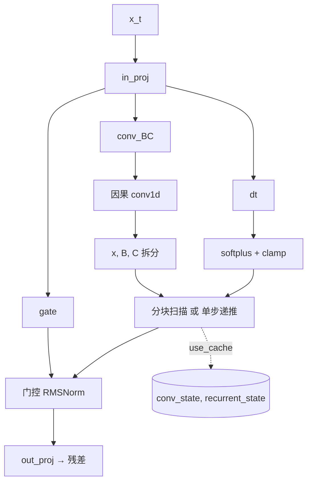
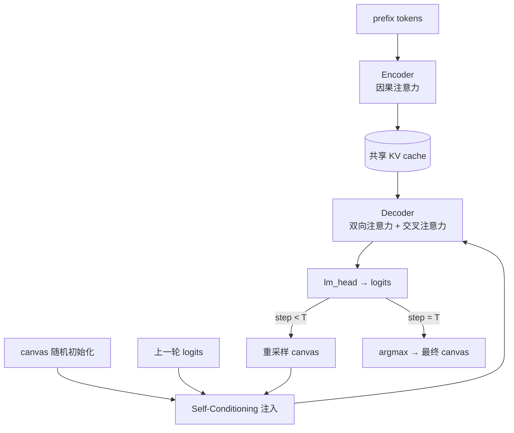

# 从 O(L²) 到 O(L)：RWKV、Mamba、DeltaNet 与 DiffusionLM 的异构注意力机制解剖

大模型的标准 `Attention` 类用 `q_proj/k_proj/v_proj` 投影、QK-Norm、RoPE、KV Cache 和 softmax 实现了教科书式的多头注意力：训练时形成 L×L 注意力矩阵，推理时 KV Cache 随序列线性增长。这个 O(L²) 的成本结构，正是下面四个架构各自尝试拆掉的墙。它们都嵌在同一个 `LLMBlock` 骨架里，通过 `config.layer_types` 切换 mixer，共享 RMSNorm、RoPE、SwiGLU、MoE 等基础设施——差异全部集中在“如何聚合历史信息”这一件事上。

---

## 一、RWKV：log-domain WKV 扫描 + Time-Mix 门控

### 1.1 核心思想

RWKV 被实现为 `RwkvAttention`，与标准 `Attention` 地位对等：都是 `LLMBlock` 中的 mixer 分支。它用**线性复杂度的 WKV 扫描**替代 O(L²) 注意力，同时通过 `time_mix_*` 参数把当前 token 与上一时间步的 hidden 做逐通道混合。整个设计可以概括为“先做时间混合，再做 log-domain 加权平均”。

关键组件：

```python
class RwkvAttention(nn.Module):
    """
    RWKV5 WKV 线性注意力混合器。
    与 Attention 地位对等: 都是 (x -> residual 分支), 用线性复杂度 WKV 替代 O(L^2) 注意力。
    包含 time-mix 的 key/value/receptance 门控与输出投影。
    """
    def __init__(self, config: LLMConfig, layer_id: int = 0):
        super().__init__()
        self.config = config
        self.layer_id = layer_id
        hidden_size = config.hidden_size       # 模型隐藏维度
        attn_hid   = config.attention_hidden_size  # WKV 内部维度

        # ---- Time-mix 门控系数（逐通道） ----
        # 形状 (1, 1, hidden_size)，前两维用于广播；每个通道独立控制
        # "当前 token 与上一时刻 hidden" 的混合比例
        self.time_mix_key        = nn.Parameter(torch.empty(1, 1, hidden_size))
        self.time_mix_value      = nn.Parameter(torch.empty(1, 1, hidden_size))
        self.time_mix_receptance = nn.Parameter(torch.empty(1, 1, hidden_size))

        # ---- WKV 扫描参数 ----
        # time_decay: 历史权重的逐通道衰减率（负值，越大衰减越快）
        # time_first: 当前 token 的逐通道偏置，控制“当前”相对“历史”的权重
        self.time_decay = nn.Parameter(torch.empty(attn_hid))
        self.time_first = nn.Parameter(torch.empty(attn_hid))

        # ---- 线性投影（无偏置，与标准 Attention 风格一致） ----
        self.key        = nn.Linear(hidden_size, attn_hid, bias=False)
        self.value      = nn.Linear(hidden_size, attn_hid, bias=False)
        self.receptance = nn.Linear(hidden_size, attn_hid, bias=False)  # 门控
        self.output     = nn.Linear(attn_hid, hidden_size, bias=False)

        # ZeroPad2d((0,0,1,-1)) 在通道维左侧补 1 个零、右侧裁掉 1 个，
        # 等价于把 hidden 沿序列维右移一位：shifted[t] = hidden[t-1]
        self.time_shift = nn.ZeroPad2d((0, 0, 1, -1))

        # 初始化（参考 transformers RWKV 的初始化方案）
        self._init_rwkv_weights(config)
```

### 1.2 WKV 扫描：用 `(num, den, max)` 三元组做 log-domain 归一化

`rwkv_wkv_scan` 是整层的数学核心。它把线性注意力写成**逐 token 递推的加权平均**，并用 `max` 做数值稳定，避免 `exp(k)` 在 log 域之外溢出：

```python
def rwkv_wkv_scan(time_decay, time_first, key, value, state=None, return_state=False):
    """
    纯 PyTorch WKV 扫描（数值稳定的 log-domain 形式）。

    数学形式（闭式）:
        WKV_t = Σ_{s≤t} exp(k_s + (t-s)·w) · v_s  /  Σ_{s≤t} exp(k_s + (t-s)·w)
    其中 w = time_decay（负值），k_s = key_s + time_first。

    直接用上式会指数爆炸，因此把 num/den 搬到 log 域递推:
        num_state = Σ exp(k_s - max_state) · v_s
        den_state = Σ exp(k_s - max_state)
        max_state = max_s k_s   （数值稳定基准）
    每一步输出时，用 m_out = max(max_state, k_t + time_first) 重归一化。

    参数:
        time_decay: (hidden,) 负值衰减率
        time_first: (hidden,) 逐通道偏置
        key, value: (B, L, hidden)
        state: 可选 (num_state, den_state, max_state)，各 (B, hidden)
    返回:
        (out (B, L, hidden), [num_state, den_state, max_state] 或 None)
    """
    B, L, hid = key.shape

    # ---- 初始化状态三元组 ----
    if state is None:
        # num_state: 加权分子 Σ exp(k - max)·v
        num_state = torch.zeros(B, hid, dtype=torch.float32, device=key.device)
        # den_state: 权重分母 Σ exp(k - max)
        den_state = torch.zeros(B, hid, dtype=torch.float32, device=key.device)
        # max_state: 数值稳定基准，初始化为极小值
        max_state = torch.full((B, hid), -1e38, dtype=torch.float32, device=key.device)
    else:
        num_state, den_state, max_state = state

    # time_decay 参数初始化为可学习值，这里取 -exp(...) 保证为负
    # （负衰减率 → exp(time_decay) ∈ (0,1)，历史权重单调递减）
    time_decay = -torch.exp(time_decay)

    out = torch.empty_like(key)
    for t in range(L):
        # ---- 当前 token 的 key / value ----
        k_t = key[:, t].float() + time_first   # 加上 time_first 偏置
        v_t = value[:, t].float()

        # ---- 输出：log-domain 加权平均 ----
        # m_out = max(max_state, k_t) 防止 exp 上溢
        m_out = torch.maximum(max_state, k_t)
        e1 = torch.exp(max_state - m_out)   # 历史项的重归一化系数
        e2 = torch.exp(k_t - m_out)         # 当前项的重归一化系数
        # out_t = (历史加权和 + 当前贡献) / (历史权重和 + 当前权重)
        out[:, t] = ((e1 * num_state + e2 * v_t) / (e1 * den_state + e2)).to(out.dtype)

        # ---- 状态更新：历史按 time_decay 衰减 + 当前 key 写入 ----
        # 衰减后的 max = max_state + time_decay（time_decay 为负，故变小）
        m_st = torch.maximum(max_state + time_decay, key[:, t].float())
        e1 = torch.exp(max_state + time_decay - m_st)
        e2 = torch.exp(key[:, t].float() - m_st)
        num_state = e1 * num_state + e2 * v_t   # 分子：加权累积
        den_state = e1 * den_state + e2         # 分母：权重累积
        max_state = m_st

    new_state = [num_state, den_state, max_state]
    return out, (new_state if (return_state or state is not None) else None)
```

写成闭式，RWKV 的 WKV 就是**带指数衰减核的线性注意力**：

$$
\text{WKV}_t = \frac{\sum_{s \le t} e^{k_s + (t-s)\cdot w} v_s}{\sum_{s \le t} e^{k_s + (t-s)\cdot w}}
$$

`time_first` 控制当前 token 的相对权重，`time_decay` 控制历史权重衰减速度。`(num, den, max)` 三元组把 `e^{k_s}` 的累加搬到 log 域，这是 transformers 中 `rwkv_linear_attention_cpu` 的标准做法。

### 1.3 Time-Mix：让 mixer 自己感知“上一时刻”

`_extract_kv` 展示了 RWKV 的另一半精髓：在投影前，先对 hidden 做时间混合。每个通道用不同的 `time_mix_*` 系数决定“当前 hidden”与“上一时刻 hidden”的混合比例：

```python
def _extract_kv(self, hidden, state):
    """
    时间混合 + 线性投影，得到 key/value/receptance。

    state: RWKV 4 元组列表 [num_state, den_state, max_state, last_hidden];
           state[3] 是“上一时间步的 hidden”，生成阶段 L==1 时用它做 shift。
    """
    if hidden.size(1) == 1:
        # ---- 生成阶段（单 token）：用缓存的上一步 hidden 作为 shifted ----
        # 因为 ZeroPad2d 的 shift 在当前步没有“前一个 token”可用
        shifted = state[3]
    else:
        # ---- 训练/预填充阶段：用 ZeroPad2d 沿序列维平移一位 ----
        # shifted[t] = hidden[t-1]，shifted[0] = 0
        shifted = self.time_shift(hidden)

    # 逐通道线性插值：mix * current + (1 - mix) * shifted
    # 不同通道学到不同的“记忆长度”：mix 接近 1 只关注当前，接近 0 更依赖历史
    key        = hidden * self.time_mix_key        + shifted * (1 - self.time_mix_key)
    value      = hidden * self.time_mix_value      + shifted * (1 - self.time_mix_value)
    receptance = hidden * self.time_mix_receptance + shifted * (1 - self.time_mix_receptance)

    # ---- 线性投影 ----
    key        = self.key(key)
    value      = self.value(value)
    # receptance 是门控：sigmoid 压缩到 (0,1)，控制 WKV 输出有多少被“接收”
    receptance = torch.sigmoid(self.receptance(receptance))

    # ---- 缓存当前 hidden 供下一步 L==1 使用 ----
    state[3] = hidden[:, -1].clone()
    return receptance, key, value
```

`time_mix_*` 的初始化也很有讲究：`time_mix_key` 用 `pow(i/hid, ratio_1_to_almost0)`，让不同通道以不同速度混合，等价于一个可学习的、逐通道的局部卷积。这种“先做时间混合，再做 WKV 扫描”的两段式设计，是 RWKV 相对纯线性注意力的关键增量。

### 1.4 完整 forward：状态初始化 + 扫描 + 门控输出

```python
def forward(self, x, position_embeddings=None, past_key_value=None,
            use_cache=False, attention_mask=None):
    """
    x: (B, L, hidden)。
    past_key_value: RWKV state 列表 [num_state, den_state, max_state, last_hidden]。
    返回 (output, past_key_value)。
    """
    # ---- 状态初始化 ----
    if past_key_value is None:
        state = [
            torch.zeros(x.size(0), x.size(2), dtype=torch.float32, device=x.device),  # num
            torch.zeros(x.size(0), x.size(2), dtype=torch.float32, device=x.device),  # den
            torch.full((x.size(0), x.size(2)), -1e38, dtype=torch.float32, device=x.device),  # max
            torch.zeros_like(x[:, 0]),  # last_hidden（供生成阶段 time-shift 用）
        ]
    else:
        state = past_key_value

    # ---- 时间混合 + 投影 ----
    receptance, key, value = self._extract_kv(x, state)

    # ---- WKV 扫描 ----
    # 注意: 这里只把 num/den/max 三元组传给扫描函数，last_hidden 不参与
    rk, rk_state = rwkv_wkv_scan(
        self.time_decay, self.time_first, key, value,
        state=[state[0], state[1], state[2]],
        return_state=use_cache,
    )
    if rk_state is not None:
        # 写回更新后的三元组
        state[0], state[1], state[2] = rk_state

    # ---- 门控输出 + 投影 ----
    # receptance (B,L,attn_hid) 逐元素门控 WKV 输出
    output = self.output(receptance * rk)

    present = state if use_cache else None
    return output, present
```

### 1.5 数据流

```mermaid
flowchart LR
    A[x_t] --> B{Time-Shift}
    A --> C[Time-Mix 混合]
    B -->|shifted| C
    C --> D[K / V / R 投影]
    D --> E[WKV 扫描<br/>num,den,max 递推]
    E --> F[σ(R) ⊙ WKV]
    F --> G[o_proj → 残差]
    E -.->|use_cache| H[(RWKV state<br/>num,den,max,last_hidden)]
```

### 1.6 与 MHA 的对照

| 维度 | MHA | RWKV |
|---|---|---|
| 训练复杂度 | O(L²) | O(L)（扫描） |
| 推理每 token | O(L)（KV cache） | O(1)（定长 state） |
| 显存 | 随序列线性增长 | 恒定 |
| 精确检索 | 全局、无压缩 | 指数衰减，远距离信息被压缩 |
| 定向遗忘 | 无显式机制 | 仅指数软遗忘，无“橡皮擦” |

RWKV 的短板在 `rwkv_wkv_scan` 里写得明明白白：状态只能通过 `exp(time_decay)` 衰减，**没法像 DeltaNet 那样对某个 key 方向做定向擦除**。

---

## 二、Mamba：选择性 SSM + 分块并行扫描

### 2.1 核心思想

`MambaMixer` 是 Mamba2 风格的实现，`layer_types` 中标记为 `"linear_attention"`。它把 SSM 嵌进一个“输入投影 + 因果 conv1d + 分块扫描 + 门控 RMSNorm”的块中。相对经典 SSM（S4），Mamba 的关键改动是让 `dt / B / C` 由输入动态生成，从而获得**内容感知的选择性**。

```python
class MambaMixer(nn.Module):
    """
    Mamba2 选择性状态空间混合器 (对应 config.layer_types 中的 "linear_attention")。
    与 Attention 层地位对等: 都是 (x -> residual 分支)，但用线性复杂度的 SSM
    替代 O(L^2) 注意力。
    """
    def __init__(self, config: LLMConfig):
        super().__init__()
        self.config = config
        self.hidden_size         = config.hidden_size
        self.num_heads           = config.mamba_num_heads       # SSM 头数 H
        self.head_dim            = config.mamba_head_dim        # 每个头的 P
        self.intermediate_size   = config.mamba_intermediate_size
        self.ssm_state_size      = config.ssm_state_size        # 状态维度 N
        self.conv_kernel         = config.conv_kernel           # 因果卷积核大小
        self.chunk_size          = config.chunk_size            # 分块大小
        self.n_groups            = config.n_groups              # B/C 的组数 G

        # ---- 投影尺寸计算 ----
        # conv 段通道数 = 中间维度 + 2 * 组数 * 状态维 (C, B 各一份)
        self.conv_dim = self.intermediate_size + 2 * self.n_groups * self.ssm_state_size
        # 一次性投影产出: [gate | conv_BC | dt]
        self.projection_size = self.intermediate_size + self.conv_dim + self.num_heads

        # ---- 1. 输入投影 ----
        self.in_proj = nn.Linear(self.hidden_size, self.projection_size,
                                 bias=config.use_conv_bias)

        # ---- 2. 因果 conv1d (每个通道独立，groups=conv_dim) ----
        # 对 BC 段做短程局部混洗，类似 DeltaNet 的 causal_conv1d
        self.conv1d = nn.Conv1d(
            in_channels=self.conv_dim, out_channels=self.conv_dim,
            bias=config.use_conv_bias, kernel_size=self.conv_kernel,
            padding=self.conv_kernel - 1, groups=self.conv_dim,
        )

        # ---- 3. SSM 参数 ----
        # dt_bias: 每个头一个，经 softplus 后得到正的时间步
        self.dt_bias = nn.Parameter(torch.zeros(self.num_heads))
        # A: 衰减率，取 -log(1..num_heads) 作为初始化（数值稳定的负值）
        A = torch.arange(1, self.num_heads + 1, dtype=torch.float32)
        self.A_log = nn.Parameter(torch.log(A))
        # D: 每个头的直接跳连
        self.D = nn.Parameter(torch.ones(self.num_heads))

        # ---- 4. 门控 RMSNorm + 输出投影 ----
        self.norm = _GatedRMSNorm(self.intermediate_size, eps=config.layer_norm_eps)
        self.out_proj = nn.Linear(self.intermediate_size, self.hidden_size,
                                  bias=config.use_conv_bias)
```

### 2.2 选择性离散化：`dt` 由输入生成

Mamba 相对经典 SSM 的关键改动是**选择性**：`dt` 不再是固定参数，而是由当前输入经 `in_proj` 生成，再经 `softplus` 和限幅。这一步让模型能根据 token 内容决定“记住多少”：

```python
# forward 中：
projected = self.in_proj(hidden_states)
# 一次投影拆出三段：gate (逐元素门控)、conv_bc (给 conv 的 BC 段)、dt (时间步)
gate, conv_bc, dt = projected.split(
    [self.intermediate_size, self.conv_dim, self.num_heads], dim=-1)

# dt: (B, L, H) -> (B, H, L)，加可学习偏置后转回 (B, L, H)
# 这里 transpose 是为了让 bias 能按 H 维正确广播
dt = dt.transpose(1, 2) + self.dt_bias.view(1, -1, 1)
dt = dt.transpose(1, 2)

# 在 _chunk_scan / _recurrent_update 内部：
dt = F.softplus(dt)                                   # 保证 dt > 0
dt = torch.clamp(dt, min=self.config.time_step_min,
                 max=self.config.time_step_max)        # 限幅，防止极端值
dA_step = torch.exp((dt * A.view(1, 1, H)).float())   # 逐通道衰减 = exp(dt·A)
```

`A` 是负值（`-exp(A_log)`），`dt > 0`，所以 `dA_step = exp(dt·A) ∈ (0,1)`。大的 `dt` 意味着更快的衰减（更积极地“忘记”旧状态），小的 `dt` 意味着更慢的衰减。因为 `dt` 由输入生成，模型就能学会“对重要 token 用小的 dt（保留更多历史），对无关 token 用大的 dt（快速遗忘）”。

### 2.3 分块扫描：块内 O(chunk²)，块间 O(1)

`_chunk_scan` 是整段代码最精巧的部分。它把序列切成 `chunk_size` 的块，块内用因果衰减核并行计算，块间用递归传递末位状态。数学上这就是 SSM 离散递推 `h_t = Ā h_{t-1} + B̄ x_t`，只是重排成“块内并行 + 块间串行”的混合形式，从而在 GPU 上获得接近线性的吞吐：

```python
def _chunk_scan(self, x, dt, A, B, C, D, initial_state=None):
    """
    x: (B, L, H, P)   SSM 输入
    dt: (B, L, H)     时间步（本函数内部再 softplus + 限幅）
    A: (H,)           衰减率（负值）
    B,C: (B, L, G, N) SSM 矩阵（G 组, N 状态维）
    D: (H,)           直接跳连
    initial_state: (B, H, P, N) 可选（来自上一轮生成的末位状态）
    返回 (out (B, L, H, P), final_state (B, H, P, N))

    参照 mamba2_chunk_scan 的纯 PyTorch 版本:
      - 块内用因果衰减核 O(chunk^2) 并行计算（对角块）
      - 块间用 O(1) 的递归传递末位状态（off-diagonal 块）
    头之间相互独立，共享同一套衰减核。
    """
    Bsz, L, H, P = x.shape
    G, N = B.shape[2], B.shape[3]
    chunk = self.chunk_size

    # ---- 组 -> 头 广播：每个头共用一个组的 B/C ----
    if G != H:
        B = B.repeat_interleave(H // G, dim=2)
        C = C.repeat_interleave(H // G, dim=2)

    # ---- dt 离散化 ----
    # softplus + 限幅 + 逐通道衰减 dA = exp(dt·A)
    dt = F.softplus(dt)
    dt = torch.clamp(dt, min=self.config.time_step_min, max=self.config.time_step_max)
    dA_step = torch.exp((dt * A.view(1, 1, H)).float())          # (B, L, H)

    # ---- 补齐到 chunk 整数倍 ----
    # 在序列维 dim=1 上补 0；F.pad 的 pad 参数从末维往前数
    pad = (-L) % chunk
    if pad:
        x       = F.pad(x,       (0, 0, 0, 0, 0, pad, 0, 0))    # (B,L,H,P) 补 dim1
        dt      = F.pad(dt,      (0, 0, 0, pad, 0, 0))          # (B,L,H)   补 dim1
        dA_step = F.pad(dA_step, (0, 0, 0, pad, 0, 0))
        B       = F.pad(B,       (0, 0, 0, 0, 0, pad, 0, 0))    # (B,L,G,N) 补 dim1
        C       = F.pad(C,       (0, 0, 0, 0, 0, pad, 0, 0))
    Lp = L + pad
    nc = Lp // chunk   # 块数

    # ---- 切块: (B, L, H, P) -> (B, nc, chunk, H, P) ----
    x_c    = x.view(Bsz, nc, chunk, H, P)
    dt_c   = dt.view(Bsz, nc, chunk, H)
    dA_c   = dA_step.view(Bsz, nc, chunk, H)
    B_c    = B.view(Bsz, nc, chunk, H, N)
    C_c    = C.view(Bsz, nc, chunk, H, N)

    # ---- 块内累计 log 衰减 ----
    # L_cum[i] = Σ_{t≤i} log dA_step，位置 t 相对 s(≤t) 的衰减 = exp(L_cum[t] - L_cum[s])
    L_cum = torch.cumsum(torch.log(dA_c.clamp_min(1e-8)), dim=2)  # (B, nc, chunk, H)

    # 因果掩码（下三角）：只允许 s ≤ l
    causal = torch.tril(torch.ones(chunk, chunk, device=x.device)).bool()

    # ---- 离散输入: dBx[t,h] = dt[t,h] * B[t,h] * x[t,h] ----
    # einsum: 逐头外积 -> (B,nc,chunk,H,N,P)
    dBx = torch.einsum('bclh,bclhn,bclhp->bclhnp', dt_c, B_c, x_c)

    # ---- 块内（对角块）: 逐头 SSM ----
    # y[l,h,p] = Σ_{s≤l} exp(L_l - L_s) · (C[l,h,n] · dBx[s,h,n,p])
    # 第一步: 把 dBx 与 C 做 einsum, 得到 (B,nc,l,s,h,p)
    tmp = torch.einsum('bcshnp,bclhn->bclshp', dBx, C_c)

    # 第二步: 衰减核 exp(L_l - L_s), 逐头
    Lt, Ls = L_cum.unsqueeze(3), L_cum.unsqueeze(2)   # query=l, source=s
    decay = torch.exp((Lt - Ls).float())              # (B,nc,l,s,H)
    decay = decay.masked_fill(~causal.view(1, 1, chunk, chunk, 1), 0.0)

    # 第三步: 对 s 求和
    y_intra = torch.einsum('bnlsh,bnslhp->bnlhp', decay, tmp)   # (B,nc,l,h,p)

    # D 跳连: y_intra += D_h * x
    y_intra = y_intra + D.view(1, 1, 1, H, 1) * x_c

    # ---- 块间（off-diagonal）: 逐块递归传递状态 ----
    # running: 每块 *起始* 的状态 (B,H,P,N)
    # 每块末位状态: end(c) = exp(L_c)*start(c) + Σ_s exp(L_c - L_s)*dBx[c,s]
    L_c = L_cum[:, :, -1, :]   # 每块累计衰减（相对块首）
    if initial_state is not None:
        running = initial_state.float()
    else:
        running = torch.zeros(Bsz, H, P, N, device=x.device)

    y_off_all = torch.empty_like(y_intra)
    for c in range(nc):
        exp_Lc = torch.exp(L_c[:, c, :])   # (B, H) 块 c 的累计衰减

        # 块起始状态对本块各位置的贡献: y_off[l] = exp(L_cum[l]) · (C[l]·running)
        C_c_ = C_c[:, c, :, :, :]                                # (B,chunk,H,N)
        y_off = torch.einsum('blhn,bhpn->blhp', C_c_, running)   # (B,chunk,H,P)
        y_off = y_off * torch.exp(L_cum[:, c, :].float()).unsqueeze(-1)
        y_off_all[:, c] = y_off

        # 更新为 *下一块* 起始状态:
        # end(c) = exp(L_c) * start(c) + Σ_s exp(L_c - L_s) * dBx[c,s]
        pos_decay = torch.exp(
            (L_c[:, c, :].unsqueeze(1) - L_cum[:, c, :]).float())  # (B,chunk,H)
        contrib = torch.einsum('bsh,bshnp->bhnp', pos_decay, dBx[:, c]).permute(0, 1, 3, 2)
        running = running * exp_Lc.view(Bsz, H, 1, 1) + contrib

    final_state = running.to(B.dtype)
    out = (y_intra + y_off_all).view(Bsz, Lp, H, P)[:, :L, :, :]
    return out, final_state
```

### 2.4 推理路径：`_recurrent_update` 的 O(1) 单步

生成阶段 `L==1` 时，`MambaMixer` 走一条专门的分支，只做一次状态更新，复杂度 O(1)：

```python
def _recurrent_update(self, state, x, dt, A, B, C, D):
    """
    逐 token 递归（生成阶段，L=1）。
    state: (B, H, P, N); x: (B, 1, H, P); dt: (B, 1, H); B,C: (B, 1, G, N)。
    返回 (out (B, 1, H, P), new_state (B, H, P, N))
    """
    Bsz, H, P = x.shape[0], self.num_heads, self.head_dim
    N = state.shape[-1]
    G = B.shape[2]

    # ---- 去掉时间维 ----
    x  = x.squeeze(1)      # (B, H, P)
    dt = dt.squeeze(1)     # (B, H)
    B_ = B.squeeze(1)      # (B, G, N)
    C_ = C.squeeze(1)      # (B, G, N)

    # ---- 组 -> 头 广播 ----
    if G != H:
        B_ = B_.repeat_interleave(H // G, dim=1)   # (B, H, N)
        C_ = C_.repeat_interleave(H // G, dim=1)
    B_ = B_.view(Bsz, H, N)
    C_ = C_.view(Bsz, H, N)

    # ---- dt 离散化 ----
    dt = F.softplus(dt)
    dt = torch.clamp(dt, min=self.config.time_step_min, max=self.config.time_step_max)
    dA = torch.exp((dt * A.view(1, H)).float())    # (B, H) 衰减系数

    # ---- 状态更新: s_new[h,p,n] = dA[h]·s[h,p,n] + dt[h]·B[h,n]·x[h,p] ----
    # einsum 把 dt、B_、x 三者组合成 (B,H,P,N) 的增量
    dBx = torch.einsum('bh,bhn,bhp->bhpn', dt, B_, x)
    new_state = state * dA.view(Bsz, H, 1, 1) + dBx
    new_state = new_state.to(state.dtype)

    # ---- 输出: y = C·s_new + D·x ----
    out = torch.einsum('bhn,bhpn->bhp', C_.float(), new_state.float())
    if D is not None:
        out = out + x.float() * D.view(1, H, 1)
    out = out.to(x.dtype).unsqueeze(1)    # (B, 1, H, P)
    return out, new_state
```

每一步只维护一个 `(B, H, P, N)` 的隐状态，常数内存、常数计算。缓存由 `(conv_state, recurrent_state)` 二元组承载，与 `Attention` 的 `(k, v)` 元组在 `LLMModel.forward` 中统一调度。

### 2.5 数据流



### 2.6 与 MHA 的对照

| 维度 | MHA | Mamba2 |
|---|---|---|
| 训练复杂度 | O(L²) | O(L)（分块扫描，块内 O(chunk²) 但 chunk 固定） |
| 推理每 token | O(L)（KV cache） | O(1)（定长 state） |
| 显存 | 随序列线性增长 | 恒定 |
| 内容感知 | 全局成对打分 | 通过 `dt/B/C` 选择性写入 |
| 定向遗忘 | 无 | 选择性写入，但无显式擦除 |
| 精确检索 | 强 | 受固定状态容量限制 |

Mamba 的“选择性”是**输入决定写多少**，但它仍然没有“针对某个 key 方向擦除旧值”的能力——这正是下一节 DeltaNet 要补的。

---

## 三、Gated DeltaNet（QSA）：带“橡皮擦”的线性注意力

### 3.1 核心思想

`GatedDeltaNet` 对应 `layer_types` 中的 `"linear_attention"`，实现的是 Qwen3.5 / Qwen3-Next 风格的门控 delta 规则。相对 Mamba，它多了一层**定向擦除**：写入新值前先沿当前 key 方向把状态里的旧分量抹掉。完整链路是“in_proj 投影 → 因果 conv1d 局部混洗 → 门控 delta 递推 → RMSNormGated 输出归一化”。

```python
class GatedDeltaNet(nn.Module):
    """
    门控 Delta 网络（线性注意力），Qwen3.5 风格，适配大模型接口。

    组成（参照 Qwen3_5GatedDeltaNet）:
    1. in_proj_qkv / in_proj_z / in_proj_b / in_proj_a 投影
    2. 因果 1D 卷积 (conv1d) 对 QKV 做局部混洗
    3. 门控 Delta 递归（torch_recurrent_gated_delta_rule）
    4. 门控 RMSNorm 输出归一化 (z 作为门) + out_proj

    状态缓存:
        past = (kv_state, conv_state)
        kv_state:   [B, num_v_heads, head_k_dim, head_v_dim] 递归状态
        conv_state: [B, conv_dim, kernel-1] 卷积滑窗缓存
    """
    def __init__(self, config: LLMConfig, layer_idx: int):
        super().__init__()
        self.config = config
        self.layer_idx = layer_idx
        self.activation = config.hidden_act

        # ---- 头维度配置 ----
        self.num_v_heads = config.linear_num_value_heads     # value 头数
        self.num_k_heads = config.linear_num_key_heads       # key 头数
        self.head_k_dim  = config.linear_key_head_dim        # key 头维度
        self.head_v_dim  = config.linear_value_head_dim      # value 头维度
        self.key_dim     = self.head_k_dim * self.num_k_heads
        self.value_dim   = self.head_v_dim * self.num_v_heads
        self.conv_kernel_size = config.linear_conv_kernel_dim
        # conv 输入 = Q 段 + K 段 + V 段
        self.conv_dim = self.key_dim * 2 + self.value_dim
        self.num_rep = self.num_v_heads // self.num_k_heads  # GQA 式重复倍数

        # ---- 因果卷积（深度可分离，groups=conv_dim） ----
        self.conv1d = nn.Conv1d(
            in_channels=self.conv_dim, out_channels=self.conv_dim,
            bias=False, kernel_size=self.conv_kernel_size,
            groups=self.conv_dim, padding=self.conv_kernel_size - 1,
        )

        # ---- 时步（门控）参数 ----
        # dt_bias: 逐头偏置，经 softplus 控制衰减
        # A: 衰减基数，均匀初始化在 (0.01, 16) 后取 log
        self.dt_bias = nn.Parameter(torch.ones(self.num_v_heads))
        A = torch.empty(self.num_v_heads).uniform_(0.01, 16)
        self.A_log = nn.Parameter(torch.log(A))

        # ---- 门控输出归一化 ----
        # RMSNormGated: 对 (x) 做 RMSNorm 后乘 SiLU(z)
        self.norm = RMSNormGated(self.head_v_dim, eps=config.rms_norm_eps,
                                 activation=config.hidden_act)
        self.out_proj = nn.Linear(self.value_dim, config.hidden_size, bias=False)

        # ---- 投影层 ----
        # in_proj_qkv: 一次性产出 Q/K/V 三段（后续做卷积）
        self.in_proj_qkv = nn.Linear(config.hidden_size,
                                     self.key_dim * 2 + self.value_dim, bias=False)
        # in_proj_z: 输出门控信号 z
        self.in_proj_z = nn.Linear(config.hidden_size, self.value_dim, bias=False)
        # in_proj_b: 输出 β（写入强度）
        self.in_proj_b = nn.Linear(config.hidden_size, self.num_v_heads, bias=False)
        # in_proj_a: 输出 a（用于算 g = -exp(A)·softplus(a + dt_bias)）
        self.in_proj_a = nn.Linear(config.hidden_size, self.num_v_heads, bias=False)

        # conv 权重手动初始化，kaiming 对深层 conv 不合适
        with torch.no_grad():
            std = 1.0 / (self.conv_dim ** 0.5)
            torch.nn.init.normal_(self.conv1d.weight, mean=0.0, std=std)
```

### 3.2 因果卷积：局部混洗后再做 delta

DeltaNet 在投影后先做一次因果 1D 卷积。这一步让 QKV 在进入 delta 递推前，先完成短程局部混合：

```python
def causal_conv1d_fn(hidden_states, weight, bias, activation):
    """
    因果 1D 卷积（对 QKV 做短程局部混洗，DeltaNet 论文的关键组件之一）。
    因果卷积：只在左侧补 kernel-1 个 0（右侧补 0），保证每个位置只看历史。

    hidden_states: [batch, channels, seq]
    weight:        [channels, 1, kernel] (groups=channels 的深度可分离卷积)
    返回: [batch, channels, seq]
    """
    _, channels, seq_len = hidden_states.shape
    padding = weight.shape[-1] - 1
    # 只在左侧 pad：F.pad 的 (left, right) 对应最后一维，即序列维
    out = F.conv1d(
        F.pad(hidden_states.to(weight.dtype), (padding, 0)),
        weight=weight.unsqueeze(1),   # [channels, 1, kernel] -> 深度可分离
        bias=bias,
        padding=0,
        groups=channels,
    )
    out = out[..., :seq_len]          # 裁掉右侧多余部分
    if activation is not None:
        out = ACT2FN[activation](out) # 默认 SiLU
    return out.to(hidden_states.dtype)
```

它是 DeltaNet 相对纯线性注意力的一个关键增量，也是 `GatedDeltaNet.__init__` 中 `conv1d` 权重需要特殊初始化的原因。

### 3.3 门控 Delta 规则：`S_t = S_{t-1}·decay + β(v - S·k)⊗k`

`torch_recurrent_gated_delta_rule` 是整层的数学心脏。与 Mamba 的“选择性写入”不同，它在写入前先**沿当前 key 方向擦除旧值**：

```python
def torch_recurrent_gated_delta_rule(query, key, value, g, beta,
                                     initial_state=None, output_final_state=False,
                                     use_qk_l2norm_in_kernel=True, **kwargs):
    """
    门控 Delta 规则（单 token / 短序列的递归实现）。

    每个时间步:
        S_t = S_{t-1} * exp(g_t) + beta_t * (v_t - S_{t-1}·k_t) ⊗ k_t
        o_t = S_t · q_t
    对应 Qwen3.5 的 torch_recurrent_gated_delta_rule。
    """
    initial_dtype = query.dtype
    batch_size, seq_len, _, k_head_dim = key.shape
    num_v_heads, v_head_dim = value.shape[-2:]
    decay = g

    # ---- 统一转成 [B, H, T, D] 并提升到 fp32（数值稳定性） ----
    query, key, value, beta, decay = [
        x.transpose(1, 2).to(dtype=torch.float32, memory_format=torch.contiguous_format)
        for x in (query, key, value, beta, decay)
    ]
    # ---- Q/K 的 L2 归一化（FLA 库惯例） ----
    if use_qk_l2norm_in_kernel:
        query = l2norm(query)
        key   = l2norm(key)
    query = query / (query.shape[-1] ** 0.5)   # 缩放，等价于 1/√d

    # ---- 状态初始化 ----
    if initial_state is None:
        state = torch.zeros(batch_size, num_v_heads, k_head_dim, v_head_dim,
                            dtype=torch.float32, device=value.device)
    else:
        state = initial_state.to(dtype=torch.float32, device=value.device)

    out = torch.zeros_like(value)
    for i in range(seq_len):
        q_t, k_t, v_t = query[:, :, i], key[:, :, i], value[:, :, i]

        # ---- 1. 状态按 decay 衰减 ----
        # decay = exp(g)，g = -exp(A)·softplus(a + dt_bias) ≤ 0，故 exp(g) ∈ (0,1]
        state = state * decay[:, :, i].exp()[..., None, None]

        # ---- 2. 计算当前 key 方向上的“旧值” S·k ----
        # kv_mem[h, v] = Σ_k S[h, k, v] · k[h, k]  (在 k 维上求和)
        kv_mem = (state * k_t.unsqueeze(-1)).sum(dim=-2)   # [B, H, v]

        # ---- 3. Delta：新值 - 旧值，乘以 β 作为写入强度 ----
        beta_t = beta[:, :, i].unsqueeze(-1)                # [B, H, 1]
        delta  = (v_t - kv_mem) * beta_t                    # [B, H, v]

        # ---- 4. 沿 key 方向写回：先擦除再写入 ----
        # S ← S + k ⊗ delta  （k 方向的分量被 delta 替换）
        # 展开即 S_t = S_{t-1} - β·k⊗(S·k) + β·k⊗v
        #           = S_{t-1}·(I - β·k·k^T) + β·v·k^T
        state = state + k_t.unsqueeze(-1) * delta.unsqueeze(-2)

        # ---- 5. 读出 ----
        # o[h, v] = Σ_k S[h, k, v] · q[h, k]
        out[:, :, i] = (state * q_t.unsqueeze(-1)).sum(dim=-2)

    # ---- 转回原 dtype 与 [B, T, H, D] 布局 ----
    out = out.transpose(1, 2).contiguous().to(initial_dtype)
    state = None if not output_final_state else state.to(initial_dtype)
    return out, state
```

写成闭式：

$$
S_t = S_{t-1} \cdot e^{g_t} + \beta_t \,(v_t - S_{t-1} k_t)\, k_t^\top, \qquad o_t = S_t\, q_t
$$

`(v_t - S_{t-1} k_t)` 就是“当前 key 方向上已存的值”与“新值”的差，`β` 控制擦除强度。当 `β=1` 时，这就是一次标准的 delta 更新；当 `β=0` 时退化为纯衰减。展开后可以看到等价形式 `S_t = S_{t-1}(I - β k k^T) + β v k^T`——`(I - β k k^T)` 是一个**定向擦除算子**，只沿当前 key 方向抹掉旧分量。这正是 DeltaNet 区别于 RWKV/Mamba 的核心。

### 3.4 门控参数与输出归一化

`GatedDeltaNet.forward` 里还藏着两层门控：`β` 控制写入强度，`g` 控制衰减，`z` 作为输出门：

```python
def forward(self, x, past_state=None, use_cache=False, attention_mask=None):
    batch_size, seq_len, _ = x.shape

    # ---- 1. 投影 ----
    mixed_qkv = self.in_proj_qkv(x)             # [B, T, conv_dim]
    z = self.in_proj_z(x).reshape(batch_size, seq_len, self.num_v_heads, self.head_v_dim)
    b = self.in_proj_b(x)                        # [B, T, num_v_heads] 用于 β
    a = self.in_proj_a(x)                        # [B, T, num_v_heads] 用于 g

    # ---- 2. 因果卷积（更新卷积缓存） ----
    conv_w = self.conv1d.weight.squeeze(1)       # [conv_dim, kernel]
    conv_b = self.conv1d.bias
    state_len = self.conv_kernel_size - 1
    mixed_qkv_in_t = mixed_qkv.transpose(1, 2)   # [B, conv_dim, T]

    if past_state is not None and past_state[1] is not None:
        # ---- 增量解码：拼上历史滑窗后做零填充卷积，原地更新 conv_state ----
        conv_state = past_state[1]
        mixed_qkv_t = causal_conv1d_update(mixed_qkv_in_t, conv_state,
                                           conv_w, conv_b, self.activation)
        new_conv_state = conv_state   # 已原地更新
    else:
        # ---- 首次前向：全序列卷积，末尾取 state_len 个输入作为滑窗缓存 ----
        mixed_qkv_t = causal_conv1d_fn(mixed_qkv_in_t, conv_w, conv_b, self.activation)
        if use_cache and state_len > 0:
            tail = mixed_qkv_in_t[:, :, -state_len:]
            left_pad = state_len - tail.shape[-1]
            new_conv_state = F.pad(tail, (left_pad, 0)).contiguous()
        else:
            new_conv_state = None
    mixed_qkv = mixed_qkv_t.transpose(1, 2)

    # ---- 3. 拆出 Q/K/V ----
    query, key, value = self._split_qkv(mixed_qkv, batch_size, seq_len)

    # ---- 4. 门控参数 ----
    beta = b.sigmoid()                                              # 写入强度 ∈ (0,1)
    # g = -exp(A)·softplus(a + dt_bias)  ≤ 0，故 exp(g) ∈ (0,1]
    g = -self.A_log.float().exp() * F.softplus(a.float() + self.dt_bias)

    # GQA 式重复：v 头数 > k 头数时，k 需要复制
    if self.num_rep > 1:
        query = query.repeat_interleave(self.num_rep, dim=2)
        key   = key.repeat_interleave(self.num_rep, dim=2)

    # ---- 5. 门控 Delta 递归 ----
    kv_state = past_state[0] if (past_state is not None and past_state[0] is not None) else None
    core_out, new_kv_state = torch_recurrent_gated_delta_rule(
        query, key, value, g=g, beta=beta,
        initial_state=kv_state,
        output_final_state=use_cache,
        use_qk_l2norm_in_kernel=True,
    )
    if use_cache:
        past_out = (new_kv_state, new_conv_state)
    else:
        past_out = None

    # ---- 6. 门控归一化 + 输出投影 ----
    # RMSNormGated: 先 RMSNorm 再乘 SiLU(z)
    core_out = core_out.reshape(-1, self.head_v_dim)
    core_out = self.norm(core_out, z.reshape(-1, self.head_v_dim))
    core_out = core_out.reshape(batch_size, seq_len, self.value_dim)
    return self.out_proj(core_out), past_out
```

`A_log` 和 `dt_bias` 与 Mamba 同源，但 `RMSNormGated` 额外引入 `z` 作为输出门——这是 Qwen3.5 的写法，等价于在 delta 输出上再乘一个 `SiLU(z)`。

### 3.5 数据流

```mermaid
flowchart LR
    A[x_t] --> B[in_proj_qkv]
    A --> C[in_proj_z]
    A --> D[in_proj_b / in_proj_a]
    B --> E[因果 conv1d]
    E --> F[Q, K, V 拆分]
    D --> G[β = sigmoid, g = -exp(A)·softplus]
    F --> H[门控 Delta 递推]
    G --> H
    H --> I[RMSNormGated × SiLU(z)]
    C --> I
    I --> J[out_proj → 残差]
    H -.->|use_cache| K[(kv_state, conv_state)]
```

### 3.6 与 MHA、RWKV、Mamba 的对照

| 维度 | MHA | RWKV | Mamba2 | Gated DeltaNet |
|---|---|---|---|---|
| 复杂度 | O(L²) | O(L) | O(L) | O(L) |
| 状态更新 | 无状态 | 衰减叠加 | 选择性写入 | **衰减 + 定向擦除 + 写入** |
| 定向遗忘 | 无 | 仅软遗忘 | 无显式擦除 | **有**：`S·k` 方向被擦除 |
| 推理缓存 | (k, v) 增长 | 定长 state | 定长 state | 定长 state |
| 检索精度 | 强 | 弱 | 中 | 较强 |

DeltaNet 的“橡皮擦”是这四个架构里最接近“可编辑记忆”的设计：它不像 MHA 那样存储所有历史，但比 RWKV/Mamba 更能避免状态饱和。

---

## 四、DiffusionLM：Encoder-Decoder 去噪，放弃因果生成

### 4.1 核心思想

前三个架构仍然在“序列建模”的框架内改注意力算子；DiffusionLM 换了一条路：**不让模型从左到右逐 token 生成，而是从随机 canvas 出发，用多步去噪并行恢复整段输出**。以下代码实现的是 DiffusionGemma 风格的 **block diffusion**：

- **Encoder**：因果注意力编码 prefix，把每层 KV 写入共享 cache；
- **Decoder**：双向注意力处理 canvas，**只读** encoder 的 KV cache，做交叉注意力；
- **Self-Conditioning**：把上一轮去噪的 logits 转成 soft embedding，注入 decoder 输入；
- **Encoder 和 Decoder 共享同一组 `LLMBlock` 权重**。

最省事的一点：`Attention` 类通过 `is_causal` 一个开关同时扮演两种角色，不需要新写 cross-attention 模块。

### 4.2 一个 `Attention`，两种模式

先看 `Attention.forward` 的关键分叉，它是整个 DiffusionLM 的支点：

```python
def forward(self, x, position_embeddings, attention_mask=None, past_key_value=None,
            use_cache=False, is_causal=True):
    """
    - is_causal=True : Encoder 模式，自回归因果注意力，写入 KV cache
    - is_causal=False: Decoder 模式，双向注意力，只读 encoder 的 KV cache
    """
    bsz, seq_len, _ = x.shape

    # ---- 1. 投影 + reshape ----
    xq = rearrange(self.q_proj(x), 'b s (h d) -> b s h d', h=self.n_local_heads)
    xk = rearrange(self.k_proj(x), 'b s (h d) -> b s h d', h=self.n_local_kv_heads)
    xv = rearrange(self.v_proj(x), 'b s (h d) -> b s h d', h=self.n_local_kv_heads)

    # ---- 2. QK-Norm ----
    xq, xk = self.q_norm(xq), self.k_norm(xk)

    # ---- 3. RoPE ----
    cos, sin = position_embeddings
    # encoder 的 cos/sin 是 2D (seq, head_dim)
    # decoder 的 cos/sin 是 3D (batch, seq, head_dim)，需要不同的 unsqueeze 维
    unsqueeze_dim = 2 if cos.ndim == 3 else 1
    xq, xk = apply_rotary_pos_emb(xq, xk, cos, sin, unsqueeze_dim=unsqueeze_dim)

    # ---- 4. KV Cache ----
    # encoder: 拼接到已有 cache 尾部 (自回归)
    # decoder: 拼接 encoder 的 prefix KV + 当前 canvas KV (双向, 只读)
    if past_key_value is not None:
        xk = torch.cat([past_key_value[0], xk], dim=1)
        xv = torch.cat([past_key_value[1], xv], dim=1)

    # decoder 不写 cache (只读 encoder 的 prefix KV)
    past_kv = (xk, xv) if use_cache else None

    # ---- 5. GQA 展开 ----
    xq = rearrange(xq, 'b s h d -> b h s d')
    xk = rearrange(repeat_kv(xk, self.n_rep), 'b s h d -> b h s d')
    xv = rearrange(repeat_kv(xv, self.n_rep), 'b s h d -> b h s d')

    # ---- 6. 注意力计算 ----
    # Flash 路径：仅用于 encoder 预填充 (因果 + 无 cache + mask 全 1)
    if self.flash and is_causal and (seq_len > 1) and (past_key_value is None) and \
            (attention_mask is None or torch.all(attention_mask == 1)):
        output = F.scaled_dot_product_attention(
            xq, xk, xv,
            dropout_p=self.dropout if self.training else 0.0,
            is_causal=True,
        )
    else:
        # 手动路径：支持双向 / 有 cache / 有 mask
        scores = (xq @ rearrange(xk, 'b h s d -> b h d s')) / math.sqrt(self.head_dim)

        # 因果掩码 (仅 encoder)：scores[:, :, :, -seq_len:] 对应新 token 段
        if is_causal:
            scores[:, :, :, -seq_len:] += torch.full(
                (seq_len, seq_len), float("-inf"), device=scores.device
            ).triu(1)

        # 额外 attention_mask（覆盖 prefix+canvas 总长度，decoder 时用）
        if attention_mask is not None:
            if attention_mask.dtype == torch.bool:
                attention_mask = attention_mask.to(scores.dtype)
            scores += (1.0 - attention_mask.unsqueeze(1).unsqueeze(2)) * -1e9

        output = self.attn_dropout(F.softmax(scores.float(), dim=-1).type_as(xq)) @ xv

    # ---- 7. 输出投影 ----
    output = rearrange(output, 'b h s d -> b s (h d)')
    output = self.resid_dropout(self.o_proj(output))
    return output, past_kv
```

`is_causal=True` 时它是 encoder 的因果自注意力，`is_causal=False` 时它是 decoder 的双向自注意力 + 对 encoder KV 的交叉注意力。**把 encoder 的 KV 拼到 `past_key_value` 里，交叉注意力就自然成立了**。

### 4.3 Encoder：因果编码 prefix，写 KV cache

`LLMEncoderModel.forward` 与标准 `LLMModel` 几乎相同，但它只负责把 prefix 编码进共享 KV cache：

```python
def forward(self, input_ids, attention_mask=None, past_key_values=None, use_cache=False):
    """编码 prefix，写 KV cache。"""
    batch_size, seq_length = input_ids.shape
    past_key_values = past_key_values or [None] * len(self.layers)

    # ---- 起始位置：用于 KV Cache / RoPE 索引 ----
    start_pos = past_key_values[0][0].shape[1] if past_key_values[0] is not None else 0

    # ---- Token 嵌入 ----
    hidden_states = self.dropout(self.embed_tokens(input_ids))

    # ---- 当前序列的位置编码 ----
    position_embeddings = (
        self.freqs_cos[start_pos:start_pos + seq_length],
        self.freqs_sin[start_pos:start_pos + seq_length],
    )

    # ---- 逐层前向（encoder: 因果注意力） ----
    presents = []
    for layer, past_key_value in zip(self.layers, past_key_values):
        hidden_states, present = layer(
            hidden_states,
            position_embeddings,
            attention_mask=attention_mask,
            past_key_value=past_key_value,
            use_cache=use_cache,
            is_causal=True,          # 关键：encoder 走因果路径
        )
        presents.append(present)

    hidden_states = self.norm(hidden_states)
    aux_loss = sum([l.mlp.aux_loss for l in self.layers
                    if isinstance(l.mlp, MOEFeedForward)],
                   hidden_states.new_zeros(1).squeeze())
    return hidden_states, presents, aux_loss
```

### 4.4 Decoder：双向注意力 + 只读交叉注意力

`LLMDecoderModel.forward` 在同一个 `Attention` 类上通过 `is_causal=False` 切换成双向，并把 encoder 的 KV 作为 `past_key_value` 传入：

```python
def forward(self, decoder_input_ids, past_key_values=None,
            self_conditioning_logits=None, self_conditioning_mask=None,
            decoder_attention_mask=None, decoder_position_ids=None):
    """处理 canvas, 双向注意力 + 交叉注意力 (只读 encoder KV cache)"""
    # ---- 1. Token 嵌入 ----
    inputs_embeds = self.dropout(self.embed_tokens(decoder_input_ids))

    # ---- 2. Self-conditioning：上一轮 logits → soft embedding ----
    if self_conditioning_logits is not None:
        # softmax(logits) @ embed_weight 得到 soft embedding
        # 乘以 embed_scale 与 token embedding 对齐量级
        soft_embeddings = torch.matmul(
            self_conditioning_logits.softmax(dim=-1, dtype=torch.float32)
                .to(self.embed_tokens.weight.dtype),
            self.embed_tokens.weight,
        ) * self.embed_tokens.embed_scale
        # 逐样本开关：mask=False 的样本不启用 self-conditioning
        if self_conditioning_mask is not None:
            soft_embeddings = soft_embeddings * \
                self_conditioning_mask.to(soft_embeddings.dtype)[:, None, None]
    else:
        # 第一轮去噪没有前一轮 logits，sc 信号置零
        soft_embeddings = torch.zeros_like(inputs_embeds)

    # ---- 3. 把 sc 信号注入 decoder 输入 ----
    inputs_embeds = self.self_conditioning(inputs_embeds, soft_embeddings)

    # ---- 4. Canvas 位置：从 prefix 长度起算 ----
    if past_key_values is not None and past_key_values[0] is not None:
        cache_seq_length = past_key_values[0][0].shape[1]   # prefix 长度
    else:
        cache_seq_length = 0
    canvas_length = inputs_embeds.shape[1]

    if decoder_position_ids is None:
        decoder_position_ids = torch.arange(
            cache_seq_length, cache_seq_length + canvas_length,
            device=inputs_embeds.device, dtype=torch.long,
        ).unsqueeze(0)
    position_embeddings = (
        self.freqs_cos[decoder_position_ids],
        self.freqs_sin[decoder_position_ids],
    )

    # ---- 5. 逐层前向（decoder: 双向注意力，只读 encoder KV） ----
    hidden_states = inputs_embeds
    for layer, past_key_value in zip(self.layers,
                                     past_key_values or [None] * len(self.layers)):
        hidden_states, _ = layer(
            hidden_states,
            position_embeddings,
            attention_mask=decoder_attention_mask,
            past_key_value=past_key_value,
            use_cache=False,     # decoder 不写 cache
            is_causal=False,     # 关键：双向
        )

    return self.norm(hidden_states)
```

### 4.5 Self-Conditioning：把上一轮的“预测”喂回下一轮

`SelfConditioning` 模块用一个 SwiGLU 结构把 soft embedding 变换后叠加到输入。`ScaledWordEmbedding` 的存在正是为了让 soft embedding 与 token embedding 处于同一量级：

```python
class ScaledWordEmbedding(nn.Embedding):
    """
    带缩放因子的词嵌入。
    embedding 输出乘以 hidden_size ** 0.5，使得 soft-embedding (softmax(logits) @ weight)
    与 token embedding 处于同一量级，self-conditioning 才能正确叠加。
    """
    def __init__(self, num_embeddings, embedding_dim, padding_idx=None, embed_scale=1.0):
        super().__init__(num_embeddings, embedding_dim, padding_idx)
        self.embed_scale = embed_scale

    def forward(self, input_ids):
        return super().forward(input_ids) * self.embed_scale


class SelfConditioning(nn.Module):
    """
    将上一轮去噪输出的 logits 转换出的 soft-embedding 处理成一个
    self-conditioning 信号, 叠加到 decoder 的输入 embedding 上。
    使用 SwiGLU 门控结构, 带 pre/post RMSNorm。
    """
    def __init__(self, config: LLMConfig):
        super().__init__()
        hidden_size = config.hidden_size
        intermediate_size = config.intermediate_size

        self.pre_norm  = RMSNorm(hidden_size, eps=config.rms_norm_eps)
        # post_norm 不学习缩放 (参考 DiffusionGemma: with_scale=False)
        self.post_norm = RMSNorm(hidden_size, eps=config.rms_norm_eps, with_scale=False)
        # SwiGLU 结构
        self.gate_proj = nn.Linear(hidden_size, intermediate_size, bias=False)
        self.up_proj   = nn.Linear(hidden_size, intermediate_size, bias=False)
        self.down_proj = nn.Linear(intermediate_size, hidden_size, bias=False)
        self.act_fn    = ACT2FN[config.hidden_act]

    def forward(self, inputs_embeds, self_conditioning_signal):
        """
        inputs_embeds: 当前 canvas 的 token embedding
        self_conditioning_signal: 上一轮 logits 的 soft-embedding
        """
        # 先 norm 再走 SwiGLU
        normed = self.pre_norm(self_conditioning_signal)
        sc_signal = self.down_proj(
            self.act_fn(self.gate_proj(normed)) * self.up_proj(normed)
        )
        # 叠加后 post_norm
        combined = inputs_embeds + sc_signal
        return self.post_norm(combined)
```

### 4.6 生成：多步去噪，随机初始化 canvas

`generate` 把“block diffusion”的采样流程讲得很清楚：每一步都并行重采样整个 canvas，而不是逐 token 生成。Self-conditioning 在中间步以 `sc_prob` 概率启用，第一步和最后一步禁用：

```python
@torch.inference_mode()
def generate(self, inputs=None, attention_mask=None, max_new_tokens=None,
             num_diffusion_steps=None, temperature=0.85, top_p=0.85, top_k=50,
             self_conditioning_prob=None, seed=None, **kwargs):
    """
    Block diffusion 去噪采样。
    从随机初始化的 canvas 出发, 进行 `num_diffusion_steps` 轮去噪:
    每轮用模型预测 logits 并重采样全部 canvas token (self-conditioning 可选),
    最后一轮取 argmax 得到最终 canvas。
    """
    if seed is not None:
        torch.manual_seed(seed)

    input_ids = kwargs.pop("input_ids", inputs)
    device = input_ids.device
    batch_size, prefix_len = input_ids.shape
    canvas_len = max_new_tokens or self.config.canvas_length
    num_diffusion_steps = num_diffusion_steps or self.config.num_diffusion_steps
    sc_prob = self.config.self_conditioning_prob if self_conditioning_prob is None else self_conditioning_prob

    # ---- 初始 canvas：从词表均匀随机采样 ----
    canvas = torch.randint(0, self.config.vocab_size, (batch_size, canvas_len), device=device)
    prev_logits = None

    for step in range(num_diffusion_steps):
        # ---- self-conditioning 调度 ----
        # 第一步和最后一步不用 sc；中间步以 sc_prob 概率启用
        if step > 0 and step < num_diffusion_steps - 1 and torch.rand(()) > sc_prob:
            prev_logits = None

        # ---- 模型前向 ----
        outputs = self.forward(
            input_ids=input_ids,
            attention_mask=attention_mask,
            decoder_input_ids=canvas,
            self_conditioning_logits=prev_logits,
        )
        logits = outputs.logits
        prev_logits = logits.detach()

        # ---- 最后一轮：贪婪取 argmax ----
        if step == num_diffusion_steps - 1:
            canvas = logits.argmax(dim=-1)
            continue

        # ---- 温度 + Top-K + Top-P 采样，一次性重采样整个 canvas ----
        logits = logits / temperature
        if top_k > 0:
            logits[logits < torch.topk(logits, top_k)[0][..., -1, None]] = -float('inf')
        if top_p < 1.0:
            sorted_logits, sorted_indices = torch.sort(logits, descending=True)
            cum_probs = torch.cumsum(torch.softmax(sorted_logits, dim=-1), dim=-1)
            mask = cum_probs > top_p
            mask[..., 1:], mask[..., 0] = mask[..., :-1].clone(), 0
            logits[mask.scatter(-1, sorted_indices, mask)] = -float('inf')

        probs = torch.softmax(logits, dim=-1)
        # multinomial 只支持 1D/2D，展平后采样再恢复
        canvas = torch.multinomial(probs.reshape(-1, probs.shape[-1]), 1) \
                       .reshape(batch_size, canvas_len)

    # ---- 返回 prefix + canvas 的完整序列 ----
    return torch.cat([input_ids, canvas], dim=-1)
```

### 4.7 数据流



### 4.8 与 MHA + 自回归的对照

| 维度 | MHA + 自回归 | DiffusionLM |
|---|---|---|
| 生成方式 | 逐 token 因果 | 多步迭代、并行 |
| 注意力方向 | 严格因果 | encoder 因果 + decoder 双向 |
| 交叉注意力 | 无 | encoder KV 只读 |
| 推理延迟 | 随生成长度线性 | 多步，但每步并行解码整个 canvas |
| 可控性 | 弱（只能靠 prompt） | 强（任意位置的初始 canvas 可干预） |
| 主要挑战 | 长上下文 O(L²) | 离散扩散的训练/采样调度复杂 |

---

## 五、横向对比：四份实现放在一张表里

| 架构 | `layer_types` | 核心类 | 训练并行性 | 推理每 token | 缓存内容 | 定向擦除 | 位置编码 |
|---|---|---|---|---|---|---|---|
| **MHA** | `"full_attention"` | `Attention` | 完全并行 | O(L) | `(k, v)` 增长 | 无 | RoPE |
| **RWKV** | `"rwkv"` | `RwkvAttention` | 扫描并行 | O(1) | `(num, den, max, last_hidden)` | 仅衰减 | 无（time-mix 隐式） |
| **Mamba2** | `"linear_attention"` | `MambaMixer` | 分块并行 | O(1) | `(conv_state, recurrent_state)` | 无显式擦除 | 无（conv + SSM） |
| **Gated DeltaNet** | `"linear_attention"` | `GatedDeltaNet` | 递归（可分块） | O(1) | `(kv_state, conv_state)` | **有**（`S·k` 方向擦除） | 无（conv 局部混洗） |
| **DiffusionLM** | encoder/decoder 共享 | `LLMEncoderModel` / `LLMDecoderModel` | encoder 因果 + decoder 双向 | 多步并行 | encoder 写 KV，decoder 只读 | 不适用 | RoPE（canvas 位置从 prefix 后算起） |

几个工程观察：

1. **统一调度**：`LLMModel.forward` 通过 `start_pos` 从全注意力层的 KV cache 推断序列位置，再把 `position_embeddings` 透传给所有层；RWKV 和 DeltaNet 忽略这个参数，Mamba 也不依赖它——因为它们各自用 time-mix / conv / SSM 隐式编码位置。这种“统一接口 + 各层自决”的设计让混合架构（`config.layer_types` 混搭）变得非常自然。
2. **缓存类型的分裂**：`(k, v)` / `(num, den, max, last_hidden)` / `(conv_state, recurrent_state)` / `(kv_state, conv_state)` 四种缓存形态共存于同一个 `past_key_values` 列表，靠 `layer_type` 区分。这是把多种线性注意力塞进同一个 Transformer 骨架的关键工程手段。
3. **MoE 与架构正交**：四份实现都保留了 `MOEFeedForward`，说明稀疏 FFN 和注意力算子是两个独立的维度，可以自由组合。

---

## 六、总结

RWKV、Mamba2、Gated DeltaNet 三者的共同目标是把序列建模从 O(L²) 降到 O(L)，但它们的**记忆写入策略**截然不同：

- **RWKV** 用 `(num, den, max)` 三元组做 log-domain 加权平均，历史通过 `time_decay` 指数软遗忘，**没有橡皮擦**；
- **Mamba2** 用输入生成的 `dt/B/C` 做选择性写入，块内并行 + 块间递归，**有选择性但无定向擦除**；
- **Gated DeltaNet** 在衰减之外引入 `(v - S·k)` 的 delta 更新，**先擦除当前 key 方向再写入**，在相同状态维度下拥有更高的有效记忆容量。

DiffusionLM 走的是另一条路：它不修改注意力算子本身，而是**把因果生成换成 encoder-decoder 的多步去噪**。`Attention` 类通过 `is_causal` 一个开关同时扮演 encoder（因果）和 decoder（双向 + 只读交叉注意力），`SelfConditioning` 把上一轮 logits 变回 soft embedding 注入下一轮——整套机制在同一个大模型骨架内完成，和前面三个架构共享 RMSNorm、RoPE、SwiGLU、MoE 等全部基础设施。

MHA 不会消失，但它的角色正在变化：从“每层唯一的序列混合引擎”转变为混合架构中的**高精度检索模块**。理解这四份实现，本质上是在理解同一件事的不同切面——**当计算预算有限时，你愿意在“记忆的压缩方式”和“记忆的编辑能力”上做怎样的取舍**。RWKV 选择最轻的压缩，Mamba 加入输入依赖，DeltaNet 加入定向编辑，DiffusionLM 则换掉整个生成范式。这四条路没有孰优孰劣，只有场景匹配与否。
