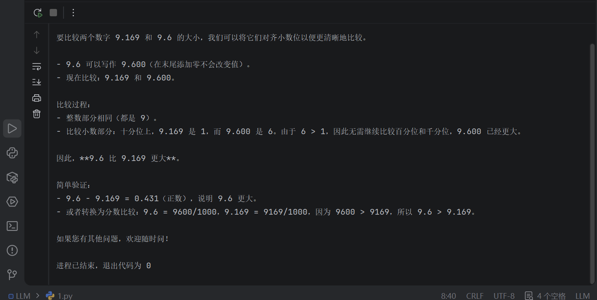
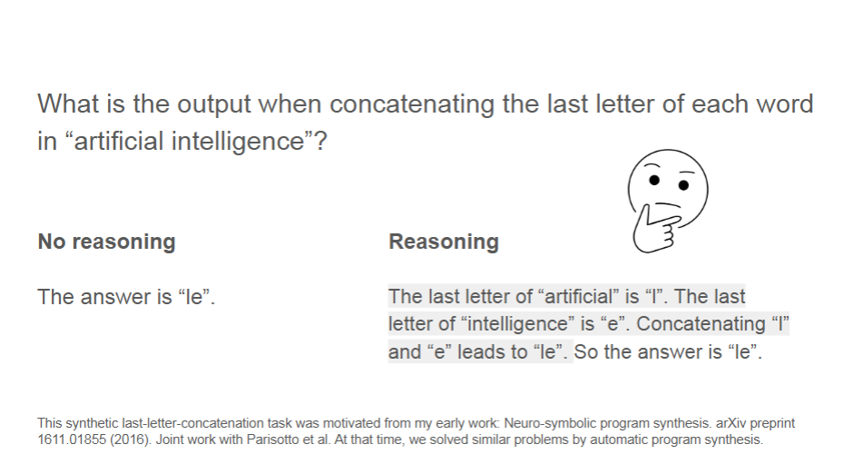
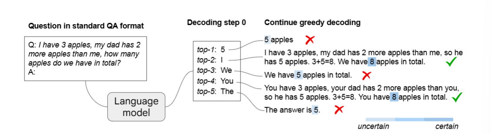
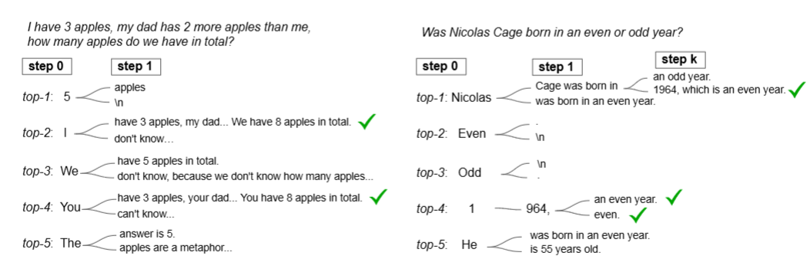
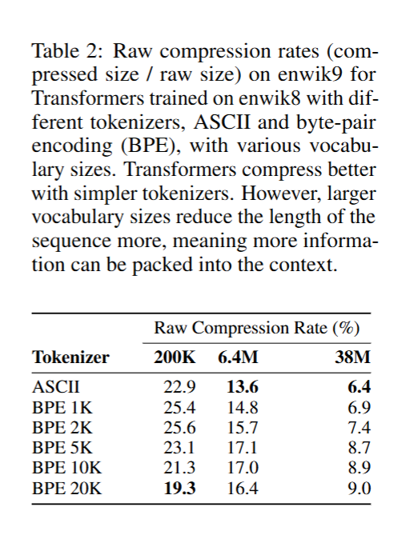
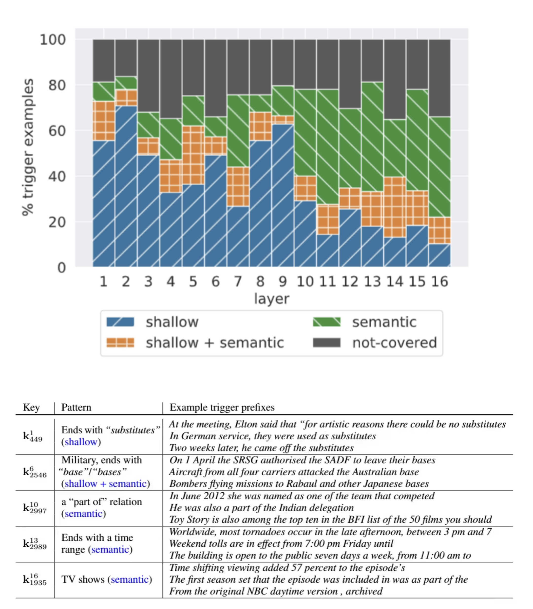
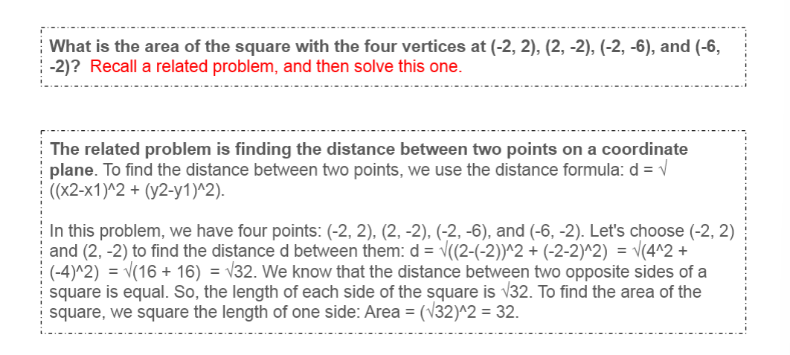
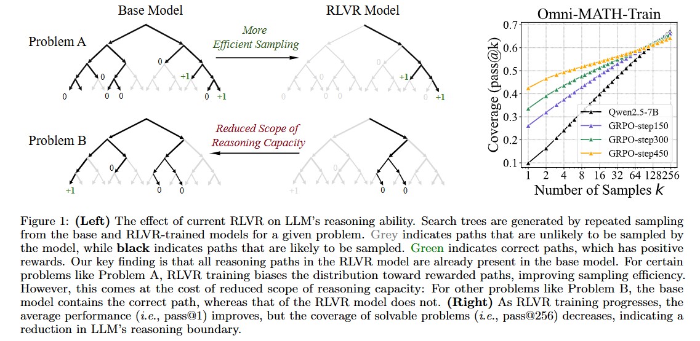

# 第 16 章 什么是LLM推理？

当我们在日常使用大语言模型（LLM）时，无论是进行简单的聊天，还是让其协助解决问题，模型通常都会给出一个看起来较为完整且逻辑清晰的回答过程。然而，这也让不少小伙伴产生一个疑问：当我们提出一个复杂问题时，模型经过一定“思考”后给出较为严谨的推理过程是可以理解的；但在面对一些人类几乎可以一眼得到答案的简单问题时，模型有时依然会花费较长的“思考时间”。

最近几天引发大家广泛关注的几个典型例子有：
- Anthropic的[Claude独立使用仅31步骤](https://www-cs-faculty.stanford.edu/~knuth/papers/claude-cycles.pdf)攻克了算法祖师爷Donald Knuth花了数周时间研究的未解的图论猜想问题；
- 与此同时，Google Research团队在今年3月6日发布了[一篇论文](https://arxiv.org/pdf/2603.04735)，利用Gemini Deep Think结合树搜索框架解决了理论物理中的一个开放难题。

由此也让我联想到，在今年2月，Google DeepMind推出的AI数学家*Aletheia*已经能够自主独立解决[研究级别的数学问题](https://arxiv.org/abs/2601.23245)。可以说，在今年开年以来，LLM在数学与物理领域可谓是“*双开花*”。

与这些令人惊叹的复杂问题求解能力形成对比的是：当我们向LLM提出一些非常简单的问题，比如基础的数值比较或直观判断时，模型却往往仍然会展开一段较为复杂的推理过程。

<div align="center">
  
  <p><em>图 1. 调用大模型的API实现</em></p>
</div>

*问题是比较9.169和9.6哪个数字更大？*

那么，这种现象背后的原因究竟是什么呢，这到底意味着**LLM已经真正涌现出了智能推理能力**，还是仅仅是在进行更复杂的“模式匹配”？为了理解这个问题，我们可以从以下五个方面进行分析：

## 1 本章学习目标

通过这五个角度的分析，我们可以从不同角度理解**LLM“思考”能力的来源与本质**：

- 预训练阶段得到的LLM本身具备怎样的问题处理能力，以及其在解决问题能力来源会是什么？
- CoT（Chain of Thought）对LLM推理能力的影响如何？
- Prompt模板设计是否能够有效引导模型进行更具逻辑性和结构化的推理？
- SFT、RLHF、RLVR等后训练对模型推理能力的影响如何，这些对齐与强化技术如何改变模型在复杂问题上的表现？
- 大模型与搜索或外部工具结合后的能力提升，其解决复杂问题的能力会怎么变化？


---

## 2 预训练

我们或许会对预训练完成的LLM普遍持有这样一种看法：如果不经过进一步的提示工程或微调，模型在回答问题时往往直接给出最终答案而不展示中间推理过程，由此认为其不具备推理能力。

<div align="center">
  
  <p><em>图 2. 无推理与推理的对比</em></p>
</div>

然而，Denny Zhou提出了一个不同的观点——预训练大模型实际上已经具备推理能力了，只是在默认的**贪婪解码**（greedy decoding）方式下能力未被充分展现。

**换言之，问题不在于模型*缺乏*推理能力，而在于我们需要通过合适的解码策略**。

### 2.1 预训练阶段中潜在推理能力的形成

这个现象最早在 [Yue 等人（2025）的研究](https://arxiv.org/pdf/2504.13837)中被系统观察到。该工作对 Qwen、LLaMA 等基础模型，以及它们经过强化学习（RLVR）微调后的版本进行了对比实验。结果发现了一个有趣的规律：**当采样次数 k 较小时**，强化学习模型的 *Pass@k* 明显高于基础模型；但**随着 k 不断增大**，基础模型的 *Pass@k* 会逐渐追上强化学习模型，在部分任务上甚至出现反超。

<div align="center">
  
  <p><em>图 3. 基础模型及其经 RLVR 训练的变体在多个数学基准数据集上的 Pass@k 曲线</em></p>
</div>

**这一现象说明什么？**

一个合理的解释是：**基础模型经过大规模预训练后，往往已经具备了解决部分复杂问题所需的知识和潜在推理能力**，只是对应的正确推理轨迹在输出分布中的概率较低，因此普通采样很难命中。

在这种情况下，强化学习微调的重要作用并不一定是从零创造能力，而是**重新塑造基础模型的行为分布**——使原本存在但难以被采样到的有效推理路径获得更高概率，从而在较小采样次数（小 $k$）下表现出更高正确率。

> **留一个思考**：强化学习微调是否只能进行概率重分配？在后面讲到后训练部分时会分析这个问题，到时候会有一个完整的回答。

还可以从另一个角度得到印证，**即便完全绕开 RL 微调**，仅靠解码策略的调整，同样能激发出基础模型中潜藏的推理能力。Denny Zhou 等人提出的 *Chain-of-Thought Decoding*正是基于这一思路：在**未经过任何微调**的基础模型上，通过多路径解码与置信度筛选的策略，就成功激发出模型在解决复杂推理问题时的中间思考过程，并显著提升了推理表现。

综合来看，**大规模预训练后的 LLM，其隐空间中已经蕴含了一定程度的推理能力**；强化学习微调，很大程度上是在影响这些潜在能力能否被稳定地激发出来。

那么，*解码策略究竟是如何影响推理能力展现的？这正是我们接下来要分析的问题*。

### 2.2 解码策略影响推理能力的展现

在大语言模型推理能力的研究中，[Denny Zhou等人在2024年研究中](https://arxiv.org/pdf/2402.10200)指出，解码策略会显著影响模型推理能力的表现形式，当采用贪婪解码时容易导致最终答案错误。

<div align="center">
  
  <p><em>图 4. 预训练模型的CoT解码示意图。预训练大语言模型无需提示即可进行内在推理，其方式是考虑备选的前k个解码路径，而非仅依赖前top-1的贪心解码路径</em></p>
</div>

*其中图4的答案颜色越深表示该模型对解码的最终答案置信度越高。*

当通过采样生成 $k$ 条候选推理路径时，可以观察到模型在不同生成轨迹中探索到不同的中间推理过程，其中往往包含能够得到正确答案的推理路径。这表明即使是仅经过预训练的LLM，其参数空间中也可能已经隐含了解决问题所需的推理能力，只是在单一路径解码时未被成功展示。意味着，改变模型推理的解码方式也可以从预训练模型中提取出思维链推导。

**贪心解码策略**

在大语言模型的自回归生成token过程中，贪心解码策略会在每一步都选择当前条件概率最大的词（token）。这种策略本质上是局部最优搜索，也就是每一步都是选择最大化概率：

$$
\arg\max P\bigl(x_t \big| x_{i{\text{<}t}}\bigr)
$$

但是其无法预见后续路径的概率分布，容易错过全局联合概率最大的序列。

比如，采用贪婪解码的LLM进行两步推理生成，词汇表中有A、B、C、D四个候选token，目标是到C或D：

**条件概率分布为：**

**第1步（起点）：**

| 候选token | 概率 $P(x_1)$ |
|---------|------|
| **A**   | **0.6** |
| B       | 0.4  |

起点有两个主要选择，我们观察从A或B出发后，第2步的概率分布：

① **若已选A（从A出发）：**

| 候选token | 概率 $P(x_2 \mid A)$ |
|---------|------|
| **C**   | **0.6** |
| D       | 0.4  |

② **若已选B（从B出发）：**

| 候选token | 概率 $P(x_2 \mid B)$ |
|---------|------|
| C       | 0.05 |
| **D**   | **0.95** |

**贪心解码过程（局部最优策略）：**

1. **Step 1**：在A和B中选概率最大的 $\to$ **A（0.6）** （因为 0.6 > 0.4）
2. **Step 2**：从A出发，在C和D中选概率最大的 $\to$ **C（0.6）** （因为 0.6 > 0.4）

贪心路径的联合概率：

$$P(A \to C) = 0.6 \times 0.6 = \mathbf{0.360}$$

**对比全局所有等长路径：**

| 生成路径 | 联合概率计算 | 结果 |
|------|------|------|
| **A → C** (贪心路径) | $0.6 \times 0.6$ | $0.360$ |
| A → D | $0.6 \times 0.4$ | $0.240$ |
| B → C | $0.4 \times 0.05$ | $0.020$ |
| **B → D** (全局最优) | $0.4 \times 0.95$ | $\mathbf{0.380}$ |

```text
结论：
B → D（0.380） > A → C（0.360）
 
贪心解码失败的原因暴露无遗：第一步的局部最优（选了概率为0.6的A）直接锁死了后续路径，导致它永远无法触及第二步中隐藏的极高概率节点（条件概率高达0.95的D），最终给出的生成序列并非全局最优。这就是束搜索（Beam Search）等全局优化算法需要被引入的原因。
```

LLM推理中，**贪心解码**虽然因为其低延迟特性被广泛应用，但极易陷入局部最优的陷阱。Denny等人的研究表明，正确的推理路径往往潜藏在解码每一步的 $Top-k$ 候选空间内，而非必然由每一步的局部最高概率标记（Token）所构成。为此，他们提出**多路径CoT解码**（可理解为多路径思维链解码），旨在弥补单一贪心路径在处理复杂逻辑任务时的稳定性缺失。

**多路径的CoT Decoding策略**

<div align="center">
  
  <p><em>图 5. 预训练PaLM-2 Large模型上的第一个解码步骤示例，模型对答案（加粗显示）的置信度以蓝色突出显示</em></p>
</div>

*其中k表示在第一个解码步骤中第k个标记的选择*

在图4中，LLM第一个解码步骤中的 $Top-k$ 标记解码还是首选的标记选择是使用贪心解码（ $k =0$ ）。在每一步的 $Top‑k$ 候选标记（tokens） 中，隐藏着更丰富的推理链条，其中一些路径包含更清晰、逻辑更连贯的推理步骤。该研究通过分析这些 $Top‑k$ 候选项，其实对于类似于 $k \neq 0$ 有明显的思维链结构（CoT）的回答得到的结论，模型通常会有更高的置信度。

<div align="center">
  
  <p><em>图 6. CoT解码过程演示，每一步解码步骤中考虑多条解码路径</em></p>
</div>

**多路径 CoT Decodeing 的核心在于在每一次解码过程中生成多个候选token，从而形成多条并行的候选推理路径，并在路径级别通过 logits 或其他评分指标选出最有可能形成连贯推理链的路径**。对于希望零训练地挖掘预训练 LLM或其他阶段 LLM 的潜在推理能力而言，多路径 CoT Decodeing 是一种非常有效的方法，因为它能够充分利用模型已学到的链式思维模式。

笔者个人认为，这个方法的美中不足在于——虽然能够比其他解码方式更全面地展现模型潜在推理能力，但由于其**多路径搜索机制需要同时维护和评估多条候选路径**，因此*在内部计算过程中可能消耗更多token的分析和处理资源*（但最终输出token数未必增加）。

---

### 2.3 LLM 问题求解能力的来源

如果上述解释成立，那么一个更有意思的问题就随之出现了：大语言模型在解决问题时所表现出的能力，究竟可能来自哪里？接下来，我们将从理论与实验两个角度，一起探讨 LLM 问题求解能力可能的来源。

---

**从理论层面看**

从本质上看，大语言模型是一种概率模型。在预训练阶段，模型通过对海量文本数据进行学习，估计 token 与 token 之间的统计规律，从而能够在给定上下文的情况下预测下一个最可能出现的 token。

<div align="center">
  
  <p><em>图 7. 不同大小均为 1GB 的数据集上的压缩率（压缩大小/原始大小），值越小越好。对于神经网络模型而言，原始压缩率不考虑参数大小，而调整后的压缩率则将参数大小计入压缩大小</em></p>
</div>

*图7来自 Delétang 等人（2023）的研究。实验将序列预测器（Transformer、Llama 2、Chinchilla）通过算术编码用作无损压缩器，并与传统压缩算法进行对比。结果表明，针对特定数据集从头训练的小型 Transformer 容易过拟合，压缩性能有限；而在通用语料上预训练的大型语言模型，反而是跨数据集的优秀通用压缩器。这一结果印证了"**语言建模即压缩**"的观点。*

在预训练过程中，语言模型通常以**最小化交叉熵损失**作为优化目标。该目标在信息论中具有明确含义：当模型的预测分布逐渐逼近真实数据分布时，交叉熵的最小化等价于提高模型对数据的编码效率。这一观点可以追溯到香农（Claude Shannon）所提出的信息论框架：**如果能够更准确地预测符号出现的概率，就能够以更接近最优的方式对信息进行编码。**

> **为什么预测符号出现的概率越准确，就能够以更接近最优的方式对信息进行编码**？
>
> 假设真实分布是 $p(x)$ ，模型预测分布是 $q(x)$ 。最优前缀编码的基本思想是符号 $x$ 的理想编码长度满足 $L(x) \approx -\log_2 p(x)$ ，即符号出现的概率越大，编码长度越短。信息源理论上平均每个符号的最小编码长度由信息熵给出： $H(p)=-\sum p(x)\log_2 p(x)$ 。实际应用中，若按模型预测分布 $q(x)$ 进行编码，平均编码长度即为交叉熵：
> $$H(p,q) = -\sum p(x)\log_2 q(x)$$
>
> 且有：
> $$H(p,q) = H(p) + D_{KL}(p \| q)$$
>
> 当 $q(x)$ 越接近 $p(x)$ ， $D_{KL}$ 散度越小，实际平均编码长度 $H(p,q)$ 就越逼近理论最优 $H(p)$。

*因此，从信息论视角来看，语言建模任务可以被视为对自然语言分布的估计过程，其目标是在**统计意义上逼近文本数据的最优编码**。*

<div align="center">
  
  <p><em>图 8. 分词器、BPE、词表大小和压缩率的相关研究</em></p>
</div>

从表征学习的角度来看，神经网络在训练过程中并不是简单地记忆数据，而是在有限参数容量的约束下，不断从数据中提取稳定结构，并将其**压缩为更加抽象的内部表示**。*因此，模型参数可以被视为对训练数据统计规律的一种高度浓缩的编码。*

作为一种形象的类比，**这一过程与生物进化中的信息编码存在一定相似性**。DNA 并不会记录个体一生中遇到的全部环境信息，而是在长期演化过程中，将那些与生存相关的重要规律以高度紧凑的形式编码在基因序列中。大语言模型同样如此——预训练过程中，模型无法存储海量语料的全部细节，而是逐渐将语言、知识以及世界结构中的统计规律压缩进分布参数空间，形成刻画数据分布的内部表示。

因此，从理论层面来看，LLM 的预训练过程并不仅仅是在学习下一个 token 的预测任务，更是在有限参数容量约束下，对海量数据中的潜在结构进行压缩与建模。这一压缩过程的关键并不在于压缩本身，而在于压缩过程中所形成的**抽象表征**——正是这些表征，使模型不仅能够复现训练数据中的模式，还能够在未见过的新问题上进行一定程度的泛化与推理。

**从实验中观察**

理论层面的分析提供了一种解释框架，但神经网络是否真的能够从数据中自动提取抽象结构？这一问题在早期曾引发过争议。20 世纪 80 年代，符号主义学派普遍认为：神经网络内部缺乏显式的结构表示，因此难以对输入信息形成抽象的概念表征。

然而，[Geoffrey Hinton 等人的经典实验](https://www.cs.toronto.edu/~hinton/absps/naturebp.pdf)直接挑战了这一观点。研究者构建了一个包含人物及其亲属关系的家谱数据集，并训练一个简单的多层神经网络，使其根据输入的人物与关系预测目标人物：

$$(Person, Relation) \rightarrow Target\ Person$$

模型训练完成后，研究者分析了隐藏层的激活模式，发现这些隐藏单元并非随机工作，而是自发地捕捉到了任务中的潜在结构——一些单元对人物的性别或国籍有较强响应，另一些则能区分不同的家族分支。这表明**神经网络能够通过反向传播自动从数据中提取潜在结构，并以分布式表征（distributed representation）的形式加以存储**：抽象概念并非以单一符号的形式编码，而是由多个神经元的联合激活模式共同表示。

这一思想为后来的表示学习和分布式嵌入（embedding）奠定了基础。现代大语言模型本质上仍依赖类似机制：**通过梯度优化不断调整网络参数，使隐藏层逐渐形成能够捕捉数据结构的内部表示**。

在 Transformer 架构中，这一机制的具体实现可以从 [Mor Geva 等人（2021）](https://aclanthology.org/2021.emnlp-main.446/)对前馈神经网络（FFN）的研究中得到更清晰的认识。

<div align="center">
  
  <p><em>图 9. 从实验中观察</em></p>
</div>

研究者将 FFN 层中的神经元视为一种 **"键值记忆结构（key-value memory）"**，通过寻找能够强烈激活每个神经元的输入前缀，并对其进行人工语义标注，分析不同层神经元所捕获的语言模式。实验结果表明：

- **较浅层（如 1–9 层）** 的神经元通常被**表层语言模式**触发，例如固定短语、词形模式或常见的局部上下文结构；
- **较深层（如 10–16 层）** 的神经元则更容易对**抽象的语义或语法特征**产生响应，例如语义关系、实体类型或特定语境模式。

结合对 Attention 机制的研究，可以从以下角度理解 Transformer 的工作机制：

- Attention 主要负责计算 token 之间的相似度，并以此进行上下文信息的加权聚合（Information Routing）；
- FFN 则负责重组和加工这些来自 Attention 的上下文信息——*浅层捕获表层模式，深层提炼抽象语义*。

**两者之间通过残差连接协同作用，使每一层在保留已有表示的基础上进行增量更新，模型的表示随层数加深而不断被细化**（refinement），最终形成合理的 token 预测概率分布。

值得一提的是，DeepSeek-R1 所基于的 V3 架构采用了混合专家模型（MoE），即以多个 FFN 专家替代单一 FFN。每个专家执行与普通 FFN 相同的非线性信息加工功能，区别在于来自 Attention 的信息需经过路由门控网络，选择性地分配给 $Top\text{-}k$ 个专家进行处理。*（例如 DeepSeek-V3 共有 256 个专家，但每个 token 仅激活其中 8 个，这使得模型总参数达 671B，而实际激活参数仅 37B，从而显著降低了计算成本）* 这一架构设计进一步印证了 FFN 作为"记忆存储单元"的角色——MoE 通过专家分工，使不同专家能够专注于不同类型的语言模式，从而在不成比例增加计算量的前提下扩大了模型的知识容量。

**除了提取抽象模式之外**，研究也发现模型在某些情况下会记住训练数据中的具体片段。研究人员通过特定提示策略，从一些大型语言模型中生成出了与《哈利·波特》系列文本高度相似的大段内容，相似度在某些情况下甚至超过 90%。

然而，*如果 LLM 仅仅是一台"复读机"，它依然无法解决未见过的复杂问题*。Denny Zhou 团队的一项研究清晰地展示了这一点：当直接要求*过去顶尖的大语言模型*求解一道复杂的几何计算题时，模型通常会失败；但如果在提示词中加上一句"*回忆一个相关的几何问题，然后解决当前问题*"，模型就能给出正确解答。团队将这种通过引导模型自主生成相关背景知识来辅助当前推理的方法称为[LLM 的类比推理](https://arxiv.org/pdf/2310.01714)。

<div align="center">
  
  <p><em>图 10. 类比推理</em></p>
</div>

这一现象说明，真正赋予 LLM 问题求解能力的，是模型参数在记忆字面文本之外，还隐式地压缩并内化了深层的结构化知识和解题模式——而巧妙地唤醒这些抽象模板，正是大模型发挥推理能力的重要途径。

综合理论与实验来看笔者认为一种合理的观点：LLM 的推理能力或许并非来源于单一机制，而是**记忆（Memorization）与泛化（Generalization）协同作用的结果**：前者使模型能够存储和调用具体的知识片段，后者则使模型在面对新问题时，能够基于其内化的结构化模式进行类比和推断。

> 当压缩比超过某个临界点时，模型不再能通过简单记录来降低*交叉熵损失*，而必须通过捕捉世界的运行逻辑（如数学规则、因果关系）来节省参数空间。**这种从"量变（数据堆砌）"到"质变（逻辑涌现）"的过程**，或许正是 LLM 求解能力真正形成的关键所在。

---

## 3 后训练

在 2025 年一项关于后训练的研究中，研究者对不同规模的模型分别进行了基于强化学习（RL）的后训练（使用 LoRA 实现参数高效更新），发现以规模更大或能力更强的 LLM 作为基座模型，后训练效果往往更好。对此给出的解释是：**RL 依赖基座模型提供足够好的策略初始化（先验能力）**——如果基座模型本身能力不足，RL 便难以在其基础上探索到更合理的推理轨迹，后训练的收益也因此有限。

<div align="center">
  
  <p><em>图 11. 后训练</em></p>
</div>

在 Yue 等人的研究、李飞飞团队针对 Qwen 系列模型的 1000 条高质量数据微调研究，以及 DeepSeek-R1 的技术报告中，研究者们得出了一个共同的结论：尽管经过 SFT（监督微调）或 RL（强化学习）等后训练过程，LLM 在解决具体任务时的表现有显著提升，但这**基本没有**为模型注入新的基础知识或提升其绝对能力上限。**对于已完成预训练的 LLM 而言，后训练本质上是对预训练阶段所积累潜能的"激发"与"对齐"**——预训练构筑了模型能力的基石，而后训练让这些内化的能力以更符合人类预期或逻辑规范的方式展现出来。

这也为我们在 1.1 节留下的问题提供了一个初步回答，上述研究倾向于认为是的——RL 的收益主要来自对已有潜在能力的激发，而非注入新能力。然而，越来越多的研究对此提出了补充：尤其是在自身的概率分布外任务（OOD）或需要持续探索的环境中，奖励信号可能引导模型发现预训练阶段未被充分利用解决问题的方式，*并在部分任务上获得超出原有行为分布的性能提升*。因此，RL 微调的收益未必完全来自能力”激发“，也可能部分来自**新的行为或推理策略**的形成。

> 也有观点认为**蒸馏**能够将教师模型已经学到的知识、推理轨迹和行为模式高效迁移给学生模型，从而使学生模型在有限参数规模和训练预算下获得超过直接 RL 后训练的效果。DeepSeek-R1 的实验结果表明，对于当前规模的小模型而言，利用 R1 生成的推理轨迹进行蒸馏，通常比让小模型从零开始通过强化学习探索更有效。这说明蒸馏能够显著提升能力迁移效率。

*不过，无论是蒸馏还是其他办法，其效果本质上应该会受制于预训练所奠定的能力基础——学生模型必须具备足够的表征能力（学生模型的容量足够），才有可能真正“接住”额外的知识（OOD）。*

---

### 3.1 后训练的办法

后训练的办法主要包括监督微调（SFT）、强化学习（RL）、知识蒸馏（Distillation）等。

**一些常见的具体后训练方法描述可以参考[diy-llm第十四章可验证奖励的强化学习](https://datawhalechina.github.io/diy-llm/#/./chapter14/chapter14_%E5%8F%AF%E9%AA%8C%E8%AF%81%E5%A5%96%E5%8A%B1%E7%9A%84%E5%BC%BA%E5%8C%96%E5%AD%A6%E4%B9%A0)，这里就不再详细展开描述了。**

在RL微调过程中，若使用AI验证器（奖励模型）动态地为模型输出提供奖励信号（核心为：直接优化目标对象），则极有可能出现奖励欺骗（reward hacking）现象——即模型学会利用奖励模型的漏洞获取高奖励，而非真正提升输出质量。目前，缓解这一问题的一种方法是在优化目标中引入 $D_{KL}$ 散度惩罚项，以约束微调后的策略分布与原始参考策略分布之间的偏离程度。

> 由基础模型强化学习微调得到DeepSeek-R1的过程中，模型能学会”自我反思修正错误“的推理步骤等一些有助于推理的新能力，从而提升了模型的表现能力。

---

## 4 CoT

随着各种具备强大Agent能力的应用不断涌现，比如最近火遍全球的“养龙虾”。LLM的API账单却出现了明显的逆势增长，一方面这是因为Agent在执行复杂任务时需要频繁调用模型，并不断叠加历史上下文；另一方面，还有一个隐藏在背后的“吞金兽”——越来越长、甚至逐渐失控的思维链。

CoT 最早由 Jason Wei 等人在 2022 年的论文《Chain-of-Thought Prompting Elicits Reasoning in Large Language Models》中提出。研究表明，通过让模型在回答问题时显式生成中间推理步骤，可以显著提升其在数学推理和复杂问题上的表现。由于效果显著，CoT 很快成为大语言模型研究中的重要方向，也引发了大量后续工作。

> 在随后的研究中，不少工作开始尝试在后训练阶段通过优化奖励函数，鼓励模型生成更长、更详细的思维链，以期进一步提升模型的推理能力和任务表现。*然而，这也带来了一个值得深入思考的问题：思维链越长，LLM 的表现真的就越好吗？*

<div align="center">
  
  <p><em>图 12. (a) 一个 6 层 GPT-2 模型在不同难度级别的算术任务上的表现呈倒 U 形曲线，随着任务难度增加，准确率峰值向更长的思维链长度偏移；(b) 使用在 LeetCode-2K 数据集上经 GRPO 训练的 Qwen2.5-7B-Instruct，随着 RL 训练轮次推进，推理准确率与思维链长度的变化趋势。</em></p>
</div>

2025 年，[北大团队为这一现象提供了更精确的刻画](https://arxiv.org/pdf/2502.07266)。他们通过控制实验构造了不同长度的推理链，并在多个难度梯度的任务上绘制出长度—准确率曲线。结果发现，**思维链长度与最终准确率之间呈倒 U 型关系：在一定范围内，随着思维链长度增加，模型表现稳步提升；然而一旦超过某一最优长度阈值，性能增益便趋于饱和，甚至出现显著下降。**

对此，一个合理的解释是：CoT 本质上充当了 LLM 解题过程中的"草稿纸"。适度延长推理步骤，使模型能够在中间过程中进行自我修正，从而提升一致性。但当这一过程过度拉长时，**基于 Transformer 架构的 LLM 会受到有限上下文窗口的制约——长距离依赖下注意力被不断稀释，关键信息逐渐被遗忘**，模型反而陷入反复修改却无法收敛的"恶性循环"，最终导致犯错误率上升。

那么，什么样的 CoT token 才算真正有效？2026 年 2 月，Google 研究团队在论文 [Think Deep, Not Just Long](https://arxiv.org/pdf/2602.13517) 中提出了推理度量指标—— *DTR（Deep Thinking Ratio）*，尝试从模型内部计算的角度回答这一问题：在模型生成推理过程时，究竟有多少 token 真正参与了深层计算？

<div align="center">
  
  <p><em>图 13. DTR 与解题准确率的关系</em></p>
</div>

具体而言，研究者通过分析 **Transformer 各层对同一 token 的预测分布变化**来判断该 token 的"收敛层"。如果某个 token 的预测在浅层就已经基本稳定，则被视为**浅层 token**；如果预测分布直到较深层仍持续发生明显变化，才在后期趋于稳定，则被标记为 **deep-thinking token**。DTR 即为生成序列中这类 token 所占的比例。

实验结果表明，**DTR 与模型的任务准确率呈明显正相关**：当模型在生成过程中产生更多需要深层计算才能确定的 token 时，往往更容易得到正确答案。这一发现揭示了一个关键区分：**"推理长度"（reasoning length）≠"推理深度"（reasoning depth）**。推理链中可能包含大量在浅层即可确定的 token——例如语法结构、填充词或模式化表达——这些 token 虽然增加了文本长度，但并未增加模型的实际计算深度。

不过需要注意的是，DTR 本质上是一个**统计性指标**。在真实推理过程中，浅层 token 与深层 token 往往共同构成完整的推理结构：前者负责组织语言结构，后者承担关键的计算与推断。*有时候，浅层的 token 也可能是解决问题的关键。* 因此，如果未来尝试利用 DTR 来控制或优化 CoT 推理，还需要结合更多维度的信息，例如推理过程中的**注意力分布、token 不确定性或推理路径一致性等指标**，从而更全面地提升 CoT 的**有效性**。

从上述分析来看，CoT 对 LLM 推理能力的影响，*核心并不在于"链条有多长"*，而在于它是否真正增加了模型处理问题时的**有效计算步骤**——过短的推理链让模型没有足够空间展开中间过程；过长的推理链则引入大量浅层 token，稀释了真正的推理密度。

---

## 5 Prompt引导

Prompt的设计包含许多实用技巧。通过合理运用这些技巧，用户往往可以更充分地激发大语言模型（LLM）在问题求解、分析与生成任务中的潜在能力，从而提升交互体验和输出质量。参考OpenAI的提示词工程指南以及其他开源实践，下面介绍几种常见且实用的Prompt编写技巧：

- **明确任务目标**
在Prompt中清晰地描述任务要求，包括任务类型（如问题求解、文本生成、代码编写等）、输入信息以及期望的输出形式。例如，可以明确要求“以列表形式输出”或“给出逐步推理过程”。清晰的任务指令能够帮助模型更准确地理解用户意图，从而生成更符合预期的结果。

- **提供必要的背景信息**
当任务涉及特定领域知识时，可以在Prompt中补充相关背景信息。例如，在解决数学问题时，可以说明问题类型（如代数、几何等），或者提供相关公式与概念。需要注意的是，背景信息应尽量简洁，可以采用关键词或要点式描述，避免Prompt过长。*（过长的提示不仅可能接近模型的上下文窗口限制，还可能稀释模型的注意力，从而影响任务理解效果）*

- **引导模型进行分步推理**
对于需要复杂推理的问题，可以在Prompt中加入引导语句，例如“请逐步推理解决以下问题”等，这种方法可以鼓励模型生成更加完整的推理链，从而提升复杂问题的求解能力。在许多数学推理和逻辑推理任务中，这种方式往往能够显著提高模型表现。

- **合理使用分隔符与结构化提示**
通过换行符、编号列表或特殊分隔符（如 `---`、`###` 等）将Prompt中的不同部分进行清晰划分，可以帮助模型更好地理解输入结构。例如可以将Prompt拆分为任务描述、输入内容、输出要求等，这种结构化的提示方式可以显著提高Prompt的可读性，同时帮助模型更准确地解析任务信息。

- **减少模糊描述**
在编写Prompt时，应尽量避免使用模糊或不确定的表达，例如“稍微增加”“适当减少”“多一点”等词语，而应使用更加具体的描述。例如可以直接给出字数范围、输出格式、示例结果等，明确的约束能够减少模型理解上的歧义，从而提高生成结果的稳定性。

- **提供示例**
在Prompt中提供一到多个示例输入与对应输出，可以帮助模型更好地理解任务模式。这种方法被称为少样本提示。

例如：

```text
输入：苹果
输出：水果

输入：胡萝卜
输出：蔬菜
```

通过这种示例模式，模型能够更容易学习到任务的映射关系，从而生成更加符合预期的结果。

- **角色提示**
在Prompt中为模型设定一个特定角色，例如：“你是一名经验丰富的数学老师”、“你是一名专业的软件工程师”等这种方式能够在一定程度上引导模型生成更加符合特定领域风格的回答。在实际应用中，这种方法常被用于技术问答、写作辅助以及代码生成等场景。

- **约束输出格式**
如果任务需要结构化结果，可以在Prompt中明确规定输出格式，例如`JSON`、`表格`、`Markdown`等，明确的格式约束可以降低模型输出的不确定性，同时也更方便后续程序进行解析和处理。

尽管通过这些设计Prompt技巧是一种较为直接的方法，可以帮助用户根据具体需求引导LLM生成更符合预期的结果，但这种方式仍然存在一定的局限性：

- 一方面，高质量Prompt的编写往往依赖于用户对任务本身以及模型能力的理解，因此在一定程度上需要用户具备相关的先验知识。例如，当用户能够在Prompt中提供问题的分析思路、关键步骤或示例时，模型通常更容易在此基础上生成更加准确和完整的回答；
- 另一方面，在缺乏清晰任务描述或有效提示信息的情况下，模型虽然仍然可以尝试给出答案，但生成结果的稳定性和质量往往会受到一定影响。

**因此，Prompt设计在提升LLM解决问题的表现同时，也在一定程度上对用户的提示词构建提出了先验要求。**

---

## 6 外部工具搜索增强

<div align="center">
  
  <p><em>图 14. 外部搜索工具+LLM</em></p>
</div>

通常情况下，在LLM完成训练之后，其模型参数便不再发生变化，这意味着模型在预训练阶段所学习到的知识在一定程度上是静态的。由于预训练数据往往具有时间滞后性，模型可能无法直接获取最新的信息。因此，在实际应用中，往往需要通过调用外部工具来补充实时数据。例如，当用户询问“今天的天气如何？”时，LLM本身并不具备实时获取天气信息的能力，而是需要通过调用外部搜索或API接口（如天气服务或搜索引擎）来获取最新数据，再结合自身的语言理解与生成能力给出回答。

基于这一思路，近年来出现了一类结合“模型推理能力 + 外部工具调用”的系统。例如，*Gemini Deep Research和OpenAI Deep Research*等项目，通常会通过多轮搜索、信息筛选与综合分析等步骤，利用LLM的推理能力对检索到的信息进行整合，从而生成更加完整和可靠的研究型回答。

此外，研究者还提出了检索增强生成（RAG，Retrieval-Augmented Generation）等技术框架，通过在模型生成回答之前先从外部知识库中检索相关文档，并将检索到的信息作为上下文输入模型，从而在不改变模型参数的情况下增强其知识获取能力。这种方法能够有效提升模型在特定领域任务中的准确性，并减少因模型知识过时或幻觉（hallucination）带来的问题。

```text
从某种意义上看，这类方法可以被理解为通过“外部记忆”和“工具调用”扩展大语言模型的能力边界，使其不再仅依赖于训练阶段所学习到的静态知识。
```

Denny Zhou在演讲的最后也提到一个观点：对于LLM解决问题的过程中，**外部工具检索 + 推理 > 仅推理**。

---

## 7 总结与测试题

### 7.1 课程总结

综合上述分析，可以从多个角度理解大语言模型推理能力的来源。在预训练阶段，模型通过对大规模语料进行语言建模，学习到丰富的统计规律与抽象表征，这一过程在一定程度上类似于对语言与世界知识的压缩与编码，从而为后续的推理能力提供基础。其次，在后训练阶段（如SFT、强化学习），模型的行为被进一步对齐与优化，不仅使其更稳定地调用预训练中习得的潜在能力，还能让模型习得新的推理策略（如自我反思、修正），从而实质性地增强推理表现。

以及在实际使用过程中，诸如CoT、Prompt引导以及多路径采样等方法，**通过将复杂问题分解为中间推理步骤，增加了推理时的计算量**，从而使模型能够解决超出单步前向传播能力的复杂问题。此外，通过检索增强或工具调用等方式，LLM可以获取外部实时信息，**弥补参数化知识在覆盖范围和时效性上的不足，为推理过程提供更准确的前提条件**，从而间接提升复杂任务的解决效果。

从已有研究可以看出，我们需要从预训练阶段改善LLM的基础能力，而大语言模型能力的提升在很大程度上遵循[Scaling Law](https://github.com/datawhalechina/diy-llm/blob/main/docs/chapter9/chapter9_Scaling_Laws.md)：随着模型参数规模、训练数据规模以及计算量按合理比例协调扩展，模型的测试损失通常呈现出可预测的幂律下降趋势，从而带来整体性能的提升。然而，这一方法在实际应用中也面临一个重要挑战，即高质量人类文本数据的增长速度有限，模型训练逐渐接近可获取数据规模的上限。

针对这一问题，一些研究提出可以在预训练和后训练等多个阶段利用模型生成的合成数据来进一步扩展训练分布。在"持续进化 AI"相关研究中，模型可以通过生成新的训练样本，并结合筛选、评估或自我改进机制对这些样本进行迭代优化，从而在一定程度上缓解对人工标注数据的依赖。这一思路在**表面形式上类似于AlphaGo Zero的自我博弈训练机制**，但需要指出关键差异：AlphaGo Zero依赖于围棋规则提供的完美验证信号，而LLM面对的大多数开放性任务缺乏可靠的自动验证器，因此自我改进的效果受到验证信号质量的严重制约。 此外，这种方法还面临模型坍塌的风险——反复在自身生成的数据上训练可能导致分布收窄与质量退化，因此通常需要引入外部验证信号和数据质量筛选机制加以保障。总体而言，合成数据方法更多是在扩展训练分布和提高能力利用效率，或许LLM能够突破所有人类知识的上限。

> 如果要借鉴AlphaGo Zero的成功经验，关键在于构建可靠的验证机制，而非简单地"设计奖励函数"。具体而言：
>
> - 对于可验证问题（数学、代码），可以利用已有的客观验证器构建类似自我博弈的训练闭环，这已被证明有效（如DeepSeek-R1）；
> - 对于开放式问题，不存在完美的奖励函数，当前只能依赖不完美的替代信号（人类偏好、模型互评等），且必须警惕奖励黑客和模型坍塌的风险；

笔者个人的一个设想是，在后训练阶段可以较大比例地引入模型生成的合成数据来扩展训练样本空间。在这一过程中，初期可以通过人工审核或高质量模型评估的方式对合成数据进行筛选，以确保训练数据具有较好的质量和合理性，从而避免低质量样本对模型能力产生负面影响，而后续迭代过程中，则可以通过统计指标对生成数据的分布进行监控，例如利用 $D_{KL}$ 等分布差异度量来衡量合成数据与原始数据分布之间的偏移程度，从而避免生成数据在多轮迭代过程中逐渐偏离真实数据分布。通过这种“人工筛选 + 分布约束”的方式，或许能够在一定程度上缓解对人工标注数据的依赖，同时保持训练数据质量的稳定从而减少”模型坍塌“的概率。

> 这里有一个笔者困惑的问题，写到最后小伙伴们可以一起思考？
>
> LLM在预训练过程中，已经形成了一套自身独有的知识压缩方式与隐含推理范式，这套范式未必与人类的思维习惯一致，但它或许是为模型自身的架构天然优化的。基于这一认知，一个值得探索的思路是：在构造合成推理数据时，是否可以不必强制对齐人类风格的思维链，而是允许模型以其"原生"的方式进行推理，随后再通过对齐阶段将最终输出转化为人类可读的形式。这一思路的本质逻辑在于——与其在推理过程的每一步都迫使模型模仿人类的线性思考方式，不如先释放其内在的推理潜力，再在输出端加一层"翻译对齐"来弥合人机表达之间的鸿沟。毕竟，强行将模型的高维推理过程约束在人类自然语言的框架中，从信息论的角度思考这个过程的本质上是用一个低维度表示去瓶颈化一个高维过程。

---

### 7.2 测试题

1. 预训练阶段得到的LLM本身具备怎样的问题处理能力，以及其在解决问题能力来源会是什么？
2. CoT（Chain of Thought）对LLM推理能力的影响如何？
3. Prompt模板设计是否能够有效引导模型进行更具逻辑性和结构化的推理？
4. SFT、RLHF、RLVR等后训练对模型推理能力的影响如何，这些对齐与强化技术如何改变模型在复杂问题上的表现？
5. 大模型与搜索或外部工具结合后的能力提升，其解决复杂问题的能力会怎么变化？

## 参考资料

- [Google DeepMind团队Denny Zhou的LLM推理研究探讨](https://dennyzhou.github.io/LLM-Reasoning-Stanford-CS-25.pdf)
- [DeepSeek-R1的训练经验总结](https://arxiv.org/abs/2501.12948)
- [Does Reinforcement Learning Really Incentivize Reasoning Capacity in LLMs Beyond the Base Model?](https://arxiv.org/pdf/2504.13837)
- [On the Interplay of Pre-Training, Mid-Training, and RL on Reasoning Language Models](https://arxiv.org/pdf/2512.07783)
- [CoT多路径解码方法](https://arxiv.org/pdf/2402.10200)
- [Hinton等人研究的家谱实验证明神经网络内部可以抽象表征输入内容](https://www.cs.toronto.edu/~hinton/absps/naturebp.pdf)
- [Transformer中前馈层网络的探究](https://aclanthology.org/2021.emnlp-main.446/)
- [Extracting books from production language models](https://www.themoonlight.io/zh/review/extracting-books-from-production-language-models)
- [Google团队提出的类比推理](https://arxiv.org/pdf/2310.01714)
- [Mind Lab后训练RL微调Kimi-K2的研究](https://macaron.im/mindlab/research/building-trillion-parameter-reasoning-rl-with-10-gpus)
- [diy-llm第十四章可验证奖励的强化学习](https://datawhalechina.github.io/diy-llm/#/./chapter14/chapter14_%E5%8F%AF%E9%AA%8C%E8%AF%81%E5%A5%96%E5%8A%B1%E7%9A%84%E5%BC%BA%E5%8C%96%E5%AD%A6%E4%B9%A0)
- [过犹不及_理解大语言模型中的思维链长度](https://arxiv.org/pdf/2502.07266)
- [Google团队提出DTR指标！](https://arxiv.org/pdf/2602.13517)
- [OpenAI提示词工程指南](https://help.openai.com/en/articles/6654000-best-practices-for-prompt-engineering-with-the-openai-api)
- [Scaling law](https://github.com/datawhalechina/diy-llm/blob/main/docs/chapter9/chapter9_Scaling_Laws.md)
- [Stanford持续进化AI](https://zitongyang.github.io/slides/ZitongYang_defense_slides.pdf)
- [神经细胞自动机（NCA）生成非语言合成数据，用于语言模型的预预训练](https://arxiv.org/pdf/2603.10055)
- [序列预测器都可以作为压缩器](https://arxiv.org/pdf/2309.10668)
- [On Distinguishing Capability Elicitation from Capability Creation in Post-Training: A Free-Energy Perspective](https://arxiv.org/abs/2605.08368)
- [Claude独立使用仅31步骤](https://www-cs-faculty.stanford.edu/~knuth/papers/claude-cycles.pdf)
- [一篇论文](https://arxiv.org/pdf/2603.04735)
- [研究级别的数学问题](https://arxiv.org/abs/2601.23245)
