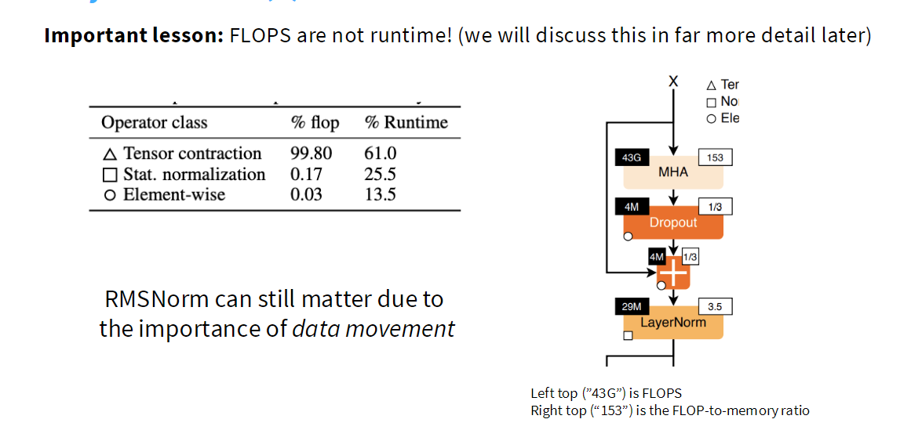
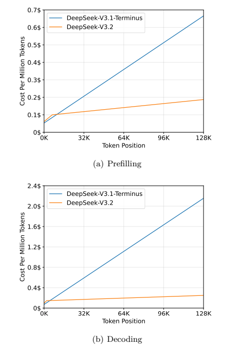
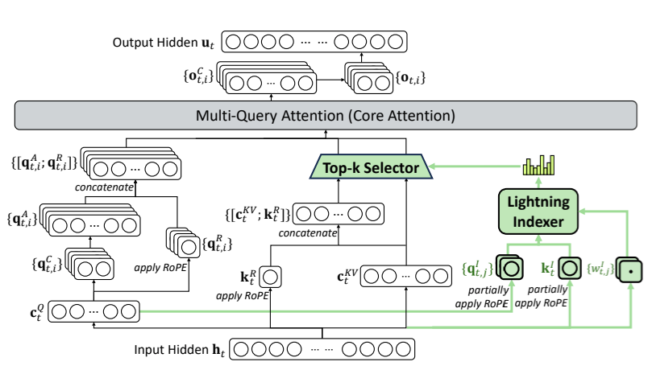

# 第 4 章 语言模型架构和训练的技术细节

transformer模型的起源可以追溯到2017年，当时由Google研究团队在论文[《Attention Is All You Need》](https://arxiv.org/abs/1706.03762)中首次提出。该模型的核心创新是引入了**自注意力机制**（Self-Attention Mechanism），摒弃了传统的循环神经网络（RNN）和卷积神经网络（CNN）结构。自注意力机制允许模型在处理序列数据时并行计算，从而大幅提高了计算效率，并解决了长距离依赖问题。

## 1 本章学习目标

在进入具体分析之前，我们先明确本节的关注重点。本节将围绕大模型的语言架构和训练技术展开，主要包括：

- 了解和快速回顾原始transformer论文中transformer的架构组成，各个组件的具体细节。
- 分析学习现代transformer各个组件的变体，包含注意力、归一化、位置编码等，以及它们的优势。
- 除了各种组件之外，各个组件的超参数选择也非常重要。

完成本章学习后，你将能够：系统理解Transformer的核心组件（位置编码、多头注意力、层归一化、残差连接、前馈网络），掌握现代语言模型的架构变体（激活函数、注意力变体、位置编码、归一化方法），并了解并学会运用超参数设计原则与稳定性技巧来分析和优化大规模语言模型的训练。

## 2 快速回顾标准的Transformer架构(如果熟悉transformer架构可以跳到标题三开始)

<div align="center">
  
  <p><em>图 1. transformer</em></p>
</div>

上述图中是 Transformer 的 Block 结构，左边是**编码器 Block**，右边是**解码器 Block**，编码器和解码器各堆叠 N 层就构成了 Transformer 结构。

### 2.1 位置编码(Positional Encoding)：正余弦位置编码

$$
\begin{align*}
PE_{(pos,2i)} &= \sin\left(\frac{pos}{10000^{2i/d_{\text{model}}}}\right) \\
PE_{(pos,2i+1)} &= \cos\left(\frac{pos}{10000^{2i/d_{\text{model}}}}\right)
\end{align*}
$$

**变量说明：**

$pos$：token在序列中的位置（0, 1, 2, ..., N-1）
$i$：维度索引
$d_{model}$：模型嵌入维度（论文中512）
$10000$：基础频率（可配置）
代入公式计算出位置编码后直接和词嵌入相加 $X = Token + PE(pos)$

正余弦位置编码是 Transformer 模型中为序列引入**位置信息**的关键设计。由于 Transformer 的核心是自注意力机制，它**本身不具备对输入顺序的感知能力**，如果直接将词向量输入模型，那么“我爱你”和“你爱我”会被视为相同的集合。为了解决这一问题，需要在输入中显式加入位置信息。正余弦位置编码是一种无需训练、通过固定公式生成的位置表示方式，其核心思想是利用不同频率的正弦和余弦函数，为序列中的每个位置生成一个唯一的、且具有相对位置关系感知能力的编码向量。

具体来说，对于序列中第 $pos$ 个位置（从 0 开始计数）和编码向量的第 $d$ 维（总维度为 $d_{\text{model}}$），我们定义维度配对索引 $i = 0, 1, \dots, \frac{d_{\text{model}}}{2} - 1$。编码值的生成规则如下：

当维度 $d$ 为偶数（即 $d = 2i$）时，使用正弦函数；当维度 $d$ 为奇数（即 $d = 2i+1$）时，使用余弦函数。值得注意的是，同一对中的偶数维和奇数维**共享相同的频率基数**。

计算公式为：

$$
PE_{(pos, 2i)} = \sin\left(\frac{pos}{10000^{2i / d_{\text{model}}}}\right)
$$

$$
PE_{(pos, 2i+1)} = \cos\left(\frac{pos}{10000^{2i / d_{\text{model}}}}\right)
$$

这里 $10000^{2i / d_{\text{model}}}$ 决定了不同维度上的波长，从而形成一个多尺度的编码体系：低维度（小 $i$）对应高频，可以精细区分相邻位置；高维度（大 $i$）对应低频，能够覆盖较远距离的相对关系。最终，每个位置都会得到一个与词向量维度相同的编码向量，二者相加后作为模型输入。

这种设计带来了几个显著的优势。首先，它完全确定，**无需额外参数**，避免了增加模型复杂度或引入训练中的位置嵌入过拟合问题。其次，通过三角函数的周期性，编码值被约束在 $[-1, 1]$ 之间，数值稳定，易于与词向量相加。更重要的是，它**天然支持相对位置的建模**：对于任意固定的偏移量 $k$，存在一个只依赖于 $k$、不依赖于 $pos$ 的分块对角矩阵 $M_k$，使得 $PE(pos+k)=M_k\cdot PE(pos)$。见 [《Attention Is All You Need》](https://arxiv.org/abs/1706.03762)。其几何含义是每一对 $(\sin,\cos)$ 维度在二维平面上发生一次旋转，旋转角度由 $k$ 和该对维度的频率共同决定；多个维度对对应多个频率上的分块旋转，因此该线性变换可写成分块对角矩阵 $M_k$。这使得自注意力机制更容易学习到序列中元素的相对位置关系，而非仅仅绝对位置。这一特性在处理变长序列和捕捉局部依赖时尤为关键。

正余弦位置编码最早在《Attention Is All You Need》中提出，作为原始 Transformer 的标准位置编码方案。尽管后来出现了可学习的位置嵌入、相对位置编码等变体，但正余弦编码因其简单、高效且无需训练的特性，仍在许多序列建模场景中被广泛使用或作为理解位置编码机制的经典范例。

**提问：为什么需要位置编码?**

**答**：由于Transformer没有循环或卷积结构，模型本身是**排列不变**的。位置编码通过与token嵌入相加，为模型提供必要的顺序信息。

**提问：正余弦位置编码如何提供位置信息的?**

**答**：对于不同位置 `pos`，位置编码向量的每个维度都有不同的取值，形成**独特模式，模型会学习到这种模式来区分远近**。

### 2.2 多头注意力机制

<div align="center">
  
  <p><em>图 2. MultiHeadAttention</em></p>
</div>

注意力机制仿照人类注意力的运行原理，人类在看一张图片时不会将注意力均匀地放在照片的每个角落，而是有选择地观察图片中亮眼和突出的部分。注意力机制也是这样，会关注输入中重要的部分，表现为权重大。注意力机制本质是加权求和。

多头注意力机制（Multi-Head Attention）是 Transformer 模型的核心创新。它通过并行执行多个注意力“头”，让模型能够从不同角度、不同语义层面同时关注序列中的多种依赖关系，从而极大增强了对复杂模式的建模能力。下面从单头注意力的做法与局限出发，逐步展开多头注意力的完整设计。

**单头注意力的做法与局限**

单头注意力的计算基于缩放点积注意力机制。对于输入序列 $X$（形状为 $[batchSize, seqLen, d_{model}]$），首先通过三组权重矩阵将其映射为查询（Q）、键（K）、值（V）：

$$
Q = X W^Q, \quad K = X W^K, \quad V = X W^V
$$

其中 $W^Q, W^K, W^V$ 的形状均为 $[d_{model}, d_{model}]$，因此 $Q, K, V$ 的形状保持 $[batchSize, seqLen, d_{model}]$。随后计算注意力输出：

$$
\text{Attention}(Q, K, V) = \text{softmax}\left(\frac{Q K^T}{\sqrt{d_k}}\right)V
$$

这里 $d_k = d_{model}$，缩放因子 $\sqrt{d_k}$ 用于防止点积结果过大导致梯度进入饱和区。

单头注意力的局限在于，它只能计算一种“查询-键-值”关系，如同只用一双眼睛观察。这导致模型难以同时捕获语法结构、语义关联、长程依赖等多种模式，注意力分布往往过于分散，无法聚焦于多个重要的子空间。因此，普遍做法是将注意力机制重复多次，让每个头学习不同的子空间表示，最后将结果合并。

**多头注意力的设计思想**

多头注意力通过将 $d_{model}$ 维的查询、键、值拆分为 $h$ 个独立的头，每个头在更低维的空间（$d_k = d_{model} / h$）中并行执行注意力计算，从而使模型能够从多个表示子空间中联合提取信息。

每个头都有自己的投影矩阵，可以关注到不同类型的特征。这种“头特化”（head specialization）现象已有系统的实证研究支撑。[Voita et al., 2019](https://aclanthology.org/P19-1580/) 对 Transformer 编码器多头自注意力进行逐头分析后发现，最重要且置信度最高的头往往承担**一致的、在语言学上可解释的角色**；

而[Clark et al., 2019](https://aclanthology.org/W19-4808/) 对 BERT 注意力的分析也发现，不同的头会分别关注分隔符、特定位置偏移、整句范围等模式，并且**部分头与句法关系（如动词的直接宾语、介词宾语）和共指关系高度对应**，某些头在这些任务上的准确率相当高。当然，具体哪个头负责哪种模式仍然依赖于训练数据和模型配置，**并非每个头都必然具有清晰的语言学功能**；但多头通过并行子空间可能形成功能分工这一设计直觉，已有实证文献支持。

**多头注意力的具体计算过程**

**第一步：多头切分（假定输入 Q, K, V 已完成线性投影）**

对于输入 $Q, K, V$（形状均为 $[batchSize, seqLen, d_{model}]$），首先将其拆分为 $h$ 个头。通过重塑和转置操作，将头维度提前：

```python
Q = Q.reshape(batch_size, seq_len, h, d_k)   # [bs, seq_len, h, d_k]
Q = Q.transpose(1, 2)                        # [bs, h, seq_len, d_k]
```

经过转置后，$Q, K, V$ 的形状变为 $[batchSize, h, seqLen, d_k]$。这样一来，每个头都能独立且高效地进行批处理。

**第二步：并行计算每个头的注意力**

对于第 $i$ 个头，独立执行缩放点积注意力：

$$
\text{Head}_i = \text{Attention}(Q_i, K_i, V_i) = \text{softmax}\left(\frac{Q_i K_i^T}{\sqrt{d_k}}\right)V_i
$$

其中 $Q_i, K_i, V_i$ 的形状均为$[batchSize, seqLen, d_k]$，因此 $Q_i K_i^T$ 的形状为 $[batchSize, seqLen, seqLen]$，表示该头内部所有位置两两之间的注意力分数。该头的输出 $\text{Head}_i$ 形状同样为 $[batchSize, seqLen, d_k]$。

**第三步：拼接与最终线性变换**

将所有头的输出沿头维度拼接起来，恢复原始维度：

$$
\text{MultiHead}(Q,K,V) = \text{Concat}(\text{Head}_1, ..., \text{Head}_h)
$$

拼接后的形状为 $[batchSize, seqLen, h \times d_k] = [batchSize, seqLen, d_{model}]$。最后通过一个输出投影矩阵 $W^O$（形状 $[d_{model}, d_{model}]$）进行线性变换，得到最终的多头注意力输出：

$$
\text{Output} = \text{MultiHead}(Q,K,V) W^O
$$

该输出保持了与输入相同的维度，便于残差连接等后续操作。

**原始论文中的具体参数**

在《Attention Is All You Need》中，多头注意力的设计采用以下配置：

- 模型维度 $d_{model} = 512$
- 头数 $h = 8$
- 每个头的维度 $d_k = d_v = d_{model} / h = 64$
- 缩放因子 $\sqrt{d_k} = \sqrt{64} = 8$

这种设置使得多头注意力的计算量与单头注意力相近：由于每个头的维度降至 $d_k=d_{model}/h$，多头注意力的总计算复杂度与在全维 $d_{model}$ 上运行的单头注意力处于同一量级。这一结论在原始论文中有对应。

换言之，多头并没有通过增加总计算量来换取表示能力；它在基本相同的计算预算下，将表示空间拆分为多个低维子空间，从而获得更丰富的注意力模式。在标准设置 $h=8$、$d_k=d_{model}/h=64$ 下，这一“成本相近、表示更丰富”的设计权衡是 Transformer 架构选择多头注意力的核心依据之一。

**提问：为什么要多头而不是单头**

**答**：并行关注不同模式，每个头可学习不同注意力模式：

比如（假设比喻，便于理解，实际上偏向黑箱）：
**Head 1**：关注**语法依赖**（主谓宾关系）
**Head 2**：关注**共指关系**（代词指代）
**Head 3**：关注**语义相似**（同义词）

**同时还可以提升表示能力**，因为每头在**低维子空间**（ $d_k=64$ ）计算，比单头在高维空间更高效
多头机制可以理解为在多个低维子空间中并行提取特征，拼接后再融合，从而提升表示的子空间多样性，**表达能力更强**。

**计算效率也更高**，各头可**并行计算**，适合GPU加速（到GPU那章可知道），总计算量与单头相当（ $d_{model} × d_{model}$ ）。

**提问：为什么要除 $\sqrt{d_k}$**

**答**：原论文[《Attention Is All You Need》](https://arxiv.org/abs/1706.03762)中解释这一缩放的必要性可以从方差角度严格理解：若 $Q,K$ 的各分量独立且零均值、单位方差，则 $d_k$ 维点积 $Q\cdot K=\sum_{i=1}^{d_k}q_i k_i$ 的方差为 $d_k\cdot \mathrm{Var}(q_i k_i)$，标准差随 $d_k$ 增长；除以 $\sqrt{d_k}$ 将 pre-softmax logits 的尺度归一化，避免 softmax 因大数值而退化为近似 one-hot 分布、进入梯度接近零的饱和区。因此，原文的“推测”可以被理解为一种**方差稳定化**操作。

点积时方差会被放大，点积 $Q \cdot K = \sum_{i=1}^{d_k} q_i k_i$ ，
点积的**方差**为：

$$
\text{Var}(Q \cdot K) = \sum_{i=1}^{d_k} \text{Var}(q_i k_i) = d_k \cdot \text{Var}(q_i k_i)
$$

除 $\sqrt{d_k}$ 后将分布重新变成标准化，作用就有：

1. **保持方差稳定**：无论 $d_k$ 多大，输入 $softmax$ 的值都在合理范围
2. **避免梯度消失**： $softmax$ 的梯度保持有效值，反向传播顺畅
3. **稳定训练**：使模型对维度选择不敏感，原始论文使用 $d_k=64$ 依然稳定

### 2.3 层归一化（LayerNorm）与残差连接

**什么是归一化**

**归一化是将数据按特定规则进行缩放**，使其落入统一的标准范围或分布的技术。在深度学习中，它主要指对神经网络中间层的激活值或权重进行变换，以稳定训练过程、加速收敛。

在概率论中的归一化公式为 $x_{norm} = (x - \mu) / \sigma$ ，其中 $\mu$ 和 $\sigma$ 分别是原始数据的均值和标准差。这样处理后的数据分布被"重置"为标准状态。对每个元素减去均值和除以标准差，最后就是一个**方差为一，均值为零的分布**。

transformer原始的层归一化：

$$
\text{LayerNorm}(v) = \gamma \frac{v - \mu}{\sigma} + \beta
$$

类似的，层归一化就是对同一层（单个样本）进行的归一化，和普通的归一化没有什么本质区别。

1. **计算均值**（对同一层的所有神经元）：

$$
\mu = \frac{1}{d} \sum_{i=1}^{d} v_i
$$

2. **计算标准差**：

$$
\sigma = \sqrt{\frac{1}{d} \sum_{i=1}^{d} (v_i - \mu)^2 + \varepsilon}
$$

其中 $\varepsilon$ 是极小常数（常见取值为 $10^{-6}$ 到 $10^{-5}$），用于防止除零错误。LayerNorm 由 [Ba, Kiros & Hinton, 2016](https://arxiv.org/abs/1607.06450) 首次提出，其原始形式为 $\text{LN}(x)=\gamma \frac{x-\mu}{\sqrt{\sigma^2+\varepsilon}}+\beta$，归一化统计量在**单个样本的所有特征维度**上计算，而非跨 batch。原文使用分母为 $d$ 的有偏方差估计，并以 $\varepsilon$ 作为数值稳定项；其目的始终是防止方差接近零时除零，且对训练的影响在合理范围内可忽略。在 LayerNorm 的语境下，有偏与无偏的选择对训练影响很小，分母为 $d$ 是原始论文与主流实现的一致做法。

3. **归一化**：

$$
\hat{v} = \frac{v - \mu}{\sigma}
$$

4. **可学习参数调整**：

$$
\text{Output} = \gamma \cdot \hat{v} + \beta
$$

**可学习参数**  $\gamma$（缩放）和 $\beta$（平移），维度与输入相同。让模型自己学习缩放和平移。

**什么是残差**

残差（Residual） 在深度学习中特指**残差连接**（Residual Connection），也称为**跳跃连接**（Skip Connection），是连接神经网络层与层之间的"捷径"，让信息可以直接绕过某些层传递。

<div align="center">
  
  <p><em>图 3. Add&amp;Norm</em></p>
</div>

残差公式：

$$
Output=  Input +Layer(Input)
$$

在这张图中可以看到，残差连接就是将子层（如多头注意力）的输入 $x$ 直接与子层输出 $\text{Sublayer}(x)$ 逐元素相加，而不是经过一个独立的“残差层”。从抽象层理解，它引入了浅层的信息流，防止随层数加深信息损失和误差扩大；残差就是不断引入之前的信息来纠正。

从数学角度上，残差就是不强制网络直接学习理想映射 $H(x)$ ，而是让网络学习"残差" $F(x)=H(x)−x$ 如果某层不需要做变换，网络只需学习 $F(x)≈0$ ，保留输入 $x$ 。

[He et al., 2016, *Deep Residual Learning for Image Recognition*](https://openaccess.thecvf.com/content_cvpr_2016/html/He_Deep_Residual_Learning_CVPR_2016_paper.html)（ResNet）系统性地推广并普及了残差连接。该论文的出发点正是“更深网络更难训练”，并提出**不强制网络直接学习理想映射 $H(x)$，而是让网络学习相对于输入的残差 $F(x)=H(x)-x$**。如果某层不需要做变换，网络只需将 $F(x)$ 学成接近零，从而保留输入 $x$；即使子层学习效果不佳，残差路径仍能保证 $Output \approx Input$，不会比不加深层更差。这一“恒等映射优先”的归纳偏置，是深层网络可优化的关键设计。


**层归一化和残差连接**

在原始Transformer论文中，层归一化（Layer Normalization） 和残差连接（Residual Connection） 是协同工作的核心设计，共同确保深层网络稳定训练。
原始论文中是先残差连接再进行归一化：

$$\text{output} = \text{LayerNorm}\big(x + \text{Sublayer}(x)\big)$$

其中 $x$是输入到当前子层模块的张量。$\text{Sublayer}(x)$是子层自身的变换（例如多头自注意力或前馈网络），直接作用在 $x$ 上。$x + \text{Sublayer}(x)$则是代表残差连接。$\text{LayerNorm}$代表层归一化，应用于残差连接之后。

与**后面提出的变体** Pre-Norm（先归一化，再子层，最后残差）相比，这里用的是Post-Norm，顺序是：**子层 → 残差 → 归一化**。

**残差连接确保梯度直接回传，至少保留恒等映射能力**，而**层归一化将相加后的分布标准化，避免数值爆炸/消失**，**二者结合使 6 层（原论文）乃至 12 层（BERT-base）的网络可训练**

**提问：层归一化的作用**

**答**：

解决分布漂移、梯度不稳定的问题，标准化分布，加速模型收敛，防止梯度消失和梯度爆炸。

**提问：残差连接的作用**

**答**：

确保梯度直接回传，至少保留恒等映射能力，提供稳定信息通路，解决分布不稳定，深层仍难训练的问题。

### 2.4 前馈网络(Feed Forward)与激活函数

<div align="center">
  
  <p><em>图 4. FeedForward</em></p>
</div>

原始Transformer论文《Attention Is All You Need》中使用的激活函数是**ReLU**（Rectified Linear Unit），具体应用于**位置前馈网络** （Position-wise Feed-Forward Networks）。

**ReLU的应用位置**

在编码器和解码器的每个层中，前馈网络的结构为：

$$
\text{FFN}(x) = \max(0, xW_1 + b_1)W_2 + b_2
$$

**第一层**为**线性变换** + **ReLU激活**，**第二层**仅为**线性变换**，无激活函数。

**具体参数配置**

根据原始论文：

| 参数 | 值 | 说明 |
|------|-----|------|
| **输入/输出维度** | $d_{\text{model}} = 512$ | 与模型主维度一致 |
| **中间层维度** | $d_{\text{ff}} = 2048$ | 扩展4倍后再压缩 |
| **激活函数** | $ReLU$ | 仅应用于第一层 |

**完整流程**为先是**512维输入**，再到**线性层(512->2048)**，然后到**ReLU** 再到**线性层(2048->512)** 最后输出。

**为什么用ReLU？**

ReLU的**计算高效**，相比Sigmoid/Tanh，ReLU的导数计算简单（0或1），ReLU 的**计算高效**正来自其导数在正区间恒为 1、在负区间恒为 0：与 Sigmoid/Tanh 需要计算指数或除法不同，ReLU 的前向与反向都只需比较和乘法，在高频调用的深层网络中显著降低计算开销。Transformer 原始论文 [Vaswani et al., 2017](https://arxiv.org/abs/1706.03762) 在 Section 3.3 中采用的正是 $\mathrm{FFN}(x)=\max(0,xW_1+b_1)W_2+b_2$，即 ReLU 作用于第一层线性变换之后。

**提问：一个合格的激活函数需要什么基础特质?**

**答**：

第一，必须是**非线性**。一个激活函数必须是非线性的，因为线性函数的复合仍然是线性函数：无论网络多深，如果每一层都只是线性变换，整个网络就等价于一个单一的线性映射，只能拟合线性可分的函数，多层堆叠不会带来任何表示能力的增益。

这一直觉的严格数学表述来自**通用近似定理**：[Cybenko, 1989,](https://doi.org/10.1007/BF02551274) 证明，仅含**单个隐藏层**且使用连续 Sigmoidal 非线性激活的前馈网络，可以在单位超立方体上以任意精度一致逼近任意连续函数；[Hornik, 1991](https://doi.org/10.1016/0893-6080(91)90009-T) 进一步将条件放宽为“任意有界非常数激活函数”。换言之，**非线性激活是神经网络成为通用函数逼近器的必要条件**；没有非线性，深层网络在表达能力上严格退化为线性模型。ReLU 正是这样一种非线性函数，它使 FFN 的两层线性变换之间插入了一个非线性开关，从而让前馈子层能够学习输入的非线性组合，而非仅仅做一次线性投影。

第二是具有**可微性**，在定义域内几乎处处可微，支持梯度下降和反向传播，否则无法使用梯度下降来训练模型。ReLU在x=0 处不可微，但实践中可以使用次梯度（subgradient），效果良好。

第三，**计算要简单高效**，一个激活函数在模型推理和训练中会被调用数十亿次，因此在高数量级的运算下其计算成本不能太高。

## 3 Transformer的现代变体及代表模型

我们介绍了Transformer的标准架构，这几年涌现了不少优质论文：CommandA、OLMo2、SmolLM、Phi-4，接着又看到Gemma3、Qwen2.5、InternLM……越来越多的模型甚至挤满了整个屏幕。去年共发布了约19个稠密模型，其中多数都涉及细微的架构调整。

<div align="center">
  
  <p><em>图 5. models</em></p>
</div>

我们会发现仅仅学习原始论文的标准架构，会越来越不足以应对市场上越来越快的创新，这里给出了一份从2017年原始Transformer到2025年最新模型的架构对比表格。

你会发现每个模块都有些创新，比如**位置编码**这一列，人们曾尝试绝对位置编码、相对位置编码、RoPE，部分模型还经历过ALiBi编码阶段。当然后面会有趋同演化，2023年左右开始，所有人都开始采用RoPE，因为性能更好！Llama-like的架构趋同趋势，Llama作为最受欢迎的开源模型（**这个地位正在被qwen系列挑战**），改进的架构都具有**参考意义**。

我将重点讲解**激活函数、前馈网络、注意力机制变体、位置编码**等所有相关组件。在确定架构之后，我们需要做什么？我们需要选择超参数：隐藏层维度设为多大？MLP内部投影层的规模如何设定？维度数量如何处理？词汇表容量多少？这些都是在实际训练语言模型时必须决策的重要事项。

我们要介绍常见的架构变体：

1. 激活函数
2. 注意力变体
3. 位置嵌入
4. 归一化

### 3.1 归一化

<div align="center">
  
  <p><em>图 6. Per&amp;PostNorm</em></p>
</div>

**位置上：Post-LN（原始论文设计，后归一化）**

**结构**：子层 -> 残差连接 -> 层归一化

$$
X = \text{LayerNorm}(X + \text{Sublayer}(X))
$$

这是 Transformer 原始论文的设计，即后归一化方案（**左侧图**）：灰色残差连接流在通过子层后，再与输入相加，最后执行 LayerNorm。但很快人们发现，将 LayerNorm 移至残差连接之前（即预归一化）能在多方面获得更好效果（**右侧图**，Pre-LN）。

**位置上：Pre-LN（现代主流，预归一化）**

**结构**：层归一化 -> 子层 -> 残差连接

$$
X = X + \text{Sublayer}(\text{LayerNorm}(X))
$$

Pre-LN 将 LayerNorm 放置在子层之前，使残差连接保留一条不经过归一化的直接路径，从而改善深层 Transformer 的梯度传播稳定性。关于其优势，[Xiong et al., 2020](https://proceedings.mlr.press/v119/xiong20b.html) 从初始化阶段的梯度尺度出发，也指出 Post-LN 靠近输出层的期望梯度较大，容易造成训练不稳定，而 Pre-LN 能够缓解这一问题，减少对学习率预热（Warm-up）的依赖。

需要注意的是，**Pre-LN 更稳定并不意味着 Post-LN 在所有情况下都更差**，两者在不同网络深度下各有优势。然而，Pre-LN 本身也存在局限性。近期研究 [The Curse of Depth in Large Language Models（2025）](https://arxiv.org/abs/2502.05795) 发现，随着网络深度增加，Pre-LN 残差流中的激活方差可能持续增长，导致深层模块的特征学习能力下降。这表明 Pre-LN 虽然改善了梯度传播问题，但并未完全解决深层 Transformer 的训练稳定性问题，也推动了 LayerNorm Scaling 等改进方法的发展。

<div align="center">
  
  <p><em>图 7. post&amp;perNormData</em></p>
</div>

采用预归一化配合其他稳定化技巧后，即使不使用**预热机制**，系统表现也能媲美甚至**优于**需要精细预热方案的**后归一化LayerNorm**。左图展示了**机器翻译**场景下的对比结果，右图则显示在各类任务（特别是使用后归一化训练的BERT）上的趋势。

关于预归一化的优势存在**多种解释**，[Takase et al., 2022,](https://arxiv.org/abs/2206.00330) 明确提出“**Post-LN 中的 LN 是梯度消失问题的主要来源**，导致训练不稳定，而 Pre-LN 避免了这一问题”；同时，**初始化阶段梯度尺度**层面的解释则由 [Xiong et al., 2020](https://proceedings.mlr.press/v119/xiong20b.html) 提供：Post-LN 靠近输出层的期望梯度过大，是训练不稳定的直接原因。因此，“Pre-LN 更稳定”与“Post-LN 在浅层不必然更差”并不矛盾：Pre-LN 在**深层、无需精细预热的场景**下提供了更可预测的梯度尺度，但这不意味着 Post-LN 在所有深度和所有条件下都劣于 Pre-LN。Takase et al. 的贡献正在于揭示了这一权衡的机制，并在此基础上提出了兼顾稳定性与深层有效训练的 B2T 连接。

<div align="center">
  
  <p><em>图 8. 前后归一化的解释</em></p>
</div>

早期研究曾聚焦于移除学习率预热阶段，因为训练 Transformer 通常依赖 Warm-up，而若能省去这一步骤，将显著简化训练流程。比如[Nguyen 和 Salazar（2019）](https://aclanthology.org/2019.iwslt-1.17/) 通过实验发现，采用 Pre-LN 并配合较小的参数初始化，可以实现无需 Warm-up 的稳定训练。随后，[Xiong et al.（2020）](https://proceedings.mlr.press/v119/xiong20b.html) 也发现原始 Post-LN Transformer 在不使用预热时容易出现训练不稳定，而 Pre-LN 即使不进行预热，也能取得较好的收敛效果。不过，[Liu et al.（2020）](https://aclanthology.org/2020.emnlp-main.463/) 通过改进参数初始化，Post-LN 同样可以实现无预热训练，说明归一化位置并非影响训练稳定性的唯一因素。

进一步的研究从梯度传播和信号传递的角度解释了 Pre-LN 在深层 Transformer 中的稳定性优势。其关键在于，Pre-LN 将 LayerNorm 放置在注意力和前馈网络等子层之前，使残差连接保留了不经过归一化操作的恒等映射路径。因此，在反向传播过程中，梯度不仅可以经过各个子层反向传递，还能够沿残差路径直接传播，从而缓解深层网络中的梯度消失问题。[Takase et al.（2022）](https://arxiv.org/abs/2206.00330) 指出，Post-LN 中的 LayerNorm 是导致梯度消失的重要因素之一，而 Pre-LN 能够有效缓解这一问题。[Kedia et al.（2024）](https://proceedings.mlr.press/v235/kedia24a.html) 分析了不同归一化结构下梯度随网络深度的变化规律，发现其研究设定下 Pre-LN 的反向梯度方差呈双曲线式增长，而 Post-LN 则呈指数衰减。这表明，Pre-LN 虽然改善了深层网络中的梯度传播条件，但并不意味着梯度范数始终保持恒定；随着网络深度增加，仍需通过合理的参数初始化和残差缩放来维持信号稳定性。

从“保持残差流干净”的设计原则出发，前置归一化显然更为合理。实验数据（如[Nguyen 和 Salazar（2019）](https://aclanthology.org/2019.iwslt-1.17/) 等人的研究）也证实前置归一化显著改善了梯度尖峰的大小和频率，整体稳定性优于后置归一化。正是这种稳定性和支持深层架构的能力，使得该方案对现代大型语言模型至关重要。因此，“将层归一化移出残差流”已成为业界普遍采纳的标准做法。

如今，**预归一化和其他LayerNorm技巧被广泛用作训练大型神经网络时的稳定性辅助手段**。

**结构上，“双归一化”**

LayerNorm 并非只能放置在子层输入端，近年来的研究开始探索更加多样化的归一化布局。例如，Google DeepMind 在 Gemma 2 中采用了前后双归一化结构，即在注意力和前馈网络子层的输入与输出位置均使用 RMSNorm，以增强训练稳定性。与之不同，Allen AI 发布的 OLMo 2 则采用了子层后归一化策略，将 RMSNorm 放置在注意力和前馈网络的输出端，并结合 QK-Norm 控制注意力计算中的数值尺度。这些实践表明，Pre-Norm 并非唯一可行的设计方案。

[Kim et al.（2025）](https://proceedings.mlr.press/v267/kim25u.html) 进一步系统研究了不同归一化位置对激活方差和梯度传播的影响，并提出 Peri-LN，在最高 3.2B 参数的实验中取得了较好的训练稳定性。此外，也有控制变量研究指出，归一化位置、QK-Norm 等架构因素及其组合会显著影响模型的长上下文扩展能力。因此，现代 Transformer 的归一化设计正在从单一的 Pre-Norm 方案向多种策略并存的方向发展。

**简化变体：RMSNorm(最受欢迎)**

LayerNorm计算均值和标准差**成本高**，且对Transformer并非必要，如今大多数现代模型都改用RMSNorm，其核心变化是：直接去除了均值调整环节。所以你不减去均值。你也不添加偏置项。许多知名模型都采用这种做法。**LLaMA系列、Chinchilla、T5、Gemma**等模型都已转向使用RMS归一化。使用RMS归一化训练的模型表现与使用层归一化训练的效果相当。但真正的原因是改用RMS归一化速度更快且效果同样好。不减去均值意味着更少的运算操作。其次，不需要添加偏置项β意味着需要从内存加载到计算单元的参数量更少。这意味着可以使用更少的运算次数和算力来实现相当甚至更好的效果。

<div align="center">
  
  <p><em>图 9. 为什么要RMSNorn</em></p>
</div>

<div align="center">
  
  <p><em>图 10. 各种操作的计算强度</em></p>
</div>

层归一化（LayerNorm）的表达能力强于RMS归一化（RMSNorm），但后者在**实践中几乎无性能损失**，且速度优势显著。这涉及系统与架构的协同设计，提升**算术强度**，即优先执行矩阵乘法等高密度计算，避免GPU因搬运细碎内存数据而低效闲置。减去均值这一操作对表达能力贡献有限，因此直接移除是合理选择。

尽管减去均值的浮点运算量仅占总量的约0.17%，但运行时间并不等同于浮点运算次数。统计标准化操作涉及大量内存搬运，而内存访问速度远慢于计算。根据工作负载不同，此类操作最高可占用高达25%的运行时间，在小模型上这一比例甚至更大，因为激活值规模相对较大时，频繁在快慢内存间搬运数据的代价尤为突出。因此，RMSNorm能有效降低算术强度极低的操作负载，从而带来显著的加速效果。

实际评估也印证了这一点。在小型**Transformer模型上切换至RMSNorm后，每秒训练步数明显增加**，有时甚至能同步提升模型性能。这堪称一次“免费”的系统层面优化，因此该方案现已被广泛采纳。

延伸来看，这一原则同样适用于移除神经网络中的偏置项。原始Transformer的线性层均带偏置，而现代实现多已将其舍弃。偏置项算术强度低、内存搬运成本相对较高，有时还可能引发稳定性问题。去除这类冗余操作，既能获得免费的系统增益，又有助于简化架构，因此成为当前主流的设计选择。

transformer原始的层归一化：

$$
\text{LayerNorm}(v) = \gamma \frac{v - \mu}{\sigma} + \beta
$$

**公式**（去掉均值归一化，仅保留方差归一化）：

$$
\text{RMSNorm}(v) = \gamma \frac{v}{\sqrt{\frac{1}{d}\sum_{i=1}^{d} v_i^2 + \varepsilon}}
$$

各个模型都在用实际情况说明去掉均值归一化，仅保留方差归一化效果更好，计算更快。

RMSNorm 原始论文（Zhang & Sennrich, 2019）报告的速度改进范围约为 7%–64%（取决于模型与实现），同时在多数任务上性能与 LayerNorm 相当；后续的系统性消融实验也反复观察到这一“速度提升、性能不降”的趋势。

<div align="center">
  
  <p><em>图 11. RMSnorm_exp</em></p>
</div>

RMSNorm运行时的收益已经能在论文中观察到。

**提问 为什么残差中的LayerNorm不好（post-norm）**

**答**：

直观解释是残差连接使得网络从**顶层到底层保持恒等映射**，这对训练极深网络时的**梯度传播**非常有利。LSTM 等循环神经网络在梯度反向传播上存在困难，而残差连接完全避免了这个问题。在中间插入LayerNorm可能会干扰这种梯度行为，这一点正好与之前展示的梯度尖峰现象吻合。虽然LayerNorm效果良好，**但如今许多模型已转向使用RMSNorm，这已成为共识性改进**。

**归一化新趋势：双重归一化（Pre + Post Norm）**

近年来，一种更激进的归一化策略逐渐兴起：在子层（如注意力或FFN）的前后**都放置LayerNorm**，形成“双重归一化”（Double Norm）。典型代表包括 Grok 和 Gemma 2。值得注意的是，OLMo 2 选择了另一条路径；它从 OLMo 1 的 Pre-Norm 切换回了 **Post-Norm**（RMSNorm 施加于注意力与 FFN 的输出之后），同时引入 QK-Norm 来稳定注意力计算，并不属于“双重归一化”阵营。

这种设计的直觉源于一个实用经验：**“如果遇到稳定性问题，到处撒一点 LayerNorm 往往能解决问题”**。尽管听起来缺乏理论优雅性，但该策略已被多次证明能在几乎不损害性能的前提下，显著提升深层 Transformer 的训练稳定性。

**设计哲学是“保持残差流的干净”**，无论是 Pre-Norm 还是双重归一化，背后的核心思想是 **“保持残差流的干净（Keep your residual stream clean）”**。在 Pre-Norm 架构中，输入 $X$ 从模型底部直达顶部的残差连接形成了一条**无障碍的梯度高速通道**，使得反向传播时梯度能够无损流动，不会因层归一化对残差路径的反复缩放而衰减或爆炸。这一直观原则解释了为什么现代模型大多将层归一化移出残差流（OLMo 2 等少数模型例外），并进一步推动了双重归一化的实践。

以 Grok-1 为例，其 64 个 Transformer 块中每个块均包含 pre_attn_norm、post_attn_norm、pre_moe_norm、post_moe_norm 四层归一化。Gemma 2 则在注意力与 FFN 子层的前后均使用 RMSNorm。这种“双重归一化”策略已被 Grok、Gemma 2 等模型验证为提升深层训练稳定性的有效手段。

### 3.2 前馈网络

原始transformer中的前馈网络

$$
FFN(x) = max(0, xW_1 + b_1)W_2 + b_2
$$

原始Transformer的前馈网络结构包含带偏置的线性层->ReLU->第二个线性层。当前多数现代实现（非门控单元版本）**已移除偏置项（b）**，移除偏置的一个理由是矩阵乘法已经足以支撑模型运行。另一个是优化稳定性。偏置项移除在工程上降低了内存搬运和算子复杂度；其对训练稳定性的贡献则主要来自 PaLM 等模型报告的大规模实证观察，精确的理论机理目前仍是开放问题。因此，现在许多实现完全省略了偏置项，仅在这些纯矩阵乘法类设置中进行训练。

去除线性层和归一化层中的偏置项（bias），不仅是为了降低内存开销和提升算术强度，还存在一个尚未完全理论解释但被广泛观察到的现象：**偏置项可能诱发训练不稳定**。尽管其确切机理仍是开放问题，但大量实证经验表明，移除偏置项通常能减少梯度尖峰和数值发散的风险。因此，现代架构中“无偏置”设计已从单纯的系统优化，上升为一种默认的稳定性保障措施。

现代模型的大多数实现（如果不是门控的）：

$$
\mathrm{FFN}(x) = \max(0, xW_1)W_2
$$

FFN去除偏置项b的理由几乎和RMSNorm一致，去除偏置项的想法广泛适用，许多模型在大多数地方根本没有偏置项。

### 3.3 激活函数

从transformer或者深度学习这个概念被发明起，大家都热衷于改进其中的激活函数，有一大堆激活函数；ReLU、GeLU、Swish、ELU、GeGLU。有不同类型的MLP；GeGLU、ReGLU、SeLU、SwiGLU和LiGLU。这些是什么？人们使用它干什么，这又有多重要？

<div align="center">
  
  <p><em>图 12. ReLU&amp;GeLU</em></p>
</div>

**1. ReLU函数**

ReLU函数我们在回顾transformer中介绍过，只需取0和输入的最大值。这是最基础的激活函数，相当简单。它的一个优点就是它的**微分简单**。

**2. GeLU函数**

GeLU又叫**高斯误差线性单元**，它将线性部分与高斯分布的累积分布函数相乘。所以这基本上就像是ReLU，但在原点这里**凸起**。在上面的图像中你可以看到它在原点处有稍微的突起，其他和ReLU函数的形状基本一致。ReLU函数在原点是突变的，这意味着它在**原点不可微**，而**GeLU改善了ReLU的这一缺点，使得函数更具可微性**，这可能对训练有帮助，也可能没有。GPT系列模型；包括GPT-1/2/3和GPT-J等都使用GeLU激活函数。而原始Transformer和一些早期模型使用的是ReLU。

$$ \text{GeLU}(x) = x \cdot \Phi(x) $$

其中 $\Phi(x)$ 是标准高斯分布的累积分布函数（CDF），公式为：

$$ \Phi(x) = P(X \le x) = \frac{1}{2} \left[1 + \text{erf}\left(\frac{x}{\sqrt{2}}\right)\right] $$

它的一个缺点就是要比ReLU计算更加复杂，会更加占用计算资源。GeLU函数由于精确计算误差函数开销大，实践中使用多项式近似，我们在高性能编程中会提到。

**门控线性单元（GLU）**

GLU 的门控机制被引入 Transformer FFN 后，与 GeLU、Swish 等激活函数结合，形成了 GeGLU、SwiGLU 等变体；GeLU 本身是这些变体中可选的“内容变换”函数之一。
2023 年之后，门控线性单元成为主流选择，但并非所有模型都采用（例如下文提到的 Nemotron 与 Falcon）。

<div align="center">
  
  <p><em>图 13. GLU</em></p>
</div>

**GLU，门控家族老祖**

$$
\text{GLU}(x) = (xW) \odot \sigma(xV)
$$

其中：
**$x \in \mathbb{R}^{d_{\text{model}}}$**：输入向量
**$W, V \in \mathbb{R}^{d_{\text{model}} \times d_{\text{ff}}}$**：两个独立的线性变换矩阵

**$\sigma$** ：Sigmoid函数，将门控值压缩到 **(0, 1)**

**$\odot$**：逐元素相乘（Hadamard积）

GLU可理解为 **"门控+内容"** 双通道机制：

1. **内容通道**： $xW$ 提供原始信息
2. **门控通道**： $\sigma(xV)$ 生成0-1之间的"开关"，决定每个神经元的通过量
3. **动态激活**：每个token的门控值都不同，实现**输入依赖的稀疏性**

可以这样理解：我们对MLP的隐藏层进行了**门控**。原始激活函数将输入映射到隐藏空间后，我会用x·V对其进行门控，再通过W2投影回隐藏维度。这里发生的核心操作就是**逐元素门控**。
像一扇智能百叶窗，根据输入动态调节每片叶片的开度，而非传统激活函数的"全开/全关"。由于是逐元素相乘， $\sigma(xV)$ 的每个元素与$(xW)$的对应元素相乘， $\sigma(xV)$ 可以理解为它为每个元素生成了零到一的开关，与$(xW)$相乘后是零的地方就为零，一的地方就是不改变，中间就相当于取了权重。

**门控主流变体**

**GeGLU（Gated GELU）**

$$
\text{GeGLU}(x) = \text{GELU}(xW) \odot (xV)
$$

它与 GLU 的区别在于：**把激活函数从门控分支的 Sigmoid 换成了内容分支上的 GELU**，即 $\mathrm{GELU}(xW)\odot(xV)$，门控分支 $(xV)$ 本身不再加激活。这样做的**优势**是梯度更稳定、性能略优。这种架构被许多谷歌模型采用，比如 **T5 v1.1**、Gemma 2/3 等（原版 T5 使用的是 ReLU FFN）。

**SwiGLU（Swish GLU）**

$$
\text{SwiGLU}(x) = \text{Swish}(xW) \odot (xV)
$$

其中 $\text{Swish}(x) = x \cdot \sigma(\beta x)$ ，其形状与高斯误差单元相似，通常$\beta=1$，$\sigma(x) = \frac{1}{1 + e^{-x}}$。

它的**优势**在于，相比 GeGLU **性能略有提升**；计算上 Swish 只需一次 sigmoid，通常并不比需要 erf 的 GELU 更贵，但整个 GLU 结构仍比单路 ReLU FFN 多一个投影矩阵。

SwiGLU基本上是当今大多数模型采用的结构。比如LLaMA系列、PaLM、OlMo等等。

**并行层与串行层的选择**

标准的 Transformer Block 是**串行**的：先计算注意力，再计算 FFN。2020 年前后，GPT-J 和 PaLM 曾尝试**并行化 Block** 设计，即将注意力和 FFN 的输出直接相加后一起注入残差流，以期通过融合算子减少延迟、提升系统利用率。

然而，这种并行结构在过去两年已基本**被弃用**。主要原因是并行结构改变了子层间的信息流：在串行设计中，FFN 以注意力的**输出**为输入，有机会在注意力提取的表示基础上进行进一步的逐层变换；并行设计中，注意力与 FFN 彼此独立地处理同一个输入，FFN 不再有机会消费注意力加工后的信息，损失了“先路由、再变换”的复合表达能力。随着硬件和软件优化的进步，串行形式的计算效率已足够高，并行省下的那部分系统开销不再能弥补这一表达力损失。

因此，2024 年后的主流模型（如 LLaMA 3、Qwen 2.5 等）均回归串行设计。这一兴衰过程充分展示了**架构设计是表达能力与系统效率之间的精密权衡**。

**提问：门控单元有效吗？**

**答**：

<div align="center">
  
  <p><em>图 14. NoamShazeer</em></p>
</div>

Noam Shazeer（2020）在论文 [GLU Variants Improve Transformer](https://arxiv.org/abs/2002.05202) 中，系统评估了 GLU、GEGLU、SwiGLU 和 ReGLU 等门控线性单元变体在 Transformer 前馈网络中的应用效果。实验结果显示，在参数量和计算量基本匹配的条件下，四种 GLU 变体在 GLUE 基准测试上的平均得分分别达到 84.20、84.12、84.36 和 84.67，均高于传统 ReLU 基线的 83.80。这一结果表明，将门控机制引入前馈网络能够在该实验设置下带来一定的性能提升，也为后续大型语言模型广泛采用 SwiGLU 等门控激活函数提供了早期实证依据。需要注意的是，论文指出实验结果存在一定波动，因此这些数据更适合作为性能改善的实验依据，而不能直接视为统计显著性证明。

Narang et al.（2021）在论文 [Do Transformer Modifications Transfer Across Implementations and Applications?](https://arxiv.org/abs/2102.11972) 中，对 40 余种 Transformer 架构变体进行了系统性评估。实验以 T5-base 规模的模型为基础，在统一的训练配置下比较不同架构修改的效果。结果显示，大多数架构改动并不能稳定带来性能提升，而 GLU 类激活函数是其中表现较为突出的改进。在预训练阶段，GLU、GeGLU、ReGLU、SwiGLU 和 LiGLU 的最终 Loss 分别为 1.814、1.792、1.803、1.789 和 1.798，均低于传统 ReLU 基线的 1.838。其中，SwiGLU 和 GeGLU 在预训练、微调及监督训练任务中均表现出性能优势，且没有明显牺牲运行效率。这进一步说明，门控线性单元不仅在单项实验中具有优势，在统一实验框架下也展现出较好的迁移表现。

<div align="center">
  
  <p><em>图 15. Narang_exp</em></p>
</div>

关于门控和激活函数，不同模型存在诸多变体，但门控线性单元已基本成为主流选择，当然需要明确的是**优秀模型不一定必须使用GLU**。不能因为它的轻微优势和普遍使用就认为不可或缺。**确实存在许多高性能模型未使用GLU的案例**。例如 GPT-3；更新的 Nemotron-4 340B 使用了平方 ReLU（squared ReLU），这是此前较少见的设计；Falcon-2 11B 则采用非门控的 4× MLP + GELU。这两者都是相对高性能的模型。因此可以看出这并非必要选择。现有证据确实表明SwiGLU和GeGLU能带来持续性能提升。

### 3.4 位置编码

要聊清楚位置编码的发展是一个非常费力的事情，我们会着重讲解**RoPE**这一个几乎所有先进模型都在使用的位置编码，其他位置编码只做简单讲解。否则我们要聊个三天三夜都没完。

<div align="center">
  
  <p><em>图 16. posEmbedding</em></p>
</div>

**绝对嵌入（Absolute Embedding）：正弦嵌入（Sine Embeddings）**

它为序列中**每个位置分配唯一编码向量**，与词嵌入相加：

$$
\text{Final Embedding} = \text{Token Embedding} + \text{Positional Embedding}
$$

T5等模型则采用相对位置编码。

**正弦嵌入就是一种绝对位置编码。**

原始Transformer论文提出的**固定式绝对位置编码**，使用正弦/余弦函数生成唯一模式：

$$
PE_{(pos, 2i)} = \sin\left(\frac{pos}{10000^{2i/d_{\text{model}}}}\right)
$$

$$
PE_{(pos, 2i+1)} = \cos\left(\frac{pos}{10000^{2i/d_{\text{model}}}}\right)
$$

其中：

$pos$：token位置索引
$i$：维度索引（0 到 $d_{\text{model}}/2-1$）
$d_{\text{model}}$：模型维度（如512）

正弦嵌入是**无参化**的，它**无需训练参数**，并且**计算高效**。同时具有一定的 **外推性**，可泛化到训练时未见的更长序列。

但是它是**绝对位置感知**，无法直接建模相对距离，并且**长序列性能会衰减**，位置编码差异随距离增大而模糊。正弦嵌入理论上可计算任意位置，具有一定的外推能力，但实际长序列性能会明显下降。

**相对嵌入（Relative Embedding）： 旋转位置编码（RoPE）**

核心思想是建模 token 间的相对距离，而非绝对位置：它不再在输入端叠加绝对位置向量，而是在**注意力计算中显式引入相对位置信息**；具体做法是对 Q、K 施加与位置相关的旋转，让注意力 logits 只依赖 token 间的距离。

旋转位置编码就是一种相对嵌入。

目前绝大多数**先进模型都采用旋转位置编码**，RoPE最早由苏剑林（Jianlin Su）在2021年的论文《RoFormer: Enhanced Transformer with Rotary Position Embedding》中提出，GPT-J是最早采用RoPE的知名开源模型之一，如今**RoPE拥有多种扩展上下文长度的算法**，这是现代生产级语言模型的重要组成部分。而且即使在小规模短上下文场景下，实证效果也非常显著，可以说已在位置嵌入的竞争中胜出。需要说明的是，决定旋转角尺度的基准 $\theta$（即 RoPE base）**本身是一个可配置的超参数**；在多数模型里它按预定方案设定，但在长上下文扩展中会被显式调整。其设计直觉与正弦余弦嵌入相同，需要覆盖不同频率范围以获取高低频信息。旋转本质是**矩阵乘法**。对一个已训练好的模型，$\theta$ 和 $m$ 的取值固定，这相当于用**固定矩阵乘以向量**。

**什么是旋转？**

旋转这个概念和复数有关。
在二维空间中，向量 $\boldsymbol{v}=(x,y)$ 可以表示为复数 $z=x+iy$。将其逆时针旋转 $\theta$ 角度，等价于乘以 $e^{i\theta}$。利用三角函数和复数的性质，又可以将其转化为**乘以一个旋转矩阵**。

在**向量空间**中，将一个向量顺时针或逆时针**旋转一定角度**，可以通过将这个**向量与旋转矩阵相乘**来实现：

在**二维空间**中，一个旋转矩阵可以表示为：

$$
R(\theta)=
\begin{bmatrix}
\cos(\theta)&-\sin(\theta)\\
\sin(\theta)&\cos(\theta)
\end{bmatrix}
$$

将一个向量旋转 $\theta$ 角度，可以等价为乘以一个旋转矩阵：

$$
R(\theta)\cdot \boldsymbol{v}
=
\begin{pmatrix}
\cos\theta & -\sin\theta\\
\sin\theta & \cos\theta
\end{pmatrix}
\begin{pmatrix}
x\\
y
\end{pmatrix}
$$

**这里插播一下旋转矩阵的数学性质**

1. **正交性**：旋转矩阵是正交矩阵，这意味着它的列向量和行向量都是单位向量，并且两两正交。因此，旋转矩阵的逆矩阵等于它的转置矩阵。
2. **行列式为1**：旋转矩阵的行列式为1，这表示旋转操作不会改变向量的长度，只改变其方向。
3. **周期性**：旋转矩阵以 $2\pi$ 为周期，即对任意整数 $k$ 有 $R(\theta+2\pi k)=R(\theta)$。
4. **基础运算**：旋转矩阵的乘法遵循矩阵乘法的规则，即 $R(a+b)=R(a)R(b)$。我们马上就会用到这一条。

当我们对 Q、K 矩阵都进行旋转后，会发生什么？

这里先明确一下 Q、K、V 的表示方式。在 Transformer 中，Q、K、V 通常是整个序列的矩阵，每一行对应一个 Token 的隐藏向量。假设输入序列长度为 $L$，那么：

$$
Q,K\in\mathbb{R}^{L\times d_k}
$$

$$
V\in\mathbb{R}^{L\times d_v}
$$

也就是说，**大写的 Q、K、V 表示整个序列的矩阵，每一行都是一个 Token 对应的行向量**。

为了方便进行数学推导，下面我们暂时只考虑两个 Token，并将它们对应的 Query 和 Key 行向量转置为列向量。这里使用小写的 $q_m$ 和 $k_n$ 表示：

$$
q_m,k_n\in\mathbb{R}^{d_k\times 1}
$$

其中，$q_m$ 表示位置 $m$ 的 Token 对应的 Query 列向量，$k_n$ 表示位置 $n$ 的 Token 对应的 Key 列向量。

因此，大写和小写的区别在于：**大写 Q、K 表示整个序列的矩阵，小写 q、k 表示单个 Token 的向量**。这里将小写向量写成列向量，只是为了方便进行旋转矩阵的数学推导，并不意味着 Transformer 中实际存储的 Q、K 矩阵改变了形状。

假设我们分别对位置为 $m$ 和 $n$ 的 Query、Key 进行旋转：

$$
q_m'=R(m)\cdot q_m
$$

$$
k_n'=R(n)\cdot k_n
$$

注意力计算需要将 Q 和 K 相乘：

$$
\text{Attention}(Q,K,V)
=
\text{softmax}\left(
\frac{QK^T}{\sqrt{d_k}}
\right)V
$$

对于两个 Token，它们旋转后的注意力分数为：

$$
\begin{aligned}
q_m'^T k_n'
&=(R(m)q_m)^T(R(n)k_n)\\
&=q_m^T R(m)^T R(n)k_n\\
&=q_m^T R(-m)R(n)k_n\\
&=q_m^T R(n-m)k_n
\end{aligned}
$$

这里用到了前面介绍的旋转矩阵的两个性质：

- 旋转矩阵的转置等于其逆矩阵，即 $R(m)^T=R(-m)$。
- 旋转矩阵相乘，等价于旋转角度相加，即 $R(a)R(b)=R(a+b)$。

最终，我们发现：

$$
\boxed{q_m'^T k_n'=q_m^T R(n-m)k_n}
$$

我们为不同位置的 Token 乘以不同角度的旋转矩阵，在计算注意力的时候，就会出现 $R(n-m)$，这就引入了两个**Token 的相对位置信息**。

当然，这只是**二维**的情况，我们还可以将其扩展到**高维向量**。虽然二维空间的旋转很直观，但高维空间的旋转方式并不显然。

RoPE 提出的解决方案是将**高维向量分割为多个二维子块**，在每个二维子空间**内独立实施旋转操作**。

假设向量维度为 $d$，并且 $d$ 是偶数，那么就可以将其划分为 $d/2$ 个二维向量。对于位置为 $m$ 的 Token，我们可以构造一个分块对角旋转矩阵：

$$
R(m)=
\begin{bmatrix}
R_0(m)&0&\cdots&0\\
0&R_1(m)&\cdots&0\\
\vdots&\vdots&\ddots&\vdots\\
0&0&\cdots&R_{\frac d2-1}(m)
\end{bmatrix}
$$

其中，每个 $2\times2$ 子块为：

$$
R_i(m)=
\begin{bmatrix}
\cos(m\theta_i)&-\sin(m\theta_i)\\
\sin(m\theta_i)&\cos(m\theta_i)
\end{bmatrix}
$$

这里，$m$ 是一个标量，通常与 Token 的位置索引相关；$\theta_i$ 是第 $i$ 个二维子空间对应的旋转频率；$d$ 是嵌入向量的维度。

矩阵中的每个 $2\times2$ 子块都对应嵌入向量中的一对维度，这些子块分别在各自的二维子空间内旋转。不同子块使用不同的旋转频率，因此同一个 Token 的不同维度对会以不同的速度旋转。

频率参数通常定义为：

$$
\theta_i=10000^{-\frac{2i}{d}}
$$

其中，$i$ 是维度对的索引（从 0 开始），取值范围为：

$$
i=0,1,\ldots,\frac d2-1
$$

$d$ 是嵌入向量的总维度。

这种高维空间的嵌入方法**简单高效**，能够将二维旋转的数学性质扩展到高维空间。**每两个维度**都会按照各自的角度进行旋转，因此会有不同的旋转速度。

我将向量中成对的维度进行旋转。这样一来，不同维度对就会以不同的频率共同编码位置信息。与正弦余弦位置编码类似，我们选择一组不同的 $\theta$ 值，使得某些维度对快速旋转，而其他维度对旋转得更慢。这样既能捕捉高频信息（对位置变化更加敏感，适合表达近距离的位置差异），也能捕捉低频信息（适合表达较远距离的位置关系）。

RoPE 的实际数学原理是：**只需要将向量与不同频率的正弦余弦旋转矩阵相乘**。如果你还记得线性代数和三角学中的相关知识，可以将其视为一种运算，即用这些 $2\times2$ 分块矩阵乘以嵌入向量。旋转操作本身不需要额外添加位置向量，而是通过矩阵乘法改变向量的方向。前面推导过的相对位置特性，则体现在旋转后的 Query 和 Key 的点积中。

相比原始 Transformer 中直接将正弦余弦位置编码添加到输入 Embedding 的方式，这里的不同之处在于：RoPE 会直接作用于注意力层中的 Query 和 Key，而不是在底层简单地添加位置嵌入。每当进行注意力计算时，都会根据 Token 的位置对 Query 和 Key 进行旋转，从而将位置信息引入注意力分数中。

**为什么大家都喜欢用RoPE：**

首先它是**显式相对位置**，**内积仅依赖相对距离**，符合注意力本质；其次它在形式上是**无界**的；任意位置都能算出对应的旋转矩阵，正交旋转可以一直乘下去；但要注意**这不等于实际可无限外推**：超出训练长度后，未见过的位置会让 logits 分布漂移，仍需位置插值（PI）、NTK-aware、YaRN 等扩展方法。最后它是**无参高效**的，零额外参数，计算开销可忽略。

**RoPE 的轻量变体：P-RoPE（Proportional RoPE）**

2026 年发布的 Gemma 4 引入了一种极为简洁的 RoPE 变体 P-RoPE（比例化旋转位置编码）。其核心改动是：**仅对每个注意力头的前 25% 的维度进行旋转**，其余维度保持原样。例如当 head_dim=512 时，仅前 128 维参与旋转。

更值得注意的是，Gemma 4 采用了 “双 RoPE”配置：滑动窗口层使用标准 RoPE（theta=10,000），全局注意力层使用 P-RoPE（$\theta$=1,000,000）。这种做法背后的假设是：**位置信息的高频变化已能通过少数维度充分表达，而大部分维度可以保留为纯内容表示，从而减少位置信号对语义空间的干扰**。尽管实现极其简单，P-RoPE 在 Gemma 4 中已被验证有效，展示了位置编码设计从全覆盖向按需分配演变的新趋势。

### 3.5 注意力机制的变体

说到注意力机制就不得不提到Q、K、V三板斧。多头注意力机制通过将输入分割为多个头，然后对每个头进行自注意力，最后再进行合并。实现多头注意力机制。

在**传统的注意力机制中**，我们会为**每个头来分配一个Q、K、V矩阵**，对于每个头都有**独属**于自己的Q、K、V矩阵。
对于 $h_1$ 来说，会为它分配 $Q_1$ 、 $K_1$ 、 $V_1$ 三个**不同**的矩阵，对于 $h_2$ 来说，也会分配 $Q_2$ 、 $K_2$ 、 $V_2$ 三个**不同的矩阵**。

**KV cache**

<div align="center">
  
  <p><em>图 17. KV_cache</em></p>
</div>

我们生成文本时，记住我们生成一个token，然后Transformer读取该token并处理它，接着我们可以得到下一个token的分布，然后我们自回归地一次一个token地执行操作。通过这样做，我们无法并行化生成过程，我们需要为每个新token逐步进行。我们会存储历史计算的K和V的值，这样我们在生成新的token的时候就不用重复计算K和V的值，这称为KV cache。

**MQA多查询注意力（Multi Query Attention, MQA）**

<div align="center">
  
  <p><em>图 18. MQA</em></p>
</div>

传统 **多头注意力机制（MHA）** 会为每个头分配一个Q、K、V矩阵，对于每个头都有独属于自己的Q、K、V矩阵。**多查询注意力（Multi Query Attention, MQA）** 则对其进行了优化。它的主要改进点是**共享K、V矩阵**，即多个头共享同一个K、V矩阵，Q矩阵则**不共享**。这也是它名字**多查询注意力**的由来。这样减小了存储KV矩阵的显存压力。

**在 MQA 中**，所有的注意力头共享相同的键（K）和值（V）矩阵。每个注意力头只保留自己的查询（Q）矩阵。这意味着键和值的计算和存储只需要进行一次，而不是为每个头重复计算。

**查询（Q）矩阵**仍然是独立的：每个头有自己独立的查询矩阵，因此每个头仍然可以从不同的角度来关注输入数据的不同特征。这样就不用为每个头单独计算K、V矩阵了，从而节省了内存和算力。

**GQA分组查询注意力机制（Grouped Query Attention, GQA）**

GQA（分组查询注意力）在此基础上稍作调整：不再采用多查询配单键的模式，而是按一定倍数减少键的数量。这样可以在推理时间表现和模型表达能力之间取得平衡，因为从多头注意力直接切换到多查询注意力可能过于激进。

GQA 的**核心思想**是将 **查询（Query）** 分成多个组，每个组共享一组键（Key）和值（Value），而不是每个 Query 头都独立使用自己的 Key 和 Value。具体来说，对于MQA来说，所有头的键和值矩阵共享，而每个头都有自己的查询矩阵；但对于GQA来说，它将头划分为多个组，每个组共享一组键和值矩阵，每个头都有自己的查询矩阵。

也就是说，GQA觉得MQA和MHA太极端了，它选择站中间，通过**分组查询注意力机制（GQA）**，Qwen系列模型在保持较高推理效率的同时，减少了KV缓存的冗余计算，例如，Qwen2.5-32B 的 GQA 配置为 40 个 Q 头、8 个 KV 头（8 组 × 5 头），KV 缓存规模约为标准多头注意力的 **20%**，相当于节省约 80%。这种设计在大规模语言模型中尤其有效，能够**显著提升推理速度和资源利用率**。

**为什么 GQA 如此有效？从 KV Cache 算术强度的视角解释**

GQA 不仅节省显存，更关键的是它解决了自回归推理阶段的**算术强度（Arithmetic Intensity）瓶颈**。

在自回归生成中，每步都需要从 KV Cache 中读取所有历史 Key 和 Value 进行增量计算。此时内存访问量剧增，而计算量不变，导致**算术强度大幅下降**，GPU 大部分时间在等待数据搬运。其算术强度大致比例于：

$$
\frac{1}{N/D + 1/B}
$$

其中 $N$ 为序列长度，$D$ 为模型维度，$B$ 为批大小。**$N/D$ 项**是导致小模型或长序列推理效率急剧恶化的元凶。

MQA/GQA 的核心贡献在于：通过让多个查询头共享同一组 Key/Value，算术强度分母中的 $N/D$ 项被乘以头数 $H$，变为 $N/(H \cdot D)$。这相当于**用更多的查询头来“摊薄”内存访问的代价**，从而在硬件层面大幅提升吞吐量，远非简单的“节省显存”所能概括。因此 GQA 可以在几乎不损失性能的情况下，获得接近 MQA 的推理效率。

**稀疏 / 滑动窗口注意力**

<div align="center">
  
  <p><em>图 19. sparse&amp;structuredAttention</em></p>
</div>

回顾2019年，OpenAI发表了一篇精彩论文，探讨如何构建更长注意力的模型。他们提出的解决方案是**设计稀疏注意力模式**，不是关注整个序列，而是聚焦于每个分块的局部窗口，再辅以对角线等注意力模式来跨区块传递信息。通过这种稀疏或结构化注意力，可以在表达能力和运行效率之间取得平衡。

GPT-3最初发布时就采用了这类技巧来实现更大的注意力窗口。滑动窗口注意力是该思想的另一个变体，在每个层级仅关注当前位置的邻近区域。这种方式能有效控制处理长文本所需的总资源量，此时有效感受野等于局部范围乘以层数。虽然这些是较早的思路，但现代实现方式有了新的发展。

<div align="center">
  
  <p><em>图 20. slidingWindowsAttention</em></p>
</div>

**LLaMA 4 和 Cohere Command A** 等模型采用了一种巧妙的交替方案：每 4 个 Transformer 块为一组，其中 **1 层使用完全全局自注意力且不含任何位置嵌入**（NoPE，既无 RoPE 也无其他位置编码），其余 **3 层使用带 RoPE 的局部注意力**。

LLaMA 4 将其称为 **iRoPE**：RoPE 层使用块内局部注意力，NoPE 层则丢弃旋转嵌入、执行全上下文全局注意力。

Cohere Command A 的具体配置为 **3 层滑动窗口（窗口 4,096）+ 1 层全局注意力（无位置嵌入）**，全局层使 token 可以在 256K 上下文上无限制交互。**Gemma 4 不归入这一模式**：它的全局注意力层并非 NoPE，而是采用**双 RoPE**，滑动窗口层使用标准 RoPE，全局层使用 P-RoPE。

这实际上是一个非常巧妙的技巧，既能控制系统层面的因素，因为完全注意力机制只是偶尔发生；同时也能处理长度外推的问题，因为RoPE只处理局部上下文窗口。对于真正长距离的依赖关系，则完全不需要位置嵌入，因此可以**实现非常激进的外推**。

**现代滑动窗口注意力的混合范式**

早期的滑动窗口注意力通常作为一种全局注意力的廉价替代品。但 2024–2025 年间，一种**全局 + 局部交替的混合范式** 迅速成为主流：

**Cohere Command A** 率先采用了每 4 个 Transformer 块为一组的交替模式：1 层使用**完全全局注意力**（能够看到所有历史 token），其余 3 层使用**滑动窗口注意力**（仅关注局部上下文）。

**OLMo 3** 则每 4 层中的**最后一层**使用全注意力，前 3 层使用窗口 4096 的滑动窗口注意力。

Qwen 3.5 将 Gated DeltaNet（线性注意力）与标准注意力以约 3:1 的比例交替排列，Gated DeltaNet 结合了 Mamba2 的门控衰减机制与 Delta 规则。

这种设计被 **LLaMA 4、Gemma 4、OLMo 3** 等最新模型广泛采纳，可在计算成本可控的前提下实现超长上下文。更进一步的探索来自 **Qwen 3.5**，它用**线性注意力（Gated DeltaNet）**替换了大部分标准注意力层，但保留了“每隔几层做一次全局注意力”的交替结构，从而将线性注意力与标准注意力融合。

该范式巧妙地利用了“局部信息层层向上汇聚为全局信息”的层次化特性，在推理效率与长程依赖建模之间找到了出色的平衡。

**MLA:DeepSeek的多头潜在注意力机制**

MLA（Multi-head Latent Attention，多头潜在注意力）是DeepSeek引入的创新注意力架构，通过**低秩联合压缩技术**显著降低推理时的KV缓存需求，在保持性能的同时大幅提升效率。

<div align="center">
  
  <p><em>图 21. MLA</em></p>
</div>

将KV缓存减少93%，DeepSeek-V2 架构示意图如上。MLA通过显著减少生成所需的 KV 缓存，确保高效推理。

传统 Transformer 模型通常采用多头注意力机制（MHA），但在生成过程中，其庞大的键值（KV）缓存会成为限制推理效率的瓶颈。为了减少 KV 缓存，有人提出了多查询注意力机制（MQA）和分组查询注意力机制（GQA）。它们需要更小的 KV 缓存量，但其性能始终比不上MHA。

<div align="center">
  
  <p><em>图 22. compareAttentions</em></p>
</div>

传统 Transformer 采用多头注意力（MHA），每个注意力头需独立缓存 Key 和 Value 向量。对于层数为 $N$、隐藏维度为 $d$ 的模型，每个 token 每层需要缓存 $2d$ 个元素，KV 缓存总量为 $O(N\cdot d)$，这是长序列推理的主要瓶颈。

MLA的核心突破是将所有注意力头的Key和Value联合压缩到一个共享的低维潜在空间，而非对每个头单独压缩。具体实现为

$$c_t^{KV} = h_t \, W^{DKV}, \qquad k_t^C = c_t^{KV} W^{UK}, \qquad v_t^C = c_t^{KV} W^{UV}$$

其中，$W^{DKV}$ 把隐藏状态 $h_t$ 下投影到维度为 $r$ 的**联合**潜在空间（通常 $r \ll d$），$W^{UK}$、$W^{UV}$ 再把它上投影成各头的 K、V。关键是 **K 和 V 共享同一个 latent**，而不是各压各的。推理时仅需缓存 $c_t^{KV}$，每 token 的缓存降至 $r$ 维，跨 $N$ 层为 $O(N\cdot r)$。

在图的中间位置可以看到，**MLA是DeepSeek模型**中的一个重要组件，它**扩展了传统的多头注意力机制**，通过引入**潜在表示**来增强模型的表达能力。MLA的本质是对**KV（Key-Value，一种缓存机制）的有损压缩**，以提高存储效率。

**MLA主要步骤如下**：

**输入映射到潜在空间**：给定输入 $x\in\mathbb{R}^{L\times d}$（$L$ 是序列长度，$d$ 是特征维度），先用下投影得到**一个**联合潜在向量，而不是分别压缩 K 和 V：

$$
c^{KV} = x\,W^{DKV} \in \mathbb{R}^{L\times r}
$$

**在注意力计算前，把潜在向量上投影回各头的 K、V：**

$$
K = c^{KV}W^{UK} \in \mathbb{R}^{L\times (h\cdot d_h)},\qquad
V = c^{KV}W^{UV} \in \mathbb{R}^{L\times (h\cdot d_h)}
$$

此外，MLA 还会为位置信息单独保留一条解耦的 RoPE 分支：$k^R = \mathrm{RoPE}(xW^{KR})$。这条分支**不进入 latent**，因为 RoPE 会破坏“把 $W^{UK}$ 吸收进 $W^{UQ}$”的推理期矩阵融合。推理时每 token 每层只需缓存 $c^{KV}$（$r$ 维）和 $k^R$（$d_h^R$ 维），这正是 93% KV 缓存削减的来源。

有人会说：这虽然减小了KV cache 的显存占用量，但是明显计算量增加了，每次要计算注意力就要解压缩，计算完后又要压缩。确实如此，但是世界上没有十全十美的东西，我们要权衡利弊，显然，显存比时间要金贵的多，而且增加的计算量在预期之内，与可以节省的显存相比，显然显存更加重要。

<div align="center">
  
  <p><em>图 23. MLA_exp</em></p>
</div>

MLA 和 MHA 在困难基准上的比较。DeepSeek-V2（采用MLA）的性能优于 MHA，但所需的 KV 缓存量显著更小。MLA 由 DeepSeek 提出，后续也被 Kimi K2 等模型采用；它在大幅压缩 KV 缓存的同时保持了优于 MHA 的性能，证明了这项技术的价值。

**DSA （DeepSeek Sparse Attention）deepseek稀疏注意力机制**

DeepSeek Sparse Attention（DSA）是 DeepSeek-V3.2-Exp 引入的细粒度动态稀疏注意力机制。它通过智能筛选关键信息大幅降低长上下文推理成本，同时几乎不损失模型质量（DeepSeek 官方在 V3.2-Exp 发布声明中的原话是“API prices cut by 50%+”，即 API 价格下降 50% 以上）。

<div align="center">
  
  <p><em>图 24. DSA_exp</em></p>
</div>

从 DeepSeek 发布的技术报告来看，V3.2 在沿用 V3.1 的 MLA 的基础上叠加 DSA 之后，在长上下文场景的成本和速度上都明显更优。

**回顾以往的注意力机制**

以往的注意力都遵循着全连接的范式，每个Query token都要和**所有的历史token**计算注意力，问题在于对模型推理关键的token其实很少，大部分token都是无关紧要的。就像一句话中并不是所有字都是关键的，还存在大量语气词和助词。

**DSA核心原理**

DSA通过**先筛选后计算**来优化这个场景，扫描历史token，计算重要性分数，只有足够高的得分才进入注意力机制中的计算。核心架构由Lightning Indexer与Top-k选择器双组件构成。

<div align="center">
  
  <p><em>图 25. DSA</em></p>
</div>

1. **Lightning Indexer**（闪电索引器）:

为每个Query Token快速扫描历史Token，计算"重要性代理分数"，它是一个轻量级的网络，使用一个远少于主模型的注意力头，以FP8低精度运行，快速扫描所有历史token，计算得分。

2. **细粒度Top-k选择**

基于索引分，为每个Query动态构建专属的Top-k集合，通常 k=2048，与序列长度L无关，复杂度强制降为 O(L·k)，而传统注意力的复杂度为 O(L^2)。

最难能可贵的是，DSA是一个可以灵活使用的插件，通过简单的训练就能让那些未使用DSA训练的模型也用上DSA。

**Deepseek V4 中的 CSA和 HCA 混合注意力架构**

**CSA的全称是Compressed Sparse Attention，压缩稀疏注意力，HCA的全称是Heavily Compressed Attention，重度压缩注意力**。

<div align="center">
  
  <p><em>图 26. Deepseekv4的评测和资源占用</em></p>
</div>

我们从上图中可以看到，deepseek-V4-Pro 效果基本追平顶尖的闭源模型，但是参数量为1.6T左右的Deepseek V4 Pro的KV cache和每个token用到的算力比Deepseek V3.2低得多。一个原因是MOE架构本身的结构优势，另一个是V4 Pro的一个重大改进；注意力架构的优化。Deepseek V4利用CSA和HCA的混合交替架构来减少KV Cache 和计算量。

CSA和 HCA 混合注意力架构是以MQA为基底的设计，核心逻辑是利用CSA和HCA的交替结构来进行**分工合作**，用 CSA 保留处理精细信息的能力，用 HCA 实现极低成本的全局长时记忆，再结合滑动窗口捕捉最临时的局部信息。

---

**一、 CSA：压缩与稀疏的平衡**

<div align="center">
  
  <p><em>图 27. CSA的结构</em></p>
</div>

CSA 的设计哲学是在大幅降低计算量的同时，保留对关键细节的高分辨率注意力。它分两步走：**先压缩，后稀疏选择**。

**1. KV缓存压缩**

这是为了避免直接处理海量的原始KV缓存。它将每 **m** 个token的KV缓存压缩成一个条目，即一个块级表征。

不是简单的平均池化，而是通过一个**可学习的加权压缩**机制。模型会为每个token计算一个压缩权重，然后将这 m 个token的KV对按权重求和，融合成一个压缩条目。在压缩时，相邻的两个压缩块会共享一部分token。这可以平滑边界信息，防止因硬性切分导致信息断裂。这样KV缓存规模降为原来的 **1/m**。在V4中，`m` 取值为 **4**。同时引入了一小组滑动窗口 KV 条目，以增强局部细粒度依赖关系。

**2. DSA 登场**

压缩后，如果对所有块做密集注意力，复杂度依然是平方级的。CSA 接着用稀疏注意力只挑选最相关的块。

先使用**闪电索引器**快速计算当前查询token与所有压缩后KV块的相关性分数。根据索引分数，只为当前查询token保留分数最高的k个压缩KV块。核心注意力的计算量从**O(序列长度)**降为**O(k)**，与序列长度解耦。在V4中，Flash的 **k=512**，Pro的**k=1024**。

*CSA层执行流程：先对KV缓存进行可学习的加权压缩，再利用闪电索引器低精度选出最相关的Top-k块，最终核心注意力只在稀疏选择的块上进行计算。*

---

**二、 HCA：极致压缩的全局背景**

<div align="center">
  
  <p><em>图 28. HCA的结构</em></p>
</div>

HCA 的目标是极低成本地维护一个覆盖十万级token的全局背景视野。它只做压缩，不做稀疏选择。

其实HCA与CSA类似，但压缩率m比CSA要大得多，多个token的局部信息被融合。因为压缩得足够狠，序列长度变得极短。所以HCA可以在这个极短的序列上进行**密集注意力**，让每个token都能不丢失地看到整个全局背景。由于序列短，计算成本完全可控。

## 4 超参数考量与设计原则

当你突然被要求训练一个新语言模型时，会对超参数产生很多疑问，因为它们的数量相当多。你应该意识到的一个关键点是：在不同成功模型中，实际上只有少数几个超参数会被调整。业界遵循着相当明确的经验法则和指导原则。比如前馈网络的尺寸应该扩大多少？注意力头数量该如何设定？词表规模多大合适？前馈层（FFN）大小应该比隐藏层大小大多少？有多少个头，num_heads 是否总是应该能整除隐藏层大小？人们是如何扩展这些模型的，是变得更深（deep）还是变得更宽（wide）？
这些问题都会在这一章解决！

### 4.1 前馈神经网络

首先从简单的前馈层开始。假设这是个带偏置(b)的ReLU版本：

$$ 
FFN(x) = max(0,xW_1 + b_1)W_2 + b_2
$$

这里涉及两个超参数：$d_{model}$（输入x的维度，即FFN的输入维度）和 $d_{ff}$（前馈网络维度，即FFN的隐藏层输出维度），最终会投影回 $d_{model}$ 维度。当你打算扩大模型的时候，FFN通常也会扩大，具体扩大多少倍其实业内早有共识：几乎所有使用ReLU类MLP的研究者都会将 $d_{ff}$ 设为 $d_{model}$ 的4倍。

$$
d_{ff} = 4d_{model}
$$

这是**经过验证的惯例**，这种惯例**不是百分百正确**的，存在一些例外：

**例外一：GLU变体会把扩展系数调整为 8/3（即 4 的 2/3）**

通过简单计算可知，GLU变体通常将 $d_{ff}$ 设为 (8/3) $d_{model}$，以在引入门控分支后保持与非门控版本相近的参数量。

$$
d_{ff}  = (8/3) d_{model}
$$

观察现有模型会发现，许多都遵循这个经验法则，**(8/3)约等于2.66**.

<div align="center">
  
  <p><em>图 29. d_ff&amp;d_model</em></p>
</div>

以 PaLM 为例，其 GLU 模型同样**并未遵循 2.6 倍规则**，而是直接采用了 **4 倍** FFN 维度（d_model=18,432，d_ff=73,728）。Mistral 7B 的比例约为 **3.5**，LLaMA-7B 约为 **2.68**，也都未严格贴合 8/3。而 **LLaMA-1、DeepSeek、Yi 以及 T5 v1.1** 等模型则大致遵循 2.6 倍左右的设定。

**例外二：T5模型**

某种程度上，大语言模型训练就像是场超参数复刻游戏，导致领域发展趋于保守。但T5模型却展现了非凡魄力，谷歌团队确实做了些相当大胆的尝试。在110亿（11B）参数的T5模型中，他们采用了令人惊叹的配置，隐藏维度仅设置为1024。但它们的 $d_{ff}$（前馈网络维度）及其向上投影的维度是65536，这将使 $d_{ff}$与 $d_{model}$ 的**比例达到64倍**。当然，与此相比，PaLM的比例因子大约是4，而其他模型则小得多。这是一个非常大的差异。最近还有一些其他例子使用了更大的乘数，比如 Gemma 2 27B 紧随其后采用了 8 倍因子（9B 版本仍为 4 倍）。

我们应该有个思考：是否有人通过更量化的实验证明这是合理的，在 Jared Kaplan 的缩放定律论文[Scaling Laws for Neural Language Models](https://arxiv.org/abs/2001.08361)中，虽然大多数人关注的是缩放定律部分，但实际上论文还包含非常有用的超参数研究，他们正好研究了提到的$d_{ff}$与$d_{model}$比例，并绘制了随该比例变化时损失值的增长曲线。**图中显示存在一个最佳区间**，比例从1到10左右都有较宽的选择范围，你可以任意选择前馈网络比例而结果都接近最优。

<div align="center">
  
  <p><em>图 30. FeedFowardRatio</em></p>
</div>

**从这些超参数研究中我们能学到什么**？大量证据表明：如果不使用GLU激活函数，默认可以选用**4倍乘数**；若使用GLU，则可采用约2.66倍。这些设置**对大多数现代语言模型都效果良好**。不过T5再次证明**不必拘泥于这些规则**，你可以打破常规自由选择，因为没有哪个超参数是铁律，在其他超参数配置下也能获得合理的语言模型。有趣的是这个故事有个耐人寻味的后续，T5的改进版T5v1.1采用了更标准的2.5倍GeGLU乘数。这或许暗示原团队重新评估后认为应该放弃原来的64倍乘数，选择更常规的配置，最终确实得到了更好的模型。

关于比例与模型效率的关系问题：这个比例本质上控制着MLP（FFN）隐藏层的宽度。T5论文当初选择64倍的理由是可以通过极大化该维度实现更庞大的矩阵乘法。虽然理论上宽度增加能带来更多并行计算而非串行计算，但这实际上是以表达力为代价对参数和计算量进行次优分配，不过当矩阵足够宽时也可能获得系统性能提升。

### 4.2 注意力头和模型维度的比例

另一个超参数共识是模型维度与头维度乘以头数量的比例。标准做法是保持每个头的维度固定而增加头数量，当然也可以选择保持单头维度不变来增加注意力部分的参数量；但大多数模型都遵循前一种方案。我们看到 GPT-3 与 LLaMA 2 的 $(NumHeads \cdot HeadDim)/ModelDim$ 恰好等于 1，LaMDA 为 2；PaLM 的注意力内部维度（48 头 × 256 维 = 12,288）也明显小于模型维度 18,432。T5 是更极端的例外：T5-11B 使用 128 个注意力头、每头 128 维，$(128\times128)/1024=16$，即约为 16 倍比例。除此之外，**大多数其他模型都大致遵循“注意力内部维度与模型维度处于同一量级”这一共识。**

<div align="center">
  
  <p><em>图 31. NumHeadRatio</em></p>
</div>

Bhojanapalli等人2020年的研究[Low-Rank Bottleneck in Multi-head Attention Models](https://proceedings.mlr.press/v119/bhojanapalli20a.html)，他们提出如果注意力头数量不断增加，其秩会越来越低。如果每个头的维度非常少，就会开始影响注意力操作的表达能力。但在实践中，我们似乎并没有遇到太多显著的低秩瓶颈问题。大多数采用1:1比例的模型都表现得很好。

<div align="center">
  
  <p><em>图 32. Parameters</em></p>
</div>

### 4.3 模型的宽深比

我们的模型应该是要**深度还是宽度**？要多深和多宽？

<div align="center">
  
  <p><em>图 33. wide&amp;deep</em></p>
</div>

普遍存在的一个最佳准则是：每层需要**约128个隐藏维度**。这个标准被很多GPT-3和LLaMA变体模型所遵循。

宽深比的考量非常重要，它会控制我们能实现的并行度。如果采用流水线并行，通常会将不同层切割后分配到不同设备或设备块上，因为每层内部也会并行化。这会给模型带来特定约束。对于特别宽的模型，可以采用张量并行，将矩阵切片分布到多个GPU上。我们将在后续课程中了解到，不同并行范式会产生不同约束。张量并行需要非常高速的网络，而流水线并行对网络速度或延迟的要求可以稍低。因此网络约束可能反过来影响宽度-深度的决策。

抛开这些限制，我们可以抽象思考：宽深比对模型性能有何影响？Kaplan等人再次提供了很好的可视化展示。这是三个不同规模的数据；5000万、2.74亿和15亿参数。横轴是宽深比，纵轴是损失差异的百分比变化。可以看到三条曲线的最小值都落在**几十到一百左右的区间**（约 30–100），在这个区间内不同规模的模型损失都接近最低。

<div align="center">
  
  <p><em>图 34. wide&amp;deep_exp</em></p>
</div>

Google的Tay等人有一项非常有趣的研究[Scale Efficiently: Insights from Pre-training and Fine-tuning Transformers](https://arxiv.org/abs/2109.10686) ，他们通过训练大量不同深度和宽度配置的 Transformer，比较了模型结构对预训练和下游微调表现的影响。研究发现，如果仅以预训练损失作为评价指标，模型表现主要受到参数规模影响，对网络深度和宽度等结构差异相对不敏感；但在下游 SuperGLUE 任务中，模型结构的影响明显增大，即使参数规模相近，不同深度配置也可能取得不同的微调效果。进一步地，作者比较了增加模型隐藏维度、FFN 宽度、注意力头数和网络层数等不同扩展方式，发现增加深度通常比单纯增加 FFN 宽度更有利于改善下游任务的计算效率。基于这一观察，作者提出了 DeepNarrow 策略，即优先增加 Transformer 的层数，而不是一味扩大模型宽度。

该研究表明，模型的深度与宽度比例并不存在一个可以脱离任务和计算预算而独立确定的最优值：预训练损失接近的模型，在下游迁移能力上仍可能存在差异。因此，在讨论 Transformer 的结构设计时，除了考虑参数规模和预训练损失，还应将下游任务表现及计算效率纳入评价。


**系统并行策略对宽深比的隐形约束**

除了损失函数上的最优盆地区间，宽深比的选择还深受**并行策略**的隐形支配。具体来说：

**越深的模型**需要跨更多层进行切分，这通常迫使架构采用**流水线并行（Pipeline Parallelism）**。流水线并行存在显式的“气泡”和复杂的调度问题，是系统工程师**极不愿面对的难题**。**越宽的模型**更容易使用**张量并行（Tensor Parallelism）**，只需将单个大矩阵的乘法分片到多个 GPU，通信模式更规整，实现也更为简单。

因此，业界普遍倾向于适度控制深度、保持一定宽度，某种意义上是在“用系统的简洁性换取训练的可行性”。这解释了为何实际大模型很少出现极端深或极端宽的设计，而大多稳定在几十到一百左右的宽深比，这正是**表达能力、计算效率与系统工程复杂度三者之间的最佳妥协点**。

### 4.4 词汇表大小

总体而言，词汇表规模呈现不断**扩大**的趋势。我们认为这很大程度上是因为大语言模型正在实际部署中投入使用，逐渐成为更有用的服务。当这种情况发生时，模型需要与使用不同语言的人群交互，处理表情符号等各种近乎模态化或超出预期的语言形式。早期模型（尤其是单语模型）的词汇量通常在**3万到5万**token之间，比如早期的GPT和LLaMA系列。

早期模型（尤其是单语模型）的词汇量通常集中在**3万到5万**token的区间，但这一选择并非经过系统的优化验证，而更多是历史惯性的结果。GPT-2 的词表为 50,257 token，GPT-3 沿用同一量级；Llama 2 的词表则固定为 32,000 token。这一区间常被称为词表规模的一个魔法数字：[Takase et al., 2025](https://aclanthology.org/2025.findings-acl.57/)（ACL 2025 Findings）指出，从 BERT 到 GPT 再到 Llama，30k–60k 的词表规模已成为一种惯例，但很少有论文为这一选择给出系统依据。换言之，早期单语模型的词表规模是在覆盖率、嵌入层参数量与训练效率之间取得的一个未经严格优化的**经验平衡**。

以注重多语言处理的Cohere公司推出的Command模型为例，其词汇量就非常庞大。即便是GPT-4及其后续采用GPT-4分词器的模型，词汇量也达到10万标记左右。

因此，**10万到20万（乃至更高）的词汇量已成为现代大语言模型的主流区间**，而这一趋势有两条互补的相关研究支撑。[Tao et al., 2024, ](https://arxiv.org/abs/2407.13623)（NeurIPS 2024）在 33M 到 3B 参数的模型上研究了词表大小与缩放定律的交互，结论是“**最优词表大小取决于可用计算预算，更大的模型需要更大的词表**”，且“大多数 LLM 使用的词表规模过小”。该工作预测 Llama2-70B 的最优词表**至少应为 216K**，是其实际 32K 的约 7 倍；仅将词表从 32K 提升到 43K，在相同 FLOPs（2.3e21）下就将 ARC-Challenge 准确率从 29.1 提升至 32.0。

而[Takase et al., 2025](https://aclanthology.org/2025.findings-acl.57/) 在受控设置下系统比较了不同子词词表规模对 LLM 性能的影响，实验结果表明“**更大的词表规模能持续带来更好的 LLM 性能**”，并且在一个持续训练场景中，切换到更合适的更大词表也优于沿用预训练阶段的词表。这两条证据共同表明：词表规模的扩大并非单纯的工程偏好，而是模型规模、计算预算与下游质量三者共同推动的系统性趋势，更大的模型有能力利用更细粒度的子词表示，而更大的词表又反过来使同等计算预算下的训练与推理更高效。

**提问：多语言词表是否有助于提升单一语言性能？**

这一问题的答案取决于“单一语言”是高资源还是低资源语言。**对于高资源语言（如英语、中文），多语言大词表的主要收益并不体现在语言建模质量本身**。但需要更精确地表述：文献中反复观察到的不是“影响较小”的中性结果，而是一个方向明确的负面效应；[Chang et al., 2024, *When Is Multilinguality a Curse? Language Modeling for 250 High- and Low-Resource Languages*](https://aclanthology.org/2024.emnlp-main.236/)（EMNLP 2024，Outstanding Paper）在超过 250 种语言上预训练了上万个单语与多语言模型，结论是“**高资源语言在多语言预训练场景下一致地表现更差**”，并且在数据规模增大后，加入多语言数据会同时损害低资源和高资源语言的性能，这一现象被称为“多语言诅咒”（curse of multilinguality）。因此，如果训练目标仅限于英语或中文，小词表已足够胜任；多语言大词表给高资源语言带来的增量质量收益很小，在容量受限或数据配比不当时甚至可能是负面的。

真正从大词表中获得系统性收益的，是**低资源语言和形态复杂、非拉丁文字的语言**。以英语为中心的标准分词器在这些语言上会产生严重的过度切分：[Petrov et al., 2023, *Language Model Tokenizers Introduce Unfairness Between Languages*](https://dl.acm.org/doi/abs/10.5555/3666122.3667730)（NeurIPS 2023）明确指出，“同一段文本翻译成不同语言后，tokenization 长度可以相差**高达 15 倍**”，并且这种差异**即使在刻意训练的多语言分词器上依然持续存在**。这种“分词税”直接转化为更高的 API 成本、更长的处理时延，以及更短的有效上下文窗口，对低资源语言构成一项结构性的额外负担。

Cohere 是这一逻辑在工程实践中的典型代表。根据公开的模型说明，Cohere 的多语言分词器被公司自身测量为在非英语文本上产生比 OpenAI 分词器更少的 token：以日语为例，差距约为 **1.67 倍**（即 Cohere 分词器所需 token 数更少），对其他非英语语言差距略小但方向一致；更少的 token 直接降低了非英语用户的推理成本并等效延长了可用上下文。Cohere Labs 新近发布的 [Tiny Aya](https://proceedings.colm.cc/paper_files/paper/2026/file/dd3c889922df2112a5b1769e3c19e28e-Paper-Conference.pdf) 系列（3.35B 参数，覆盖 70 种语言）进一步将**script-aware tokenizer** 作为核心设计：其分词器在大多数书写系统上实现有竞争力或更优的压缩率，并**特别针对代表性不足的文字系统**进行优化，明确服务于低资源语言的推理效率。这些工程选择印证了一个关键判断：**多语言大词表的优先服务对象不是英语或中文这类高资源语言的质量提升，而是低资源语言在表示效率与推理经济性上的“追赶”**。换言之，如果你只关心英语或中文的语言建模，小词表在质量上足以胜任；大词表的价值在于让那些在英语中心分词器下“每一个词都被切碎”的语言，第一次获得与高资源语言可比的 token 效率。

### 4.5 dropout和其他的正则化方法

模型运行前需要设置的两个重要组件：dropout和其他正则化方法。

预训练看似是最不需要正则化的场景；因为**预训练通常只进行一个训练周期**，由于数据量过大甚至无法完整遍历所有数据，**单轮训练**几乎不可能导致过拟合。这似乎构成了不需要正则化的充分理由。但实际情况却比较复杂。早期研究大量使用dropout，权重衰减也被广泛采用。虽然现在很多团队不再详细发布训练超参数，但dropout已逐渐失宠，而权重衰减**仍被持续使用**。

<div align="center">
  
  <p><em>图 35. dropoutRatio</em></p>
</div>

许多旧模型在预训练期间使用了 dropout，而较新的前沿模型在预训练中已基本将激活 dropout 设为 **0**。

需要说明的是，dropout 退场后承担稳定性职能的**不只是权重衰减**：海量数据本身、梯度裁剪、以及 RMSNorm/LayerNorm 的隐式正则效果都在发挥作用；但权重衰减是其中**最显式、最被持续保留的超参数**，也正因如此，它的角色才值得单独讨论。

这其实相当反常：当使用SGD在海量数据上对巨型神经网络进行单轮训练时，为什么要使用权重衰减？

答案或许出乎直觉：权重衰减并非用于控制过拟合。实验表明，不同强度的权重衰减并不会改变训练损失与验证损失之间的比例关系。即使完全不使用权重衰减，过拟合现象也不会出现。真正有趣的是，权重衰减会以某种奇特的方式与优化器的学习率调度机制产生交互作用。

实施权重衰减并非为了正则化模型（虽然这原本是设计初衷），而是为了获得**更低的训练损失**。之所以能达到这个效果，是因为在训练末期随着学习率趋近于零时，各种学习动态产生了特殊作用。这是个非常有趣且复杂，甚至在某种程度上令人困扰的语言模型特性。但现在你们应该明白，为什么很多技术报告都会注明“我们使用了权重衰减”。

<div align="center">
  
  <p><em>图 36. Andriushhenko_exp</em></p>
</div>

现在让我们看看可以实施的不同类型的权重衰减。在使用**权重衰减**时，模型在较高学习率下训练效果不佳。而当你降低学习率后，损失值会迅速下降。观察余弦学习率衰减时可以发现，高权重衰减的模型初始进展缓慢，但随着学习率降低（即冷却过程），它们会快速优化。这说明优化器与权重衰减之间存在着复杂的相互作用，在训练末期**会产生某种隐性加速**，最终得到更优模型。

**权重衰减的真实角色：正则器还是优化加速器？**

一个深刻的反直觉事实是：在当今的大规模语言模型预训练中，**权重衰减（Weight Decay）几乎不再扮演“防止过拟合”的正则化角色**。由于数据规模远大于模型单轮遍历的能力，过拟合根本不会发生，训练损失与验证损失高度一致。

传统上，权重衰减（Weight Decay）通常被视为一种用于限制模型参数规模、缓解过拟合的正则化手段。然而，D’Angelo、Andriushchenko 等人（2024）在论文 [Why Do We Need Weight Decay in Modern Deep Learning?](https://arxiv.org/abs/2310.04415) 中指出，在现代大语言模型的训练场景下，权重衰减的作用可能更多体现在优化过程本身，而非传统意义上的过拟合控制。作者通过 GPT-2 模型的实验发现，即使训练数据与模型之间几乎不存在明显的泛化差距，适当的权重衰减仍然能够降低最终训练损失。其关键机制在于，权重衰减通过控制模型参数范数，间接改变优化过程中的有效学习率（Effective Learning Rate），进而影响随机优化中的偏差—方差权衡。在训练前期，较高的有效学习率虽然能够加快优化偏差的消除，但也可能放大梯度噪声带来的方差；随着训练推进和学习率逐渐衰减，方差的影响减弱，前期积累的优化优势便可能转化为更低的最终训练损失。

因此，权重衰减在现代大模型训练中不应仅被理解为防止过拟合的正则化工具，它同时也是一种能够改变优化动态、影响最终训练效果的重要超参数。

## 5 模型的稳定性

过去一年的核心架构变化不大，但许多发布版本都突出强调了称之为**稳定性技巧**的内容。这些技巧旨在以更稳定的方式训练模型。随着模型规模不断扩大，训练时间持续延长，这类稳定性问题愈发凸显。

<div align="center">
  
  <p><em>图 37. OLMo2_exp</em></p>
</div>

我们从OLMo2论文中可以看到这个案例，该论文在LLM训练稳定性方面提供了出色的学术成果。他们首先展示了这张图表：观察这里的蓝色曲线，这个梯度图的L2范数令人触目惊心。虽然损失曲线看似正常，但会不时出现异常尖峰。打开梯度范数图，会发现布满尖峰的恐怖图像，范数值完全失控。

用这种方式训练模型，将很难实现合理收敛；最终梯度范数爆炸导致训练彻底中断。因此当前重点是如何将**蓝色曲线**转变为类似**橙色曲线**的形态。虽然橙色曲线的损失值较高（可能因数据集切换所致），但其梯度范数始终保持在理想低位，这才是我们希望看到的图像。那么Transformer中哪些环节容易引发稳定性问题？实际上任何部位都可能出问题，但根据现有的技术干预来看，有个组件确实堪称“问题儿童”的就是**softmax函数**。问题根源在于：指数运算可能导致数值异常，除法运算可能产生除零错误。基于多种原因，softmax确实容易引发各类问题。需要补充说明：Transformer中存在两个softmax模块：**一个是末端输出层的softmax，另一个是自注意力机制中的softmax。**

在Transformer的两个softmax模块中：
自注意力softmax：计算注意力权重时，logits（ $QK^T$ ）可能过大，导致梯度消失
输出层softmax：生成分布时，logits可能爆炸，使交叉熵损失不稳定

### 5.1 z—Loss技术-解决输出层的softmax

z-loss是一种softmax归一化器正则化技术，由Google在PaLM模型中正式提出并命名，但思想可追溯至更早的机器翻译研究。其核心目标是防止**softmax分母（归一化因子Z）过大或过小**，从而稳定训练过程。

$$
\mathcal{L}_{\text{z-loss}} = \lambda \cdot \log^2 Z
$$

其中：

**$Z$**：softmax的归一化因子（partition function）， $Z = \sum_{i=1}^{V} \exp(z_i)$

**$\lambda$**：权重系数（PaLM使用 **$10^{-4}$**）

**$z_i$**：logits（未归一化的预测分数）

**总损失函数**：

$$
\mathcal{L}_{\text{total}} = \mathcal{L}_{\text{cross-entropy}} + \lambda \cdot \log^2 Z
$$

它的目的是让**softmax归一化器**保持在良好的区间内。当 $Z$ 接近 1（即 $\log Z$ 接近 0）时，可以认为 softmax 处于良好状态。从某种意义上说，PaLM确实是开创者。他们率先使用了z-loss技巧，而其他很多模型在很长时间内都没有采用，至少公开论文的模型是如此。

后来跟进者不少。Baichuan 2 是较早公开使用 z-loss 的开源模型之一，不过它用的是 max-z loss：令 $z=\max_i z_i$，正则项约束的是 $\lambda \cdot \mathbb{E}[z^2]$，而不是 PaLM 那种 $\lambda \cdot \log^2 Z$ 形式的归一化因子 z-loss，其中 $Z=\sum_i \exp(z_i)$。OLMo 2 则明确沿用了 PaLM 风格的 z-loss，权重取 $\lambda=10^{-5}$。两者目标相近，都是压住输出层 logits 的幅度，但正则项的具体构造不同。这是个非常优雅实用的**稳定性提升方案**。

### 5.2 解决注意力层的softmax

$\text{Attention}(Q, K, V) = \text{softmax}\left(\frac{Q K^T}{\sqrt{d_k}}\right)V$

标准流程：

$Q = W_q(x)$

$K = W_k(x)$

$logits = QK^T / \sqrt(d_k) $

这一思路常见的落地形式是 QK 归一化：在查询和键投影之后、点积之前，对它们做归一化：

$Q = \text{Norm}(W_q(x))$

$K = \text{Norm}(W_k(x))$

$logits = QK^T / \sqrt{d_k}$

它控制的不是 softmax 的归一化因子 Z，而是 softmax 输入 logits 的数值范围，从源头上压住极端值。这里有个容易混淆的细节：Dehghani 等人在 ViT-22B 里的原始干预，正是**对 Q、K 投影做 LayerNorm（QK-Norm）**，然后再做点积，而不是在注意力分数之后加 LayerNorm。后来 OLMo 2、Gemma 3 等模型把这一思路工程化成了对 Q/K 投影本身做 RMSNorm。两者方向一致：都是在 softmax 之前把 logits 的数值范围压住。

在**稳定性干预措施中**，最令人吃惊的就是**层归一化惊人的有效性**。我们见证了层归一化从仅出现在模块前端，发展到覆盖非残差组件的首尾两端，现在又拓展到Q和K分量中。至少在提升**稳定性**方面，层归一化在几乎不影响性能的前提下展现出了惊人的效果。

在训练过程中会应用LayerNorm。**在推理阶段LayerNorm还会保留**。因为LayerNorm已经学习了参数，它的完整作用是对激活值进行归一化处理，然后按特定尺度进行缩放。如果移除这个步骤，会对模型造成巨大改变，模型将无法处理那些未归一化的激活值。

### 5.3 第三个方法：对输入softmax的logits进行软截断

软截断（Soft-clipping）技术，也称为 logit-capping 或 tanh-scaling，是一种新兴的 softmax 稳定化策略。它的核心思想是：在内积运算之后、softmax 之前，用 tanh 函数把 logits 的极端值动态压回来，让它们保持有界。

**标准缩放点积**

$$logits = Q \cdot K^T / \sqrt{d_k}$$

**可能范围：(-∞, +∞)**

**软截断（以 Gemma 2 为代表）**

Gemma 2 的做法更细一些：注意力层和输出层用的并不是同一个阈值。注意力层的 cap 取 50，最终输出层的 cap 取 30。

$$logitsClipped = cap \cdot tanh(logits / cap)$$

**范围：(-cap, +cap)**

在完成自注意力机制的内积运算后，将其通过软截断的softmax函数处理。具体来说就是使用上面这个公式：以logits 作为输入，**里面先除以软截断值，外面再乘以软截断值**。

当你的logits大幅超过软截断值时，tanh函数会将其裁剪到1。这样你就能在这里获得软截断值的上限。从某种意义上看，这种方法能实现对 logits 的软裁剪。不过，把 Gemma 2 和 OLMo 2 并列成软截断的使用者并不准确。Gemma 2 确实是软截断最有代表性的模型；OLMo 2 的稳定性主线则是 QK-norm 加 z-loss，并没有把 soft-capping 当作核心手段。软截断至今也没有像 QK-norm 那样被广泛采纳。

英伟达团队的实验其实给出了更细的图景。bf16 基线模型的困惑度是 11.19；单独用 QK 归一化，困惑度降到 10.84；QK 归一化与 softmax capping 的组合（QK_norm_cap）困惑度为 11.00；而单独使用 soft cap 时困惑度为 11.24，反而略差于基线。稳定性方面，基线在 8e-3 就发散，QK 归一化可以稳定到 40e-3（60e-3 发散），而 QK_norm_cap 可以稳定到 60e-3，相对 QK 归一化把可用学习率提高了 1.5 倍。所以更准确的说法不是“软截断使效果变差”，而是：QK 归一化路线在困惑度上更干净，软截断单独使用时可能要接受一定精度代价；两者联合则能在保持稳定性的同时换来更高的可用学习率。

## 6 总结与测试题

### 6.1 课程总结

大模型的架构每时每刻都在发生变化，我们设置的许多超参数都是依据经验或大量实验来证明它确实有用的。依据最新的研究成果和前人的经验，我们可以迅速改造好一个模型，就像搭积木一样简单。

<div align="center">
  
  <p><em>图 38. 各类模型架构对比（同图 5）</em></p>
</div>

Transformer 的许多方面（架构、超参数）在大型语言模型中是相似的。

### 6.2 测试题

1. 提问：为什么需要位置编码?

2. 提问：为什么要多头而不是单头

3. 提问：为什么要除 $\sqrt{d_k}$

4. 提问：门控单元有效吗？

5. 提问：多语言词表是否有助于提升单一语言性能？

## 参考资料

- [Attention Is All You Need — Vaswani et al., 2017](https://arxiv.org/abs/1706.03762)
- [Are Sixteen Heads Really Better than One? — Voita et al., 2019](https://aclanthology.org/P19-1580/)
- [What Does BERT Look At? An Analysis of BERT's Attention — Clark et al., 2019](https://aclanthology.org/W19-4808/)
- [Layer Normalization — Ba, Kiros & Hinton, 2016](https://arxiv.org/abs/1607.06450)
- [Deep Residual Learning for Image Recognition — He et al., 2016](https://openaccess.thecvf.com/content_cvpr_2016/html/He_Deep_Residual_Learning_CVPR_2016_paper.html)
- [Approximation by Superpositions of a Sigmoidal Function — Cybenko, 1989](https://doi.org/10.1007/BF02551274)
- [Approximation Capabilities of Multilayer Feedforward Networks — Hornik, 1991](https://doi.org/10.1016/0893-6080(91)90009-T)
- [On Layer Normalization in the Transformer Architecture — Xiong et al., 2020](https://proceedings.mlr.press/v119/xiong20b.html)
- [The Curse of Depth in Large Language Models — 2025](https://arxiv.org/abs/2502.05795)
- [On Layer Normalizations and Residual Connections in Transformers (B2T Connection) — Takase et al., 2022](https://arxiv.org/abs/2206.00330)
- [Transformers without Tears: Improving the Normalization of Self-Attention — Nguyen & Salazar, 2019](https://aclanthology.org/2019.iwslt-1.17/)
- [Understanding the Difficulty of Training Transformers — Liu et al., 2020](https://aclanthology.org/2020.emnlp-main.463/)
- [Transformers Get Stable: An End-to-End Signal Propagation Theory for Language Models — Kedia et al., 2024](https://proceedings.mlr.press/v235/kedia24a.html)
- [Peri-LN: Revisiting Normalization Layer in the Transformer Architecture — Kim et al., 2025](https://proceedings.mlr.press/v267/kim25u.html)
- [GLU Variants Improve Transformer — Shazeer, 2020](https://arxiv.org/abs/2002.05202)
- [Do Transformer Modifications Transfer Across Implementations and Applications? — Narang et al., 2021](https://arxiv.org/abs/2102.11972)
- [Scaling Laws for Neural Language Models — Kaplan et al., 2020](https://arxiv.org/abs/2001.08361)
- [Low-Rank Bottleneck in Multi-head Attention Models — Bhojanapalli et al., 2020](https://proceedings.mlr.press/v119/bhojanapalli20a.html)
- [Scale Efficiently: Insights from Pre-training and Fine-tuning Transformers — Tay et al., 2021](https://arxiv.org/abs/2109.10686)
- [Large Vocabulary Size Improves Large Language Models — Takase et al., 2025](https://aclanthology.org/2025.findings-acl.57/)
- [Scaling Laws with Vocabulary: Larger Models Deserve Larger Vocabularies — Tao et al., 2024](https://arxiv.org/abs/2407.13623)
- [When Is Multilinguality a Curse? Language Modeling for 250 High- and Low-Resource Languages — Chang et al., 2024](https://aclanthology.org/2024.emnlp-main.236/)
- [Language Model Tokenizers Introduce Unfairness Between Languages — Petrov et al., 2023](https://dl.acm.org/doi/abs/10.5555/3666122.3667730)
- [Tiny Aya: Bridging Scale and Multilingual Depth — Cohere Labs](https://proceedings.colm.cc/paper_files/paper/2026/file/dd3c889922df2112a5b1769e3c19e28e-Paper-Conference.pdf)
- [Why Do We Need Weight Decay in Modern Deep Learning? — D'Angelo et al., 2024](https://arxiv.org/abs/2310.04415)
