# 第 5 章 注意力的改进方案

Transformer 逐渐成为现代大语言模型的核心机制。但随着参数规模与上下文窗口持续扩展，原始 Transformer 架构在计算复杂度、显存开销和模型容量上的瓶颈日益突出。为此，近年研究主要围绕两条路线展开：

- **扩展上下文处理能力**：在有限资源下高效处理更长序列。代表工作包括：[FlashAttention 优化 Attention Kernel 提升 GPU 利用率、PagedAttention 改进 KV Cache 内存管理](https://datawhalechina.github.io/diy-llm/chapter6/chapter6_%E7%AC%AC%E5%85%AD%E7%AB%A0GPU%E5%92%8CGPU%E7%9B%B8%E5%85%B3%E7%9A%84%E4%BC%98%E5%8C%96.html)、MLA压缩 Key-Value 表示降低缓存开销以及 Hybrid Attention 兼顾计算效率与建模能力。其共同目标是降低长上下文带来的计算与存储代价，同时缓解性能退化。
- **扩展模型容量**：在计算量基本不变的前提下提升表达能力。MoE通过动态路由仅激活少量专家参与计算，以近乎恒定的 FLOPs 大幅扩展参数规模，已成为主流大模型的关键架构选择。

当前 Agent、长上下文推理、复杂 Tool Use 等场景对模型同时提出了长上下文建模与高效推理的双重要求，推动了上述两条路线的持续演进，也出现了 Harness、外部记忆 等新的能力扩展方向。

本章聚焦于 Attention 机制层面的改进，即 Attention Alternatives。我们将从经典的 Attention 出发，系统介绍各类注意力变体的设计思想与核心原理，并从计算效率、显存开销、适用场景等维度加以对比分析。

## 1 本章学习目标

读完本章之后，应该能回答这些问题：

- 在LLM架构层面，有哪些具体技术（如注意力机制变体、位置编码改进、KV Cache优化 等）可用于扩展上下文窗口长度？
- 解释 MoE 的基本概念与运行机制包括门控网络、稀疏激活等关键环节，并阐述该架构主要解决了大模型训练和推理中的哪些瓶颈问题（例如计算成本、模型扩展性等）?
- 为什么 MoE 架构能在实际应用中有效提升模型性能，其高效性背后的根本原因是什么？

## 2 Attention的改进方法

<div align="center">
  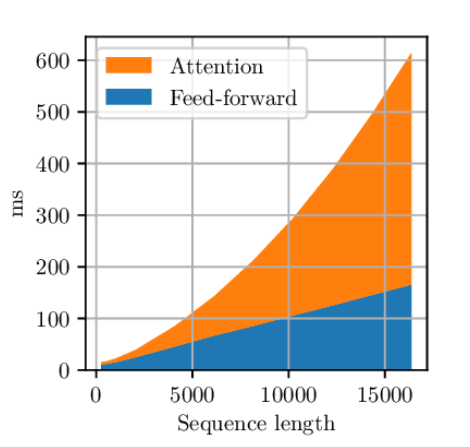
  <p><em>图 1. Attention处理时间与上下文长度的关系</em></p>
</div>

随着处理的上下文长度增加，标准Attention 机制面临多重瓶颈：

- 注意力分数矩阵的计算与存储随序列长度（ Attention复杂度 为 $n^{2}d$ ）呈二次增长，同时 KV Cache 随上下文**线性**累积，两者共同加剧显存压力，导致计算处理速度急剧下降；
- 注意力分数在长距离上的分散与位置编码的外推漂移，使模型对长文本的建模能力逐渐衰减——这一现象在层数更深的模型中尤为突出。

为缓解上述问题，研究者们从注意力机制本身出发，提出了多种结构变体与高效近似方法。

### 2.1 Hybrid Attention

对于提到的第一个问题，我们首先从标准 Attention 的计算原理及其复杂度出发，分析二次增长关系的根源。假设隐藏层的维度为 $d$ ，序列长度为 $n$ ，对于一个 Transformer 层，计算处理的主要流程为   $\text{Softmax}\left(\dfrac{QK^\top}{\sqrt{d}}\right)V$  -> MLP，那么对应的时间复杂度为：

$$O(n^{2}d + n^{2} + n^{2}d) \approx O(n^{2}d)$$

因此，标准 Attention 的计算量会随上下文序列长度呈二次增长。那么线性注意力机制（如 Mamba、RNN 等模型）的情况如何呢？其核心思想是将历史信息压缩到一个固定大小的隐藏状态中进行递推：

$$S_{t}=S_{t-1}+k_tv_{t}^{T}, \quad y_t=W_{t}S_{t}$$

其中， $S_{t-1}$ 表示截至第 $t-1$ 时刻的隐藏状态压缩， $y_t$ 表示 $t$ 时刻的输出。其推理时的时间复杂度为：

$$O(nd)$$

从推理效率的角度进一步对比两者：标准 Attention 在推理时为了尽可能地减少重复计算，需要逐层累积 KV Cache，其显存占用随上下文长度**线性增长**（每个新 token 增加一对 KV 向量），当处理序列长度很大时这仍是沉重的负担；而线性注意力机制的**隐藏状态大小是固定的** ，推理时显存占用为**常数级**，*对长序列推理非常友好*。

既然线性注意力机制在推理效率上优势明显，为什么部分的 LLM 仍然以标准 Attention 为主呢？主要原因有两点：

- **训练效率**：标准 Attention 可以通过矩阵并行计算一次性处理整个序列，硬件利用率极高；线性注意力机制虽然可以通过并行扫描等技术加速训练，但在当前 硬件架构 上的并行效率和吞吐量相较于 标准Attention 仍有差距。
- **表达能力**：标准 Attention 能对序列中任意两个 token 进行精确的全局交互，信息损失较少；线性注意力机制将所有历史压缩为固定大小的状态，不可避免地会丢失细粒度的上下文信息，在需要更多精确的回忆（比如复杂推理、长距离事实检索）的任务上表现较弱。

简而言之，标准 Attention 表达能力强，线性注意力机制推理效率高。一个自然的想法是——能否将两者结合，在保持足够语义理解能力的同时大幅提升推理效率？事实上，已有研究沿着这个方向展开了探索，即 Hybrid Attention：在模型的部分层使用标准 Attention 以保留全局精确交互能力，在其余层使用线性注意力机制以降低整体计算和显存开销。

---

**开源模型中的混合注意力机制**

**1.Nemotron 3 Super**

MiniMax M1 算得上是较早采用 Hybrid Attention 的开源大模型，但此后相当一段时间内，大部分 LLM 团队并未在核心架构中引入线性注意力机制。近期，这一思路重新受到关注，例如 Nemotron 3 Super、Kimi K3 等模型相继采用了 Hybrid Attention。

<div align="center">
  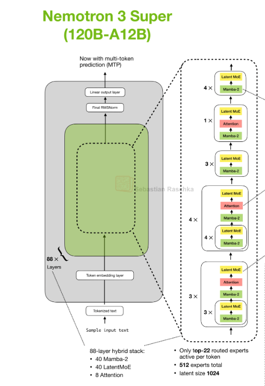
  <p><em>图 2. Nemotron 3 Super (120B-A12B)</em></p>
</div>

Nemotron 3 Super 采用了 Mamba 与标准 Attention 交替组合的架构：Mamba 层负责高效的序列建模，以线性复杂度处理长距离依赖；标准 Attention层 则补齐线性注意力机制在精确全局交互上的不足。两者相互配合，在保持推理效率的同时提升了整体的语义建模能力。

**2.KDA**

与 Nemotron 团队直接组合现有模块的方案不同，Kimi 团队提出了 KDA ，在线性注意力的递推公式中引入 $\text{Diag}(\alpha_{t})$ 对隐藏状态施加逐维度的衰减控制，从而更细粒度地管理对历史信息的遗忘与保留，同时增强对序列位置关系的感知能力。

<div align="center">
  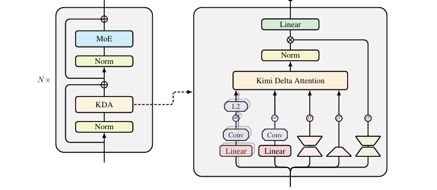
  <p><em>图 3. KDA</em></p>
</div>

对应的原理表示为：

$$S_t=(\mathbb I - \beta k_t k_{t}^T)Diag(\alpha_{t})S_{t-1}+\beta k_t v_{t}^T$$

<div align="center">
  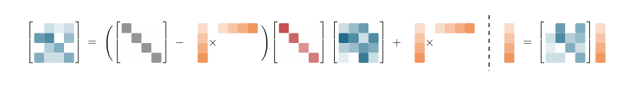
  <p><em>图 4. KDA的公式原理可视化</em></p>
</div>

KDA是一种线性注意力机制，其核心思想是在 Gated DeltaNet 的基础上，引入了按不同隐藏维度的可学习遗忘机制（Diag( $\alpha_t$ )）。在 GDN 中，所有隐藏维度共享同一个可学习的遗忘系数，因此不同维度会以相同的速度衰减历史信息；而 KDA 则将这一遗忘系数扩展为一个向量，即为每个隐藏维度分别学习独立的遗忘率，使不同维度能够根据训练数据自动决定保留多少历史信息、遗忘多少历史信息，从而显著提高了记忆表示的灵活性。

Kimi 团队认为，这一设计与 RoPE 的思想具有一定的相似性。RoPE 的优势不仅在于引入了旋转位置编码，更重要的是不同隐藏维度对应不同的旋转频率，从而能够自然地表示不同时间尺度的位置关系。

此外，在 Kimi Linear 的整体架构设计中，通过大量实验发现，在其模型配置下，**线性注意力层与标准 Softmax Attention 层约为 3:1 的混合比例**时，可以在模型性能与计算效率之间取得较好的平衡。不过需要注意的是，这一比例可能会受到模型规模、网络结构、训练策略以及硬件平台等因素的影响，并不意味着所有模型都存在统一的最佳比例。在不同架构或训练条件下，该比例仍需要根据具体实验进行调整。

当然，采用 Hybrid Attention 的大模型不止上述的，还有许多其他模型也在探索类似的架构方案。以及还有其他 Attention 的改进方法。

---

### 2.2 DeepSeek Sparse Attention

与 Hybrid Attention 通过替换部分层的注意力机制来降低整体复杂度不同，DeepSeek 团队提出了另一种思路：在 标准Attention 计算之前引入轻量级索引器，预测每个 Query 最值得关注的少量 Key Token，仅对这些候选 Token 执行完整的 Attention 计算，从而将计算量从全局 $O(n^2)$ 降低到近似 $O(n \cdot k)$ （ $k \ll n$ ）。

<div align="center">
  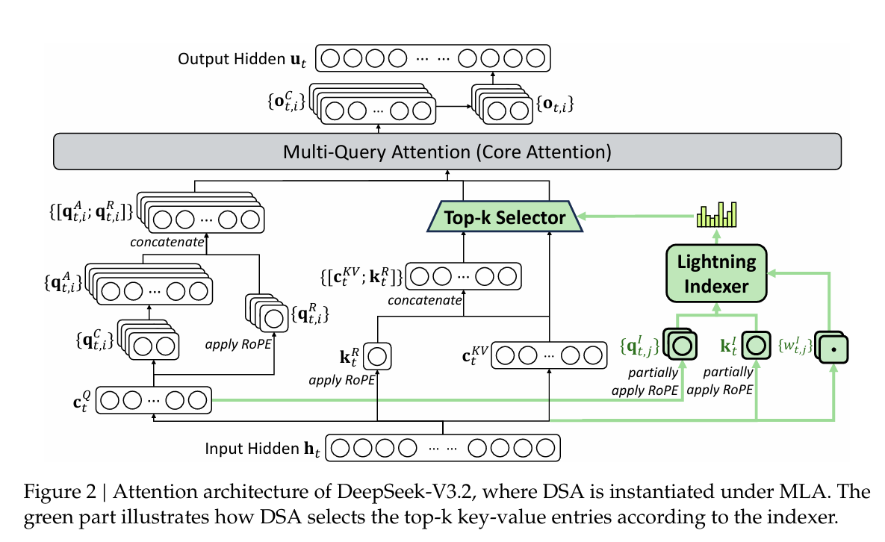
  <p><em>图 5. DSA</em></p>
</div>

具体而言，对于输入的 Query 和 Key，轻量级索引器首先计算每个 Key Token 相对于 Query 的相关性分数：

$$
S = f(Q, K)
$$

其中， $f(\cdot)$ 为轻量级索引函数，其计算成本远低于 标准Attention。随后，根据相关性分数选取前 $k$ 个最相关的候选token，得到候选集合：

$$
\mathcal{C} = \text{TopK}(S, k)
$$

最后，仅在候选集合 $\mathcal{C}$ 上执行标准 Scaled Dot-Product Attention：

$$
\text{Attention}(Q, K_{\mathcal{C}}, V_{\mathcal{C}}) = \text{Softmax}\left(\frac{QK_{\mathcal{C}}^{T}}{\sqrt{d}}\right) V_{\mathcal{C}}
$$

由于完整 Attention 仅发生在少量候选 token 上，计算复杂度相比全局注意力显著降低，同时通过选取最相关的Token，能够较好地保留模型的表达能力。

在训练策略上，DSA 采用两阶段训练方式：

①第一阶段使用较短上下文并采用标准 Attention 进行预训练，使模型充分学习基础语言建模能力。第二阶段则在第一阶段模型参数的基础上引入轻量级索引器，并切换至长上下文继续训练，使模型逐步适应稀疏注意力计算模式，同时学习有效的 候选token 选择策略。

②为减少索引器随机初始化对模型性能造成较大影响，在第二阶段开始时，通常先冰冻住主模型参数，仅优化索引器，*并以 标准Attention 的注意力分布作为教师信号*，通过 **KL散度** 损失对齐稀疏注意力与标准注意力的分布，即

$$
\mathcal{L}=
D_{KL}\left(
P_{\mathrm{Dense}}
\parallel
P_{\mathrm{Sparse}}
\right),
$$

其中， $P_{\mathrm{Dense}}$ 表示 标准Attention 的注意力分布， $P_{\mathrm{Sparse}}$ 表示 稀疏Attention 的注意力分布。完成索引器的初步对齐后，再解除参数冻结，对索引器与主模型进行联合优化，使模型能够在保持原有语言建模能力的同时，进一步提升稀疏注意力的表示能力和长上下文建模能力。

采用分阶段训练而非直接联合训练的主要原因在于，语言建模和稀疏索引学习属于两个优化目标。如果从训练初期同时优化二者，随机初始化的索引器可能无法有效筛选候选token，从而很可能破坏注意力计算过程，影响模型基础语言能力的学习。通过先学习语言表示、再逐步引入并优化稀疏索引器，可以降低训练难度，提高训练稳定性，并获得更好的最终表现能力。

除了对 Attention 模块进行优化之外，近年来研究者也开始关注 Transformer 中另一核心组件——FFN的改进。相比于 Attention 负责建模 token 之间的交互关系，FFN主要承担特征变换和知识存储的作用，其参数量通常占据 Transformer 的较大比例。

近年来，越来越多的大语言模型采用了 MoE 架构，通过将原本的稠密 MLP 替换为稀疏激活的专家网络，在保持计算成本基本不变的情况下显著扩大模型参数规模。接下来，我们将分析 MoE 的基本原理、核心组成以及其在一些 LLM 中的应用。

## 3 MoE原理分析

MoE是一种稀疏激活架构，其基本思想是将 Transformer 中原本的单一FFN 替换为多个并行的专家网络（Experts），并引入一个路由器来决定每个输入 token 应该由哪些专家进行处理。在一次前向传播过程中，每个 token 通常只会激活少量专家（如 Top-1 或 Top-2），其余专家保持不参与计算。因此，虽然整个模型拥有庞大的参数规模，但每次计算仅激活其中一小部分参数，从而实现了模型容量大、计算开销相对较低的特点。

> **值得注意的是**——多数研究表明，MoE架构在参数规模较大、数据和计算资源充足时优势最为明显；在小规模或资源受限的环境下，其表现可能不如对应的稠密（Dense）模型，具体效果还取决于任务类型、数据量以及实现细节。

**概念直观理解：**

`MoE模型`就像一个拥有大量书籍的图书馆（专家集合）,当一个读者（输入数据）来访时，他并不需要翻遍所有书架，而是根据自己感兴趣的主题由图书管理员（路由机制）指引，只去相关书架寻找书籍区域（稀疏激活）。这样一来，读者仍然可以访问图书馆中所有书籍的知识（模型的巨大参数容量），同时查找过程却快速高效。

---

### 3.1 路由机制与负载均衡

在MoE模型中，路由机制也称门控机制负责在每次前向传播时从全部专家中选择少量专家参与计算。当前主流的路由方式是基于可学习门控得分的`Top-K`路由，并在此基础上衍生出两种执行策略：`TC`与`EC`，两者都需要依赖可学习的门控得分机制，并通常会配合负载均衡策略以避免专家不均衡。

> 早期也有尝试用强化学习来优化离散路由即把路由视为策略学习问题，但由于梯度方差、训练稳定性与计算成本等问题，该方向在大规模MoE中并不常见。

假设一共有 $N$ 个专家，输入为 $x$ ，门控函数为 $G(\cdot)$ 用于决定每个专家的权重， $E_i(\cdot)$ 表示第 $i$ 个专家的输出，则TC和EC的通用门控机制核心计算公式为：

$$
y = \sum_{i \in \mathcal{T}} G_i(x) E_i(x)
$$

**关键点在于集合 $\mathcal{T}$：**

实现稀疏化的关键步骤，这里的 $\mathcal{T}$ 是通过 **$Top\text{-}k$** 机制选出的索引集合。无论是TC还是EC $G(x)$ 都有的计算过程包含两个步骤：

- **打分：** 计算路由分数 $h(x) = x \cdot W_g$ 。
- **稀疏化：** 仅保留分数最高的 $k$ 个专家（激活 $k$ 个专家），并对这些分值进行Softmax归一化。未被选中的 $N-k$ 个专家权重被强制置零，这意味着这部分专家在本次前向传播中*完全不参与计算*，从而在模型参数巨大的情况下，保证了实际FLOPs的高效。

> $W_g$ 是路由器中的可学习线性投影层，它将每个token的特征映射为与专家数量相同的得分向量（logits），表示token与各个专家的匹配程度，模型会对这些得分应用 $top-k$ 策略：`在TC模式下`，每个token选择最适合处理的专家；`在EC模式下`，每个专家主动选择最适合处理的token。

*Tips：可学习路由能否发挥作用的关键——并不在于具体采用何种路由（TC/EC...）形式，**而在于输入表示是否已经具备足够的语义结构，使得样本在表示空间中具有可分性，从而支撑稳定且有意义的专家选择**。*

<div align="center">
  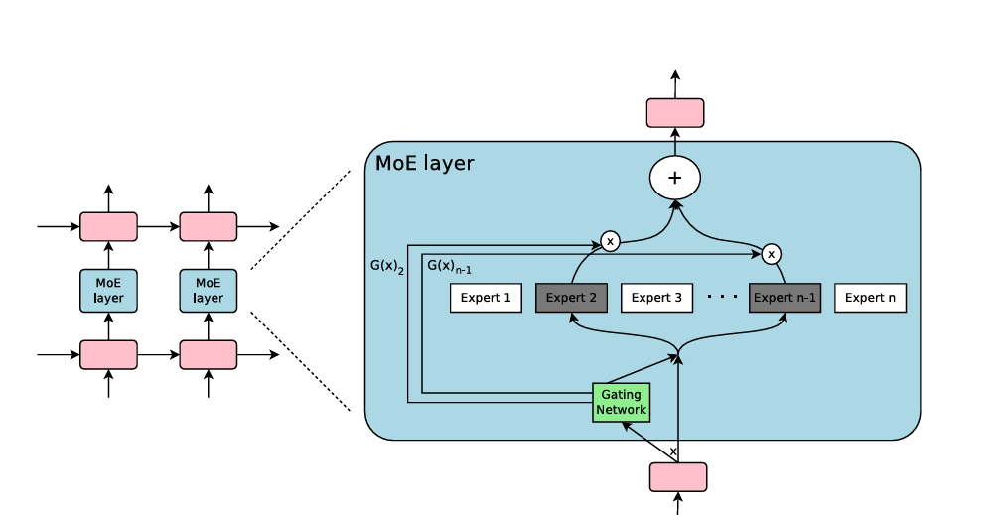
  <p><em>图 6. 词元选择模式</em></p>
</div>

- `TC`中 $W_g$ ：在打分步骤中，它可以理解为一个 “专家特长档案”。它将token的隐藏特征映射到专家集合的能力空间，并告诉token不同专家分别擅长什么语义，每个token会根据与各个专家“特长档案”的匹配程度，主动挑选最适合处理自己的Top-K专家。

**简易MoE的 $Top-k$ 词元选择模式实现步骤**

第一步：定义专家网络

```python
class Expert(nn.Module):
    def __init__(self, dim):
        super().__init__()
        self.ffn = nn.Sequential(
            # 维度升高
            nn.Linear(dim, dim * 4),
            # 非线性激活，提高表达能力
            nn.ReLU(),
            # 还原到初始维度
            nn.Linear(dim * 4, dim)  
        )

    def forward(self, x):
        return self.ffn(x)  # 前向传播
```

每个专家网络由`线性层 → ReLU → 线性层`组成，用于在该专家独有的特征子空间中处理被路由到的 token，从而提供可区分的语义变换，使Top-K路由后的组合输出更具专家特性。

第二步：定义TC MoE网络

```python
class TC_MoE(nn.Module):
    def __init__(self, dim, num_experts, k):
        super().__init__()
        # 设置专家数量
        self.num_experts = num_experts
        # 设置每个token选用的专家数量
        self.k = k
        # 路由器：将输入映射到专家特征空间
        self.router = nn.Linear(dim, num_experts)
        # 创建专家模块列表（每个专家是独立的）
        self.experts = nn.ModuleList([Expert(dim) for _ in range(num_experts)])
    def forward(self, x, tokens=None, verbose=False):
        # 获取批量大小和特征维度
        B, D = x.shape
        # 计算每个专家对每个token的分数，使用softmax得到概率分布
        gate_scores = F.softmax(self.router(x), dim=-1)  # gate_scores: [B, E]

        # token选取分数最高的k个专家及其分数
        # topk_scores: [B, k]（对应被选中的专家概率值）
        # topk_idx:    [B, k]（对应被选中的专家索引）
        topk_scores, topk_idx = gate_scores.topk(self.k, dim=-1)
 
        # 初始化输出张量与输入同形状
        out = torch.zeros_like(x)

        # 每个token对应的每一个top-k位置单独处理（同一个token可能被不同专家处理）
        for i in range(self.k):
            # B表示处理的token总数
            # expert_ids表示每个token在第i个Top-K选择的专家编号，形状：[B]
            expert_ids = topk_idx[:, i]
            # expert_weight表示第每个token在第i个Top-K选择上专家所占的权重，形状：[B]
            expert_weight = topk_scores[:, i]

            # 用于累加当前第i个选择位置上所有专家的输出
            expert_output = torch.zeros_like(x)

            # 遍历所有专家，让对应专家处理被分配给它的token
            # e_id表示对应Top-K专家处理的token索引值
            for e_id, expert in enumerate(self.experts):
                # 创建掩码当token在第i个选择位置的专家索引等于当前专家e_id时为1，否则为0
                # mask形状为[B, 1]，用于在计算专家网络前把不属于该专家的token置0
                mask = (expert_ids == e_id).float().unsqueeze(1)

                # mask.sum()表示属于该专家的token数量；若为0表示该专家在本轮没有任务
                if mask.sum() == 0:
                    continue

                # 只把属于该专家的token送入该专家的前馈网络
                # 注意：这里采用x * mask的方式，能保持张量形状一致并保留反向传播路径
                expert_output += expert(x * mask)

            # 将第i个选择位置上专家的输出按对应权重加权并累加到最终out
            # expert_weight.unsqueeze(1)变为[B, 1]以便广播乘到[B, D]
            out += expert_output * expert_weight.unsqueeze(1)

        # out：每个token在Top-K专家上的加权聚合的向量表示
        return out
```

**以上展示的是Top-K TC混合专家的关键板块，运行的代码在[Top-K TC](https://github.com/1iyouzhen/CS336-Chinese-co-construction/blob/main/docs/chapter5/Top-K%20TC.py)。**

TC_MoE(dim=32, num_experts=10, k=2)，输入文本：
> "MoE是很强大的机制！", "专家混合模型非常高效。"

输出：
> 按照字节级切分文本，得到33个token，专家负载统计从0到9号专家处理token总数统计依次为[13, 13, 16, 14, 9, 6, 20, 19, 18, 4]

<div align="center">
  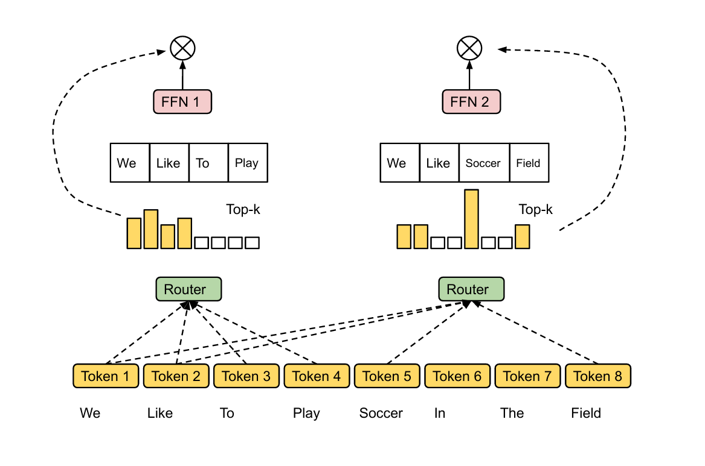
  <p><em>图 7. 专家选择模式</em></p>
</div>

- `EC`中 $W_g$ ：在打分步骤中，它可以理解为一个 “语义导航器”，将token的隐藏特征映射到每个专家的语义空间，并把这份导航信号提供给所有专家。每个专家会根据这份“导航信息”，主动挑选最符合自己能力范围的Top-K token进行处理。

**简易MoE的 $Top-k$ 专家选择模式实现步骤**

第一步：定义专家网络

```python
class Expert(nn.Module):
    def __init__(self, dim):
        super().__init__()
        self.ffn = nn.Sequential(
            nn.Linear(dim, dim*4),
            nn.ReLU(),
            nn.Linear(dim*4, dim)
        )
    def forward(self, x):
        return self.ffn(x)
```

第二步：定义EC MoE网络

```python
class EC_MoE(nn.Module):
    def __init__(self, dim, num_experts, k):
        super().__init__()
        # 专家的总数量
        self.num_experts = num_experts
        # 每个专家最多选多少个token  
        self.k = k
        # 用于给每个token输出E个专家得分的路由器                
        self.router = nn.Linear(dim, num_experts)  
        self.experts = nn.ModuleList([Expert(dim) for _ in range(num_experts)])  
    def forward(self, x, tokens=None, verbose=False):
        # 获取输入token的数量B_total和维度D
        # B_total表示所有token的总数（批次 × token数）
        B_total, D = x.shape

        # 路由器计算每个token、每个专家的匹配得分输出维度：[B_total, num_experts]
        # softmax确保所有专家得分加起来为1
        gate_scores = F.softmax(self.router(x), dim=-1)

        # EC模式： “专家挑token”
        # 转置后变成[num_experts, B_total]
        # scores_T[e][t] = 第e个专家对第t个token的评分
        scores_T = gate_scores.transpose(0, 1)

        # 每个专家从所有token中挑选top-k个最相关的token
        # topk_idx: 每个专家选中Top-K token的索引
        # topk_scores: 对应的路由得分
        # 维度：[num_experts, k]
        topk_scores, topk_idx = scores_T.topk(min(self.k, B_total), dim=-1)

        # dispatch_weights大小：[B_total, num_experts]
        # 初始化dispatch_weights
        dispatch_weights = x.new_zeros((B_total, self.num_experts))

        # 对每个专家e，把top-k token的得分写入对应位置
        for e in range(self.num_experts):
            # topk_idx[e]是一个Top-K token索引列表
            # topk_scores[e]是Top-K token的得分
            # 填写dispatch_weights：每个专家对各个token评分归一化处理
            for t_idx, s in zip(topk_idx[e].tolist(), topk_scores[e].tolist()):
                dispatch_weights[t_idx, e] = s

        # 初始化输出out，与输入x大小相同
        out = torch.zeros_like(x)

        # 对每个专家进行前向计算
        for e_id, expert in enumerate(self.experts):

            # mask: 这个专家是否选择了该token
            # mask[t] == 1 → token t被这个专家选中
            # 维度：[B_total, 1]
            mask = (dispatch_weights[:, e_id] > 0).float().unsqueeze(1)

            # 如果专家没有选择任何token，则跳过计算
            if mask.sum() == 0:
                continue

            # 确保每个专家只处理其选中的Top-K token
            # mask会把不属于该专家的token设置为0，不同专家可能会处理相同的token
            expert_out = expert(x * mask)

            # 将专家输出按其权重加回到最终输出中
            # dispatch_weights[:, e_id]是每一组Top-K token对这个专家的权重
            out += expert_out * dispatch_weights[:, e_id].unsqueeze(1)
        return out
```

**以上展示的是Top-K EC混合专家的关键板块，运行的代码在[Top-K EC](https://github.com/1iyouzhen/CS336-Chinese-co-construction/blob/main/docs/chapter5/Top-K%20EC.py)。**

EC_MoE(dim=32, num_experts=10, k=2)，输入文本：
> "MoE是很强大的机制！", "专家混合模型非常高效。"

输出：
> 按照字节级切分文本，得到33个token，专家负载统计从0到9号专家处理token总数均为2，但是有部分token一次都没有被处理过比如：['混'，'合'， '模'， '型'...]。

因此，在每一次前向传播中，模型只会对Top-K路由机制挑选出的专家子集 $T$ 进行计算，从而实现稀疏化推理。路由机制的核心作用可以概括为：**为每个输入选择最合适的少数专家+对这些激活专家的输出按路由权重进行加权融合**。

路由机制的选择依据是输入的隐藏状态。具体来说，输入词元在经过嵌入、位置编码及前置处理后生成隐藏状态，然后作为路由器`通常是线性层或小型MLP`的输入计算专家分数，这种行列维度的区别决定了稀疏化的粒度。

   - **TC模式**：对每一个token（矩阵的每一行），在专家维度（列维度）上选择Top-K 专家。
   - **EC模式**：对每一个专家（矩阵的每一列），在token维度（行维度）上选择Top-K token。

**TC vs EC** ：

通过运行两段代码[Top-K EC](https://github.com/1iyouzhen/CS336-Chinese-co-construction/blob/main/docs/chapter5/Top-K%20EC.py)和[Top-K TC](https://github.com/1iyouzhen/CS336-Chinese-co-construction/blob/main/docs/chapter5/Top-K%20TC.py)，直观比较两种路由策略的差异。

1. `在TC模式下`，每个token主动选择自己最合适的Top-K专家像“学生找导师”。优势是每个token都会被至少尝试分配到专家上，因此语义完整性较高，减少了信息丢失的风险。缺点问题是专家`负载不均衡`，少数“热门”专家会处理绝大部分token，得到充分训练并显著优于其他专家，而大量“冷门”专家长期闲置能力停滞。`这种差距导致模型出现“偏科”现象在即高频领域表现良好，而在低频领域能力不足`。
2. `在EC模式下`，每个专家主动从所有token中挑选自己最想处理的Top-K像“导师挑学生”。这种机制天然约束了每个专家的处理量（招生名额），从而显著缓解或消除专家负载不均衡，有利于专家能力的均衡提升。但代价是部分token可能完全未被任何专家处理（被丢弃），导致语义信息缺失或上下文片段被跳过，`从而增加模型在理解、推理时出现断章取义或错误的风险从而降低LLM最后的表现能力`。

**结论** &emsp;TC在语义完整性上占优但易遭遇专家能力`两极化`；EC在负载均衡上占优但要承受潜在可能的语义丢失风险，两种模式代表了稀疏专家系统在信息完整性 vs 负载均衡上的典型权衡抉择，根据近期的研究也有解决这个权衡问题的思路。

| 策略名 | 核心思路 | 说明 |
| ------ | -------- | ----------- |
| [辅助负载均衡](https://yangyutu.github.io/llm_book.github.io/docs/chapter_LLM_arch/LLM_moe_sparse_architectures.html) | 在训练 loss中加入一个正则项，鼓励专家之间接收的token量、路由概率趋于均匀分布，避免少数专家处理掉绝大多数token | 这是最早也是最经典的方法，在`Switch Transformer`以及后续很多MoE实现中被采用。 |
| [容量控制 + expert capacity + overflow机制](https://mljourney.com/mixture-of-experts-moe-routing-algorithms-for-sparse-llms) | 给每个专家设定一个容量上限，超过后不再接token、转为fallback路径(或dropout、备用expert)；避免单个专家过载，也避免忽略“冷门” expert | 多MoE系统建议通过capacity factor+expert capacity控制单专家负载以及治理overflow情况。 |
| [动态、无辅助损失的负载均衡](https://www.emergentmind.com/papers/2408.15664) | 避免引入额外训练梯度，通过对每个专家加 bias（基于过去负载统计）动态调整路由分数，从而平衡专家负载，无需aux‑loss也可稳定路由分布 | 最近研究Loss‑Free Balancing for MoE提出该方式，显示比传统aux‑loss更稳定，不破坏原模型优化目标。|
| [改善路由器、相似度保持路由](https://arxiv.org/abs/2506.14038) | 设计路由器，使相似语义的token → 相似分配专家、在专家间分布均匀；减少重复路由和专家负载偏移 | 提升收敛速度和负载均衡效果。|
| [改进专家结构、路由机制](https://arxiv.org/abs/2511.10971) | 通过改变专家参数化例如用正交基、basis或用更稳定、可解释的路由评分而非简单linear logits，提升路由稳定性以及专家利用率 | 最新工作不仅减轻传统路由不稳定和专家闲置，还自然实现更均匀专家负载。 |
| [混合共享 + 路由专家池](https://arxiv.org/pdf/2401.06066) | 将部分专家设为共享专家 ，所有token都激活其余为路由专家，共享专家保证即使路由阶段极不均衡也能覆盖所有token，减少token dropout与语义丢失 | 工程实践中如DeepSeekMoE使用该办法以折中保持语义覆盖+专家特长训练。|

在一些相关的MoE研究中，复杂智能路由器（如Top‑K可学习路由）并非绝对必要，还存在`哈希（Hash）路由`等非学习式方法：

- **Hash原理**：通过固定哈希函数将输入token映射到专家，天然具备较好的负载均衡和低开销实现。
- **Hash的局限**：尽管Hash路由在语义灵活性和精细化专家分工上通常不如可学习路由，但在若干基准测试和工程场景中，仍能展现出相当的竞争力。

<div align="center">
  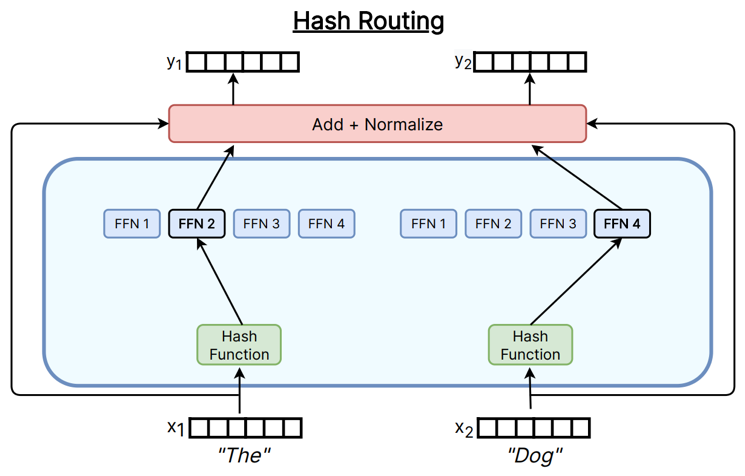
  <p><em>图 8. 哈希路由</em></p>
</div>

[LSH](https://proceedings.neurips.cc/paper_files/paper/2024/file/61674667d642ae52f6bb281bea90ee29-Paper-Conference.pdf)为例，采用**固定的、非训练**的哈希函数。每个哈希函数通过将输入Token嵌入 $x \in \mathbb{R}^d$ 投影到由随机向量 $a_i \in \mathbb{R}^d$ 和随机偏置 $b_i$ 定义的平面上，再通过桶宽度 $\epsilon$ （间接控制每个桶的token容量）进行量化，从而将 $x$ 映射到一个索引值为 $i$ 的 $h_i(x)$ 整数哈希桶。

$$
h_i(x) = \left\lfloor \frac{a_i^\top x + b_i}{\epsilon} \right\rfloor
$$

这里的 $D$ 是复合哈希函数即随机投影方向的数量。这种方法不通过梯度优化哈希参数，但路由结果会因随训练演化的 $x$ （Token Embedding）而动态改变，LSH**概率性地**实现了负载均衡，并且由于其局部敏感性，能够保留弱局部性——即相似Token更可能落入同一哈希桶。因此，LSH算是一种“弱语义”非学习路由。

*`桶宽度`  $\epsilon$  与上式中的量化步长对应，用于把连续投影值分桶；桶越宽，同一桶内聚集的向量越多。*

> **说明：** 上文带 $\epsilon$ 的公式刻画的是**随机投影 + 标量量化**一类 LSH；下文示例代码则采用**随机超平面符号哈希**（对投影结果取正负号再编码为比特串），二者同属LSH家族但实现细节不同，阅读时请勿把公式参数与代码逐行一一对应。

**基于LSH路由机制的简易MoE实现**：

```python
import torch
import torch.nn as nn
# 简单字符级 tokenizer
class CharTokenizer:
    def __init__(self):
        self.vocab = {}
        self.inv_vocab = {}
    def build_vocab(self, texts):
        chars = set("".join(texts))
        self.vocab = {c:i for i,c in enumerate(sorted(chars))}
        self.inv_vocab = {i:c for c,i in self.vocab.items()}
    def encode(self, text):
        return [self.vocab[c] for c in text]
    def decode(self, ids):
        return "".join([self.inv_vocab[i] for i in ids])

# Expert FFN
class Expert(nn.Module):
    def __init__(self, dim):
        super().__init__()
        self.ffn = nn.Sequential(
            nn.Linear(dim, dim*4),
            nn.ReLU(),
            nn.Linear(dim*4, dim)
        )
    def forward(self, x):
        return self.ffn(x)

# LSH Router
class LSHRouter(nn.Module):
    def __init__(self, d_model, num_experts, n_hashes=8):
        super().__init__()
        self.num_experts = num_experts
        self.n_hashes = n_hashes
        self.register_buffer(
            "random_vectors",
            torch.randn(n_hashes, d_model)
        )
    def forward(self, x):
        projections = x @ self.random_vectors.T
        signs = (projections > 0).long()
        hashes = signs @ (1 << torch.arange(self.n_hashes, device=x.device))
        expert_ids = hashes % self.num_experts
        return hashes, expert_ids

# LSH-MoE
class LSH_MoE_Text(nn.Module):
    def __init__(self, dim, num_experts, n_hashes=8, vocab_size=None):
        super().__init__()
        self.embedding = nn.Embedding(vocab_size, dim)  # embedding 层
        self.dim = dim
        self.num_experts = num_experts
        self.router = LSHRouter(dim, num_experts, n_hashes)
        self.experts = nn.ModuleList([Expert(dim) for _ in range(num_experts)])

    def forward(self, token_lists, verbose=True):
        """
        token_lists: list of LongTensor，每条tensor是一条文本token ID
        """
        lengths = [t.size(0) for t in token_lists]
        total_tokens = sum(lengths)
        x_flat = torch.cat(token_lists, dim=0)  # [total_tokens]
        x_flat = self.embedding(x_flat)         # [total_tokens, D]

        hashes, expert_ids = self.router(x_flat)
        out_flat = torch.zeros_like(x_flat)

        expert_load = torch.zeros(self.num_experts, dtype=torch.long, device=x_flat.device)
        for e_id, expert in enumerate(self.experts):
            mask = (expert_ids == e_id).float().unsqueeze(1)
            n_tokens = int(mask.sum().item())
            expert_load[e_id] = n_tokens
            if n_tokens > 0:
                out_flat += expert(x_flat * mask) * mask

        # 拆回原句子
        outputs = []
        start = 0
        for l in lengths:
            outputs.append(out_flat[start:start+l])
            start += l
        if verbose:
            print("\n========== LSH-MoE Token 哈希映射 ==========")
            start = 0
            for idx, l in enumerate(lengths):
                for j in range(l):
                    token_idx = start + j
                    print(f"Sentence {idx}, Char {j}: Hash={hashes[token_idx].item()} -> Expert {expert_ids[token_idx].item()}")
                start += l
            print("\n========== LSH-MoE 专家负载统计 ==========")
            for e in range(self.num_experts):
                print(f"Expert {e}: {expert_load[e].item()} tokens")
            print("------------------------------------------------\n")

        return outputs

# 测试
if __name__ == "__main__":
    sentences = ["你好世界", "今天天气很好"]
    tokenizer = CharTokenizer()
    tokenizer.build_vocab(sentences)
    token_lists = [torch.tensor(tokenizer.encode(s), dtype=torch.long) for s in sentences]
    dim, num_experts = 16, 5    # 每个 token 的 embedding 维度，专家数量
    moe_text = LSH_MoE_Text(dim=dim, num_experts=num_experts, vocab_size=len(tokenizer.vocab))
    outputs = moe_text(token_lists)
    for i, out in enumerate(outputs):
        print(f"Sentence {i} 输出shape: {out.shape}")

```

输入
> dim, num_experts = 16, 5

输出
> 每个句子的token哈希映射以及LSH_MoE专家负载统计。

*输出结果会随着 embedding 层动态变化。*

**MoE路由机制对比**

| 路由方式 | 核心思路 | 是否可学习 | 优点 | 缺点 | 典型用途 |
|---------|----------|------------|-------|--------|-----------|
| **Top-K路由**（TC、EC） | 门控网络为token–expert计算得分，选择Top-K专家参与计算 | 是 | 语义灵活、可适应数据分布；可结合负载均衡loss、noisy gating等技巧；效果好 | 需要训练；在大规模时有负载倾斜风险；通信开销较高 | DeepSeek-MoE、GPT-MoE、Qwen、Switch Transformer等 |
| **哈希路由** | 通过固定哈希函数将输入映射到专家如LSH、随机哈希... | 否 | 天然负载均衡；无需训练路由器；极度高效；通信成本低 | 语义表达能力弱；无法根据任务动态分配专家 | 大规模推理、轻量级MoE、部分稀疏训练实验 |

尽管MoE结构早在较早时期就已提出，但其在大规模语言模型中的广泛应用主要发生在2021年之后（如Switch Transformer、GLaM等工作）。近年来，模型（如DeepSeek-R1）进一步展示了MoE在高性能推理任务中的潜力，但其核心挑战仍主要体现在训练稳定性与优化效率方面：

- **在模型浅层阶段**，token表示处于快速演化过程中，输入分布呈现出显著的非平稳性（即语义结构尚未稳定形成）。这使得基于表示学习的路由器面临高噪声输入，从而导致专家分配决策具有较高方差，并增加了训练收敛难度。
- **MoE中常见的负载不均衡问题**，会导致不同专家接收到的训练样本数量显著不均，进而使部分专家得到充分训练，而另一部分专家由于缺乏激活而处于欠训练状态，甚至出现“死亡专家”现象。

需要注意的是，**稀疏的可学习路由机制（如Top-K）引入了离散决策过程，使得梯度估计具有较高方差**。同时，由于专家网络仅在被路由选中时`才接收`梯度方向传播进行对应的更新，而**路由网络则持续从样本中接收训练信号中`持续更新`**，这种**条件计算下的梯度不对称性**会导致不同模块在优化过程中依赖于不同的数据分布，从而使优化步调难以协调，增加训练不稳定性。

> **可学习路由的MoE模型，在不同迭代步中实际上优化的是一些根据路由诱导的子目标函数**，使得整体优化过程呈现出`非平稳性`与`路径依赖性`，从而增加训练难度。

*Tips：MoE架构中，梯度更新具有条件性其更新路径由路由决策所决定。当路由网络发生变化时，反向传播所对应的优化目标及梯度路径也随之改变，从而体现为一种由条件计算引入的优化不一致性问题。*

---

### 3.2 MoE变体

在混合专家模型MoE里，每个专家就像一位“老师”，负责处理输入的一部分（token）。然而在实际训练中，有两个常见问题会阻碍专家真正形成“专业领域”：

1. **知识混合**：分配给某个专家的token可能多样化即涵盖多种不同类型的知识。就像一位老师被要求同时教数学、历史和美术，他很难在自己的课堂上把每门课都讲得透彻。
2. **知识重复**：不同专家处理的token可能存在重叠的知识需求。结果就像几位老师都在准备相同的教材，每个人都在重复劳动，无法凸显各自的“专业特长”，也导致专家之间缺乏明确的“专业分工”。

这两个问题叠加起来，可能会限制MoE模型发挥其理论上最大的能力，让专家难以真正做到“各司其职”，理解这些限制，可以启发我们设计更智能的路由策略，让每位专家专注于自己的“领域”，从而提升模型整体表现。在接下来的内容中，我们将介绍两种MoE变体，这些方法正是为了解决知识杂乱和重复问题而提出的。

1. DeepSpeed-MoE在降低MoE训练成本方面的贡献涵盖从模型结构、训练系统到推理加速的全栈设计，使得稀疏专家模型比同质量的稠密模型在训练成本、部署效率和实时性上都更具优势，从而让超大规模 LLM 向更高效、更可落地的方向发展：

- **参数效率提升：** DeepSpeed-MoE在模型结构上提出了PR-MoE以及其蒸馏压缩版本MoS，PR-MoE用固定MLP+“专家残差纠错”减少参数与通信，再用“金字塔式专家数量”把专家集中在深层，从而达到更高的参数效率；MoS则通过分阶段蒸馏进一步压缩模型，让MoE在保持性能的同时显著加速推理。
- **蒸馏压缩加速推理：** Mos通过“分阶段知识蒸馏”将PR-MoE进一步压缩，用较浅的稀疏学生模型替代原模型以提升推理速度。由于直接减少层数会导致模型能力下降，而从头到尾都用教师信号训练也会导致学生欠拟合，MoS采用“两阶段”方式：训练前期使用蒸馏稳定学习教师分布，后期关闭蒸馏、只优化语言模型损失，让学生模型具备自主泛化能力。实践中，MoS可以将模型尺寸再缩小3.7倍，同时推理速度比质量相当的稠密模型还要更快。
- **系统优化升级：** 系统层重写MoE并行与通信方式，使MoE在真实大规模训练和推理中更快、更稳定：
    - 由于不同层的专家数量不一致，它采用专家并行、专家切片、数据并行和张量切片的灵活组合，保证每层都能获得最合适的并行方式。
    - 这种自适应并行让MoE可以在上百块GPU上稳定扩展，并避免负载不均与显存浪费。
    - 在通信方面，DeepSpeed-MoE通过张量切片将All-to-All的复杂度从 $O(p)$ 降到 $O(p/L)$ ，并使用分层All-to-All来降低跨节点延迟。最核心的优化是将MoE的稀疏重排改写为显式数据布局转换，使关键内核延迟下降6倍以上，从而显著提升推理速度。

> 分层All-to-All指的是在MoE中，把原本一次性、全局、所有GPU之间的token通信，按照硬件拓扑拆成逐级执行的多层通信：先在同一节点、同一机器内部完成高速的All-to-All，再跨不同节点、不同机器之间进行必要的数据交换，从而显著减少跨机器通信量。

2. Switch Transformer致力于在不显著增加每个样本FLOPs的前提下极大扩展模型参数量。其核心策略是把标准Transformer中的密集前馈网络替换为稀疏激活的专家集合，使不同输入动态激活不同专家，从而扩展参数容量而不显著增加计算成本，其中有辅助损失函数添加解决负载均衡的问题、以及中间传输过程使用低精度、关键路由决策等使用中精度计算：

- **路由器计算**：路由器对token的表示 $x$ 计算logits，通常对logits做softmax可以得到每个专家的概率分布 $p_i(x)$ 。
- **实际路由决策**：采用Top-1策略，每个token被分配到得分最高的单个专家执行FFN。softmax 得到的概率主要用于统计、辅助损失，而实际的前向计算只使用被选定的专家即稀疏激活，相较于Top-k，Top-1路由显著简化实现、减少跨设备通信并降低专家同时被调用的计算量，从而提高硬件、通信效率。
- **超容量处理**：若某专家被指派的token超过其容量，超出部分**不会执行该专家的FFN**即被“丢弃”，这些token仅通过残差传递到下一层；**因此超额token不会为该专家产生梯度**。
- **Router Z-loss**：为避免路由logits在低精度下产生极端值，引入对logits幅度的惩罚项，减小softmax对极端输入的敏感性，从而提高训练的数值稳定性。
- **较小的初始化**：考虑到路由器随机初始化困难，于是通过从截断正态分布中抽取元素来初始化权重矩阵，均值为0，适当减小某些线性层、FFN的初始化尺度可以降低训练初期梯度方差，减少早期不稳定现象，提高模型的能力。

<div align="center">
  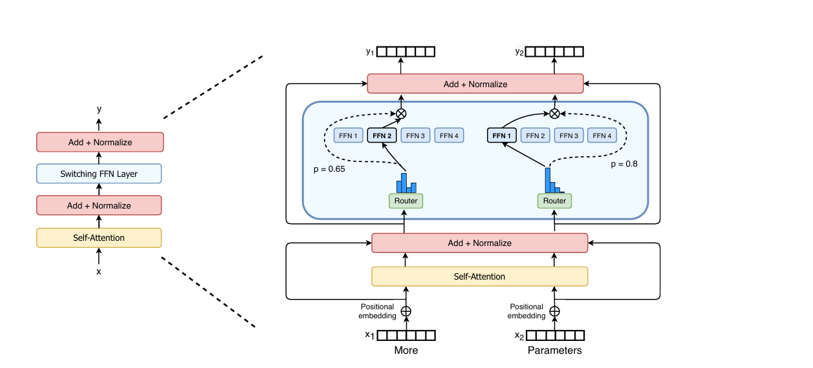
  <p><em>图 9. Switch Transformer</em></p>
</div>

> Switch Transformer子层顺序采用**自注意力层Self-Attention → 前馈网络FFN、MoE**的结构，是实现高效训练与深度语义建模的关键：

①**先Self-Attention（建立全局语义）**：
计算所有token之间的相似度与依赖关系，Self-Attention本质上会让每个token与上下文中的所有其余token建立加权联系，从而生成包含丰富上下文信息的情境化表示，这种表示不仅保留词自身的语义特征，还融合来自整句乃至更长上下文的关联信息，使模型在处理每个token时能够更充分理解其在全局语义结构中的角色、作用与语境位置。

②**后FFN、MoE（专家的特征增强）**：
随后的FFN或MoE层基于Self-Attention输出的情境化特征，对每个token进行独立地非线性的语义增强。对于MoE而言，这意味着路由器能够利用丰富的上下文信息，将token更准确地分配到功能最匹配的专家，从而提升专家的专精能力，也减少路由器在训练初期不稳定的问题。

总结，Switch Transformer这种“先获取全局关系，再增强个体特征”的流水式结构，能够最大化Transformer中的语义建模效率。如果顺序被颠倒，让FFN、MoE先处理缺乏上下文的原始embedding，不仅会削弱特征增强的效果，也可能因为非线性变换扰乱token之间原本的几何关系，可能会使Self-Attention的相似度计算准确度下降，最终导致模型无法正确捕捉依赖性，从本质上降低Transformer的表达能力与训练效率。

> Switch Transformer强调稳定性与简化FLOPs，DeepSpeedMoE强调专家分布、模型蒸馏，两者构成了现代MoE的两条设计思路：
>
> ① 精度与通信的分级设计，降低训练成本；
>
> ② 动态约束与结构调节，提升训练稳定性与专家专业性。

---

### 3.3 混合专家与稠密模型

MoE相较于传统稠密模型的优势是它可以**扩大模型参数规模的同时保持计算量基本不变**，从而显著提升模型的表示能力与性能；并且由于MoE的专家是**稀疏激活**的，每次仅有少量专家参与计算，因此各专家*通常是前馈网络*可以作为独立模块分布在不同设备上。路由器只需根据输入将对应的token发送到相应设备，计算便在该专家所在设备上独立完成。这种天然的结构切分方式使MoE能实现高效的**专家级并行**，成为构建超大规模模型时必不可少的并行化策略，也是现代大模型在多机多卡环境下突破容量与性能瓶颈的重要基础。

<div align="center">
  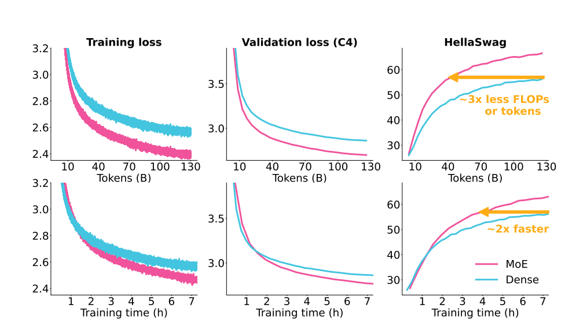
  <p><em>图 10. 混合专家 vs 稠密模型</em></p>
</div>
从上图中我们不难发现，在所示实验设置下 MoE 架构往往比稠密模型收敛更快且表现更好（具体结论依赖数据规模、训练配方与评测任务）。

在MoE研究中，常见两条实践路径：

- **稠密→稀疏升级**：把已训练好的稠密模型upcycling为MoE，以复用先前的训练成果与权重；
- **从零训练MoE**：从随机或专门初始化开始训练MoE，使专家与路由器从头共同演化。

实证结果显示，这两条路径在不同设置下表现差异显著。比如：

- OLMoE的实验发现采用TC路由从零训练的MoE在约500–600B tokens时就能追上并在随后超越upcycled模型——这相当于原始Dense模型训练数据量的约25%的计算预算即可达到追赶点。
- 而Komatsuzaki等人在其upcycling工作采用EC路由中报告的结论是从零训练的MoE需要大约原稠密模型训练量的120%才能赶上upcycled模型，二者的差异来源于实验范式与路由策略等设置不同。

并且，OLMoE的实验提到原有的稠密模型的各种参数可能会对upcycled模型起到一定约束作用，因此OLMoE在升级模型时采用的是从零开始训练MoE模型。

> OLMoE的实验表明，在数据量有限的情况下，将一个已训练的稠密模型转换为MoE，会引入两类阻碍早期学习稳定性的结构性因素：
>
> ①原稠密模型的权重已经编码了较强的通用能力，在MoE化后这些参数需要部分“遗忘”过去的表征再重塑为专家专业化能力，**但由于梯度流仍受到旧表示的影响，新学习信号容易被历史分布干扰，形成“遗忘以及重学困难”的现象**；
>
> ②MoE路由器通常以随机初始化开始，**在训练早期呈现近似随机或均衡分配，难以在前半程形成清晰的专家分工，而当训练进展到路由器逐渐趋于稳定时，学习率往往已衰减**，使得路由器对专家的“特长”划分仍可能保持“模糊”，即出现“路由器学得太晚”的情况。

此外，工程实践中也出现了成功的upcycling案例，例如Qwen系列中的Qwen1.5-MoE通过将已有稠密模型改造为MoE，在保持或提升性能的同时显著提升了计算参数效率，相关模型说明其在激活参数更少的条件下能匹配更大稠密模型的表现。

> **为什么会有25% vs 120% 之类的大差异？**
> 1. 路由策略差异TC、EC：TC与EC在负载均衡、专家分化速度与早期训练动态上存在本质差异，会显著影响从零训练的收敛速度。
> 2. 模型范式不同：decoder与encoder架构在训练目标与信息流上不同，upcycling的收益会随范式变化。

## 4 MoE的应用

MoE并不是仅用于**Transformer**的技术，而是一种可广泛嵌入各种神经网络结构的通用“条件计算框架”。它的核心思想是让不同专家处理不同类型的数据或子任务，因此在Transformer之外也被大量应用：

- 在**CNN**中作为动态卷积提升视觉建模的多样性；
- 在**语音识别**中让不同专家专注于不同音素或噪声条件；
- 在**推荐系统**解决多任务排序问题；
- 在**强化学习** 中分解为多策略、多技能专家；
- 在**多模态模型**中实现跨模态专家协作。

正因MoE的结构独立性与分工能力，它成为大模型扩展参数规模、提升表示能力和降低计算成本的重要基础模块。接下来介绍的是MoE在LLM的应用。

---

### 4.1 MoE与LLM

在LLM中，MoE通常通过引入一个路由器以及将Transformer中的单个前馈网络板块替换或扩展为由多个独立专家组成的稀疏子网络。每个token在前向与反向传播中仅激活少量专家，使模型能够在不显著增加每次计算量的前提下大幅提升参数容量与表示能力。

### 4.2 简易MoE+LLM实现

**第一步：构建字节级分词器**

```python
class ByteTokenizer:
    def __init__(self):
        self.vocab_size = 259
        self.bos = 256 # 序列开始，告诉LLM一个独立的文本片段或输入样本从这里开始。
        self.eos = 257 # 序列结束，告诉LLM一个文本片段到这里结束。
        self.pad = 258 # 填充，在模型训练或推理时，通常需要将多条长短不一的文本组成一个批次。
        # <pad>会被添加到较短序列的末尾使批次中所有序列长度一致，便于高效的矩阵运算。
```

这个词汇表的总大小是256+3，由两部分组成：

 1. 基础字节编码：数量256个，它们代表了计算机中所有可能的单字节值从0到255。这种方法能够确保任何文本，不论其语言或编码，都能被无损地编码成一串数字Token ID。
 2. 特殊功能编码：数量3个，这些Token专门用于提供文本结构信息，确保模型能够正确处理和理解文本段落的边界和批处理时的对齐，便于计算。

```python
def encode(self, text, add_bos=True, add_eos=True):
    # 把输入文本信息进行utf-8字符集编码，得到字节序列b
    # 每个字节值0-255对应一个Token ID
    b = text.encode('utf-8', errors='surrogatepass')
    ids = list(b)   # 将UTF-8字节序列转换为Token ID列表
    if add_bos:
        # 标记文本开头，添加<bos> Token ID
        ids = [self.bos] + ids 
    if add_eos:
        # 标记文本结束，添加<eos> Token ID
        ids = ids + [self.eos] 
    return ids # 返回最终处理完成的Token ID序列
def batch_encode(self, texts, pad_to=None):
    # pad_to 用于规定批处理中每条 Token ID 序列的目标长度（强制对齐）
    encs = [self.encode(t) for t in texts] 
    # 如果未指定pad_to，则使用当前批次中最长序列的长度；否则使用 pad_to 规定的长度
    maxlen = max(len(x) for x in encs) if pad_to is None else pad_to
    pad = self.pad

    # 将所有序列填充到maxlen长度，填充方式是在每条序列末尾添加[pad]，强制对齐形成规则的张量
    arr = [x + [pad] * (maxlen - len(x)) for x in encs] 
    
    # 记录原始序列的真实长度，这条信息将用于Attention，避免模型关注到[pad] Token
    lengths = torch.LongTensor([len(x) for x in encs])  

    # 经过填充对齐Token ID张量输入给模型，原始序列的真实长度张量用于Attention
    return torch.LongTensor(arr), lengths
```

*Tips：字符是人类语言中具有最小语义功能的抽象单位例如字母`A`、汉字`中`、符号`+`等，而字节是计算机存储和传输数据的最小可寻址物理单位，字符可以由一个或多个字节表示是字符编码的核心机制。*

batch_encode阶段返回对齐处理张量、未对齐处理的序列长度的考虑：

- 不规则的张量不能直接输入到为高性能并行计算优化的硬件GPU、TPU中，对齐是进行批处理和利用硬件并行性的必要预处理步骤。这种填充虽然解决了并行计算的问题，但也引入了计算冗余比如这里的[pad]。
- 原始序列长度信息，则是为了告诉模型末尾填充[pad]从哪里开始的，从而在Attention机制中屏蔽掉它们，防止其将计算资源和注意力分散到这些无关紧要的数据上，确保模型只关注真实的输入信息。

**第二步：构建自注意力层**

```python
class SimpleSelfAttention(nn.Module):
    def __init__(self, d_model, nhead):
        super().__init__()
        # 检查模型的隐藏层维度d_model能否被头数量nhead整除
        assert d_model % nhead == 0 
        self.nhead = nhead           # 多头注意力机制的头数量
        self.d_k = d_model // nhead  # 每一个头分配到的维度
        # 投影层将输入x投影到Q、K、V三个张量，总输出维度为3 * d_model。
        self.qkv = nn.Linear(d_model, d_model * 3) 
        self.out = nn.Linear(d_model, d_model)
    def forward(self, x, mask=None):
        B, T, D = x.shape # 输入张量的信息
        # 线性投影 Q, K, V
        qkv = self.qkv(x)  # 对输入[B, T, D]进行投影，得到形状为[B, T, 3*D]的融合张量
        q, k, v = qkv.chunk(3, dim=-1) # 沿最后一个维度均切分成Q, K, V，形状均为[B, T, D]

        # 多头拆分借助view()，Q, K, V改变[B, T, D]->[B, T, nhead, d_k]
        # transpose转置，Q, K, V改变[B, T, nhead, d_k]->[B, nhead, T, d_k]
        q = q.view(B, T, self.nhead, self.d_k).transpose(1, 2) # 先拆分再转置
        k = k.view(B, T, self.nhead, self.d_k).transpose(1, 2)
        v = v.view(B, T, self.nhead, self.d_k).transpose(1, 2)

        # 计算Q和K的内积相似度，形状为[B, nhead, T, T]
        # 除以 √d_k 尺度缩放防止内积结果过大，导致归一化处理以后梯度消失
        scores = torch.matmul(q, k.transpose(-2, -1)) / math.sqrt(self.d_k)
        
        # Attention Mask掩码操作
        if mask is not None:
            # mask通常为[B, T]，生成掩码~mask.bool()需要掩码的地方为1，乘以-1e9将mask处的得分设为一个极小的负数。
            attn_mask = (~(mask.bool().unsqueeze(1).unsqueeze(2))) * -1e9
            scores = scores + attn_mask  # 对得分进行掩码操作

        # Softmax归一化：将得分转换为注意力权重，极小负数的位置权重趋近于0（完成屏蔽）。
        attn = F.softmax(scores, dim=-1) 
        # 注意力加权，权重attn乘以Value，得到加权求和的输出[B, nhead, T, d_k]。
        out = torch.matmul(attn, v)

        # 先转置恢复 [B, T, nhead, d_k]，
        # 然后用contiguous().view() 将所有头的输出拼接回原始的D维度[B, T, D]。
        out = out.transpose(1, 2).contiguous().view(B, T, D)
        return self.out(out)
```

**第三步：构建MoE层**

其中简化MoE层:

   - d_model: 输入输出维度即Transformer层的隐藏层大小。
   - d_ff: 专家内部隐藏维度，每个专家FFN内部的扩展维度。
   - n_experts: 专家数量，MoE层中并行运行的FFN模块数量。
   - k: Top-K激活专家数，表示每个token会被路由并由K个专家进行处理。
   - capacity_factor: 每个专家容量系数，用于计算每个专家能接收的最大token数量，缓解负载不均衡问题。
   - B、T、D、N: 处理批次大小即一次输入的样本句子数量、当前批次中所有句子经过填充操作后的最大长度或固定长度、模型的特征向量维度即d_model，这是每个token的embedding维度大小、同一批次中所有token的总数量等于 $B \times T$ 。

```python
class MoELayer(nn.Module):
    def __init__(self, d_model, d_ff, n_experts=4, k=1, capacity_factor=1.25, noisy_gating=True):
        super().__init__()
        assert k in (1,2) # 确保K激活专家数是1或2
        self.d_model = d_model
        self.d_ff = d_ff
        self.n_experts = n_experts
        self.k = k
        self.capacity_factor = capacity_factor
        self.noisy_gating = noisy_gating

        # 门控网络：负责计算每个token与n_experts个专家的匹配得分（Logits）。
        self.w_gating = nn.Linear(d_model, n_experts, bias=False)
        if noisy_gating:
            # 噪声网络：引入噪声有助于在训练时平均分配token到不同的专家，缓解负载不均衡问题。
            self.w_noise = nn.Linear(d_model, n_experts, bias=False)

        # 专家网络，每个专家是一个独立的FFN
        self.experts = nn.ModuleList([
            nn.Sequential(
                nn.Linear(d_model, d_ff),
                nn.GELU(), # 使用GELU激活函数
                nn.Linear(d_ff, d_model)
            ) for _ in range(n_experts)
        ])

    def _noisy_logits(self, x):
        """
            x : 展平后的输入token向量，形状为[N, D] (N=B*T)。
            Tensor: 带噪声的专家logits，形状为[N, E]。
        """
        logits = self.w_gating(x)
        
        # 在训练模式且开启noisy_gating时引入随机噪声
        if self.noisy_gating and self.training:
            # 使用sigmoid将w_noise的输出映射到[0, 1]，作为噪声的标准差
            noise_std = torch.sigmoid(self.w_noise(x))

            # 加上正态分布噪声这增强了随机性，有助于训练时的负载均衡
            logits = logits + torch.randn_like(logits) * noise_std
        return logits

    def forward(self, x, mask=None):
        B, T, D = x.shape
        N = B * T
        x_flat = x.view(N, D)  # [B, T, D] -> [N, D]

        logits = self._noisy_logits(x_flat)
        scores = F.softmax(logits, dim=-1) # 归一化的专家选择权重，[N, E]

        if self.k == 1:
            top1 = torch.argmax(scores, dim=-1)  # 每个token选出的Top-1专家索引，[N]
            # Dispatch Mask：[N, E]，标记每个token选中的Top-1专家，用1表示选中
            dispatch_mask = F.one_hot(top1, num_classes=self.n_experts).to(x.dtype)
            # 提取每个token选中的Top-1专家的得分作为最终组合权重，得到[N]
            combine_weights = torch.gather(scores, 1, top1.unsqueeze(1)).squeeze(1)
            # 计算规定每个专家最多处理的token数量
            capacity = int((N/self.n_experts)*self.capacity_factor)+1

            expert_inputs = []
            expert_indices = []
            for e in range(self.n_experts):
                # 找到专家e应该处理的token原始索引值，[N]
                idx = torch.nonzero(dispatch_mask[:, e], as_tuple=False).squeeze(-1)
                if idx.numel() > capacity:
                    # 专家e容量检查，如果超过容量，丢弃多余的token
                    idx = idx[:capacity]
                # 保存专家e需要处理的token
                expert_inputs.append(x_flat[idx])
                # 记录专家e需要处理token的原始索引值
                expert_indices.append(idx)
            # 初始化输出
            out_flat = torch.zeros_like(x_flat)

            # 遍历每个专家
            for e in range(self.n_experts):
                if expert_inputs[e].size(0)==0:
                    continue   # 专家e没有处理的token
                # 第e个专家处理token
                y = self.experts[e](expert_inputs[e])
                out_flat[expert_indices[e]] = y  # 将专家e的输出放回其在原始序列中的位置
            out_flat = out_flat * combine_weights.unsqueeze(1)  # 所有专家处理的结果乘以组合权重
            return out_flat.view(B, T, D)
        else:
            # Top-2 简化实现
            # 每个token选出Top-2专家的得分和索引，[N, 2]
            topk_vals, topk_idx = torch.topk(scores, k=2, dim=-1)
            # 计算出每个专家最大处理token数量
            capacity = int((N/self.n_experts)*self.capacity_factor)+1
            expert_buckets = [[] for _ in range(self.n_experts)] # 初始化存储空间
            for i in range(N):
                for j in range(2):
                    e = int(topk_idx[i,j].item())      # Top-K专家索引值
                    w = float(topk_vals[i,j].item())   # 相应的token组合权重
                    expert_buckets[e].append((i,w)) # 存储：token原始索引、权重

            out_flat = torch.zeros_like(x_flat) # 初始化输出结果
            for e in range(self.n_experts):
                bucket = expert_buckets[e]
                if len(bucket)==0:
                    continue
                if len(bucket) > capacity:
                    bucket = bucket[:capacity]  # 每个专家丢弃超过容量的token

                # token的原始索引值转化为张量：[C] ->（C=容量限制后的数量）
                idxs = torch.tensor([i for i,_ in bucket], device=x.device, dtype=torch.long)
                # 对应的组合权重转化为张量：[C]
                weights = torch.tensor([w for _,w in bucket], device=x.device, dtype=x.dtype)
                inp = x_flat[idxs]  # 获取专家e需要处理的token，[C, D]
                y = self.experts[e](inp)
                # 专家的输出乘以权重后，累加到输出张量上（Top-2叠加），可能有不止一个专家处理同一个token
                out_flat[idxs] += y * weights.unsqueeze(1)
            return out_flat.view(B,T,D)
```

在以上MoE架构中，解决负载不均衡问题，结合以下两种策略：

1. 噪声门控

   - 原理：在路由器的logits中引入由数据依赖的标准差 $\sigma = \text{Sigmoid}(W_{\text{noise}}x)$ 调节的**正态分布随机噪声**。
   - 作用：在训练过程中，这种噪声会轻微扰动Top-K的选择结果，鼓励路由器为输入token选择不同的专家组合，从而**增强专家的多样性**和**减轻路由器的确定性**，帮助分散负载。

2. 容量限制

   - 原理：为每个专家设置一个最大容量 $C_{expert} = \lceil (\frac{N}{E}) \times capacity_{factor} \rceil$ 。如果路由到某个专家的token数量超过 $C_{expert}$，则*丢弃*超出的token。
   - 作用：强制所有专家只能处理有限数量的token，从而避免少数专家被过度占用token资源，并确保整个MoE层的计算时间可预测且稳定。但是被丢弃的token缺失了部分输入的语义信息，如果它未经过任何专家处理，这会给模型的收敛速度和最终准确率带来负面影响。

**第四步：构建完整的 Transformer 板块**

支持在传统 FFN 和 MoE 之间切换，一个 Transformer Block 含有两个子层依次为：自注意力层、FFN 或 MoE，结构可以参考图 Switch Transformer。

```python
class TransformerBlock(nn.Module):
    def __init__(self, d_model, nhead, d_ff, use_moe=False, moe_params=None, dropout=0.1):

        super().__init__()
        # 第一子层：多头自注意力机制
        self.attn = SimpleSelfAttention(d_model, nhead) 
        
        # Layer Normalization层：LN1位于注意力层之前
        self.ln1 = nn.LayerNorm(d_model)
        # Layer Normalization层：LN2位于FFN、MoE层之前
        self.ln2 = nn.LayerNorm(d_model) 
        
        # Dropout层
        self.dropout = nn.Dropout(dropout)
        self.use_moe = use_moe
        
        # 第二子层：根据use_moe决定使用FFN还是MoE
        if use_moe:
            assert moe_params is not None
            # 稀疏MoE层 
            self.moe = MoELayer(**moe_params)
        else:
            # 传统的前馈网络(FFN)
            self.ffn = nn.Sequential(
                nn.Linear(d_model, d_ff), # 扩展维度
                nn.GELU(),                # 激活函数
                nn.Linear(d_ff, d_model)  # 还原维度
            )
            
    def forward(self, x, mask=None):
        # Transformer Block的前向传播
        # 第一子层：自注意力模块
        # 1. Layer Norm (LN1) -> 2. Attention -> 3. Dropout -> 4. 残差连接 (+)
        attn_out = self.attn(self.ln1(x), mask=mask)
        x = x + self.dropout(attn_out)
        
        # 第二子层：FFN、MoE模块
        if self.use_moe:
            # MoE路径：Layer Norm -> MoE -> Dropout -> 残差连接
            moe_out = self.moe(self.ln2(x), mask=mask)
            x = x + self.dropout(moe_out)
        else:
            # FFN路径：Layer Norm -> FFN -> Dropout -> 残差连接 
            ffn_out = self.ffn(self.ln2(x))
            x = x + self.dropout(ffn_out)
        return x
```

**第五步：简易LLM＋MOE模型**

```python
# mini LLM+MoE模型
class MiniMoELLModel(nn.Module):
    def __init__(self, vocab_size, d_model=256, nhead=4, n_layers=4, d_ff=1024,
                 use_moe_layer_index=None, moe_params=None):
        """
        use_moe_layer_index: 哪些层使用MoE，例如[1,3]
        moe_params: MoE参数字典，会自动注入 d_model和d_ff
        """
        super().__init__()
        self.vocab_size = vocab_size      # 词汇表大小，不用考虑特殊token的预测
        self.d_model = d_model            # Token Embedding 维度

        # Token+位置编码
        self.tok_emb = nn.Embedding(vocab_size, d_model) # Token嵌入层
        self.pos_emb = nn.Embedding(4096, d_model)        # 可学习的位置编码，最大上下文窗口长度限制为4096

        # Transformer层
        self.layers = nn.ModuleList()
        # 判断是否使用MoE
        if use_moe_layer_index is None:
            use_moe_layer_index = set() # 默认使用标准FFN
        else:
            use_moe_layer_index = set(use_moe_layer_index)
        # 配置MoE相关参数
        if moe_params is not None:
            moe_params = moe_params.copy()        # 复制参数，注入LLM的d_model和d_ff
            moe_params.setdefault("d_model", d_model)
            moe_params.setdefault("d_ff", d_ff)

        for i in range(n_layers):
            use_moe = (i in use_moe_layer_index)  # 确定当前层是否使用MoE模块
            self.layers.append(
                TransformerBlock(
                    d_model=d_model,
                    nhead=nhead,
                    d_ff=d_ff,
                    use_moe=use_moe,
                    moe_params=moe_params
                )
            )

        # LayNorm+输出层，共享embedding权重
        self.ln_f = nn.LayerNorm(d_model) # 最终Layer Normalization
        self.lm_head = nn.Linear(d_model, vocab_size, bias=False) # 语言模型头，logits投影
        self.lm_head.weight = self.tok_emb.weight   # 权重共享

    def forward(self, idx, mask=None):
        B, T = idx.shape
        pos = torch.arange(T, device=idx.device).unsqueeze(0) # 生成位置索引 [1, T]
        x = self.tok_emb(idx) + self.pos_emb(pos)      # 输入嵌入=Token Embedding + Position Embedding，[B, T, D]
        for blk in self.layers:
            x = blk(x, mask=mask)   # 经过Transformer块，包含Attention和FFN、MoE
        x = self.ln_f(x)            # 最终的层归一化
        logits = self.lm_head(x)    # 投影到词汇表维度，得到logits[B, T, vocab_size]
        return logits  # 返回Logits，用于损失计算或Softmax后的概率预测
```

*mini LLM = token Embedding + 位置编码 + Transformer Layers + 输出投影*

> mini LLM在输出投影前一层使用LayerNorm的作用是什么？
>
> 应用层归一化（LayerNorm）作为进入最终预测头lm_head之前的标准步骤，其核心作用是稳定和规范化模型输出的隐藏表示 $x$ 。它对每个Token embedding的d_model维度特征进行不同样本的独立归一化，确保输入到最终线性投影层的特征 $x$ 具有近似一致的尺度和分布。这种规范化效应不仅能显著稳定模型的训练过程，允许使用更高的学习率，从而加快收敛速度，还能帮助lm_head更准确地将统一尺度的特征映射回词汇表（logits），最终提高LLM的预测精度。

**以上是MoE在mini LLM应用的关键模块代码展示，完整可运行代码在[Mini LLM+MoE](https://github.com/1iyouzhen/CS336-Chinese-co-construction/blob/main/docs/chapter5/Mini%20LLM%2BMoE.py)**

---

## 5 DeepSeek的创新

### 5.1 DeepSeek V3的创新关键点

DeepSeekMoE一种创新的专家混合模型，其目标是实现**极致的专家专业化**，以解决传统MoE模型中存在的**知识混合**和**知识重复**问题，从而在保持计算成本适中的同时，极大地提升模型性能和参数效率。`DeepSeekMoE`的架构主要通过以下两个策略来实现专家专业化：

<div align="center">
  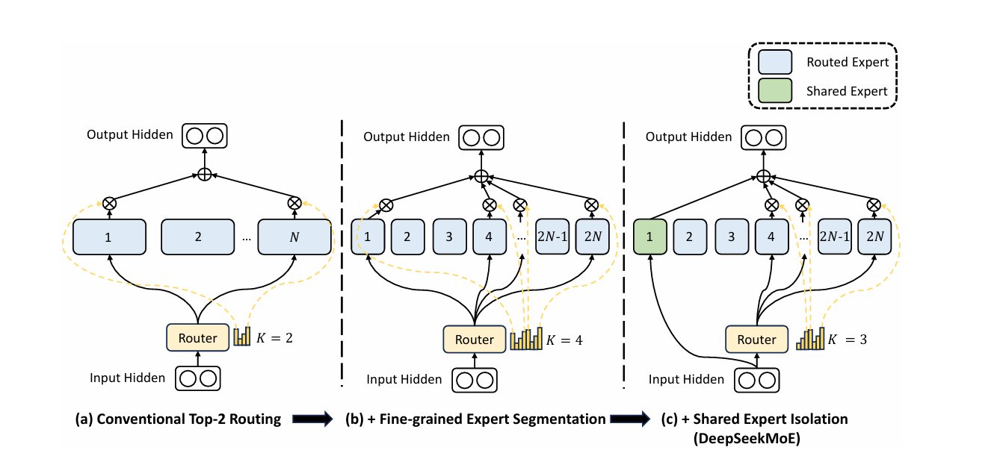
  <p><em>图 11. DeepSeekMoE结构示意图</em></p>
</div>

- **细粒度专家分割**：在保持专家参数总量不变的前提下，把原来的“较大”FFN专家按比例缩小例如每个小专家为标准FFN参数量的0.25倍，并将每个原专家分割成若干个更小的专家，从而显著增加总体专家个数即将 $N$ 个专家扩展为 $mN$ 个小专家。这种做法把模型的参数密度从“每个专家更大”转向“更多但更小的专家”，为专家间更细致的分工提供可能。

- **保持计算成本恒定的激活策略**：为了使 $\frac{\text{激活计算量}}{\text{激活参数量}}$ 大致不变，模型会在每次前向中激活更多个`小专家`。换言之，当每个专家变小（参数减少）时，路由器会选取更多的专家参与例如将原来的Top-K激活扩展为对分割后的小专家激活 $mK$ 个，从而在参数组合上维持或提升表达能力同时控制每次前向的计算预算。

- **组合灵活性与指数级组合空间增长**：细粒度化专家后，可供选择的专家集合组合数量呈阶乘、组合数爆炸式增长，从而显著提高路由器为某一输入构建`专家联盟`的自由度与多样性。

> 比如，如果原始 $N=16$ 且激活Top-2，那么可能组合数为 $C_16^2=120$ ；若每个原专家被分为4个小专家，则细粒度化专家以后得到总共 $64$ 个，并激活8个小专家，则可能组合数为 $C_64^8=4,426,165,368$  ，这展示了潜在组合空间的巨大扩张。

- **共享专家**：提出保留若干`共享专家`来捕获通用知识，从而降低路由专家之间的冗余并稳定训练，即在路由专家之外保留 $K_s$ 个共享专家作为常驻接收器或补偿通道。该设计与细粒度分割协同，能在提升专业化的同时保持对通用模式的覆盖。

<div align="center">
  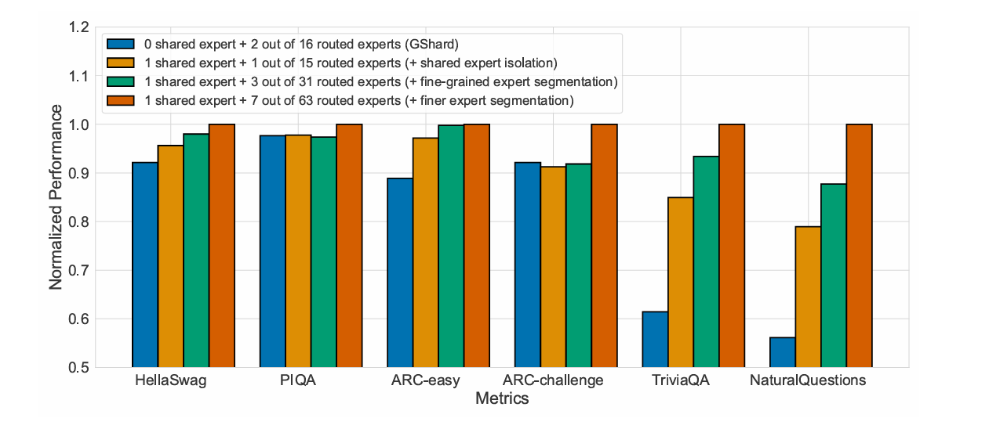
  <p><em>图 12. 总参数和激活参数的数量相同的对比实验</em></p>
</div>

在保持总参数量和激活参数量恒定的实验中，逐步把专家拆得更小，确实可以提升模型性能。不过，随着专家越来越细化，性能增益会逐渐减缓，而且通信开销、路由稳定性等工程因素的影响程度会开始变大，也就是说性能提升不是无限的。[论文](https://arxiv.org/pdf/2401.06066)的消融实验也提供了一个经验：**当共享专家和激活的领域化专家保持大约1:3的比例时，在基准任务上效果最好**。

因此，在实际操作中，需要在专家粒度、激活数量、共享专家比例，以及通信和路由开销之间进行trade-off，并通过消融实验找到在当前硬件和计算预算下的最佳配置。

- **负载均衡策略**：为了缓解负载不均衡可能导致的路由坍塌和计算瓶颈，DeepSeekMoE引入了辅助损失，这在DeepSeek-V3的后续版本中得到了进一步的演进。

   - 专家级平衡损失 $L\_{ExpBal}$ ：用于最小化Token在各个专家间分配的不均匀性，从而缓解路由崩溃的风险。
   - 设备级平衡损失 $L\_{DevBal}$ ：当专家分布在多个设备上时如DeepSeek-V3，引入此损失是为了确保跨设备的计算负载平衡，以优化并行计算效率。

> 在DeepSeek-v3里为了减少通信开销，一是把要传输的激活量用FP8格式量化，这样发消息更省带宽；二是把激活对应的梯度在送进MoE投影之前也做压缩，节省通信和内存。这个过程中为了不影响训练稳定性，涉及把各个专家输出“合并”的那一部分关键计算还是用BF16格式计算，保证精度不掉。**简单说就是传输用低精度（省带宽），关键计算用中等精度（保证稳定）。**

---

### 5.2 DeepSeek V4的改进

面对浅层的MoE架构，训练极其不稳定的情况，DeepSeek V3、Mimo等开源模型选择把浅层换成Dense FFN层来为后续可学习路由的MoE层提供稳定输入，而[DeepSeek V4则直接在浅层引入了3层Hash MoE（非学习路由）替代以往Dense层](https://huggingface.co/deepseek-ai/DeepSeek-V4-Pro/blob/main/config.json)，这在一定程度上缓解了这个问题。

面对训练MoE时因训练数据量翻倍引发的严重不稳定性以及反复损失尖峰（Loss Spike），不再是简单的`回滚机制`可以解决的问题，DeepSeek V4引入了两种方法：

- **前瞻路由**，将路由网络与主干网络的同步更新过程进行解耦，其主要思想是：

    - 利用**之前的一步**（即步骤 $t - \Delta t$ ）的路由参数，为步骤 $t$ 的数据**提前计算并缓存好专家分配结果**；

    - 同时，引入异步自动检测机制，仅在检测到损失尖峰时自动触发该前瞻路由模式，系统会回滚并稳定运行一段时间后再切回标准训练流程。

*Tips：前瞻路由虽然会带来约 20% 的额外计算开销，但经过与计算过程的流水线编排，成功消除了 Loss Spike 引发的训练不稳定，且未损害模型最终性能。*

- **SwiGLU钳制**，在训练过程中，**团队发现将SwiGLU激活函数的激活值限制在一个固定范围内，可以有效抑制异常值的产生**。具体做法是，将 `SwiGLU的线性分量`钳制在 [-10, 10] 区间，并将`门控分量`的上限钳制为10。

> DeepSeek团队，对于改善MoE模型的训练稳定性这种技术，尚未形成完整的理论基础，仅实际应用中得到了有效的验证。后续社区可以进一步研究这方面的问题。

## 6 MoE与深度学习

**基础层级特征抽取与传统分工**

在深度学习中，神经网络的每一层通常会**逐层抽取特征**：例如卷积神经网络从低层的边缘和纹理信息开始，逐步构建到高层的物体部件和抽象语义特征。在同一层中，不同卷积核**并行响应输入**，各自对特定模式敏感——这直观地体现了**特征分工**。需要注意的是，这种分工是**隐式且固定、弱并行**的，由权重和输入数据共同决定。

**混合专家的动态与稀疏分工**

与传统卷积核的固定分工不同，**混合专家**模型引入了**条件路由**例如**Top-k 门控机制**，在前向计算时**只动态激活少数专家模块**。每个专家可以专注处理特定类型的输入或特征模式，从而在**显著提升模型容量**的同时，保持**FLOPs可控**。换句话说，MoE的分工是**输入驱动、动态且稀疏的**，而传统卷积核的分工是算子并行且**固定**的。

**工程挑战**

从宏观角度来看，生物大脑在处理信息时也表现出**局部或模块化激活**：视觉、语言、运动等脑区“各司其职”。这与MoE的**专家专精化+条件激活**直观相似，二者都体现了**模块化与选择性计算**的优势，*然而，这只是概念性的类比工程实现与生物机制并非完全对应*。在实际MoE系统中，还需考虑问题：**专家负载均衡**、**路由器稳定性**以及**分布式通信开销**等实际挑战。

**超大规模MoE上的优化思路和方法**

在超大规模的**MoE推理模型**上，研究者展示了通过**LoRA + 强化学习**进行高效微调的可行性，这里的LoRA是在模型的dense层和专家层加上低秩适配器，使得微调时只更新少量参数，而**RL**用于优化模型的行为策略。

**在微调阶段对大模型引入RL**。以`Kimi-K2`为例（约`1.04T`参数，激活参数约`32.6B`），**研究团队结合混合并行与LoRA分片**，实现了稳定的RL训练，相比全参数RL该方法将GPU成本降低至约10%。

`Kimi-K2`的对比实验表明——`大基座模型+小规模LoRA`的RL明显优于`小模型的全参数RL`，**这一现象可归因于：本阶段RL的效果受限于基座模型的`先验能力`**，强大的base model能产生更高质量的训练轨迹，从而显著提升RL的学习效率。超大规模`MoE`会遇到一些特殊挑战，例如：

   - **路由不均衡**：部分专家被过度调用，部分专家闲置；
   - **通信压力**：不同GPU、节点间数据交换频繁；
   - **并行布局复杂**：tensor、pipeline、专家和序列并行的组合很难优化；
   - **训练、推理不一致**：可能导致专家重要性比例突然失衡。

为解决这些问题，Kimi团队提出了几种工程优化方法：

1. **混合并行设计**：合理安排不同并行方式，减少通信开销；
2. **截断重要性采样修正**：防止少数专家过载；
3. **自适应并行调度器**：根据实时指标GPU利用率、内存、步长时间自动调整tensor、pipeline、专家、sequence并行策略。

> 这些结论基于Kimi-K2和特定任务，具有工程环境依赖，在其他模型或任务中，效果可能有所不同，需要复现验证。

## 7 总结与测试题

### 7.1 课程总结

**本节梳理了关于 标准Attention 的改进、MoE的核心原理与主流路由机制**，并分析了其在大规模训练中面临的稳定性挑战。结合前沿大语言模型的实践，我们探讨了如何从**架构设计**（如DeepSeek V4的Hash MoE与前瞻路由）与**训练策略**（如SwiGLU钳制）两方面，有效提升MoE模型的训练效率。以及最近，MoE 进一步发展出现了 Kimi K3、Nemotron 3的 LatentMoE。

### 7.2 测试题

1. 目前 标准Attention 的改进以及其对应的原理是什么？

2. 改进MoE中负载不均衡、训练不稳定的方法有哪些？

3. MoE相较于Dense模型的区别是什么，两种架构运用场景是什么？

4. 路由器的训练通常面临不可微分的优化难题和早期不稳定性，尤其容易导致专家负载不均衡。这种不均衡不仅影响训练效率，也阻碍每个专家形成稳定且专精的功能。那么，如何稳定路由器训练使其能够更好地区分各个专家的“特长”，成为`MoE`架构研究中的关键问题，也是提升模型性能和资源利用率的重要方向吗？

## 参考资料

- [减少计算消耗的万亿参数MoE调优](https://macaron.im/mindlab/research/building-trillion-parameter-reasoning-rl-with-10-gpus)
- [DeepSeek-MoE](https://arxiv.org/pdf/2401.06066)
- [DeepSeek-V3](https://arxiv.org/pdf/2412.19437)
- [Kimi研究的KDA架构](https://arxiv.org/pdf/2510.26692v2)
- [Nemotron 3 Super 120B A12B](https://arxiv.org/abs/2604.12374)
- [Kimi团队基于KDA实现的Kimi linear 48B A3B model](https://huggingface.co/moonshotai/Kimi-Linear-48B-A3B-Instruct/blob/main/modeling_kimi.py)
- [FlashAttention 优化 Attention Kernel 提升 GPU 利用率、PagedAttention 改进 KV Cache 内存管理](https://datawhalechina.github.io/diy-llm/chapter6/chapter6_%E7%AC%AC%E5%85%AD%E7%AB%A0GPU%E5%92%8CGPU%E7%9B%B8%E5%85%B3%E7%9A%84%E4%BC%98%E5%8C%96.html)
- [Top-K TC](https://github.com/1iyouzhen/CS336-Chinese-co-construction/blob/main/docs/chapter5/Top-K%20TC.py)
- [Top-K EC](https://github.com/1iyouzhen/CS336-Chinese-co-construction/blob/main/docs/chapter5/Top-K%20EC.py)
- [辅助负载均衡](https://yangyutu.github.io/llm_book.github.io/docs/chapter_LLM_arch/LLM_moe_sparse_architectures.html)
- [容量控制 + expert capacity + overflow机制](https://mljourney.com/mixture-of-experts-moe-routing-algorithms-for-sparse-llms)
- [动态、无辅助损失的负载均衡](https://www.emergentmind.com/papers/2408.15664)
- [改善路由器、相似度保持路由](https://arxiv.org/abs/2506.14038)
- [改进专家结构、路由机制](https://arxiv.org/abs/2511.10971)
- [LSH](https://proceedings.neurips.cc/paper_files/paper/2024/file/61674667d642ae52f6bb281bea90ee29-Paper-Conference.pdf)
- [Mini LLM+MoE](https://github.com/1iyouzhen/CS336-Chinese-co-construction/blob/main/docs/chapter5/Mini%20LLM%2BMoE.py)
- [DeepSeek V4则直接在浅层引入了3层Hash MoE（非学习路由）替代以往Dense层](https://huggingface.co/deepseek-ai/DeepSeek-V4-Pro/blob/main/config.json)
