# 第 6 章 GPU 与 GPU 相关优化

进入 AI 时代后，深度学习中的**矩阵运算**把 GPU 推上了核心位置。神经网络训练与推理的本质是大量的矩阵乘加，这类计算规则、重复且数据并行度高，正好契合 GPU 的设计目标。大约从 2010 年前后开始，研究者就逐步把 GPU 用于加速深度学习相关计算。

## 1 本章学习目标

在进入具体分析前，先明确本章关注的重点。我们将围绕大模型训练与推理所依赖的硬件加速器展开，主要包括：

- 理解 GPU 的基本架构、与 CPU 的差异，以及从图形处理器到通用计算加速器的发展历程。
- 掌握 GPU 的执行模型（SM、Warp、Block、Thread）和分层内存体系（全局内存、L2 缓存、共享内存、寄存器等）。
- 学习 GPU 性能优化的关键技术：减少串行瓶颈、低精度计算、算子融合、重计算、内存合并访问、分块（Tiling）等。
- 深入理解 FlashAttention 与 PagedAttention 的核心原理，以及它们对长序列训练与推理效率的改进。

## 2 GPU的起源

在深度学习概念没有火起来之前，GPU 在普通人眼中是**游戏显卡**，即图形处理器。下面用一个例子来说明 GPU 为什么适合这类计算。

当我们打开游戏里面的 3D 模型，可以发现 3D 模型都是由一个一个**小三角形**构成。三角形由三根线构成，为了节省存储空间，我们只存储三角形的三个顶点坐标，构成线的像素点坐标并不预先存储，而是实时计算出来。

<div align="center">
  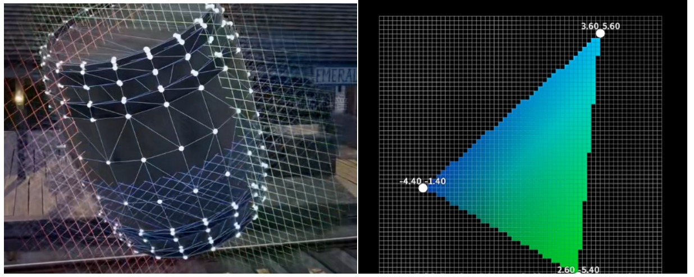
  <p><em>图1.三维模型与三角形光栅化</em></p>
</div>

渲染需要对大量顶点、片元执行高度相似的操作。这种大规模、规则的数据并行需求，正是图形处理器被设计出来的直接原因。后来 GPU 进一步演变成通用计算加速器。

---

### 2.1 CPU 和 GPU 的区别

CPU 与 GPU 的根本差异在于设计目标：

- **CPU** 以低延迟和复杂控制流为目标。它把大量晶体管用于分支预测、乱序执行、大容量缓存和复杂控制逻辑，核心数量相对较少，但单核性能强，**适合处理不规则、分支密集的任务**。
- **GPU** 以高吞吐量为目标。它把大部分晶体管投入到大量并行算术单元（ALU）上，用相对简单的控制逻辑协调海量线程，**适合执行规则、数据并行度高的计算（如矩阵乘加）**。

<div align="center">
  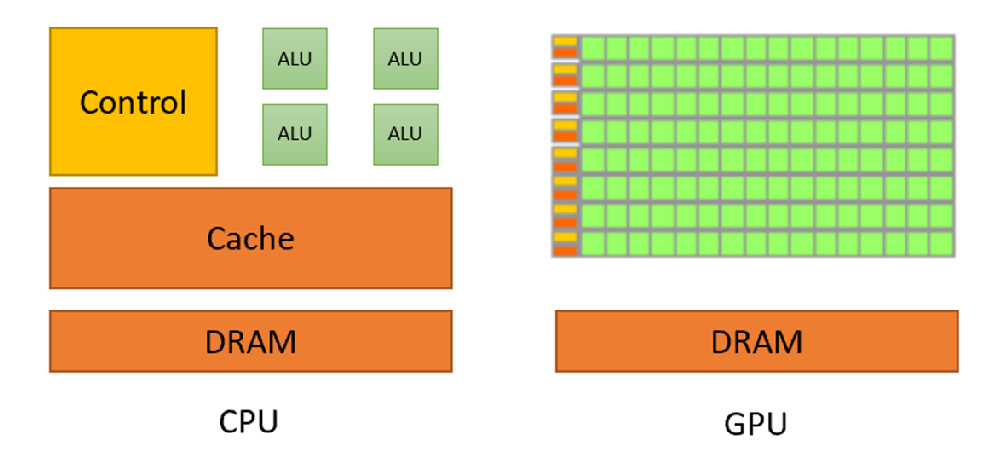
  <p><em>图2.CPU与GPU结构对比</em></p>
</div>

从图中可以直观看到资源分配的差异—— CPU 的计算单元较少，控制与缓存占比高；GPU 则大幅压缩控制逻辑，把芯片面积主要留给并行计算单元。

实际程序中通常由 CPU 负责调度与控制，GPU 执行适合数据并行的 kernel。但是，**主机与设备之间还存在数据传输和同步开销，这些成本在程序设计时需要一并考虑**。

---

### 2.2 A100 显卡核心的构成

一个实际 GPU 的结构：

<div align="center">
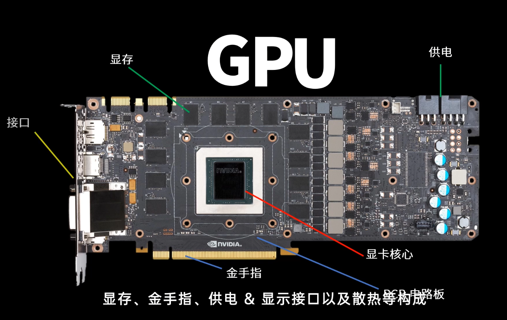
<p><em>图3.消费级GPU板卡结构</em></p>
</div>

一张典型的数据中心 GPU 主要由供电电路、GPU 核心、显存以及主机接口组成。A100 是面向数据中心的纯计算 GPU，不提供传统图形输出接口。

完整 GA100 芯片设计有 128 个 SM，量产 A100 通常启用 108 个 SM。

**Ampere 核心架构拓扑**：

<div align="center">
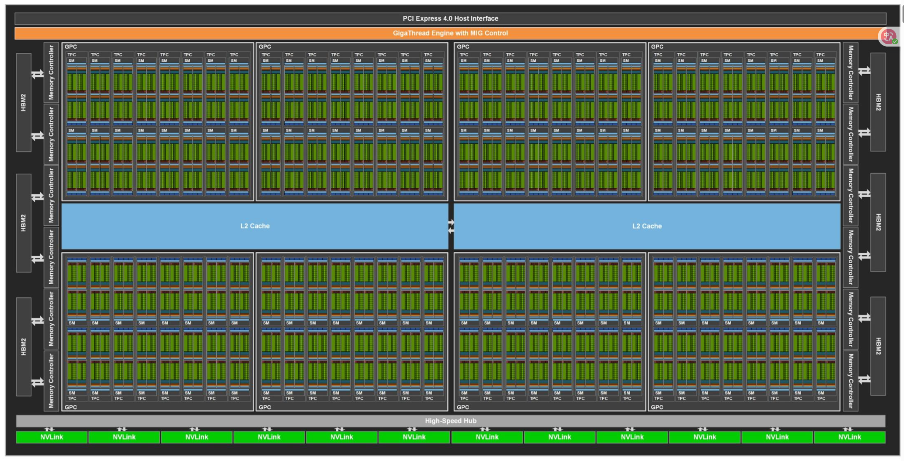
<p><em>图4.GA100芯片架构</em></p>
</div>

A100 的层级结构大致为：

- **GPC**（Graphics Processing Cluster）：完整芯片设计 8 个，量产 A100 通常启用 7 个。
- **TPC**（Texture Processing Cluster）：每个 GPC 含多个 TPC。
- **SM**（Streaming Multiprocessor）：最终启用 108 个。每个 SM 有 64 个 FP32 CUDA Core 和 4 个第 3 代 Tensor Core。
- 显存：5 个 HBM2e 堆栈，总计 80 GB，带宽约 1.9–2.0 TB/s（PCIe 与 SXM 略有差异）。

| 项目 | A100 80GB 代表性规格 |
|------|----------------------|
| 显存 | 80 GB HBM2e |
| 显存带宽 | PCIe ≈ 1.935 TB/s，SXM ≈ 2.039 TB/s |
| 启用 SM | 108 |
| FP32 CUDA Core | 6912 |
| Tensor Core | 432（第 3 代） |
| FP16/BF16 Tensor Core 峰值 | 312 TFLOPS（稠密） |
| TF32 Tensor Core 峰值 | 156 TFLOPS（稠密） |
| FP64 峰值 | 9.7 TFLOPS（CUDA Core）/ 19.5 TFLOPS（Tensor Core） |

Tensor Core 是专门的矩阵乘加单元，与 CUDA Core 属于不同执行管线。理解这个层级结构，对后续做占用率、共享内存、Tensor Core 利用率等优化很有帮助。


## 3 GPU 的执行模型

我们简单介绍了 A100 GPU 的结构，但还不知道 GPU 是如何真正执行计算的。下面介绍 GPU 各个部分是如何协同完成计算的。

---

### 3.1 执行模型

在 GPU 运行中，我们按三个粒度层级来理解执行过程：**Block（线程块）→ Warp（线程束）→ thread（线程）**，粒度逐级细化。

<div align="center">
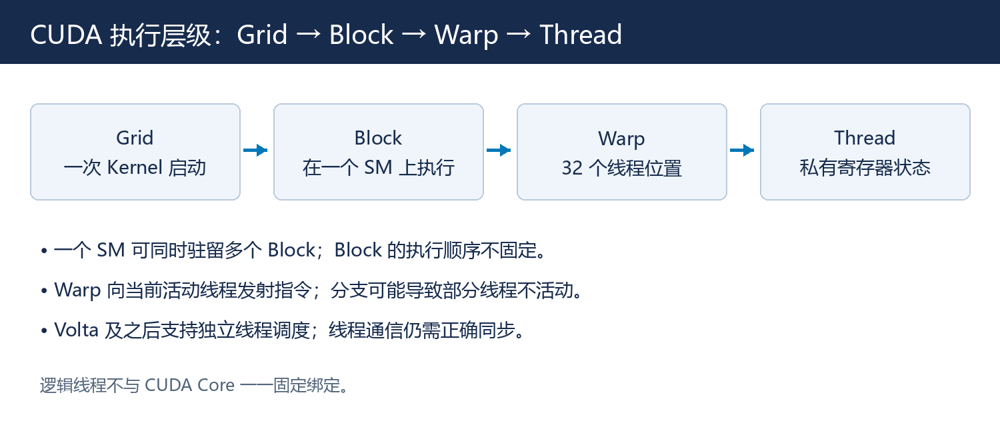
<p><em>图5.CUDA执行层级</em></p>
</div>

- **Block** 是程序员可以指定的较大线程组，**每个 Block 会被分配给一个 SM 处理**。可以把 SM 想象成独立工作的计算单元，而 Block 就是分配给它的任务包。**同一个 Block 内的所有线程必须在同一个 SM 上执行，不能跨 SM**。
- 每个 Block 内部包含大量线程。这些线程在执行时会按固定大小分组，这种分组就叫 **Warp**。
- 每个 Warp 由 **32 个连续编号的 thread** 组成，它们会被同步调度和执行。

多个 Block 被分配到不同的 SM 上；每个 Block 内部再被切分成多个 Warp；每个 Warp 由 32 个线程组成。所有这些线程都在执行相同的指令，只是处理的数据不同，这就是 GPU 最基本的执行模型。

<div align="center">
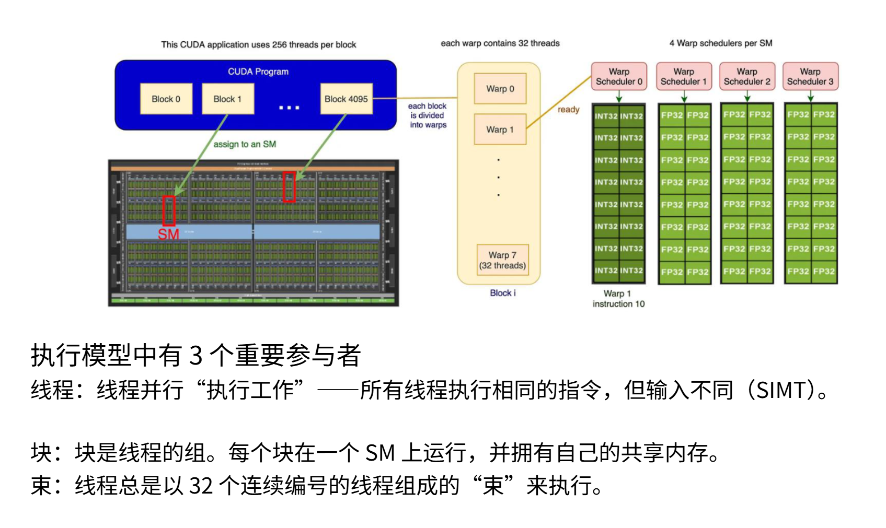
<p><em>图6.SM线程调度</em></p>
</div>

**Block**&nbsp;&nbsp;是程序员在启动 Kernel 时指定的线程组，会被映射到**一个 SM** 上执行。可以把 Block 想象成一个“施工队”：队内成员可以共享工具（共享内存），也可以通过同步指令进行协调。

每个 Block 独占该 SM 分配给它的共享内存和寄存器资源，**Block 内的所有线程必须在同一个 SM 内完成执行，不能跨 SM**。

**Warp**&nbsp;&nbsp;是由 32 个线程组成的固定小组，是 SM 调度的**最小单元**。硬件每次向整个 Warp 发射同一条指令，Warp 内的线程以锁步方式执行。如果部分线程因为 if-else 等分支走向不同路径，就会发生 **Warp Divergence**。


**thread**&nbsp;&nbsp;线程是最细粒度的执行单元。**每个线程都执行完全相同的 Kernel 代码，但操作的是不同的数据**，即每个线程负责处理一个数据元素（例如向量中的一个数）。

每个线程拥有自己的私有寄存器（数量由编译器和占用率共同决定，常见配置下每个线程可用约 255 个 32-bit 寄存器）。线程通过 `threadIdx.x`（以及 y、z）来确定自己负责处理哪一份数据。

---

### 3.2 SM 的作用

SM 是 GPU 中**独立调度和执行的基本硬件单元**。

每个 SM（执行计算，同时也负责通信相关的内存操作）内部包含大量流处理器（SP）。SM 本身拥有一套控制逻辑，负责决定执行什么指令（包括分支判断），而 SP 则负责把相同的指令应用到不同的数据上，从而实现海量并行计算。因此，**SM 是控制粒度的基本单元**，单个 SP 则负责具体的数值计算。

**线程调度与执行**&nbsp;&nbsp;SM 同时管理数千个线程，决定哪个线程在何时使用哪个计算单元。它不像 CPU 那样为每个线程保存大量上下文状态，而是采用轻量级切换，几乎没有切换开销。

**指令流水线**&nbsp;&nbsp;SM 内部有多条独立的指令流水线。A100 的每个 SM 配备 4 个 Warp 调度器，每个时钟周期最多可以同时向 4 个不同的 Warp 发射指令。

**数据缓存与共享**&nbsp;&nbsp;每个 SM 都拥有独立的、可配置的 L1 缓存/共享内存，仅供本 SM 内的线程访问。L2 缓存和全局显存（HBM）则由整块 GPU 上的所有 SM 共享。


**CUDA Core**&nbsp;&nbsp;最基础的通用计算单元，负责执行常规的浮点和整数运算。每个 CUDA Core 在一个时钟周期内通常完成一次标量 FMA（乘加）或类似运算。它们在 **SIMT 执行模型**下工作——warp scheduler 以 warp（32 个线程）为单位发射指令，CUDA Core 并行处理 warp 内不同线程的数据。

**Tensor Core**&nbsp;&nbsp;专门为矩阵乘加（MMA）设计的专用加速单元。它通过 MMA 指令在**一个时钟周期内完成一次小型矩阵 tile 的乘加操作**，远高于 CUDA Core 的吞吐量。**大矩阵通过软件分块（tiling）多次调用 MMA 来完成**。

A100 的第三代 Tensor Core（每 SM 4 个，全卡 432 个）支持 TF32、BF16、FP16、FP64、INT8、INT4 以及 2:4 结构化稀疏计算，是深度学习训练和推理中矩阵运算性能的核心来源。

>**注**：CUDA Core 在矩阵吞吐上远不如 Tensor Core，但在非矩阵运算、不规则控制流、极小矩阵（*无法有效填满 Tensor Core tile*）或无法使用混合精度/稀疏的场景中，CUDA Core 仍是必要且可能更优的选择。

## 4 GPU的内存模型

<div align="center">
  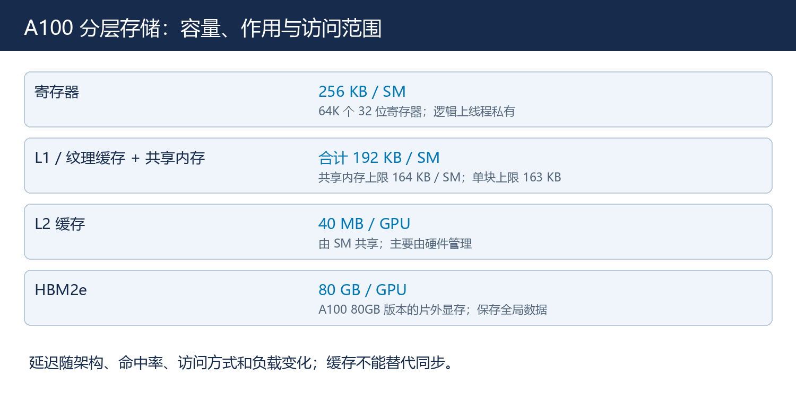
  <p><em>图7.A100分层存储</em></p>
</div>


**内存距离 SM 越近，访问速度越快，并且数据刷新得很快**。SM 内部拥有速度最快的存储：寄存器、L1 缓存和共享内存。寄存器用于保存线程私有的临时数据，速度极高；L1 缓存/共享内存则供同一 SM 内的线程快速共享数据。

L2 缓存位于芯片内部、紧邻各 SM 集群（图中蓝色区域），由所有 SM 共享。它比 L1/共享内存慢一个数量级，但仍远快于全局显存。

全局显存（HBM）通过芯片边缘的 PHY 连接到外部 DRAM，数据需要离开芯片进行传输。访问延迟约 290 个周期，是整个层级中最慢的一级。

从延迟表可以看到，从共享内存到全局显存存在约 **10倍** 的差距。如果计算过程频繁访问全局显存，SM 很容易因等待数据而空转导致利用率下降。

---

### 4.1 全局内存（Global Memory）

全局内存是 GPU 中容量最大、位置最远的存储层。它物理上位于 GPU 芯片外部的 HBM2e 显存堆栈中。比如，A100 80GB 版本使用 HBM2e，总容量达到 80GB，带宽约为 2 TB/s。

全局内存由程序员手动管理，所有线程都可以访问。它用于存放模型权重、激活值、梯度、训练数据以及各类中间结果，是数据持久化的主要场所。主机与 GPU 之间的数据传输也通过 PCIe 经过全局内存完成。

虽然延迟较高，但全局内存提供了巨大的容量，能够容纳大模型所需的海量参数，是**整个 GPU 存储体系的基础**。

---

### 4.2 L2 缓存（二级缓存）

**L2 缓存位于 GPU 芯片内部**，由所有 SM 共享，A100 上的容量为 40MB。它的带宽显著高于全局内存。

L2 缓存由硬件自动管理，对所有 SM 的所有线程可见。它的核心作用是缓存全局内存中的热点数据（例如频繁访问的模型权重），从而减少对高延迟 HBM 的直接访问。同时，L2 也是不同 SM 之间交换数据的共享枢纽，保证了跨 SM 的数据一致性。

在 NVIDIA 架构中，SM 与全局显存之间的绝大多数数据通路都会经过 L2 缓存，因此 L2 实际上承担了整个 GPU 的数据总枢纽角色。合理利用 L2 缓存命中，是缓解内存墙、提升有效带宽的关键手段。

---

### 4.3 L1 缓存/共享内存（Shared Memory）

**L1 缓存与共享内存位于每个 SM 内部，两者共享同一块可配置的 SRAM**，总容量为 192KB/SM。访问延迟远低于 L2，大约在 20–30 个周期。

共享内存由程序员完全手动管理，同一 Block 内的所有线程都可以访问，常用于块内线程之间的数据交换，例如矩阵乘法中的分块（Tiling）数据。当不显式使用共享内存时，这片 SRAM 会自动作为 L1 缓存，由硬件管理，用于缓存全局内存数据。

由于延迟低且可编程控制，L1/共享内存是算子性能优化的核心层级。通过显式把热点数据放入共享内存，可以接近寄存器级别的访问速度，同时实现复杂的线程协作模式。

---

### 4.4 寄存器文件（Register File）

**寄存器文件是距离计算单元最近、速度最快的存储层**，位于每个 SM 内部，紧邻 CUDA Core。A100 上每个 SM 拥有 256KB 的寄存器文件，访问延迟几乎为零。

寄存器完全由编译器自动分配，每个线程私有，用于存放局部变量和临时计算结果。单个线程最多可使用约 255 个寄存器。寄存器用量越少，SM 上能够同时驻留的 Warp 数量就越多，从而直接影响并行度和占用率。

虽然速度极快，但**寄存器容量有限且成本高昂**，那么在**编写高性能算子时需要在计算复杂度和寄存器压力之间做好 trade-off**。

---

### 4.5 GPU 分层存储的原因

在物理世界中，信号传播速度受光速限制，电信号在导线中传输需要时间。**物理距离越短，延迟就越低，因此片上（On-Chip）通信的延迟远低于片外（Off-Chip）通信**。

受芯片面积、功耗和工艺密度限制，越靠近计算核心的存储，速度越快、延迟越低，但容量越小；越远离计算核心，容量可以做得更大，但延迟和能耗也更高。需要在访问速度、存储容量、功耗之间找到平衡，这就是为什么 GPU 必须采用多层存储结构。

程序访问数据时通常具有局部性：
- **时间局部性**：刚被访问的数据很可能很快再次被访问，例如循环中反复使用的权重。
- **空间局部性**：相邻地址的数据很可能被一起访问，例如矩阵不同行的元素。

GPU 也可以通过分层存储来利用这些局部性：
- **L2 缓存**主要利用时间局部性，自动缓存被反复访问的全局数据（如模型权重），减少对高延迟 HBM 的访问。
- **共享内存**由程序员手动管理，把同一 Block 内线程需要协作或反复使用的数据块（如 Tiling 后的矩阵分块）加载进来，实现低延迟、高带宽的数据共享与复用。
- **寄存器**则保存线程最频繁使用的临时变量，提供几乎零延迟的访问。

## 5 TPU架构（Tensor Processing Unit）

**TPU**是Google从2015年开始自己设计的专用芯片（ASIC），专门为神经网络计算打造。如果说GPU是“从游戏显卡转型做AI”，那TPU就是“天生只为AI服务”的芯片。

它从设计之初就只聚焦一件事——把张量（尤其是矩阵）运算做得又快又省电。

<div align="center">
  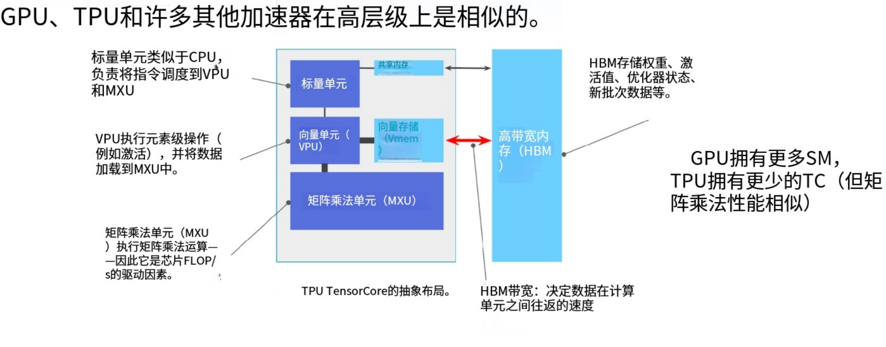
  <p><em>图8.TPU抽象结构</em></p>
</div>

### 5.1 TPU与GPU的相似性

TPU芯片里有一个或多个叫 **TensorCore** 的计算单元，这里的 TensorCore 是 Google 自己的叫法，和NVIDIA的Tensor Core不是一回事。

每个 TensorCore 大致可以分成这几部分：

- **标量单元**：负责控制流程、计算地址这类工作。
- **矢量单元**：处理逐个元素的运算，比如激活函数。
- **MXU（矩阵乘法单元）**：芯片里占地最大、最核心的部分。它用一种叫“脉动阵列”的特殊结构，专门高效做大规模矩阵乘法。
- 片上有高速小容量存储，片外则是大容量的高带宽内存（HBM）。

GPU 和 TPU 两者都采用了“计算核心 + 片上高速存储 + 片外大内存”的分层结构，也都针对矩阵运算做了专门加速。

**核心区别**：
- TPU几乎只为密集矩阵乘法优化，不做通用计算，所以结构更简单、能效更高。
- TPU没有GPU那种 Warp、CTA 之类的线程模型，编程主要靠 XLA 编译器自动优化。
- 真正干重活的是MXU，它像一条高效的流水线，专门把矩阵乘法做得极致。

简单来说,GPU像一台功能全面的通用工具，什么都能做；而 TPU 则像一把专门的工具，是把矩阵乘法这件事做到极致。

## 6 性能扩展趋势

### 6.1 我们希望矩阵运算又快又好

<div align="center">
  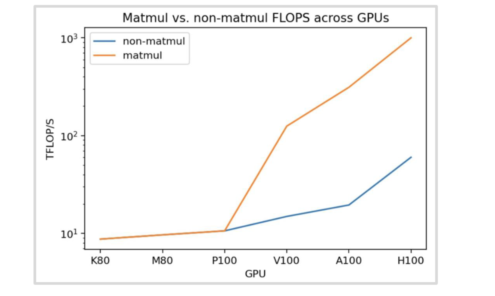
  <p><em>图9.矩阵与标量运算峰值对比</em></p>
</div>

从上图可以看出，从 V100 开始，橙色的矩阵乘法（matmul）性能与蓝色的非矩阵运算性能开始显著分化。这主要得益于 NVIDIA 在 Volta 架构引入的 **Tensor Core**，它是专门为矩阵乘法设计的硬件电路，使矩阵乘法运算比其他浮点运算快 10 倍以上。

### 6.2 计算与内存扩展不平衡

<div align="center">
  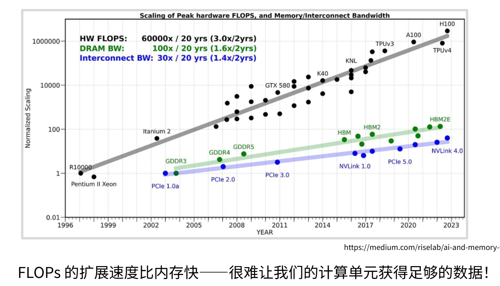
  <p><em>图10.算力与带宽增长趋势</em></p>
</div>

过去 20 年，硬件峰值 FLOPS 提升了约 60000 倍（灰线），而内存带宽仅提升约 100 倍（绿线），互联带宽提升更慢（约 30 倍，蓝线）。计算能力的扩展速度远超内存，导致“算得动但喂不饱”的问题日益严重。

<div align="center">
  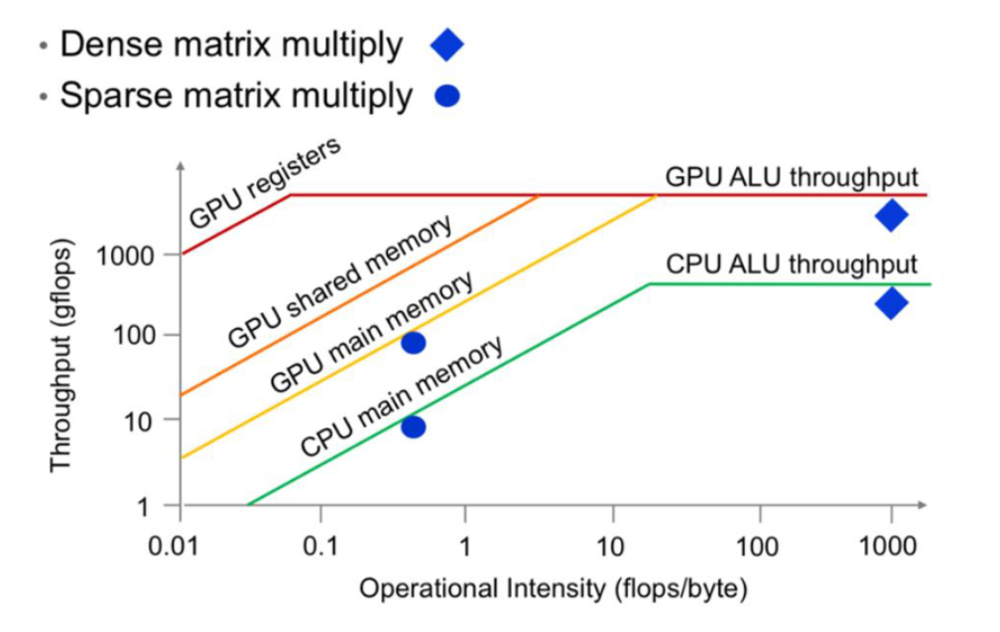
  <p><em>图11.Roofline模型</em></p>
</div>

Roofline Model 横轴是算术强度（即每字节数据能支撑的浮点运算次数），纵轴是吞吐量：

- 左侧区域属于**内存受限**：数据搬运速度跟不上计算，性能受限于内存带宽。
- 右侧区域属于**计算受限**：计算单元已满载，性能受限于算力上限。

不同颜色的斜线代表不同存储层次的带宽上限（寄存器最高，主存最低）。理想情况下，我们希望算法落在右侧计算受限区域，尽量减少对低速全局内存的访问，提高数据复用率。

由于硬件层面内存带宽增长远慢于算力增长，未来性能优化将会更多依赖软件层面的内存友好设计。


## 7 性能优化技术

### 7.1 避免串行执行

下面是一个简单的分支示例：

```c
// 代码示例
if (x < 4) {
    A;  // x < 4 时执行
    B;
} else {
    X;  // x >= 4 时执行
    Y;
}
Z;      // 无论 x 取何值都会执行
```

GPU 的 CUDA Core 采用 SIMT 执行模型：同一线程束（Warp，通常 32 线程）内的所有线程必须执行相同的指令（仅操作的数据不同）。当 Warp 内部分线程走 if、另一部分走 else 时会发生分支发散，GPU 通过掩码机制串行处理两条路径，导致该 Warp 执行时间近似等于两条路径耗时之和，计算资源利用率下降。

Tensor Core 则采用 MMA 执行模型，以 warp 级矩阵乘加指令的形式工作，其执行语义和数据组织方式与 SIMT 不同。

但是核心优化原则始终是**尽量避免同一 Warp 内的线程走不同分支**。如果一个 Warp 内所有线程都走同一路径，分支开销几乎为零。


---

### 7.2 使用低精度提升性能

使用低精度的本质是用**精度**换取更快的计算和更省的带宽。这背后主要有硬件电路简化、数据量减少、专用加速单元三重优化。

<div align="center">
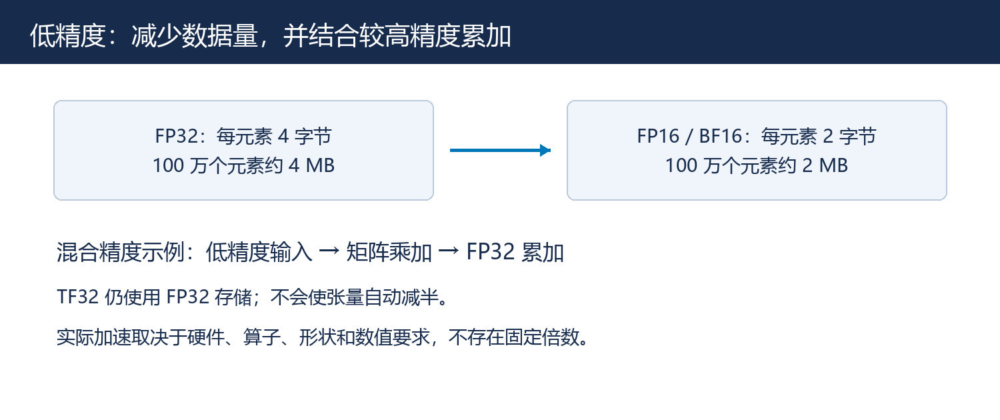
<p><em>图12.低精度存储与混合精度</em></p>
</div>

常见的低精度格式：

| 精度类型 | 位数 | 表示范围 | 典型场景 | 速度提升 |
|---------|------|----------|----------|----------|
| **FP32** | 32 位 | 3.4×10³⁸ | 传统训练，精度敏感 | 基准 |
| **FP16** | 16 位 | 6.5×10⁴ | 通用训练/推理 | 2-4 倍 |
| **BF16** | 16 位 | 3.8×10³⁸ | AI 训练首选 | 2-4 倍 |
| **TF32** | 19 位 | 3.4×10³⁸ | A100+ 默认格式 | 5-10 倍 |
| **INT8** | 8 位 | ≈256 | 量化推理 | 8-16 倍 |
| **INT4** | 4 位 | 16 | 极致推理 | 16-32 倍 |
| **FP8** | 8 位 | 动态范围 | Hopper/Blackwell | 10-20 倍 |

低精度虽然能显著降低数据搬运量和计算开销，但也会损失一定的数值精度，这是正确性与效率之间的权衡。因此在实际训练和推理中，通常采用**混合精度**计算：关键路径传输使用低精度加速，累加和部分敏感操作保持较高精度，以兼顾性能与稳定性。

这 3 个提高计算速度的方法则是更多是在低精度优化中实现的：

**提速机制一：显存占用降低**

低精度下，同样参数量的模型占用显存显著降低。以 GPT-3 175B 为例：FP32 约 700 GB，BF16 约 350 GB。激活值和梯度同样可减半。

以 HBM2e 约 2 TB/s 带宽估算：FP32 每秒约可传输 5×10¹¹ 个参数，BF16 则可翻倍。低精度能缩短权重加载时间，并让显存容纳更大模型。

**提速机制二：Tensor Core 专用加速**

Tensor Core 是 NVIDIA 为低精度矩阵乘专门设计的硬件，并非简单缩小版 FP32 单元。

A100 Tensor Core 峰值性能（密集）参考：

| 精度 | 峰值算力 | 相对 FP32 CUDA Core |
|------|----------|---------------------|
| FP32 | 19.5 TFLOPS | 1×（基准） |
| TF32 | 156 TFLOPS | 8× |
| FP16 / BF16 | 312 TFLOPS | 16× |
| INT8 | 624 TOPS | 32× |

其加速原理包括：权重可预加载到阵列中减少搬运，以及使用 FP32 累加器在保证精度的同时接受低精度输入。

**提速机制三：同样面积可集成更多计算单元**

同样芯片面积下，低精度可支撑更高的计算密度。A100 的 SM 中，Tensor Core 与 CUDA Core 共享资源：FP32 模式主要依赖 64 个 CUDA Core；低精度模式下 Tensor Core 可提供远高于 CUDA Core 的矩阵运算吞吐。

<div align="center">
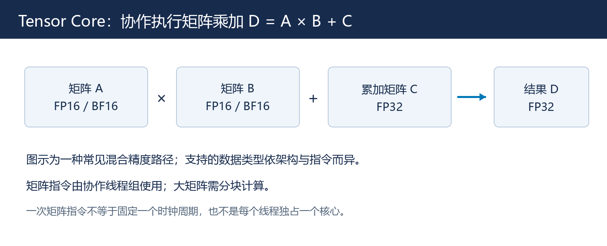
<p><em>图13.TensorCore矩阵乘加</em></p>
</div>


---

### 7.3 算子融合

算子融合通过**消除中间结果的内存读写**和**减少 Kernel 启动开销**，实现性能提升。

<div align="center">
  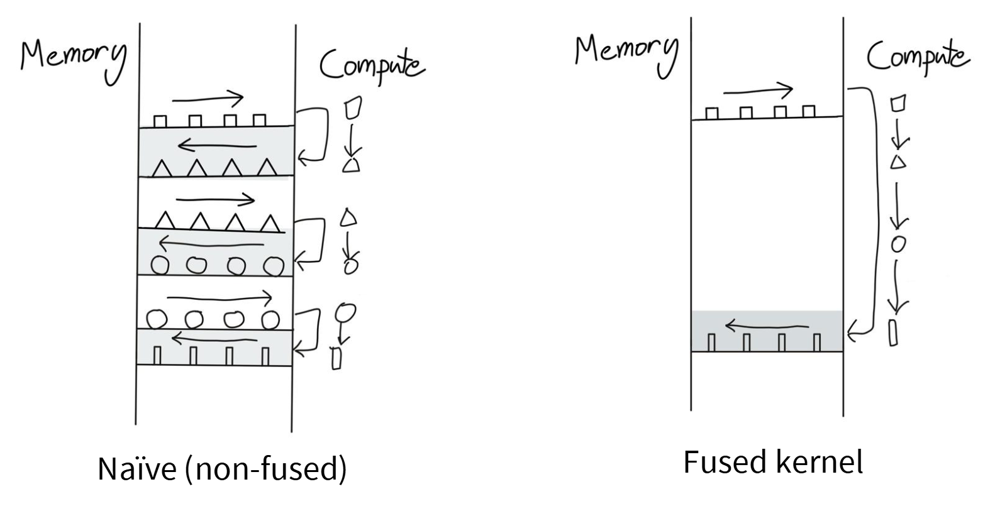
  <p><em>图14.算子融合与数据搬运</em></p>
</div>

左侧是**未融合**的情况。每个算子独立执行，中间结果都要写回全局内存，再被下一个算子重新读取。数据在 Memory 和 Compute 之间多次往返，产生大量不必要的内存流量；右侧是**融合 Kernel** 的情况。把多个连续算子合并到同一个 Kernel 中，中间结果直接保留在寄存器或共享内存里，只在最后需要时才写回全局内存。

核心思想很简单——**能在计算单元内完成的操作，就不要把中间结果写回内存**。这样既能减少内存访问，也能降低 Kernel 启动开销，从而提升整体效率。


这里举一个更直观的例子：

<div align="center">
  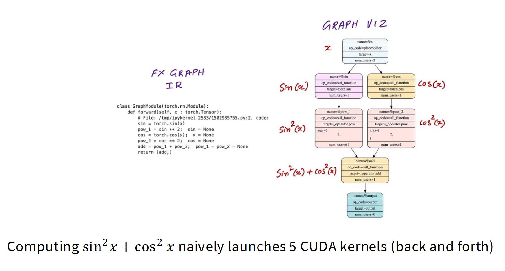
  <p><em>图15.逐元素算子融合</em></p>
</div>

假设我们要计算 $\sin^2 x + \cos^2 x$。在 PyTorch 中如果按普通写法执行，会生成类似上图的计算图，并依次启动多个 CUDA Kernel：计算 $\sin x$、计算 $\cos x$、对两者分别平方、最后相加。每个 Kernel 都需要从全局内存读取数据、写回中间结果，导致数据在内存和计算单元之间反复传输。

实际上这些运算可以**融合成一个 Kernel**。中间结果（ $\sin x$ 、 $\cos x$ 、平方结果）直接保留在寄存器中，只在最后把最终结果写回全局内存。**这样原本需要多次 Kernel 启动和多次内存往返的操作，就变成了一次高效的融合计算**。

---

### 7.4 重计算

**重计算的核心思想是通过增加计算量来避免内存访问**。

<div align="center">
  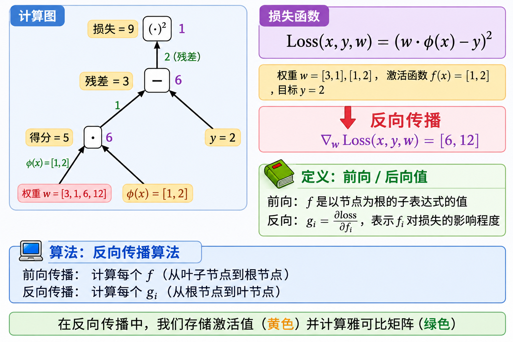
  <p><em>图16.计算图与反向传播</em></p>
</div>

我们获取最底层的输入数据（黄色节点），然后我们向上传播激活值。这些也是树上的黄色数值。接着我们反向计算雅可比矩阵。这些是边上的绿色数值。为了计算梯度，我将进行反向传播，需要进行乘法运算。我们会将雅可比矩阵和激活值结合，反向传播梯度。前向传播后的那些黄色数值必须被存储起来，它们被存储后需要从我们存放的全局内存中提取，并送入计算单元。

从机制上来说，这个过程是必然发生的。但这可能会导致海量的内存输入输出操作，不过能够避免这种情况。比如这个关于 sigmoid 函数的例子：

<div align="center">
  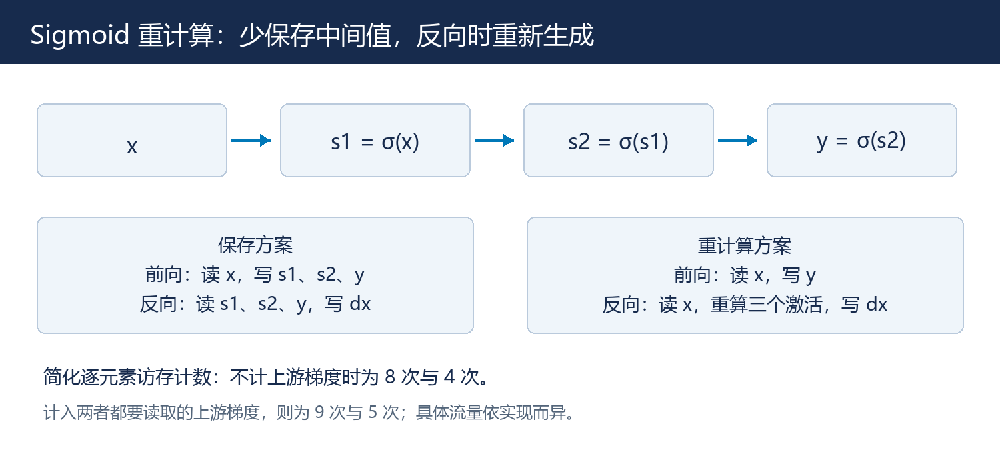
  <p><em>图17.Sigmoid重计算</em></p>
</div>


三个 sigmoid 层层堆叠。前向传播时计算并存储中间激活值 S1、S2，最终得到输出；反向传播时需要读取这些存储的激活值来计算梯度。整个过程涉及多次全局内存读写（共约 8 次）。

**重计算的核心**是前向时不存储 S1 和 S2，只保留输入 $x$ 和最终输出。反向传播时，利用输入 $x$ 和上游传来的梯度 $D_{out}$ ，在本地内存中就需要**动态重新计算三个 sigmoid，再完成梯度计算**。

这个方法把内存访问量降到原来的 5/8，代价是多算三次 sigmoid。**当计算单元因内存带宽瓶颈而闲置时，用过剩的算力换取紧缺的内存带宽，往往会划算一些**。

---

### 7.5 访存合并

GPU中的**慢速内存**（即全局内存/DRAM）实际上极其缓慢。为了**提升速度，硬件层面会进行特定优化**。

<div align="center">
  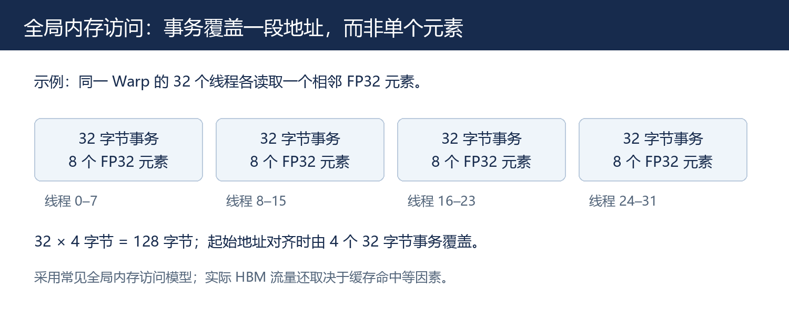
  <p><em>图18.全局内存访问事务</em></p>
</div>


DRAM 的一项重要优化是**突发模式**（Burst Mode）：一次读请求后，内存不会只返回单个数据，而是连续返回整个突发段（常见长度为 4 或 8 个字）。原因在于——打开一行并将数据送入读出放大器是最耗时的步骤。一旦完成，同一行内后续连续地址的数据几乎可以“免费”依次传出。因此，内存按突发长度组织传输，系统在一次激活后直接返回整段数据。

**如果访问是连续且对齐的，就能充分利用突发模式，有效带宽显著提升。随机访问则需要反复承担行激活延迟**。

在 GPU 等并行架构中，把多个线程的访存请求合并成少量匹配突发长度的事务，从而高效利用上述特性，这一机制称为**访存合并**。它能大幅减少实际内存事务数量，提升整体吞吐量。

<div align="center">
  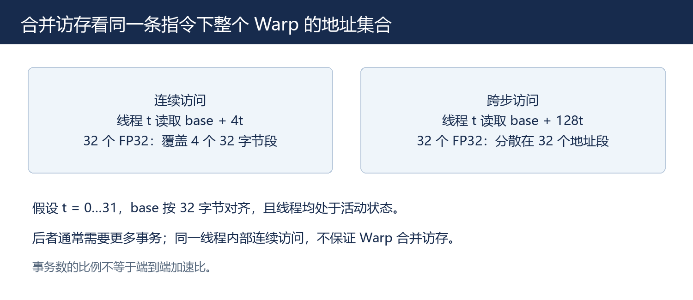
  <p><em>图19.Warp合并访存</em></p>
</div>

访存合并看的是**同一条指令下整个 Warp（32个线程）产生的地址集合**，而不是单个线程随时间的访问顺序。

- **连续访问**（线程 t 读 `base + 4t`）：32 个 FP32 通常只覆盖少量 32 字节段，硬件可合并成很少的内存事务。
- **跨步访问**（线程 t 读 `base + 128t`）：地址分散到很多段，需要大量事务。

同一线程内部连续访问，**并不保证** Warp 能合并；关键看同一时刻 Warp 内所有线程的地址是否连续或对齐。

**以行主序矩阵为例：**

<div align="center">
  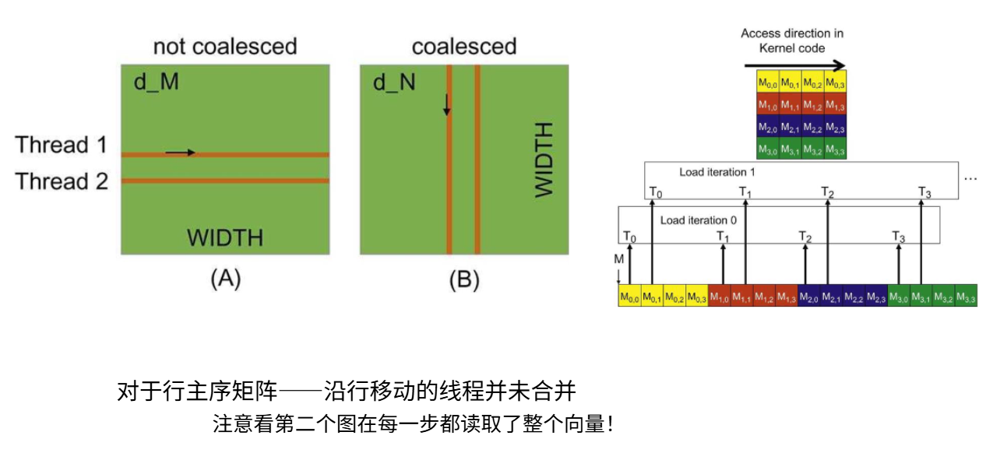
  <p><em>图20.行主序矩阵线程映射</em></p>
</div>

- 每个线程负责**一行**，Warp 内线程在同一时刻访问的地址间隔为矩阵宽度 → 高度跨步，无法合并，性能差。
- 每个线程负责**一列**，Warp 内线程在同一时刻访问同一行的连续元素 → 地址连续，可完全合并，带宽利用率高。

让同一 Warp 的线程在同一指令里尽量访问**连续、对齐**的地址，才能充分利用 DRAM 突发和缓存行，否则实际使用带宽率会远低于理论值。事务数减少的比例也不等于最终加速比。


**这种内存访问顺序的差异看似底层的细节变化，但在 GPU 编程中至关重要。遍历顺序一旦设计不当，性能往往会出现数量级的下降**。

---

### 7.6 分块（Tiling）

**分块的核心思想是通过分组内存访问来减少全局内存的访问量**。

<div align="center">
  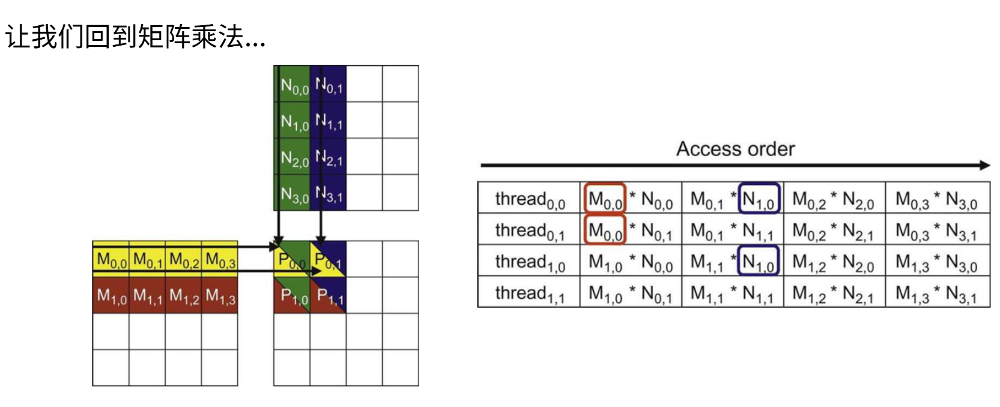
  <p><em>图21.朴素矩阵乘法访存</em></p>
</div>


以朴素矩阵乘法为例，每个线程直接从全局内存读取 $M$ 的一行和 $N$ 的一列做内积。这种访问通常无法合并，且同一元素会被多个线程反复读取，全局内存流量很大，性能较差。

理想做法是把需要的数据块先加载到共享内存，在共享内存里完成大量计算，再处理下一批数据，从而大幅减少全局内存访问。

<div align="center">
  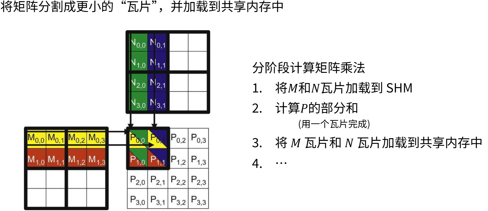
  <p><em>图22.共享内存分块矩阵乘法</em></p>
</div>

将 $M$ 和 $N$ 划分成小块（如 $2\times2$ ）。每次把当前需要的 $M$ 小块和 $N$ 小块加载到共享内存，计算对应的部分积并累加到结果中，再加载下一批小块，重复直至完成。

这样做大幅减少了全局内存访问。同时，因为加载的是完整小块，可以灵活选择遍历顺序，更容易实现合并访问，从而获得更好的整体性能。

<div align="center">
  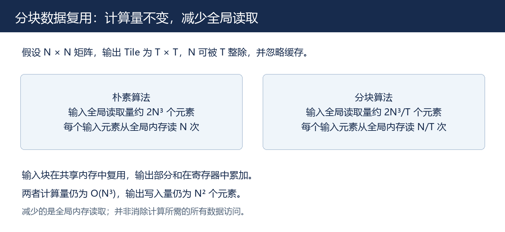
  <p><em>图23.分块数据复用分析</em></p>
</div>

计算量不变，通过把大部分访问转移到共享内存，全局内存读取量减少约 $T$ 倍。

但是分块策略本身很复杂，这也是 GPU 矩阵乘法性能常表现得“难以理解”的原因之一。

<div align="center">
  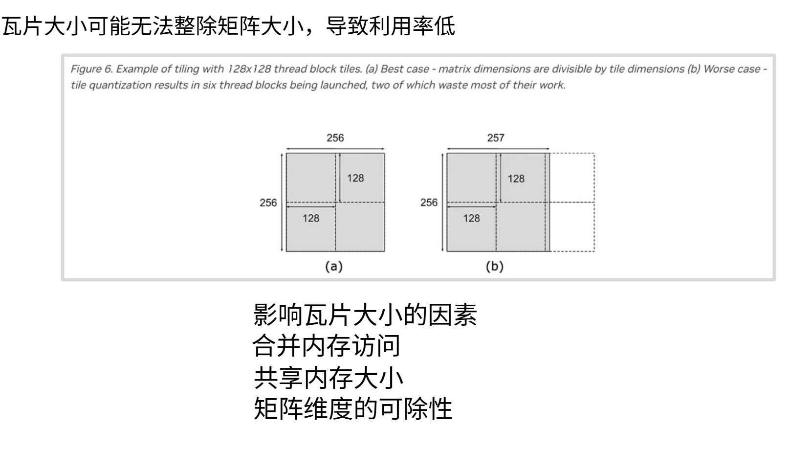
  <p><em>图24.分块边界与资源利用</em></p>
</div>

以 128×128 的 Tile 为例：矩阵尺寸为 256 时，刚好被整除，2×2 个 Tile 就能完整覆盖，效率很高。若矩阵变成 257，就需要额外的 Tile 来覆盖边界，其中部分 Tile 几乎没有有效数据。每个 Tile 对应一个线程块并被调度到 SM 上执行，这些“空” Tile 会让对应 SM 几乎空转，造成负载不均衡和利用率下降。

而 Tile 大小的选择需要同时权衡：
- 能否实现访存合并；
- 是否超出共享内存容量；
- 矩阵维度能否被较均匀地整除，避免大量空闲线程块。

更深一层的问题是**与 DRAM 突发段的对齐**。当矩阵或 Tile 尺寸是突发长度的整数倍时，一个 Tile 的加载通常能匹配少量对齐的突发事务，效率较高。一旦尺寸无法整除（例如末尾多一个元素），行与突发段发生错位，同一行数据可能跨多个突发段，导致**事务数明显增加。常见解决办法是对矩阵做 padding 恢复对齐，从而避免额外的内存流量**。

这些细节虽然底层，却直接影响最终性能；忽略它们很容易陷入“算法对了但跑得很慢”的陷阱。

> **注**：这里的**事务**指 **GPU 内存事务**，即内存控制器向 DRAM 发起的一次实际数据传输请求。

## 8 FlashAttention

<div align="center">
  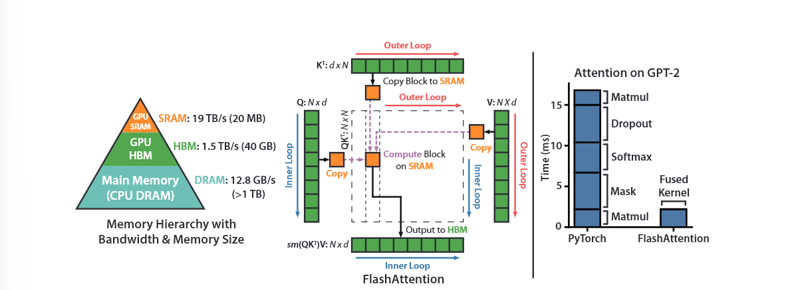
  <p><em>图25.FlashAttention分块与融合</em></p>
</div>

Transformer的标准Attention在序列长度为 $N$ 时具有 $O(N^2)$ 的计算与显存复杂度，其性能瓶颈通常来源于对高带宽显存（HBM）的频繁访问，而非纯计算开销。*尽管部分近似注意力方法通过降低理论复杂度来优化性能，但由于GPU上kernel调度开销以及不规则的内存访问模式，这类方法在实践中往往难以实现理想的加速效果。*

FlashAttention并不改变Attention的渐进计算复杂度（FLOPs仍为 $O(N^2)$ ），而是通过分块（tiling）策略，在片上SRAM中完成分块的 $QK^T$ 、online softmax以及与 $V$ 的累积计算，从而避免将完整的Attention matrix显式并写入HBM。该方法通过显著减少HBM访问次数并提高数据复用率，从而提升计算密度，在实际过程中中常将Attention计算从带宽限制转变为更接近 compute-bound，从而在实际GPU上获得显著性能提升。

> FlashAttention在数学上与标准attention等价（除浮点误差外），属于精确重排而非近似计算。**这里可以通过运行 [FlashAttention.ipynb](https://github.com/datawhalechina/diy-llm/blob/main/docs/zh/chapter6/Flashattention.ipynb)，对比一下FlashAttention和标准Attention的计算结果差异。**

<div align="center">
  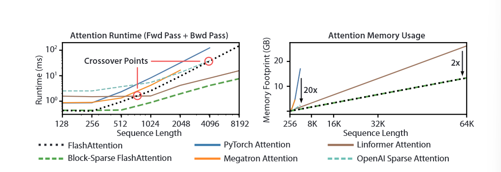
  <p><em>图26.注意力运行时间与显存对比</em></p>
</div>

根据图 26 的分析可以发现，尽管不同Attention实现方法的运行时间相差不大，但FlashAttention的显存占用明显更低，约为其他实现的一半。因此，在长序列场景下FlashAttention具有更好的可扩展性和更高的资源利用效率。

### 8.1 FlashAttention V1计算原理

其中Q、K、V均 $∈R^{Nxd}$ （N行是token表示结构，d列是token属性特征表示），而 $i∈N，j∈d$ 以下表示底层支持因果建模计算过程（带有mask）：

```text
# 初始化
m_i = -inf
l_i = 0
O_i = 0
for each K,V block i:
    load K_i, V_i
    m_i = -inf      
    l_i = 0         
    O_i = 0         

    for each Q block j:
        if causal and j > i:
            continue

        load Q_j
        S_{ij} = Q_j @ K_i^T      # (B_r, B_c)

        if causal and i == j:
            apply mask to S_{ij}

        # softmax累加 → 归约
        update m_i, l_i, O_i(online softmax)

    write O_i to HBM
```

> 为什么FlashAttention V1要分块（tile/block）?
>
> 在GPU中，Attention的计算主要瓶颈在**缓存（SRAM）容量和计算带宽**。直接计算 $Q K^T$ 会生成一个 $N \times N$ 的中间矩阵，当 $N$ 较大时，无法一次性放入高速缓存，并且同时频繁访问HBM会加大缓存压力；FlashAttention的**核心思想**是：通过分块计算，减少对全局内存的访问，提高缓存利用率，并保证计算效率和数值稳定性。具体做法是在SRAM中处理可容纳的小块，同时进行softmax累加，从而大幅降低全局内存访问压力。

具体举例：

- 假设Q、K的形状为 $1024 \times 512$ 。
- 将Q按行分成8块，每块大小 $128 \times 512$ ，将 $K^T$ 按列分成8块，每块大小 $512 \times 128$ 。
- 每次只在SRAM内计算得到一个 $128 \times 128$ 的子矩阵并累加结果，直到完成整个 $Q K^T$ 和 $Q K^T V$ 的计算。

### 8.2 online softmax

online softmax与标准softmax在数学上完全等价，二者都需要进行全局归一化。不同之处在于，`online softmax`采用流式（streaming）计算方式，在遍历过程中动态维护当前最大值和归一化因子（指数累加和），从而无需存储完整的中间结果，这种流式特性使其能够与分块计算自然结合。在FlashAttention中，Attention分数按tile逐块计算，并在块间持续更新最大值和归一化因子实现跨块的全局归一化。

**online softmax在6.7.1 FlashAttention V1计算作用过程详细分析：**

```text
m_{ij} = rowmax(S_{ij})
m_new = max(m_i, m_{ij})

l_i = exp(m_i - m_new) * l_i 
  + sum(exp(S_ij - m_new), axis=1)

O_i = exp(m_i - m_new) * O_i 
  + exp(S_{ij} - m_new) @ V_j

m_i = m_new
O_i = O_i / l_i
```

*因此online softmax成为`FlashAttention V1`在不显式构造整个注意力矩阵情况下完成精确Attention计算的关键组件。*

---

### 8.3 FlashAttention V2：面向Tensor Core的并行优化

FlashAttention V1 通过分块和在线 softmax 解决了注意力计算的显存瓶颈，但其循环顺序和并行策略并未充分发挥现代 GPU（尤其是 A100 及后续架构）中矩阵乘法（Tensor Core）的峰值吞吐能力。V2 在保持 V1 核心思想的基础上，对算法进行了深度重构，实现了**更高效的并行**与**更低的非矩阵乘法开销**。

**FlashAttention V2 核心改进：对 Q 做分块并行处理（改变循环顺序 + split-KV）**

FlashAttention V1 采用 **外循环遍历 $K/V$ 块、内循环遍历 $Q$ 块** 的方式。对每个 $Q_i$，线程块必须串行扫描全部 $K_j, V_j$ ，才能把 online softmax 的相关状态（max、sum、rescale）更新完。虽然这避免了存储完整注意力矩阵、大幅降低了 HBM 访问，但带来了严重的**数据依赖链**：

```
matmul → 归约(max/sum) & rescale → matmul → 归约 & rescale → …
```

这些非 matmul 的标量更新与跨块依赖，显著拉低了 Tensor Core 利用率，也限制了算子融合与并行调度空间。

**FlashAttention V2 把基本数据加载顺序改为 $Q$ 在外层、$K/V$ 在内层**，并引入更激进的并行策略：

1. **循环顺序反转**：同一个 $Q_i$ 不再由单个线程块串行扫完全部 KV，而是把 KV 维度切分给多个线程块并行处理（split-KV）。
2. **保留 online softmax 的数学形式**，但把原先“沿 KV 维度的串行依赖”转化为：
   - 各线程块独立计算局部 attention 与局部 statistics（max/sum）；
   - 最后做一次跨线程块的归约与 rescale。

这个处理，让计算并行度显著提高，从而使 Tensor Core 的利用率与吞吐量显著提高。


```text
for each Q block i in parallel:              # V2的核心：Q 维度并行
    load Q_i into SRAM                      

    # 初始化
    m_i = -inf                             
    l_i = 0                                
    O_i = 0                               

    for each K,V block j:
        load K_j, V_j into SRAM             

        S_ij = Q_i @ K_j^T                  # Tensor Core
        m_ij = rowmax(S_ij)                
        m_new = max(m_i, m_ij)
        
        # 重标定旧累积
        alpha = exp(m_i - m_new)           
        P_ij = exp(S_ij - m_new[:, None])   
        l_ij = rowsum(P_ij)               

        # 更新归一化因子
        l_new = alpha * l_i + l_ij         

        # 更新输出（核心优化点之一），online softmax累加
        O_i = (alpha[:, None] * O_i) + (P_ij @ V_j)
        m_i = m_new
        l_i = l_new

    # 末端归约
    O_i = O_i / l_i[:, None]
    write O_i back to HBM
```

**V1 → V2性能提升的原因：**

(1). **降低非矩阵计算对执行的干扰（而非减少其总量）**

在V1中，每处理一个 $K, V$ 块，都需要对当前 $Q_i$ 的统计量（$m_i, l_i$）进行在线更新，并对累积输出执行重缩放操作，这些标量、向量运算会频繁穿插在矩阵乘法之间，形成计算数据依赖链。

(2). **V2并未减少这些操作的数学次数（仍然是 $T_q \times T_{kv}$ 级别）**

是将原本沿 $K,V$ 维度的串行依赖转化为并行计算，*从而减少这些非matmul操作对执行调度的阻塞，提高整体吞吐*。

(3). **提升Tensor Core利用率（来自调度与并行重构，而非“批量提交”）**

$Q_i K_j^T$ 和后续的 $P_{ij} V_j$ 本身始终是矩阵乘法，V1与V2在算子层面并无变化。性能差异主要来自执行方式：

   - V1中，由于**online softmax 的逐块依赖**，matmul与标量更新交替执行限制了Tensor Core 的持续工作能力；
   - V2通过**增加并行线程块（尤其是split-KV）**，让更多matmul可以在不同SM上同时进行，**从而提高Tensor Core的整体占用率**。

> 值得注意的是，**SM的整体占用率并不等同于其实际计算单元的利用率**。即使线程块已充分填满SM，如果数据加载与计算之间存在同步等待，仍会导致Tensor Core等执行单元出现空闲。而FlashAttention V3正是在这一背景下提出，**通过引入异步执行与流水线机制，进一步提升计算与数据传输的重叠程度，减少硬件空闲**。

因此，V2提升的本质是：**更多并行matmul + 更少串行依赖，而不是单线程内“批量提交” 的matmul。**

> 一句话对比V1、V2版本——FlashAttention V2的本质不是减少FLOPs，而是把“online softmax的时间串行依赖”改写成“空间并行”。

**分块大小与硬件适配**

V2 对分块大小进行了精细调整，以匹配 GPU 的 SRAM 容量和寄存器资源。以 A100 为例，每个 SM 拥有 192KB 共享内存，V2 选择 $B_r$（$Q$ 块行数）和 $B_c$（$K, V$ 块行数）使得 $Q_i, K_j, V_j$ 以及中间统计量能完全容纳在共享内存中，同时为寄存器溢出留出余量。对于序列长度 4096、头维度 128 的典型配置，V2 将 $B_r$ 设为 128，$B_c$ 设为 128，每个块的计算恰好适配 A100 的 Tensor Core 指令粒度。

**性能表现**

- **速度提升**：在A100上，对于序列长度512-16k，V2 相比 V1 平均加速 **1.7~2.0 倍**，相比 PyTorch 标准实现加速 **8~10 倍**。
- **显存占用**：与V1保持一致，仍为 $O(N \cdot d)$ ，但支持的最大序列长度因计算效率提升而有所扩展（单卡40GB A100可稳定训练32k长度）。
- **硬件适应性**：V2的优化策略对Ampere及后续架构（如 H100）同样有效，为后续版本（V3）奠定了高效并行的基础。

FlashAttention V2通过提升序列维度的并行度并优化计算调度，在保持V1内存访问高效（IO-aware）特性的前提下，显著提升了Tensor Core的利用率，**从而将注意力计算的整体吞吐推向更高水平**。这一改进使得长上下文Transformer的训练和推理在单卡或有限资源环境下更加高效，成为现代高性能Transformer系统中的重要优化组件，并被包括Llama 2、GPT-4等在内的多种大模型工程实现所采用或借鉴。

---

### 8.4 FlashAttention V3：异步与低精度优化

FlashAttention V2在A100等Ampere架构GPU上已接近Tensor Core的理论极限，但 H100（Hopper）架构引入了革命性的新特性：**异步执行模型**（支持计算与数据搬运完全重叠）、**WGMMA（Warpgroup Matrix Multiply-Accumulate）指令**以及**原生FP8支持**。V3正是针对这些硬件特性进行深度优化的产物，其目标是让注意力计算在H100上实现**接近理论峰值的吞吐量**，并充分利用低精度格式带来的算力红利。

**FlashAttention V3的核心改进在异步WGMMA流水线**

FlashAttention V3**并不是建立在“Q 外循环、K/V内循环”的顺序变化之上**，而是在V2已有的并行与归约框架基础上，对底层执行机制进行重构。其核心改进是引入基于NVIDIA Hopper（如H100）的异步计算能力，将计算流程组织为**生产者–消费者流水线**。

其核心思想是利用Hopper架构中的异步指令（如TMA数据搬运与WGMMA矩阵乘法），实现：

- 数据加载（global → shared memory）与Tensor Core解耦；
- **跨warp group的流水线并行执行**，在计算一个block的同时，预取下一个block的数据。

**从而显著减少因数据等待导致的SM空闲周期，使GPU执行任务的周期更加接近理想的持续计算状态。**

```text
# 初始化double buffer
buffer_K[2], buffer_V[2]

for each Q block i:
    load Q_i

    async_load(buffer_K[0], buffer_V[0])

    for j in range(num_blocks):

        curr = j % 2
        next = (j + 1) % 2

        # 生产者，提前加载下一块
        if j + 1 < num_blocks:
            async_load(buffer_K[next], buffer_V[next])

        # 消费者，使用当前buffer计算
        S_ij = wgmma(Q_i, buffer_K[curr])

        update m_i, l_i   # softmax reduce

        O_i += wgmma(P_ij, buffer_V[curr])

        # 只在必要时同步（避免stall）
        wait_for(buffer_K[next])

    write O_i
```

**WGMMA（Warpgroup Matrix Multiply-Accumulate）** 是 H100 引入的新型指令，它将一组 warp（32 个线程）组织为 warpgroup（4 个 warp，共 128 线程），并在硬件层面直接支持**异步执行**。V3 将 $Q_i K_j^T$ 的矩阵乘法拆分为多个 WGMMA 指令，这些指令在 Tensor Core 中执行的同时，CPU 可以继续发射后续的数据加载指令，实现计算与数据传输的 **完全重叠**。通过精心设计流水线阶段（通常为 2~3 级），V3 使得 SM 的利用率从 **V2 的约 60% 提升至 80% 以上**。

**H100对FP8的低精度支持和混合精度**

H100的第四代Tensor Core在**FP8精度下的理论吞吐量是FP16的两倍**（例如H100 SXM的FP8峰值约为1979 TFLOPS，而FP16为989TFLOPS）。V3原生支持FP8输入，但在注意力计算中必须解决 **数值稳定性** 问题，因为 softmax 对精度敏感。

因此 V3 采用**混合精度策略**就可以提升性能：

矩阵乘法 $QK^T$ 使用FP8执行，充分利用Tensor Core的高吞吐，**累加器** 保持FP 16或BF 16精度，避免FP8累加时的精度损失。**Softmax 计算**提升到FP32进行，保证指数运算的数值稳定性（softmax 中的指数和除法极易在低精度下溢出）。同时输出 $PV$ 可选择性转换为FP8，以适应后续层。

此外，V3 实现了 **动态缩放因子** 管理。由于 FP8 的表示范围有限（E4M3 约 -448 到 448，E5M2 约 -57344 到 57344），在计算 $QK^T$ 前需要根据输入范围确定缩放因子，防止溢出。V3 按块（tile）动态计算缩放因子，并在流水线中传递，确保 FP8 计算的精度与 FP16 相当。

**块布局与寄存器优化**

H100 的每个 SM 拥有 256KB 共享内存（比 A100 的 192KB 更大），且寄存器文件也更为充裕。V3 重新调整了分块大小 $B_r$（ $Q$ 块行数）和 $B_c$（ $K, V$ 块行数），使其更好地适配 H100 的 WGMMA 指令粒度（WGMMA 要求矩阵维度为 64 的倍数）以及共享内存容量。典型配置下（序列长度 8192，头维度 128），$B_r$ 设为 128， $B_c$ 设为 64，使得每个 warpgroup 负责的矩阵乘法恰好与共享内存的 bank 对齐。

更重要的是，V3 对寄存器使用进行了精细控制，**避免寄存器溢出**（register spilling）到本地内存（L1缓存）。通过将中间统计量（ $m_i, l_i, O_i$ 的部分累加）尽量驻留在寄存器中，V3减少了不必要的内存访问，进一步提升了流水线效率。

**性能表现上计算效率和速度、长序列能力都有提升**

- **计算效率**：在 H100 SXM 上，使用 FP8 时，V3 的 TFLOPS 利用率可达 **75%~80%**，接近理论峰值。这意味着注意力计算几乎不再受内存带宽限制，而是完全由计算能力驱动。
- **速度提升**：相比 V2 在 H100 上的 FP16 实现，V3 的 FP8 版本速度提升约 **1.5~2 倍**；即使在相同 FP16 精度下，V3 的异步优化也能带来约 **1.3 倍** 的加速。
- **长序列能力**：在 128k 甚至 1M 长度的序列上，V3 仍能保持极高的吞吐，使得超长上下文模型的训练和推理成本大幅降低。单卡 H100 80GB 可稳定训练 256k 长度的模型。

FlashAttention V3是算法与硬件深度协同设计的典范。它通过**异步WGMMA流水线**解耦了数据加载与计算，利用**FP8混合精度**释放了H100的低精度算力，并通过精细的**块布局与寄存器优化**消除了内存瓶颈。这一系列改进使得注意力计算不再是Transformer长上下文扩展的阻碍，而是成为能够充分利用硬件极限的“高性能组件”。V3的诞生，直接支撑了当前工业界100k~1M上下文窗口的大语言模型的工程实现。

> 总结，对于 FlashAttention 的发展：
> - V1 解决的是 IO 瓶颈；
> - V2 解决的是并行调度与 GPU 利用率问题；
> - V3 解决的是计算与访存重叠（SM工作效率）问题。
>
> 一句话概括也就是，从“减少内存带宽瓶颈” → “提升并行调度与 GPU 利用率” → “实现计算与访存重叠，让 SM 始终忙碌”。 

---

## 9 PagedAttention

<div align="center">
  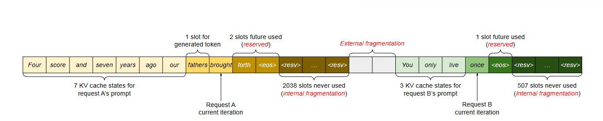
  <p><em>图27.连续KV缓存的显存浪费</em></p>
</div>

**在传统的KV Cache管理方式中，通常为每个请求序列预先分配一段逻辑上连续的缓存空间，用于存储其历史生成的Key/Value状态**。然而，由于实际生成长度难以精确预测，这种静态预分配策略会带来显存利用率问题。当预留空间大于实际生成长度时，会产生`内部碎片`（internal fragmentation），即已分配但未被使用的显存空间；同时，由于不同请求的生命周期不一致，释放时间存在差异，显存中可能形成多个零散的空闲块，这个时候尽管总空闲容量充足，但由于无法提供足够大的连续缓存块来满足新序列的分配需求，从而产生`外部碎片`（external fragmentation）。

<div align="center">
  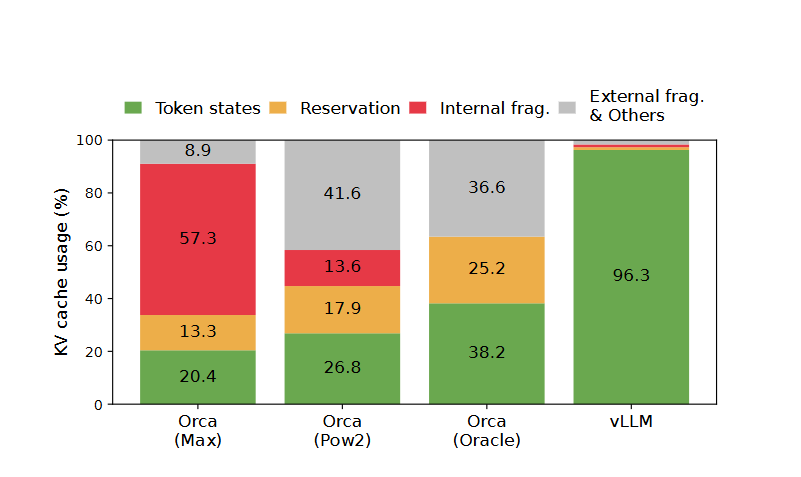
  <p><em>图28.KV缓存显存利用率对比</em></p>
</div>

上述碎片问题会显著降低GPU高带宽显存（HBM）的整体利用效率。为**从系统层面缓解这问刚才提到的问题**，根据操作系统分页机制（paging），PagedAttention将KV Cache拆分为固定大小的页面（pages），并通过页表进行间接地址映射，使逻辑连续的KV存储不再依赖物理连续内存，从而有效减少碎片并提升显存利用率。

### 9.1 PagedAttention 原理分析

在标准的自回归（AR）推理过程中，**每个新生成的 token 都会产生对应的 K 和 V，并按时间顺序追加至 KV cache**。逻辑顺序严格对应时间顺序，而物理存储顺序则取决于具体的实现策略。为了**保证高效的 GPU 访问与 CUDA kernel 的访存模式（如 memory coalescing）**，传统实现通常将 KV cache 组织为连续内存张量，并依据预设的最大序列长度上界进行显存预分配。然而，**由于不同请求的实际生成长度存在显著差异，且 GPU 显存分配器难以支持低代价的动态扩容与内存重排**，这种基于最大长度的连续预分配策略容易产生内部碎片与外部碎片。

不妨通过一个例子来说明标准 AR 中连续物理内存带来的问题。假设每次请求都按最大长度 2048 个 token 预留连续的 KV cache 物理空间：

$$
[ K_1 | K_2 | K_3 | ... | K_{2048} ]
$$

如果同时存在多个长度各异的请求，比如请求 A 实际生成 128 个 token，请求 B 生成 1024 个 token，请求 C 生成 300 个 token：

```
请求A：128 token
请求B：1024 token
请求C：300 token
```

那么问题就显现出来了。**内部碎片**体现在：每个请求都提前占用了 2048 长度的连续物理空间，但实际使用量远小于此，造成大量剩余空间被浪费（例如请求 C 浪费了 1700 多个 token 的容量）。**外部碎片**则表现为：显存中散落着许多小块空闲空间，却**没有一整块连续区域能够被利用**，这在 GPU 上尤为严重，导致碎片化的空闲内存无法再分配给新的请求。

vLLM 提出的 **PagedAttention** 正是为了解决上述问题——它将“静态连续存储”转变为“动态分页管理”。 **核心思路是将 KV cache 切分为固定大小的块（Page）** ，例如每个 Page 包含 16 个 token 的 KV 存储。通过一个页表（Block Table），PagedAttention **将逻辑上连续的 token 对应的 KV 映射到物理上未必连续的存储块中，从而最大化利用显存空间**。例如，三个逻辑连续的 token 段（1–16、17–32、33–48）可以通过页表分别映射到物理地址的 Block7、Block2 和 Block19，物理上不必相邻。

**为什么这样就不需要连续的物理空间呢**？因为在 Attention 计算时，系统会依据页表逐块读取 KV：**每处理一个 block，先查页表找到对应的物理 block，再执行读取操作**。只要页表维护了正确的映射关系，即使物理地址不连续，读取的顺序逻辑依然是正确的。整个流程可以简化为：

```
for each block:
    查页表
    找到对应物理 block
    读取
```

更重要的是，这个内存分配过程是**按需动态进行**的——随着请求实际生成的 token 数量增长，逐步为其分配新的 page，而非预先圈定一整块空间。

PagedAttention 将显存管理从**以请求为单位的静态圈地转变为以 token 为单位的动态确权**。通过物理地址的非连续映射，它彻底解决了标准 AR 中因预留最大长度而导致的严重内部碎片问题。仍以 300 tokens 的请求为例，每个 Page = 16 tokens 时：

- 所需 Page 数量为 $300 / 16 = 18.75$ ，向上取整需要 **19 个 Page**。
- 实际分配的物理空间为 $19 \times 16 = 304$ 个 token 容量。
- 浪费仅为 $304 - 300 = 4$ 个 token。

相比之下，标准 AR 预留 2048 长度会浪费 $2048 - 300 = 1748$ 个 token。vLLM 将显存浪费从 1700+ token 降至个位数，使同一块 GPU 上的并发能力（throughput）获得了数量级的提升。

用一个简单的用餐类比可以帮助理解：**标准 AR 像是“按次收费的满汉全席”**，不管吃多少，都必须按 2048 道菜的规模占位，吃 300 道就走，剩下 1748 道只能倒掉（显存被强占且无法复用）。而 **PagedAttention 则是“按需取餐的自助餐”**，每 16 个 token 是一盘菜，吃完一盘再取下一盘，空出来的餐盘可以立即让给其他用餐者（显存可动态回收复用）。

因此，传统 AR 的浪费规模为 $O(\text{max\_seq\_len})$，而 PagedAttention 的浪费仅控制在 $O(\text{page\_size})$ 级别，显存利用率与并发能力由此得到显著提升。

总结来看，PagedAttention 的工作原理可以概括为：

```
虚拟地址 -> 页表 -> 物理地址
```

在 vLLM 的源码层面，其映射逻辑可以表达为：

```
请求 ID + Token 偏移量 -> 逻辑块索引 -> Block Table 检索 -> 物理内存基址 -> 偏移读取
```

---

### 9.2 FlashAttention 与 PagedAttention 的对比

尽管 PagedAttention 与 FlashAttention 在表面上都致力于提升大模型的推理性能，但二者的优化维度有着本质上的不同。

**FlashAttention 主要聚焦于单次前向计算中的 IO 复杂度**，属于算子级的微观优化。它通过分块计算（tiling）与在线 Softmax（log-sum-exp streaming）技术，避免了显式构建完整的 $QK^T$ 中间矩阵，从而显著减少 HBM 与 SRAM 之间的数据往返次数，降低内存带宽压力与访问延迟。简单来说，FlashAttention 解决的是 **“算得更快”** 的问题。

**PagedAttention 则着眼于整个生成生命周期中的显存管理效率**，属于系统级的宏观设计。它并不改变 Attention 的数学计算公式，而是将 KV Cache 组织为固定大小的物理块（page），并通过逻辑 block table 实现逻辑顺序与物理顺序的解耦。这种分页结构有效缓解了显存碎片问题，支持动态批处理与长上下文推理，从而提升显存利用率与并发吞吐能力。PagedAttention 解决的是 **“存得更高效”** 的问题。

从几个关键维度来看，二者的差异更为清晰。在优化目标上，FlashAttention **专注于单次 forward 的 IO 复杂度**，而 PagedAttention **致力于整个生成生命周期的内存管理**。在时间尺度上，前者是 micro-level（算子级）的优化，后者是 macro-level（系统级）的优化。在影响对象上，FlashAttention 作用于 attention kernel 本身，PagedAttention 则管理 KV Cache 的生命周期。此外，FlashAttention 对训练和推理均有影响，而 PagedAttention 基本仅适用于推理场景；FlashAttention 不依赖 decoder-only 架构，PagedAttention 则对此有强依赖。

在实际的推理框架中，二者通常**协同使用**，以**同时优化单请求延迟与整体吞吐量**。但值得注意的是，PagedAttention 通过间接寻址引入了 KV cache 的非连续物理布局，这可能破坏 FlashAttention 对连续内存访问与 memory coalescing 的假设。因此，在联合使用时，FlashAttention kernel 通常需要以 page 为最小 streaming 计算单元进行适配，或者确保 block_size 与 tile_size 相近，以维持共享内存利用率和访存效率。

## 10 总结与测试题

### 10.1 课程总结

本章从 GPU 的起源与发展出发，以 A100 为例，介绍了 GPU 与 CPU 的设计差异、线程执行模型和分层存储体系，并对比了 TPU 的架构特点。在此基础上，结合算力与内存带宽增长不平衡的趋势，利用 Roofline 模型理解计算受限与访存受限的性能瓶颈，梳理了减少分支发散、低精度计算、算子融合、重计算、合并访存和分块等优化方法。

接着分析了 FlashAttention 从减少显存读写、优化并行调度，到引入异步流水线与低精度计算的演进过程，以及 PagedAttention 通过按需分配和分页管理 KV Cache，减少显存碎片、提升推理并发能力的原理。前者侧重注意力算子的计算与访存效率，后者侧重推理过程中的显存管理，二者可以协同发挥作用。这些技术共同体现了本章的核心思想：**高效利用硬件，需要让算法的计算组织与数据访问方式适配硬件架构，在算力、存储容量和数据搬运开销之间取得平衡**。


---

### 10.2 测试题

1.为什么GPU上的线程块不能依赖跨块同步？warp发散会带来什么代价？

2.Roofline模型的横轴和纵轴是什么？算术强度高是否必然更快？

3.低精度训练为什么通常需要混合精度和数值检查？

4.算子融合、重计算和Tiling分别减少或增加了什么成本？

5.FlashAttention和PagedAttention解决的问题有什么不同？分页布局会带来哪些额外开销？


## 参考资料

- [FlashAttention原理](https://arxiv.org/pdf/2205.14135)
- [PagedAttention原理](https://arxiv.org/pdf/2309.06180)
- [NVIDIA A100 Tensor Core GPU Architecture](https://images.nvidia.com/aem-dam/en-zz/Solutions/data-center/nvidia-ampere-architecture-whitepaper.pdf)
- [GPU 架构与内存分析资料（arXiv:2405.11425）](https://ar5iv.labs.arxiv.org/html/2405.11425#1)
- [NVIDIA A100 ensor Core GPU](https://images.nvidia.cn/aem-dam/en-zz/Solutions/data-center/a100/nvidia-a100-datasheet-nvidia-a4-2188504-r5-zhCN.pdf#1#1)
- [英伟达技术博客](https://developer.nvidia.com/blog/using-tensor-cores-in-cuda-fortran/)
- [斯坦福大学cs336中的数据](https://cs336.stanford.edu/)
- [NVIDIA Ampere 架构详解](https://developer.nvidia.com/blog/nvidia-ampere-architecture-in-depth/)
- [NVIDIA Ampere GPU 架构应用优化](https://developer.download.nvidia.cn/video/gputechconf/gtc/2020/presentations/s21819-optimizing-applications-for-nvidia-ampere-gpu-architecture.pdf?ref=blog.paperspace.com#3#1)
- [NVIDIA GPU 每线程寄存器限制讨论](https://forums.developer.nvidia.com/t/whats-the-max-register-number-that-causes-slowdown/234969#main-container)
- [FlashAttention.ipynb](https://github.com/1iyouzhen/CS336-Chinese-co-construction/blob/main/docs/zh/chapter6/Flashattention.ipynb)
- [Ascend NPU 大语言模型部署教程](https://github.com/datawhalechina/self-llm/blob/master/support_model_Ascend.md)
