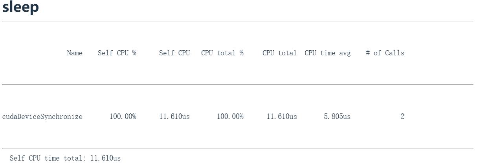
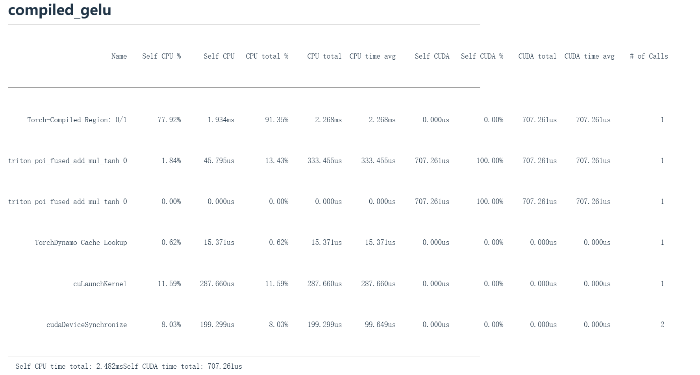

# 第 7 章 GPU高性能编程

[第 6 章](../chapter6/chapter6_第六章GPU和GPU相关的优化.md)已经介绍了 GPU 架构、执行模型、分层内存和常见优化原理。本章在此基础上，重点学习如何测量性能、定位瓶颈，并用 CUDA、Triton 和 `torch.compile` 实现与验证优化。

## 1 本章学习目标

学习完本章，应该能够明白这些问题：

- 运用执行模型与分层内存知识，分析线程块配置、寄存器压力和数据访问方式对内核性能的影响。
- 掌握基准测试（Benchmarking）与性能分析（Profiling）的方法，学会使用PyTorch内置分析器及Nsight Systems等专业工具定位性能瓶颈。
- 将算子融合原理落实到 GeLU 内核，通过手写 CUDA、Triton 与 PyTorch 实现的对比，验证优化效果。
- 学习使用Triton编写高效GPU内核，理解其以块为中心的编程模型，并与PyTorch原生实现、手写CUDA进行性能对比。
- 了解`torch.compile`的自动优化能力及其适用场景，明确何时值得手写底层内核、何时依赖编译器。

## 2 回顾 GPU 架构与执行模型

GPU 的基本概念与执行模型已在第六章详细讲解，建议先回顾该章内容。本章不再重复展开相关基础描述，直接进入知识的应用部分。

---

### 2.1 编程细节

**【这里可以添加一些图片直观理解】**

**共享内存 bank conflict**

共享内存划分为 32 个 bank，每个 bank 宽 4 字节。**同一时钟周期内，每个 bank 只能服务一个线程**。若同一 warp 中多个线程访问同一 bank 的不同地址，就会发生 bank conflict，访问被串行化。最坏情况是 32 路冲突（32 个线程同时访问同一列），性能显著下降。矩阵乘法的数据布局需通过 swizzling 等技术避免。

**延迟隐藏与驻留 Warp**

当 warp 执行高延迟操作（如从 HBM 读数据，可达数百周期）时，SM 的调度器会立即切换到其他就绪 warp，几乎无开销。因此 SM 可通过并发多个 warp 隐藏内存延迟。只要有足够可切换的 warp，计算单元就能保持忙碌——这也是 GPU 需要大量线程的根本原因之一。

**占用率与寄存器压力**

寄存器用量直接影响并行度（详见第 6 章）。结合每 block 线程数与每线程寄存器数，可估算 SM 能同时驻留的 block/warp 数量，并观察尾波（tail wave）导致部分 SM 空闲的情况。

**寄存器压力与占用率示例（B200）**

假设一个 Block 含 128 个线程，每线程使用 160 个寄存器：

- 每个 Block 需要的寄存器数： $128 \times 160 = 20480$
- B200 每个 SM 共有 65536 个寄存器，因此每个 SM 最多同时驻留： $\frac{65536}{20480} \approx 3$ 个 Block
- 每个 Block 含 $\frac{128}{32} = 4$ 个 Warp，故最多驻留 $3 \times 4 = 12$ 个 Warp
- B200 每个 SM 最多可驻留 64 个 Warp，因此 Warp 占用率仅为 $\frac{12}{64} \approx 18.75$ %

这是典型的**寄存器压力导致低占用率**的情况。需要注意：高占用率并非总是最优，实际中需与计算效率比如是否发生寄存器溢出、指令级并行度等进行权衡。

对于极轻量的逐元素操作，若每线程只处理一个元素，会产生大量短线程。可采用**线程粗化**：让每线程处理多个元素（如 8 个），减少线程总数、提高单线程计算强度，并简化调度。

**用硬件原理辅助判断瓶颈**

后续基准测试与性能分析沿用第 6 章的算术强度与 Roofline 思路。阅读结果时，重点结合输入规模、数据类型和实际内核，判断时间主要花在计算、访存还是启动/调度上。

>补充说明：
>- Block 的作用是把多个需要紧密协作的 Warp 打包在一起，使它们可以高效地通过 Shared Memory 通信并同步。
>- 硬件调度时，必须把一个完整的 Block 放到同一个 SM 上执行，不能将 Block 拆分到多个 SM。


## 3 性能分析方法

编写代码时，必须需要进行**基准测试和性能分析**。常见误区是：凭主观感觉认定“某段代码是瓶颈”，然后投入大量时间去优化，结果发现它根本不是真正的瓶颈，或者优化后反而引入了新的瓶颈。

使用专业的性能分析工具，可能会更准确揭示真正的瓶颈位置，以及机器当前的实际运行状态。掌握这些信息后，才能把注意力集中在代码执行中最关键、收益最高的部分进行优化。

GPU 的具体执行细节、编写 softmax 内核的方法，可能会随架构和工具不断演变，甚至可以直接依赖 torch 编译器的自动 JIT 优化。但**性能分析的重要性永远不会改变**，那么**持续写出高性能代码，就必须持续进行性能分析**。

---

### 3.1 基准测试

我们定义MLP模型，然后生成随机高斯分布输入，最后在5个步长中运行，每次计算前向传播后执行反向传播，最终返回MLP输出的平均值。这里甚至没有损失函数，简单到只是运行MLP前向传播并在最后进行平均池化。

```python

class MLP(nn.Module):
    """
    简单的MLP: linear -> GeLU -> linear -> GeLU -> ... -> linear -> GeLU以此类推
    """
    def __init__(self, dim: int, num_layers: int):
        super().__init__()
        self.layers = nn.ModuleList([nn.Linear(dim, dim) for _ in range(num_layers)])
    def forward(self, x: torch.Tensor):
        for layer in self.layers:
            x = layer(x)
            x = torch.nn.functional.gelu(x)
        return x

def run_mlp(dim: int, num_layers: int, batch_size: int, num_steps: int) -> Callable:
    # 定义一个随机权重的模型
    model = MLP(dim, num_layers).to(get_device())
    # 随机高斯分布的输入X
    x = torch.randn(batch_size, dim, device=get_device())
    def run():
        #  运行模型 num_steps 次
        for step in range(num_steps):
            # 前向传播
            y = model(x).mean()
            # 反向传播
            y.backward()
    return run

```

我们会运行简单的**多层感知机**，设置**128**个维度，16个**网络层**，指定批次大小，进行5个训练步长。这里仅执行**前向传播和反向传播**各5次。

```python

# 进行基准测试（测量运行时间）和性能分析（探查函数内部的时间消耗分布）的伪代码

def benchmarking_and_profiling():
    run_mlp(dim=128, num_layers=16, batch_size=128, num_steps=5)
    benchmarking()       # 需要多长时间？
    profiling()          # 在哪里花费了时间

```

接下来要做两件事：基准测试（Benchmarking）和性能分析（Profiling）。我们先从基准测试开始。

基准测试的目标是测量操作的实际耗时，这里我们只关注多层感知机（MLP）函数的端到端执行时间，用来比较 Triton 实现、手写 C++/CUDA、原生 PyTorch 以及 Torch Compile 的性能差异。通过对比可以评估写 CUDA 内核是否值得，以及当矩阵规模增大时性能会如何变化必须进行实证基准测试。

本章后续会反复使用同一个基准测试函数，它通常包含需要测试的目标函数、预热迭代次数，以及正式计时的运行次数。

首次运行 PyTorch 代码时往往明显更慢，因为存在编译、向 GPU 发送指令等初始化开销。**预热的目的就是让程序进入稳定状态，确保我们测量的是稳态性能，而不是启动阶段的开销**。当我们真正关心的是成千上万次迭代下的持续性能时，预热尤为重要。

另外，GPU 与 CPU 是两个独立的计算单元，可以异步执行。Python 代码在 CPU 上运行，调用 GPU 计算时会向 GPU 分发内核，之后 CPU 不会等待 GPU 完成就继续往下执行。如果基准测试时不做同步，计时可能在 GPU 还没算完就结束，结果会明显偏低。调用 `torch.cuda.synchronize()` 可以让 CPU 等待 GPU 上所有任务完成，两者同步后，多次计时才能准确反映 GPU 的真实执行时间。

```python
# 基准测试代码

def benchmark(description: str, run: Callable, num_warmups: int = 1, num_trials: int = 3):
    """Benchmark `func` by running it `num_trials`, and return all the times."""
    # 热身：第一次运行可能较慢,因为要编译和缓存
    # 我们将多次要运行内核，因为重要的是稳态的运行时间。
    for _ in range(num_warmups):
        run()
    if torch.cuda.is_available():
        torch.cuda.synchronize()  # 等待 CUDA 线程完成（非常重要！）
    # 现在真正计时!
    times: list[float] = [] # @inspect times, @inspect description
    for trial in range(num_trials):  # 多次重复
        start_time = time.time()
        run()  # 实际执行计算
        if torch.cuda.is_available():
            torch.cuda.synchronize()  # 等待 CUDA 线程 完成同步
        end_time = time.time()
        times.append((end_time - start_time) * 1000) # @inspect times
    mean_time = mean(times) # 多次测量取平均
    return mean_time
```

这样如果 CPU 运行较快，它会等待 GPU 执行实际完成，反之亦然。现在测量**完成取平均值**，因为单次测量可能会因 GPU 的热特性等因素产生波动，因此需要多次**重复测量**，取平均值后返回结果。

**基准测试过程中两个关键点：进行预热操作，调用 CUDA 同步**。

---

### 3.2 矩阵乘法的基准测试

现在我们可以进行矩阵乘法的基准测试。我将逐步演示部分结果，虽然只是用数据验证已知结论，但希望通过具体演示确保理解一致。会在原课程中使用的**A100 GPU**上运行测试，针对**不同尺寸的矩阵乘法进行测量**，系统收集了各个维度的矩阵乘法耗时数据。


```python

    # 矩阵乘法基准测试代码

    '''
    Benchmarking 测量执行某些操作的实际耗时。它只给你端到端的时间，而不是时间花在哪里（性能分析）。
    比较不同的实现哪个更快，以及理解性能如何扩展（例如，随着维度的增加）。
    '''

    benchmark("sleep", lambda : time.sleep(50 / 1000)) #在上面实现的的基准测试函数
    
    if torch.cuda.is_available():
        dims = (1024, 2048, 4096, 8192, 16384)  # 不同维度
    else:
        dims = (1024, 2048)  # @inspect dims
    
    matmul_results = [] 
    for dim in dims:
        # @ inspect dim
        result = benchmark(f"matmul(dim={dim})", run_operation2(dim=dim, operation=lambda a, b: a @ b))
        matmul_results.append((dim, result))  # @inspect matmul_results

```

<div align="center">
  
  <p><em>图 1. 矩阵运算时间</em></p>
</div>

随着矩阵尺寸增大，运行时间呈现超线性增长。但在最小尺寸（如 1024 和 2048）时耗时几乎不变，此时固定开销占主导。当矩阵更大后，计算量按 $O(n^3)$ 显著增加，这是耗时上升的主要原因；工作有时候会被拆分到多个 Block 和 SM 上，全局内存访问也会增多，但内存访问量仅按 $O(n^2)$ 增长，并非导致耗时明显上升的主导因素。

---

### 3.3 MLP的基准测试

```python
def benchmarking():
    
    # 测试MLP

    dim = 256  # @inspect dim
    num_layers = 4  # @inspect num_layers 
    batch_size = 256  # @inspect batch_size
    num_steps = 2  # @inspect num_steps
    mlp_base = benchmark("run_mlp", run_mlp(dim=dim, num_layers=num_layers, batch_size=batch_size, num_steps=num_steps)) # @inspect mlp_base

    # 对步数进行缩放
    step_results = []

    for scale in (2, 3, 4, 5):
        result = benchmark(f"run_mlp({scale}x num_steps)", 
                         run_mlp(dim=dim, num_layers=num_layers, 
                                batch_size=batch_size, num_steps=scale * num_steps)) # @inspect result, @inspect scale, @inspect num_steps
        step_results.append((scale, result))  # @inspect step_results
    
    # 增加层数
    layer_results = []
    for scale in (2, 3, 4, 5):
        result = benchmark(f"run_mlp({scale}x num_layers)", 
                         run_mlp(dim=dim, num_layers=scale * num_layers, 
                                batch_size=batch_size, num_steps=num_steps)) # @inspect result, @inspect scale, @inspect num_layers, @inspect num_steps
        layer_results.append((scale, result))  # @inspect layer_results
    
    # 增加批次大小
    batch_results = []
    for scale in (2, 3, 4, 5):
        result = benchmark(f"run_mlp({scale}x batch_size)", 
                         run_mlp(dim=dim, num_layers=num_layers, 
                                batch_size=scale * batch_size, num_steps=num_steps)) # @inspect result, @inspect scale, @inspect num_layers, @inspect num_steps
        batch_results.append((scale, result))  # @inspect batch_results
    
    # 对维度进行缩放
    dim_results = []
    for scale in (2, 3, 4, 5):
        result = benchmark(f"run_mlp({scale}x dim)", 
                         run_mlp(dim=scale * dim, num_layers=num_layers, 
                                batch_size=batch_size, num_steps=num_steps)) # @inspect result, @inspect scale, @inspect num_layers, @inspect num_steps
        dim_results.append((scale, result))  # @inspect dim_results

```

现在让我们尝试对**MLP**进行基准测试。具体操作是：将MLP扩展至256维，设置四层网络，批处理大小为256，执行两个训练步。测得耗时6.2秒(mlp_base)。

<div align="center">
  
  <p><em>图 2. 缩放各种参数的规律</em></p>
</div>

进行基础扩展测试：将训练步数从 2 逐步增加到 5，分别进行基准测试。与矩阵乘法不同，增加 MLP 的前向与反向传播次数时，运行时间应呈线性增长。实际数据也印证了这一点，每次 MLP 执行约 5 秒，总体运行时间基本符合 $n \times 5$ 秒的规律。同样，当网络层数从 2、3、4 增加到 5 层时，运行时间也随层数线性递增，单层约 5 秒（略少），总体耗时约为层数的倍数。这再次验证了线性缩放规律。

无论是训练步数还是网络层数，都与运行时间存在清晰的线性关系，符合预期。批处理规模的测试在此跳过，因为当前追踪的数据量已经较为庞杂。基准测试部分到此结束。


这个基准测试函数会做少量预热并执行 CUDA 同步，能测量任意代码的运行时间。但它属于粗粒度工具，只能反映整体快慢，无法定位具体耗时位置。需要更精确分析时，我们通常会改用性能分析（Profiling）。

## 4 性能分析（Profiling）

分析函数的结构大致如下，同样进行**预热**，执行TorchCUDA同步，然后调用分析器同时追踪CPU和GPU时间。接着运行目标代码，再次同步后输出所有时间的平均值表格。

```python
def profile(description: str, run: Callable, num_warmups: int = 1, with_stack: bool = False):
    # 预热
    for _ in range(num_warmups):
        run()
    if torch.cuda.is_available():
        torch.cuda.synchronize()  # 等待CUDA线程结束
    
    # 使用性能分析器运行代码
    
    with torch.profiler.profile(
            activities=[ProfilerActivity.CPU, ProfilerActivity.CUDA],
            # 输出堆栈跟踪以进行可视化
            with_stack=with_stack,
            #  需要导出堆栈跟踪以进行可视化
            experimental_config=torch._C._profiler._ExperimentalConfig(verbose=True)) as prof:
        run()
        if torch.cuda.is_available():
            torch.cuda.synchronize()  # 等待CUDA线程结束
    # 打印表格
    table = prof.key_averages().table(sort_by="cuda_time_total",
                                      max_name_column_width=80,
                                      row_limit=10)
    #text(f"## {description}")
    #text(table, verbatim=True)
    # Write stack trace visualization
    if with_stack:
        text_path = f"var/stacks_{description}.txt"
        svg_path = f"var/stacks_{description}.svg"
        prof.export_stacks(text_path, "self_cuda_time_total")
    return table
```

性能分析将是我们需要进行的更精细化的操作。性能分析它不仅能查明时间消耗在哪个**函数**，我们可以查看调用栈，通常我们接触的是PyTorch接口层，即直接调用的PyTorch组件，但在**PyTorch底层存在着完整的CUDA调用体系**。运行分析器时可以一直追踪到底层调用，看清实际执行的代码路径。这样能更直观地理解程序在硬件上的真实执行过程。PyTorch内置了非常便捷的分析器工具。这让我们不离开Python或者PyTorch环境就能获得清晰的输出结果。PyTorch 有一个很棒的内置分析器 https://pytorch.org/tutorials/recipes/recipes/profiler_recipe.html

### 4.1 sleep函数的性能分析

使用这个sleep函数示例，就是那个休眠函数。

```python 

def profiling():
    sleep_function = lambda : time.sleep(50 / 1000)
    sleep_profile = profile("sleep", sleep_function) 
```

<div align="center">
  
  <p><em>图 3. sleep的性能分析</em></p>
</div>

观察运行结果会发现100%的时间都消耗在名为CUDA设备同步（`cudaDeviceSynchronize`）的操作上，因为实际上**没有GPU计算任务**。我们现在就像是在分析空操作。

### 4.2 矩阵加法的性能分析

现在让我们看下面这个有实际意义的例子。这是个矩阵加法基础运算，先定义了接收参数A和B的加法函数执行矩阵相加。这个辅助函数会实例化两个随机高斯分布矩阵，然后调用操作参数中的内容。将两个2048维矩阵相加。

```python
def run_operation2(dim: int, operation: Callable) -> Callable:
    # Setup: create two random dim x dim matrices
    x = torch.randn(dim, dim, device=get_device())
    y = torch.randn(dim, dim, device=get_device())
    # Return a function to perform the operation
    return lambda : operation(x, y)

def profiling():
    add_function = lambda a, b: a + b
    add_profile = profile("add", run_operation2(dim=2048, operation=add_function))

```

<div align="center">
  
  <p><em>图 4. add的性能分析</em></p>
</div>

现在开始分析并调用分析器，会得到类似上面这个图片中的输出结果。这就是分析器返回的内容。

当我们在Python中调用加法函数时，我们显式接触的只有这个add函数，就是A加B。但底层发生的远不止这些。这个操作会被分派到GPU执行：首先经过 `aten:add` （PyTorch的C++接口层,在表格中第二行字），这个封装器被调用后确认执行**加法运算**，这是最外层的调用封装。接着会分派到具体的内核函数 `vectorized_elementwise_kernel4` （在表格中第三行），在 `nativeCUDA` 中执行**向量加法**等等，这才是实际执行加法的部分。同时还有CUDA启动内核操作也耗费时间，CUDA启动内核实际上是CPU执行指令并发送给GPU的过程，**即内核启动耗时**。最后**CUDA设备同步**需要等待GPU完成计算并传回数据，这个阶段同样耗时。仅仅同步这个操作本身就会消耗一定时间。最终我们得到的总时间是：CPU上1.4毫秒，CUDA上17微秒。

可见GPU运行极快，而CPU较慢。观察**CPU耗时**（即自占CPU时间），发现C++接口或C接口（比如 `aten:add` ）实际消耗了大量CPU时间，这些是向GPU传输数据时产生的开销。这就是加法函数的内部运行机制。

### 4.3 矩阵乘法

```python
def run_operation2(dim: int, operation: Callable) -> Callable:
    # Setup: create two random dim x dim matrices
    x = torch.randn(dim, dim, device=get_device())
    y = torch.randn(dim, dim, device=get_device())
    # Return a function to perform the operation
    return lambda : operation(x, y)


def profiling():
    matmul_function = lambda a, b: a @ b
    matmul_profile = profile("matmul", run_operation2(dim=2048, operation=matmul_function))
```

矩阵乘法也是类似情况。这里我对A乘以B进行矩阵乘法运算，再次使用2048维矩阵并进行性能分析。此时看到 `aten:matmul` 调用，这说明底层接口执行矩阵乘法的过程。然后就会调用 `Cutlass` ,这是英伟达的高性能矩阵乘法CUDA库，随后分派到特定的Cutlass内核，其中包含分块尺寸参数。这实际上指向特定的分块（瓦片）尺寸和线程块数量等参数化配置，正是这些在执行矩阵乘法。同样在底部看到两个熟悉项：内核启动（ `cuLaunchKernel` ）和CUDA设备同步（ `cudaDeviceSynchronize` ）。可以再次观察到CPU时间与CUDA时间的分配情况。**由于矩阵乘法比向量加法更耗时，CUDA部分占用时间显著增加**。

<div align="center">
  
  <p><em>图 5. 矩阵乘法的性能分析</em></p>
</div>

**这里还有一个矩阵乘法示例**

```python
def run_operation2(dim: int, operation: Callable) -> Callable:
    # Setup: create two random dim x dim matrices
    x = torch.randn(dim, dim, device=get_device())
    y = torch.randn(dim, dim, device=get_device())
    # Return a function to perform the operation
    return lambda : operation(x, y)


def profiling():
    matmul_function_128 = lambda a, b: a @ b
    matmul_profile_128 = profile("matmul(dim=128)", run_operation2(dim=128, operation=matmul_function_128))   
```

在这里乘以128维矩阵。128乘以128，比上面这个小得多。

<div align="center">
  
  <p><em>图 6. 矩阵乘法的性能分析2</em></p>
</div>

通过PyTorch profiler输出的内核名称，可以获取许多底层实现信息。例如矩阵乘法内核名 `cutlass_80_simt_sgemm_64x64x16` 中：
- `cutlass` 指示使用了NVIDIA的CUTLASS线性代数库；
- `80` 代表SM架构版本（如SM80对应A100）；
- `sgemm` 表示单精度通用矩阵乘法；
- `64x64x16` 是分块尺寸。

对不同尺寸矩阵，PyTorch可能调度不同的内核（如小尺寸时可能直接使用 `xmma_gemm` 而绕过CUTLASS）。理解这些命名有助于判断是否用到了最优实现，也可利用 `torch.compile` 的自动调优功能为你的模型选择最佳内核。

你会看到现在它实际上直接执行这个不同的命令，从 `sm80_xmma_gemm_f32f32_f32f32_f32_nn_n_tilesize32x32x8_stage3_warpsize1x2x1_ff` 这一行可以看到和上面的矩阵乘法的不同，它执行的是 `xmma_gemm` 。GEMM是一种矩阵乘法类型。后面跟着f32，即float32。从该内核的命名可以看出实际发生的情况，即这是一种瓦片（分块）的矩阵乘法。它没有经过 `Cutlass` ，而是直接执行这个特定命令。

**对于小矩阵乘法，我们会看到它现在分派到不同的内核**。由此可见矩阵乘法的复杂性。当我们在这种高度抽象层面操作时，我们只把矩阵乘法视为单一事物，比如我们调用A乘以B就完成了。但在底层程序会根据你拥有的维度和硬件，它实际上会分派到**完全不同的矩阵乘法原语**。这会表现为截然不同的性能特征。一个有趣的技巧是`Torch.compile`（我们后面会讲到） ，它**实际上有一个选项可以在你的硬件上对矩阵乘法性能进行宏观基准测试，然后它会为你的模型选择性能最高的矩阵乘法子程序**，过去我发现这能免费带来10%的速度提升。优化这些内容能在现实中带来免费增益。

性能分析器相比原始基准测试的高级之处在于，我们现在可以看到正在调用哪些CUDA内核。我们可以看到不同大小的矩阵会导致不同的CUDA内核。我们看到 `cutlass_80simtt_sgemm` ，来自`Cutlass`线性代数库，它告诉我们分块大小等信息。

到目前为止，这些操作在某种程度上非常简单。比如矩阵乘法和加法。它们基本是一一对应的：CPU端有一个操作，它就转换为GPU操作直接传输过去。我们可以做一些更加复杂的操作。

### 4.4 torch.cdist计算距离的复杂操作

```python
def run_operation2(dim: int, operation: Callable) -> Callable:
    # Setup: create two random dim x dim matrices
    x = torch.randn(dim, dim, device=get_device())
    y = torch.randn(dim, dim, device=get_device())
    # Return a function to perform the operation
    return lambda : operation(x, y)


def profiling():
    cdist_function = lambda a, b: torch.cdist(a, b)
    cdist_profile = profile("cdist", run_operation2(dim=2048, operation=cdist_function))
```

这个叫`torch.cdist`的操作，它的作用是**计算两组矩阵之间向量的成对欧几里得距离**。这将是我需要的A和B之间的大型距离矩阵计算，这就是cdist。这是一个更复杂的操作，要计算欧几里得距离需要**计算点积，还需要计算平方根**。

<div align="center">
  
  <p><em>图 7. cdist的性能分析</em></p>
</div>

当我们计算cdist时就会看到上面这张图片，这是cdist的分析输出。我们看到这个Torch Python 命令在C接口中的map映射到一些较低级的cdist。第一行的 `aten::cdist` ，然后映射到 `aten::euclidean_dist` 。接着这会分解成一整套操作：比如 `aten::matmul、aten::pow` 等等，因为这些是计算所有向量间欧几里得距离所需的基本原语。

当执行每个矩阵乘法、连接和乘幂操作时，都有一个对应的CUDA命令在这里被调用。我们有熟悉的GEMM，这是矩阵乘法，占用了GPU 78%的计算时间。还有数组的复制和连接，占执行时间的6%。然后这个向量化逐元素内核（进行乘幂运算）占GPU时间的5%，3%用于求和。现在我们得到了GPU时间分配的详细细分。

由此我们可以知道应该把优化时间花在哪里，比如我们可以优化矩阵乘法，因为它占GPU70%以上的时间。

### 4.5 gelu 和 softmax

```python
def run_operation2(dim: int, operation: Callable) -> Callable:
    # Setup: create two random dim x dim matrices
    x = torch.randn(dim, dim, device=get_device())
    y = torch.randn(dim, dim, device=get_device())
    # Return a function to perform the operation
    return lambda : operation(x, y)

def profiling():
    gelu_function = lambda a, b: torch.nn.functional.gelu(a + b)
    gelu_profile = profile("gelu", run_operation2(dim=2048, operation=gelu_function))
```

GELU 的定义前面已经介绍过，这里不再展开。这个例子先计算 `A + B`，再调用 GELU，重点观察这两步在性能分析器中分别对应哪些 CUDA 内核。

<div align="center">
  
  <p><em>图 8. gelu的性能分析</em></p>
</div>

我们再次观察到基本相同的运算映射，比如 `aten::add` 对应A+B运算，接着看到其CUDA等效实现，最后这里还有一个完全用CUDA实现的GELU函数，这部分消耗了约33%的计算资源，比例很合理。

```python
def run_operation2(dim: int, operation: Callable) -> Callable:
    # Setup: create two random dim x dim matrices
    x = torch.randn(dim, dim, device=get_device())
    y = torch.randn(dim, dim, device=get_device())
    # Return a function to perform the operation
    return lambda : operation(x, y)

def profiling():
    softmax_function = lambda a, b: torch.nn.functional.softmax(a + b, dim=-1)
    softmax_profile = profile("softmax", run_operation2(dim=2048, operation=softmax_function))
```

随后我们看到softmax运算。由于这些运算模式会重复出现，将不再逐一展开详细说明。

<div align="center">
  
  <p><em>图 9. softmax的性能分析</em></p>
</div>

这里关注的是：一次 PyTorch 算子调用，在底层可能对应专门编写的融合内核。融合为什么能减少中间结果的显存读写和内核启动，已在[第 6 章第 7.3 节](../chapter6/chapter6_第六章GPU和GPU相关的优化.md#73-算子融合)说明，这里不再重复。本章第 5 节会用 GeLU 实验，进一步对照未融合与融合实现的内核调用情况。

现在让我们思考一个更复杂的场景。以最初用于基准测试的MLP为例，假设我们需要优化这个MLP使其高速运行。理想情况下我们需要进行精细化的性能分析。

使用Torch性能分析器会得到这样的结果：回忆MLP结构中的堆叠线性层，包含前向传播和反向传播过程。可以观察到反向传播的相关操作，包括矩阵乘法、线性运算以及梯度累积操作。这里显示（从上到下）的是矩阵乘法的内核实现，由于界面限制只能显示10个条目。虽然分析结果被截断，但仍能清晰显示大部分时间消耗在矩阵乘法运算上。

但是在self CUDA一列仅有31%的时间停留在 xmma 模块，另外60%的时间显示在 `aten::mm` 上，但是没有对应的内核实现，这显得有些神秘。对于复杂模块而言，这种可视化呈现并不理想。

### 4.6 专业级分析工具 Nsight Systems

现在我们可以启用真正的专业级分析工具——NVIDIA **Nsight Systems**。这是NVIDIA提供的GPU**行为与性能详细分析方案，能让我们精确观察MLP运行时的实际状况**。

<div align="center">
  
  <p><em>图 10. NsightSystems</em></p>
</div>

本质上，当我们观察分析结果时，会看到几个不同的组成部分，我们在左上角的栏目可以看到CUDA硬件部分（CUDA HW），往下看到线程部分（Threads）。上半部分这个CUDA区域展示的是GPU正在执行的工作。而在线程部分，我们看到的是CPU正在处理的任务。

<div align="center">
  
  <p><em>图 11. NsightSystems代码</em></p>
</div>

我们可以用NVTX工具对代码进行标注，就像上面这一幅图一样，这样当性能分析器运行时，它就能识别出这段代码属于名为 `define_model` 的代码块（`with nvtx.range("define_model"):model = MLP(dim, num_layers).to(get_device())`）。

在调用分析器之前，我们应该已经在代码中添加了所有这些注释。

<div align="center">
  
  <p><em>图 12. NsightSystems2</em></p>
</div>

加载库文件之类的操作非常耗时，光是初始化所有内容就花费了7.5秒。然后在GPU上程序运行约7.5秒后才真正开始构建模型。

**CPU和GPU之间的协作机制**，其执行模型是这样的：当首次调用PyTorch代码时不会直接执行而是会实时编译代码。像运行时触发的模块加载这类操作，都是为初始化层和计算、将代码片段移入GPU所产生的开销工作，因此非常耗时。

我们可以通过这个工具来看每一步操作cpu和gpu都发生了什么，耗时在哪些操作上。

这个软件操作十分复杂，这里图文难以讲清楚，由于篇幅有限可以移步去看看视频来学习。


## 5 内核融合（Kernel Fusion）

算子融合的概念、数据搬运开销以及示意图，已经在[第 6 章第 7.3 节](../chapter6/chapter6_第六章GPU和GPU相关的优化.md#73-算子融合)详细介绍，这里不再展开。

这里会直接进入 GeLU 实战：先对比 PyTorch 内置实现与手工组合算子的耗时和内核调用，再编写一个 CUDA 融合内核，验证前一章的优化思路。然后使用同一任务比较 Triton 和 `torch.compile` 的实现。

---

### 5.1 PyTorch 和手工实现 GeLU 的内核

GeLU 的具体原理和细节可参见第四章。

```python
# PyTorch 实现的 GELU
def pytorch_gelu(x: torch.Tensor):
    # 使用 tanh 近似，以匹配后续手写实现
    return torch.nn.functional.gelu(x, approximate="tanh")
```

这是 PyTorch 官方的 GELU 实现。通过设置 `approximate="tanh"`，它采用 tanh 近似而非精确的高斯累积分布函数，目的是与接下来手写的简单版本保持数值一致。

```python
# 手工实现
def manual_gelu(x: torch.Tensor):
    return 0.5 * x * (1 + torch.tanh(0.79788456 * (x + 0.044715 * x * x * x)))
```

手写版本对应公式：  

$$
0.5 x \left(1 + \tanh\left(0.79788456 \left(x + 0.044715 x^3\right)\right)\right)
$$

该公式虽能有效近似 GELU，但包含大量运算（双曲正切、立方、常数乘法、加法及与 0.5 和 $x$ 的乘法等）。如果这些操作被拆成多个独立的 CUDA 内核执行，效率会明显偏低——这正是我们从算子融合概念中得到的直觉判断。

```python
# 运行这两个实现

    x = torch.tensor([1.])  # @inspect x
    y1 = pytorch_gelu(x)  # @inspect y1
    y2 = manual_gelu(x)  # @inspect y2
    # 检查结果是否匹配
    assert torch.allclose(y1, y2)
```

<div align="center">
  
  <p><em>图 13. 两个gelu的计算结果</em></p>
</div>

可以看到上面这幅图显示两个实现的**计算结果相同**，也可以在随机高斯分布上系统性地验证这一点。

**进行基准测试**：

```python
def run_operation1(dim: int, operation: Callable) -> Callable:
     # 创建一个 dim x dim 的随机矩阵
    x = torch.randn(dim, dim, device=get_device())
    # 返回一个执行操作的函数
    return lambda : operation(x)

manual_time = benchmark("manual_gelu", run_operation1(dim=16384, operation=manual_gelu))
pytorch_time = benchmark("pytorch_gelu", run_operation1(dim=16384, operation=pytorch_gelu))

```

<div align="center">
  
  <p><em>图 14. 7-14-两个gelu的时间</em></p>
</div>

从上图看到手动实现处理超大数据量需要8.1毫秒，而PyTorch原生实现仅需1.1毫秒。

### 5.2 对两个实现进行性能分析

```python
    # 对两个实现进行性能分析

    manual_gelu_profile = profile("manual_gelu", run_operation1(dim=16384, operation=manual_gelu))
    pytorch_gelu_profile = profile("pytorch_gelu", run_operation1(dim=16384, operation=pytorch_gelu))
```

<div align="center">
  
  <p><em>图 15. 手动 gelu 的性能分析</em></p>
</div>

剖析底层运行机制。手工实现的 GeLU 虽然做了向量化，但仍会启动多个 CUDA 内核来完成大量运算。从性能分析结果可以看到，相关 CUDA 内核被多次调用，每次调用都可能引入启动与调度开销，最终累积成可观的时间成本，这与我们之前的直觉判断一致。

<div align="center">
  
  <p><em>图 16. PyTorch gelu 的性能分析</em></p>
</div>

相比之下，PyTorch 版的 GELU 仅通过一次 CUDA 内核启动就完成了全部计算，因此速度显著更快。

我们自然也希望能达到同样的效果。虽然 PyTorch 内部可能使用了更底层的实现，但我们不会直接写最底层的代码，而是通过 C++ API 来编写 CUDA 内核，以实现类似的高效融合。

### 5.3 使用 C++ API 编写内核

把 GPU 的执行模型落实到 CUDA C++ 的索引计算和内核启动。

一次内核启动对应一个由多个 Block 组成的 Grid。对于本例的一维数据，内核通过 `blockIdx.x * blockDim.x + threadIdx.x` 计算每个线程负责的元素索引；CPU 端的包装函数则负责确定线程块数量和每块线程数。下面结合代码说明。

```cpp
// 文件保存为 gelu.cu
// Python 端通过 cuda_gelu_src = open("gelu.cu").read() 调用
#include <math.h>
#include <torch/extension.h>
#include <c10/cuda/CUDAException.h>

// 第一部分：内核
__global__ void gelu_kernel(float* in, float* out, int num_elements) {
    int i = blockIdx.x * blockDim.x + threadIdx.x;
    if (i < num_elements) {
        float x = in[i];
        out[i] = 0.5f * x * (1.0f + tanhf(0.79788456f * (x + 0.044715f * x * x * x)));
    }
}

inline unsigned int cdiv(unsigned int a, unsigned int b) {
    return (a + b - 1) / b;
}

// 第二部分：包装函数
torch::Tensor gelu(torch::Tensor x) {
    TORCH_CHECK(x.device().is_cuda());
    TORCH_CHECK(x.is_contiguous());

    torch::Tensor y = torch::empty_like(x);
    int num_elements = x.numel();
    int block_size = 1024;
    int num_blocks = cdiv(num_elements, block_size);

    gelu_kernel<<<num_blocks, block_size>>>(
        x.data_ptr<float>(), y.data_ptr<float>(), num_elements);
    C10_CUDA_KERNEL_LAUNCH_CHECK();

    return y;
}
```

`gelu_kernel` 是实际在 GPU 上执行的内核；`gelu` 是运行在 CPU 上的包装函数，负责准备参数并启动内核。

**第一部分：内核**

内核通过 `__global__` 关键字定义，表示它将在 GPU 上执行。每个线程需要处理一个元素，但系统不会自动告知线程对应的全局位置，因此必须自行计算：

```cpp
int i = blockIdx.x * blockDim.x + threadIdx.x;
```

其中 `blockIdx.x` 是当前 Block 的索引，`blockDim.x` 是每个 Block 的线程数，`threadIdx.x` 是线程在 Block 内的索引。三者结合得到全局一维坐标 `i`。这是 CUDA 中最常见的索引计算模式。

由于可能存在线程数超过实际元素数的情况，需要手动做边界检查：

```cpp
if (i < num_elements)
```

只有合法范围内的线程才会执行计算，避免越界访问。计算部分直接对应 GELU 的 tanh 近似公式，从输入指针读取 `in[i]`，将结果写入 `out[i]`。


**第二部分：包装函数**

包装函数运行在 CPU 上，主要完成两件事：检查输入合法性，以及启动内核。需要检查：

- `x.device().is_cuda()`：确保输入在 GPU 上；
- `x.is_contiguous()`：确保输入内存连续。因为当前内核按一维连续地址进行索引，非连续张量会导致错误结果。

实现时应该保证输入满足连续存储的前提。接着分配输出张量：

```cpp
torch::Tensor y = torch::empty_like(x);
```

使用 `empty_like` 而非 `zeros_like` ，避免不必要的初始化开销，因为后续内核会完整覆盖这些内存。

计算启动参数：
- `num_elements`：总元素数；
- `block_size = 1024`：每个 Block 的线程数；
- `num_blocks = cdiv(num_elements, block_size)`：需要的 Block 数量（向上取整，保证覆盖所有元素）。

通过三元组语法启动内核：

```cpp
gelu_kernel<<<num_blocks, block_size>>>(...)
```

并调用 `C10_CUDA_KERNEL_LAUNCH_CHECK()` 检查启动是否成功。

实际使用时，`block_size` 的选择应结合基准测试，并参考本章关于寄存器压力与线程块调度的内容进行调优。

```python
# 在python中编译运行
# CUDA 是 C/C++ 的扩展，具有管理 GPU 的 API
# 写 f(i)，CUDA 内核计算 f(i) 对所有 i

import os
import torch
from torch.utils.cpp_extension import load_inline

# 设置调试模式，这样如果出现错误，CUDA 会告诉你出了什么问题。
os.environ["CUDA_LAUNCH_BLOCKING"] = "1"


def create_cuda_gelu():

    cuda_gelu_src = open("gelu.cu").read()
    # C++代码中定义了 gelu 函数

    cpp_gelu_src = "torch::Tensor gelu(torch::Tensor x);"
    # 编译 CUDA 代码并将其绑定到 Python 模块。
    ensure_directory_exists("var/cuda_gelu")
    if not torch.cuda.is_available():
        return None
    
    # ` load_inline ` 函数使得编写 CUDA 代码并将其绑定到 Python 模块以立即使用变得方便。  
    module = load_inline(
        cuda_sources=[cuda_gelu_src],
        cpp_sources=[cpp_gelu_src],
        functions=["gelu"],
        extra_cflags=["-O2"],
        verbose=True,
        name="inline_gelu",
        build_directory="var/cuda_gelu",
    )
    cuda_gelu = getattr(module, "gelu")
    return cuda_gelu

```

调试 CUDA 时建议设置环境变量 `CUDA_LAUNCH_BLOCKING=1`。这会牺牲一定的运行时性能，但能让错误信息及时反馈，否则在编写和调试 CUDA 代码时会非常困难。

接下来使用 `load_inline` 直接加载写好的 CUDA GELU 代码，并在 Python 环境中编译成可调用的模块。定义完成后，即可通过 C 绑定在 Python 中直接调用该 CUDA 函数。调用完成后，可验证手动实现的 GELU 与 CUDA 版本的结果是否一致。

最后对两个版本进行性能测试：

```python
if cuda_gelu is not None:
    cuda_time = benchmark("cuda_gelu", run_operation1(dim=16384, operation=cuda_gelu))  # @inspect cuda_time
    cuda_gelu_profile = profile("cuda_gelu", run_operation1(dim=16384, operation=cuda_gelu))
```

<div align="center">
  
  <p><em>图 17. cuda的gelu的性能分析</em></p>
</div>

这里记录了运行 PyTorch 版本所需的时间，和上次测试结果类似。

这个 CUDA 版本将时间降低到了 1.8 毫秒。虽然还没有完全达到 PyTorch 官方实现的水平，但已经非常接近。接下来进行性能分析：

<div align="center">
  
  <p><em>图 18. CUDA 版 GELU 性能分析</em></p>
</div>

从结果可以看到，实际执行的是我们编写的 `gelu_kernel` 内核。除此之外，还有 `aten::empty_like`、`aten::empty_strided` 等初始化操作，以及内核启动与设备同步。

在 CUDA 时间占比中，`gelu_kernel` 占据了 100% 的 GPU 时间，这正是我们期望的结果。

对比第 5.2 节中手工 PyTorch 版本出现的多个内核调用，这里只启动了一个 `gelu_kernel`，说明算子融合已经成功实现。后续编写其他逐元素函数时，也可以用同样的方式验证融合效果。

当然，除了直接使用 C++/CUDA 实现外，我们还有更友好的 Python 抽象来编写 CUDA 内核，那就是 Triton 接下来将介绍相关内容。

## 6 Triton

Triton 是 OpenAI 在 2021 年开发的领域特定语言，它让 GPU 编程更容易上手。开发者无需管理全部底层细节，可用熟悉的 Python 语法编写代码，重点关注 Block 而非单个线程。

在 Triton 中，通常用 `tl.program_id` 确定当前程序实例处理的数据块，用 `tl.load` / `tl.store` 读写数据，并通过归约和 `tl.dot` 表达块内计算。线程映射等细节交给编译器处理，数据块的划分与边界检查仍需在代码中明确写出。

Triton 的一个突出优势是，它常常能写出接近甚至超越许多原生 PyTorch 实现的高性能内核。整个开发过程都在 Python 中完成，支持单步调试，相当于在熟悉的环境中直接编写高效的 GPU 内核。


---

### 6.1 使用Triton编写

**Triton实现Softmax（整行装入一个块）**

当矩阵一行的大小不超过线程块大小时，可以将一行完整分配给一个线程块。Triton代码几乎与普通PyTorch一致，因为块内操作自动涵盖归约和广播。

```python
@triton.jit
def softmax_kernel(x_ptr, y_ptr, n_cols, BLOCK_SIZE: tl.constexpr):
    pid = tl.program_id(0)          # 每个块负责一行
    row_start = pid * n_cols        # 该行的起始地址
    offsets = row_start + tl.arange(0, BLOCK_SIZE)
    mask = offsets < (pid + 1) * n_cols  # 确保不越界

    x = tl.load(x_ptr + offsets, mask=mask, other=-float('inf'))
    x_max = tl.max(x, axis=0)       # 求最大值（数值稳定）
    x_exp = tl.exp(x - x_max)
    x_sum = tl.sum(x_exp, axis=0)
    y = x_exp / x_sum
    tl.store(y_ptr + offsets, y, mask=mask)
```

启动时网格大小等于行数，每个线程块独自完成该行的 softmax 计算，**一次读写 HBM 即可**，无需跨块通信。

---

**Triton实现行求和（数据超过块大小，需分块归约）**

当行长度超过线程块大小时，需要在块内**循环处理多个 tile**，每个线程维护一个局部累加器，最后跨线程归约。

```python
@triton.jit
def row_sum_kernel(x_ptr, y_ptr, M, N, BLOCK_SIZE: tl.constexpr):
    pid = tl.program_id(0)          # 负责第pid行
    row_start = pid * N
    acc = tl.zeros((BLOCK_SIZE,), dtype=tl.float32)  # 局部累加器

    for start in range(0, N, BLOCK_SIZE):
        offsets = row_start + start + tl.arange(0, BLOCK_SIZE)
        mask = offsets < row_start + N
        x = tl.load(x_ptr + offsets, mask=mask, other=0.0)
        acc += x                     # 累加当前tile

    result = tl.sum(acc, axis=0)     # 跨线程归约求和
    tl.store(y_ptr + pid, result)    # 标量结果写回
```

关键要点：

- 外层循环沿列方向遍历 tile，每次加载一个 tile 的数据并累加。
- 循环结束后使用 `tl.sum` 完成线程间归约，得到该行的总和。
- 这种**块内循环 + 局部累加 + 最后归约**的模式，是处理大行（或更一般的大维度）的核心方法，也是后续矩阵乘法分块的基础。

---

**Triton 实现矩阵乘法**

把朴素矩阵乘法的实现写成 Triton 内核：每个程序实例负责输出矩阵的一个 `BLOCK_M × BLOCK_N` 数据块，沿 K 维循环加载输入块，并用 `tl.dot` 累加部分结果。阅读代码时重点关注二维索引、循环累加和输出写回。

```python
@triton.jit
def matmul_kernel(A_ptr, B_ptr, C_ptr, M, N, K,
                  BLOCK_M: tl.constexpr, BLOCK_N: tl.constexpr, BLOCK_K: tl.constexpr):
    pid_m = tl.program_id(0)
    pid_n = tl.program_id(1)

    offs_m = pid_m * BLOCK_M + tl.arange(0, BLOCK_M)
    offs_n = pid_n * BLOCK_N + tl.arange(0, BLOCK_N)
    acc = tl.zeros((BLOCK_M, BLOCK_N), dtype=tl.float32)

    for k in range(0, K, BLOCK_K):
        offs_k = k + tl.arange(0, BLOCK_K)
        a = tl.load(A_ptr + offs_m[:, None] * K + offs_k[None, :],mask=offs_m < M)  
        b = tl.load(B_ptr + offs_k[:, None] * N + offs_n[None, :],mask=offs_n < N)
        acc += tl.dot(a, b)   
    acc = tl.maximum(acc, 0)  
    tl.store(C_ptr + offs_m[:, None] * N + offs_n[None, :], acc)
```

值得注意的一些细节：
- 网格是二维的，对应 C 矩阵的 tile 划分。在 K 维度上循环，使用 `tl.load` 读取 A、B 的数据块并用于本次局部计算；底层的数据搬运由编译器完成。
- `tl.dot` 执行高效的局部矩阵乘法。可在写回前融合激活函数（如 ReLU），实现算子融合。
- 调整 `BLOCK_M`、`BLOCK_N`、`BLOCK_K` 时，结合第 6 章的分块资源约束和本章的寄存器压力进行基准测试。在实际中通常会使用 Triton 超参数工具搜索对应最优的参数组合。

---

**实现gelu**
`triton_gelu` 是包装函数，接收输入 `x`，用两个断言确保它在 GPU 上且内存连续。然后用 `empty_like` 分配输出张量 `y`，计算总元素数和所需的 block 数量，最后调用 `triton_gelu_kernel[(num_blocks,)](...)` 启动内核。

```python
pid = tl.program_id(axis=0)
block_start = pid * BLOCK_SIZE
offsets = block_start + tl.arange(0, BLOCK_SIZE)
```

这三行计算索引。`block_start` 是当前 block 的起始位置（block ID 乘以 block size）。`offsets` **是一个向量**，因为这里是以 block 为单位做向量化编程，而不是单个线程。`tl.arange(0, BLOCK_SIZE)` 生成 block 内的相对偏移，加上 `block_start` 后就得到这个 block 负责的所有全局坐标。

末端可能超出边界，所以用 `mask = offsets < num_elements` 屏蔽无效位置。

接着一次性加载数据`x = tl.load(x_ptr + offsets, mask=mask)`，得到当前 block 对应的临时向量。

然后对这个向量执行 GELU 计算：

```python
a = 0.79788456 * (x + 0.044715 * x * x * x)
exp = tl.exp(2 * a)
tanh = (exp - 1) / (exp + 1)
y = 0.5 * x * (1 + tanh)
```

这里没有直接调用 `tanh`，所以用指数手动实现，公式与之前一致。计算完成后，用 `tl.store(y_ptr + offsets, y, mask=mask)` 把结果写回输出。

---

### 6.2 triton的测试

```python
manual_time = benchmark("manual_gelu", run_operation1(dim=16384, operation=manual_gelu))

pytorch_time = benchmark("pytorch_gelu", run_operation1(dim=16384, operation=pytorch_gelu))

cuda_time = benchmark("cuda_gelu", run_operation1(dim=16384, operation=create_cuda_gelu()))

triton_time = benchmark("triton_gelu", run_operation1(dim=16384, operation=triton_gelu))

triton_gelu_profile = profile("triton_gelu", run_operation1(dim=16384, operation=triton_gelu))
```

<div align="center">
  
  <p><em>图 19. triton 的 GELU 实现性能分析</em></p>
</div>

手动实现的 GELU 耗时 8.1 毫秒，PyTorch 版本 1.1 毫秒，CUDA 版本 1.84 毫秒，Triton 版本 1.848 毫秒。虽然 Triton 在速度上没有明显优势，但编写起来要容易得多——直接用 Python 写，以 block 为单位思考，还能自然进行向量化运算。面对更复杂的任务时，Triton 会帮你处理大量底层的内存操作，这一点确实很有价值。

<div align="center">
  
  <p><em>图 20. triton的gelu的性能分析</em></p>
</div>

性能分析再次显示，单个内核启动消耗了所有GPU时间，这正是我们想要的。

## 7 torch.compile

相比手动编写 CUDA 内核或 Triton，使用 `torch.compile` 可以自动完成优化。只需把未优化的 PyTorch 代码传进去，例如：

```python
compiled_gelu = torch.compile(manual_gelu)
```

它会自动进行内核融合等优化（比如把立方和指数运算融合进同一个 CUDA kernel），生成性能更好的版本。编译后的结果与原始实现数值等效，本质上是利用 PyTorch 的 JIT 编译器自动完成这些优化工作。

```python
def pytorch_compilation():
    compiled_gelu = torch.compile(manual_gelu)
    check_equal(compiled_gelu, manual_gelu)
    if not torch.cuda.is_available():
        return
```

这个 `torch.compile` 实现和之前几种实现 GELU 的函数相比，时间消耗：

<div align="center">
  
  <p><em>图 21. compile的的时间消耗</em></p>
</div>

运行时间，手动 8.1 毫秒，PyTorch 1.1 毫秒，CUDA 1.81 毫秒，而 torch.compile 仅需 1.47 毫秒。

<div align="center">
  
  <p><em>图 22. compile的gelu的性能分析</em></p>
</div>

现代 JIT 编译器已经非常强大，能够在几乎不需要人工干预的情况下完成操作融合等优化，效果甚至略优于我们手写的版本。因此，`torch.compile` 的表现十分出色。

>对于简单的算子融合和矩阵乘法这类场景，只要形状信息已知，`torch.compile` 就能自动选择合适的内核，人工很难在这些方面做得更好。

## 8 总结与测试题

### 8.1 课程总结

本章把第 6 章的 GPU 架构与优化原理，将算子融合、访存优化等思路落实到代码中。我们以 GeLU 为主线，对比 PyTorch 原生实现、手写 CUDA Kernel、Triton 内核和 torch.compile 的自动优化，理解不同实现方式在编程复杂度与性能表现上的权衡。

看起来简单的算子，在实际实现中仍可能遇到索引越界、数据布局不匹配、寄存器压力和数值误差等问题。因此，代码更底层或内核数量更少，并不必然意味着性能更好。每次优化都需要先验证结果正确性，再通过包含预热、同步和重复测量的基准测试评估收益。

在模型训练与推理的优化中，还要将局部算子的耗时放回端到端执行过程考察。借助 PyTorch Profiler 和 Nsight Systems 等工具，结合内核调用、数据搬运与 CPU/GPU 时间线定位瓶颈，再有针对性地选择算子融合、调整内核配置或使用编译器优化，最后重新测量整体性能，形成“测量—分析—优化—验证”的闭环。

---

### 8.2 测试题


1.基准测试为什么需要预热、CUDA 同步和重复测量？比较 torch.compile 时，如何区分首次编译耗时与稳定运行耗时？.

2.基准测试与性能分析分别回答什么问题？当 CPU 耗时明显高于 CUDA 耗时时，如何结合 Profiler 和 Nsight Systems 定位开销？

3.手工组合 PyTorch 算子的 GeLU 为什么可能比融合实现慢？为什么融合成一个内核后，仍不一定超过 PyTorch 原生实现？

4.Triton 中的 tl.program_id、tl.arange 和 mask 分别有什么作用？输入为 1000 个元素、BLOCK_SIZE=256 时，需要多少个程序实例，哪些偏移量应被屏蔽？

5.某个 GeLU 内核耗时减半，但端到端推理几乎没有加速，应如何继续定位瓶颈？如何权衡原生实现、torch.compile、Triton 和手写 CUDA 的收益与成本？

## 参考资料

- [性能分析（Profiling）工具](https://pytorch.org/tutorials/recipes/recipes/profiler_recipe.html)
